# 护肤流程

> [!CAUTION]
>
> 警告：其他少见类型的皮肤有湿疹、银屑病、玫瑰痤疮等，这些皮肤病均须经正规皮肤科医生诊断和治疗，不在本文章的讨论范围之内。

## 1.常规知识

### 1.1.皮肤结构

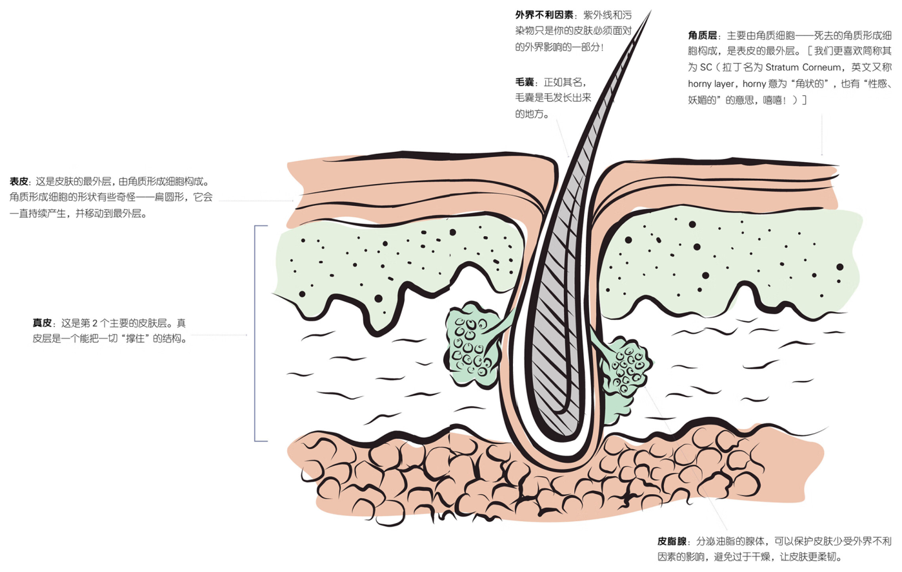

首先您需要了解皮肤结构，按照上图顺序可以简单分为以下的层级：

- **[外界]**：紫外线和污染物
- **[表皮]**：这里我们把角质层也纳入进去
  - **{酸性保护层和微生物群}**：角质层是偏酸性的，这使它成了一个强大的防御体系。告诉你一个有趣的事实，皮肤的 `pH` 值影响着那些在皮肤表面生存的微生物！有些理论认为，这就是皮肤 `pH` 值升高会导致皮肤不适甚至产生痤疮的原因
  - **{角质层}**：由死去的角质形成细胞，也就是角质细胞组成，也叫 `SC`
    - **(角质细胞)**：角质细胞组成，类似砖块的作用，由活去的角质形成细胞组成，一直产生移动到外层
    - **(脂质屏障)**：屏障主要有两个作用
      - **挡污**：脂质屏障负责阻挡住“坏家伙”（污染物、致病微生物），同时放进来“好人”（水）。这就是你听到的所有护肤评论里都会提及屏障功能（阻止水分从皮肤中散失而导致皮肤干燥）的原因。用更专业的话来说，脂质屏障的完整性对皮肤健康至关重要，它也是皮肤表面疏水的缘由。脂质屏障主要由 ==神经酰胺、游离脂肪酸、胆固醇、天然保湿因子== 构成
      - **保水**：虽然角质层的大部分成分是脂质，但为了维持正常功能，角质层还是需要保持一定的水分，来看看天然保湿因子（`NMFs`）吧。==尿素、乳酸、吡咯烷酮羧酸钠（PCA 钠）== 之类的物质，是皮肤自然生成的保水成分，这些成分占角质层干重的 `20%〜30%`
    - **(黑色素细胞)**：负责生产皮肤中的色素。它们会产生黑素小体（里面装满色素的小囊泡），这是皮肤被晒伤后所产生的保护性防御反应。有时，严重的日晒和外界压力会引发过度的保护反应，导致产生雀斑和色素沉着。
      美白淡斑精华针对的就是这些 “小家伙”
  - **{透明质酸}**：这种很流行的护肤成分实际上就存在于你的皮肤中，在表皮和真皮中都有。透明质酸可以支撑皮肤结构，也可以“抓住”水分（保水）
  - **{角质形成细胞}**：表皮的主要构成细胞，从基底层不断分裂、向上移动，逐渐分化为角质细胞，最终形成角质层
- **[真皮]**：虽然护肤品那些令人兴奋的功效绝大多数都是在表皮产生的，但真皮也很重要。事实上所有负责“支撑”的重要结构都位于真皮中，当“支撑”出现问题时，皮肤的状态发生改变，如松弛、下垂，甚至是形成皱纹。告诉你一个有趣的真相，很多抗衰老成分的细胞试验用的都是真皮层的细胞！
- **[毛囊]**：毛发的生长部位
- **[脂腺]**：与毛囊相连，分泌皮脂，润滑皮肤、维持屏障功能，分泌油脂的腺体，可以保护皮肤少受外界不利因素的影响，避免过于干燥，让皮肤更柔润

因此实际上，大部分护肤品都只 ==作用在以下三层：外界、表皮、真皮==。

### 1.2.皮肤类型

大多数人的皮肤会呈现各种皮肤类型，因为皮肤状态是不断变化的，影响因素包括生活方式、气候、压力、激素、年龄等。随着这些变化的发生，你需要不断去调整自己的护肤程序。

| 皮肤类型   | 特点                                                         | 特点                                                         | 优点                                                         | 缺点                                                         |
| ---------- | :----------------------------------------------------------- | ------------------------------------------------------------ | ------------------------------------------------------------ | ------------------------------------------------------------ |
| 中性皮肤   | 拥有中性皮肤实在是太幸运了。皮肤状态刚刚好：不油、不干（既不干得掉皮，也不太油腻），健康，水分充盈，皮肤本身有弹性、亮丽。这是因为你的皮肤角质层中水分的含量是别人梦寐以求的适中状态。幸运儿，继续加油！不过，拥有中性皮肤并不代表你永远不会遇到皮肤问题，毕竟生活在不断向皮肤发起挑战。但你的起点很高！ |                                                              |                                                              |                                                              |
| 干性皮肤   | 表现为皮肤紧绷、脱屑、粗糙、瘙痒、整体柔韧性欠佳。原因很简单，皮肤中没有足够的水分。用专业的话来讲就是当角质层中脂质屏障不完整时，水分从皮肤中蒸发的速度会比正常情况下更快。这将导致一系列不良反应：死亡角质细胞的脱落变慢，导致皮肤变厚（而且不再是丰盈、充满㬵原蛋白的良好状态）、粗糙、不平滑且暗淡。不幸的是，随着年龄增长，皮肤会越来越干燥。但别怕！化学家的工作核心就是制造保湿产品，它们针对的正是皮肤干燥问题。 | 皮肤紧绷、干燥、脱屑、触感粗糙，甚至可能发痒。           | 极少产生痤疮和黑头。如果你想叠用护肤品，完全可以一层又一层地涂。 | 皮肤脱屑、不光滑、易产生细纹和皱纹。以下几个因素会使以上问题加剧：所在地的气候、几乎毫无水汽的飞机舱、季节变化和年龄增长！ |
| 油性皮肤   | 脸上油光锃亮，脑海中总是闪过“我是闪亮的灯泡”的念头。油性皮肤的特点是皮肤油脂（皮脂，由扩大的皮脂腺产生）分泌过多。皮脂腺与毛囊是连通的，这就是为什么痤疮（症状为毛囊发炎）总是找上油性皮肤的人。男性更容易是油性皮肤，因为他们的睾酮水平更高。虽然你可能觉得过量的皮脂很恶心，但它实际上对皮肤的健康和免疫功能很重要。有了皮脂，皮肤才能产生脂溶性的抗氧化成分，才能形成抵抗有害微生物的屏障。对油性皮肤的另一个误解是，油性皮肤的人不需要用保湿霜。的确，皮脂可以间接地保持角质层水分，但“皮脂产生”和“皮肤保湿”是两个独立的过程。能阻止皮肤水分蒸发的是脂质屏障，但它与皮脂腺（毛囊旁）分泌出来的油脂无关（参考前文的皮肤结构彩图，可以更好地分清皮脂腺和脂质屏障）。所以，皮肤排出更多的油脂并不会对角质层把水分保持在皮肤里的能力有多大影响。长话短说，油性皮肤也要注意保水。 | 皮脂过多，容易长痘、黑头，毛孔粗大，下午时皮肤会变得油光发亮，让人特别想一遍遍地洗脸。 | 油性皮肤通常水分较为充足，因而不易产生细纹和皱纹问题。 | 经常会带来不便：烛光晚餐时的满脸油光、当众演讲前突然爆痘等。建议使用一些能适当遮油的产品。 |
| 混合皮肤 | 你可能同时觉得皮肤很油和很干，搞不清楚到底怎么回事。说实话，这样的皮肤状况是正常的。我们常说的“T 区”指的就是那些相比脸颊、下巴有更多皮脂腺的区域。但是，对于真正的混合性皮肤，“T 区”和“U 区”的差异更大。说到护肤，这种皮肤实际上是最难处理的。通常来说，混合性皮肤需要更多的精细护理，包括在不同区域使用不同产品。 | 皮肤有很干的区域，同时还有一个很油的“T 区”。            | 你会成为朋友中的护肤真相大师！拥有混合性皮肤意味着你会了解市面上所有类型的护肤产品（是的，我们知道说这话相当欠揍……）。 | 想一步到位找到同时解决干区皮肤和油区皮肤的不同需求的办法真的很难。逐渐习惯“重点护理干性区域”吧。 |
| 敏感皮肤   | 说实话，人们现在并未充分了解敏感性皮肤。就我们的讨论目的来说，它主要意味着“会对很多护肤产品产生不良反应”。专业人士也很难诊断和治疗敏感性皮肤，因为在很多情况下，他们甚至很难确定它的根源。你要处理的可能是真正的皮肤过敏，可能是产品引发的刺激，也可能是身体健康状况、生活方式或环境变化逐渐引起的特殊反应。很难治疗敏感性皮肤的原因之一是，每个人都有各自不同的敏感引发原因。有些护肤产品宣称“不含致皮肤敏感成分”，但事实是，任何成分（尤其是浓度较高时）都有可能引发敏感。在建立护肤程序的过程中，找到皮肤的“痛点”和致敏条件可能需要漫长的时间！ |                                                              |                                                              |                                                              |

### 1.3.皮肤分区

| 区域名称 | 具体位置                          | 特点                                                         |
| -------- | --------------------------------- | ------------------------------------------------------------ |
| T 区     | 额头、鼻梁、下巴，呈 “T” 字形     | 皮脂腺密集，容易出油、毛孔粗大、长黑头和痘痘                 |
| U 区     | 两侧脸颊、眼周、唇周，呈 “U” 字形 | 皮脂腺较少，容易干燥、起皮、敏感，是需要重点保湿的区域       |
| V 区     | 下颌线到下巴的区域                | 容易因内分泌、清洁不到位等问题反复长痘，也就是常说的 “下巴痘” |
| C 区     | 颧骨到太阳穴的区域                | 是色斑、红血丝和敏感问题的高发区，也是紫外线伤害最明显的区域 |
| 眼周     | 上下眼睑和眼尾区域                | 皮肤最薄，皮脂腺最少，容易出现干纹、细纹、黑眼圈和眼袋       |
| 唇周     | 嘴唇周围的皮肤                    | 容易干燥、起皮，也可能因剃须刺激或食物残留而敏感、长痘       |

## 2.心理准备

1. **建立自己的护肤程序始于弄清成分**。每个人都有自己的皮肤特点，搞清楚究竟什么对你有用的第一步是看懂成分表，这也能帮你弄清什么不适合你。
2. **坚持！坚持！坚持！** 护肤是一场马拉松，而非一场短跑。持续的好习惯将使这场长跑变得更棒。一夜之间就会发生奇迹，这种承诺着实诱人。但说实话，任何真实可见的护肤效果的背后都需要耐心和时间。在绝大多数临床试验中，“可见的皮肤改善”的试验时间至少是 4 周。皱纹、炎症后色素沉着之类的问题要想看到显著改善效果，时间可能长达 12 周
3. **没必要太多步骤**。你朋友的 12 步护肤法并不一定就比你的精简护肤更有效。有没有效果还是得看用的是什么产品、究竟需要多少用量、是否坚持使用，以及个人的皮肤特点
4. **浓度是关键**。挑选护肤产品时，要选择注明了活性成分浓度的产品。如果浓度过低，产品不会有任何效果；如果浓度过高，你得冒可能会刺激皮肤的风险。记住，离开剂量谈什么都没用——毒性是这样，奇效也是这样
5. **东西再好也不能贪多**。在晚间护肤时一口气用上 10 种功效成分以期获得 10 种效果，听起来的确相当吸引人。然而，太多的功效成分只会增加皮肤受刺激的风险
6. **对敏感性皮肤来说，简简单单才是真**。敏感性皮肤护理的关键就是越少越好、少即是多。10 步护肤法意味着有 10 个潜在的刺激来源，而且被一个个叠加起来了！如果你是敏感性皮肤，一定要记住：护肤越简单就越能掌握主动权
7. **疼痛不一定是收获**。有些皮肤护理很疼但很有效，但它们毕竟只占少数，而且有效的重要前提是这类操作一定是由持证的可靠医生或技师完成的。你自己在家进行护肤时不应该出现比“微微针刺感”更强烈的不适感。泛红、瘙痒、灼热都不意味着产品正在起效，这些是你的皮肤在拉响的警报
8. **斑贴试验！斑贴试验！斑贴试验！** 即使你从来都没有皮肤敏感，你也不能确定下次不会过敏。所以，在脸上使用任何一种新产品前都先在隐蔽处（如小臂）试一试吧
9. **护肤是很个人化的（这条倒是普适的）**。最后但同样重要的是，对你的朋友有效的东西未必对你也有效，反之亦然。这也是护肤如此令人抓狂的重要原因之一。有些产品在绝大多数人身上的效果都特别好，但对少数人就很刺激。别因为你的朋友讨厌某个产品，你就跟着唾弃它。还有，某个产品如果有刺激性，但在网上却炒得很热，千万别盲目尝试它。还是要听自己皮肤的话
10. **护肤是无论男女的事情的**。如果有人觉得男生用护肤品比较娘，没关系，请无视他们，或者自己偷偷用就可以，等到这种人顶着自己的高度糖化、充满褶皱、痤疮化脓的脸的时候，就有的他们后悔的。不管怎么样，一个干干净净的男生在外出没，总是要比那些脸上伤痕满满的脸要跟容易感到亲和力一些，这是实际状况

## 3.基础护肤

无论市面上有多么繁杂的护肤品，暂且抛去神乎其神的功效用品，让我们只关注护肤的三个环节，也就是 ==洁面、保湿、防晒==。

### 3.1.洁面步骤

#### 3.1.1.理论解析

每个护肤程序都应该从洁面开始，以除去每天在皮肤表面堆积的脏东西，洁面相当于给后续的护肤步骤准备好一张白纸。洁面也可以看作是皮肤抗衰老的一步，因为白天堆积的污垢会刺激皮肤，产生的自由基也会加速皮肤衰老。这样看来洁面就没那么简单了。

> [!IMPORTANT]
>
> 补充：自由基，简单说就是缺少 `1` 个电子、结构不稳定的分子。分子本来电子成对才稳定；丢了一个电子之后，它会疯狂从周围其他细胞 “抢夺电子” 来补全自己。被抢走电子的细胞，自身结构就会受损，这个过程叫氧化，类似金属生锈、苹果切开后变黄。皮肤里自由基从几个方面来：
>
> - 紫外线（最主要）：日晒会大量催生自由基，一边刺激黑色素细胞分泌黑素小体（长斑变黑），一边直接破坏胶原蛋白
> - 外界污染、雾霾、二手烟，这里就是堆积污垢的来源
> - 熬夜、压力、炎症（皮肤长痘破损也会产生）
>
> 对皮肤的两大伤害：
>
> - 促黑、长色斑：自由基会刺激黑色素细胞过度活跃 → 大量生成黑素小体，加重色沉、雀斑、晒斑（刚好接上你上一段文字的知识点）
> - 老化：攻击角质细胞、胶原蛋白，让皮肤松弛、细纹、发黄、粗糙
>
>
> 人体本身也会少量产生自由基，少量是正常代谢，过量自由基才是皮肤的麻烦。靠抗氧化成分（维 C、维 E、麦角硫因、阿魏酸、谷胱甘肽等）。抗氧化剂可以主动给出电子，牺牲自己，把不稳定的自由基中和掉，不让它攻击皮肤细胞，减少黑色素刺激、延缓老化。

洁面可能是最被低估的护肤方法。即使你是最爱干净的人，污垢还是会每天堆积在你的脸上。算算你每天用手碰脸的次数，每天要在脸上涂多少护肤产品，更别说还得算上走过行驶的汽车、吸烟者、建筑工地之类的次数了。日复一日，每个这样的时刻都会使你的脸上增加微生物、污染物、灰尘，甚至压力源。长期的脏污积累并不会真的让你脏到长虫，但会加速皮肤老化。好消息是，去除这些污垢很简单，洁面就可以了！

你的脸就是会变脏，这是自然而然发生的。变脏不仅是因为皮肤在日常生活中沾染了污垢，也是因为皮肤自身也会脱落死细胞、分泌汗液和油脂。后者是皮肤自然更新的过程，它保证了皮肤成为一道保护健康的屏障，可以持续地抵御外界危害。换句话说，你在蜕皮，这也没关系！但是，想想你打扫屋子时扫出的一团团絮状灰尘……很多灰尘其实来自你自己！别把锅甩给你养的猫！

把洁面当作皮肤抗衰老的一步来操作。你可能会把洁面与卸妆产品联系起来，或者认为洁面是为了预防痤疮这个“老冤家”，洁面的作用不止如此。那些微小的脏污会不断累积，导致肤质变差、肤色不均，甚至可能会刺激皮肤。肆无忌惮的污染物如果不加以控制，则会引发一系列的自由基损伤，并最终导致衰老。你没看错，洁面产品发挥着防止皮肤衰老的作用。

把洁面作为你的护肤程序的第一步。开诚布公地说吧：如果你不是为了构建一个属于自己的护肤程序，你不会读这本书。所以，咱们还是先确保起点就正确——把脸洗干净！在一张没洗过的脸上使用护肤产品可能会让脸更容易吸附污垢，更别提污垢下面还有一些你压根儿不想要的微生物。这样做除了会引发皮肤问题，还会让护肤产品更难起效。总而言之，如果你想构建一个有效的护肤程序，绝不能跳过洁面这一步。所以，咱们还是从一张干净的“白纸”开始吧！

对了，一般来说，建议每天保持早晚洗两次脸的习惯，每次洗都使用洁面产品加保湿产品，油皮可以稍微在中午用清水多洗一次，并且薄涂一次保湿产品（后续保湿环节介绍）。

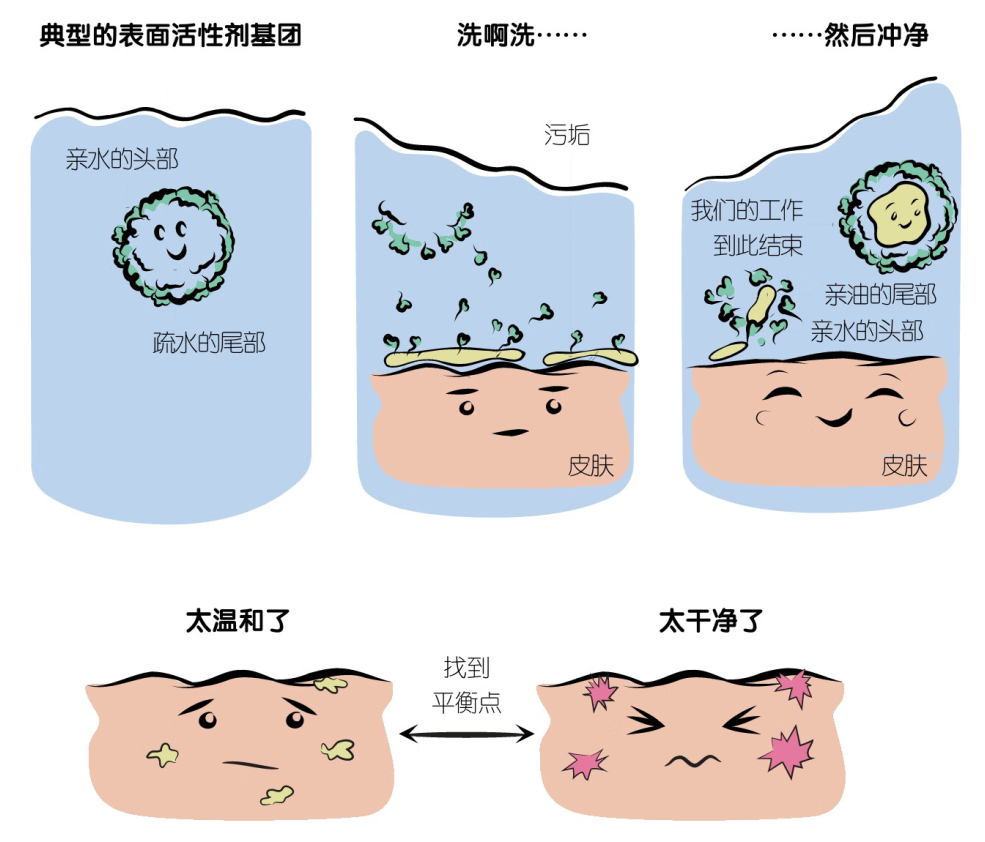

任何洁面产品，不管其形态是皂、凝㬵、油还是泡沫，它们的清洁功效都来自 **表面活性剂**。这些可爱的“小家伙”有亲水（易与水结合）的头部和疏水（不易与水结合）的尾部，这种“一体二用”的特性使得它们天生就是清洁高手：抓住灰尘和污垢，然后借助水流把脏东西从脸上“拽”下来。在洁面产品中，表面活性剂分子会聚集在一起形成一团团的㬵束，当你在脸部涂上洁面产品后打圈摩擦时，这些㬵束就会与油脂相互作用并彼此紧紧抓牢，最后通过冲洗把污垢带走。这听起来挺简单的，对吧？其实说简单，却又不简单。

相对来说，科学还是比较简单易懂的（我们希望如此！），但调配完美的洁面产品可就有点艺术味了。理想的洁面产品应该只结合并带走污垢而不会影响角质层。但有些表面活性剂并不是解决问题的高手。一些看似强效的表面活性剂实际上会与角质层的蛋白质和脂质相结合，使你在清洁皮肤后会感觉干得要脱皮了。有些人会把这种“皮都没了”的感觉误认为是超级干净，这可不对！

除了与角质层相互作用外，洁面产品还有可能会破坏角质层的酸性保护膜。酸性保护膜并不是一层实际的膜，而是指角质层的弱酸性环境，这种酸性环境也与角质层的整体健康有关。事实上，较高的皮肤 `pH` 值（碱性较高）会导致皮肤菌群紊乱，这也是湿疹和特应性皮炎等皮肤问题的特征之一。不幸的是，许多洁面产品，包括好的肥皂都有很高的 `pH` 值，这会刺激到那些皮肤受损的人。

这里就需要化学家来为你支招了！你在市场上看到的每种洁面产品都经过了化学家的上百次试验，他们会精心平衡洁面产品的稳定性、辅助成分、清洁能力、潜在刺激性和使用感。所以请继续阅读！我们将为你介绍一些需要注意的关键成分，这样你也可以在洁面产品“闯关游戏”中大显身手。

#### 3.1.2.核心成分

洁面产品的类型真是太多了！不过你只需要记住一点：不管是哪种产品，诀窍都是寻求平衡。合适的洁面产品会恰好满足你的皮肤需求，在清洁力和温和性之间实现平衡。那么，究竟该如何找到最适合自己的洁面产品呢？这里就该我们登场啦！我们建议你先熟悉常见的表面活性剂，然后检查 `pH` 值，最后用一些辅助产品强化洁面效果，而不是直接选用更强力的洁面产品。

| 类别                                                         | 特点                                                         | 适合人群                         | 不适合人群                                                   | 如何挑选                                                     |
| ------------------------------------------------------------ | ------------------------------------------------------------ | -------------------------------- | ------------------------------------------------------------ | ------------------------------------------------------------ |
| **皂基**                                                     | 清洁力极强，但 `pH` 值高到可以让皮肤脱屑                     | 中性和油性皮肤类型人群           | 干性、敏感性皮肤，以及有湿疹等角质层问题的人群               | 成分表靠前的位置会出现氢氧化钠或氢氧化钾，化学家们用它们和脂肪酸制造出皂基 |
| **硫酸盐**                                                   | `pH` 值中，泡沫很丰富，清洁力极强                            | 几乎所有的皮肤类型人群           | 对硫酸盐类表面活性剂敏感的人群（如果你不确定自己是否对其过敏，可以感觉洁面后皮肤是否特别干） | 月桂醇硫酸酯钠（SLS）和月桂醇聚醚硫酸酯钠是这类成分中最主要的两种，相较而言，后者对皮肤更友好 来认识一下 **月桂醇硫酸酯钠（SLS）**，它是任何宣称“温和、无硫酸盐”的洁面产品都会避开的清洁成分。许多洁面产品里加 `入SLS` 的原因是它很廉价，同时清洁力也不错。几乎可以说它的清洁力太好了，好到可以在刺激性试验中作为阳性对照（以一种可控的方式用高浓度的 `SLS` 刺激皮肤，然后在受损的皮肤上进行产品测试，看用或不用产品时是否影响皮肤恢复）。 |
| **椰子甜菜碱**                                               | 最常见的温和表面活性剂，对皮肤友好，清洁力强，泡沫适中       | 所有寻求更温和产品的皮肤类型人群 | 讽刺的是，有些人可能对它过敏                                 | 全称是椰油酰胺丙基甜菜碱，有时化学家会简称其为 “椰子甜菜碱”  |
| **其他温和的表面活性剂： （1）椰油酰异硫酸钠 （2）葡糖苷（椰油基葡糖苷、月桂基葡苷） （3）椰油酰乙酸酯和氨基酸** | 试过所有最常见的表面活性剂，但仍然没有找到你的真爱？试试这里的吧 | 皮肤敏感或长期干燥的人群         | 喜欢丰富、绵密泡沫的人群，因为这类表面活性剂通常是少泡或无泡的 | 椰油酰异硫酸钠、葡糖苷（椰油基葡糖苷、月桂基葡苷）、椰油酰乙酸酯和氨基酸是这一类中的常见成分，它们通常被搭配在一起使用 |

如果你是敏感性皮肤或有长期的皮肤干燥、银屑病、湿疹等问题，那么仔细检查你的洁面产品的 `pH` 值永远不会有坏处。皮肤的天然酸性保护膜（`pH` 值通常在 `5.5` 左右）是皮肤微生物群和皮肤整体健康的重要组成部分。虽然科学家还没完全搞清微生物群和皮肤 `pH` 值的复杂关系，但还是尽量使用标明“`pH` 对皮肤友好”（`pH` 值小于 `6`）的洁面产品吧。但是，根据 `pH` 值选择洁面产品总是正确的吗？事实上，健康的皮肤有自我调节 `pH` 值的能力。所以，如果你有中性、健康的皮肤，但你喜欢 `pH` 值较高的洁面产品也不用大惊小怪！对于那些皮肤受损的人来说，`pH` 值才是更值得慎重考虑的因素。

#### 3.1.3.具体用法

| 产品类型 | 图片                                                         | 特点                                                         |
| -------- | ------------------------------------------------------------ | ------------------------------------------------------------ |
| 洁面皂   | 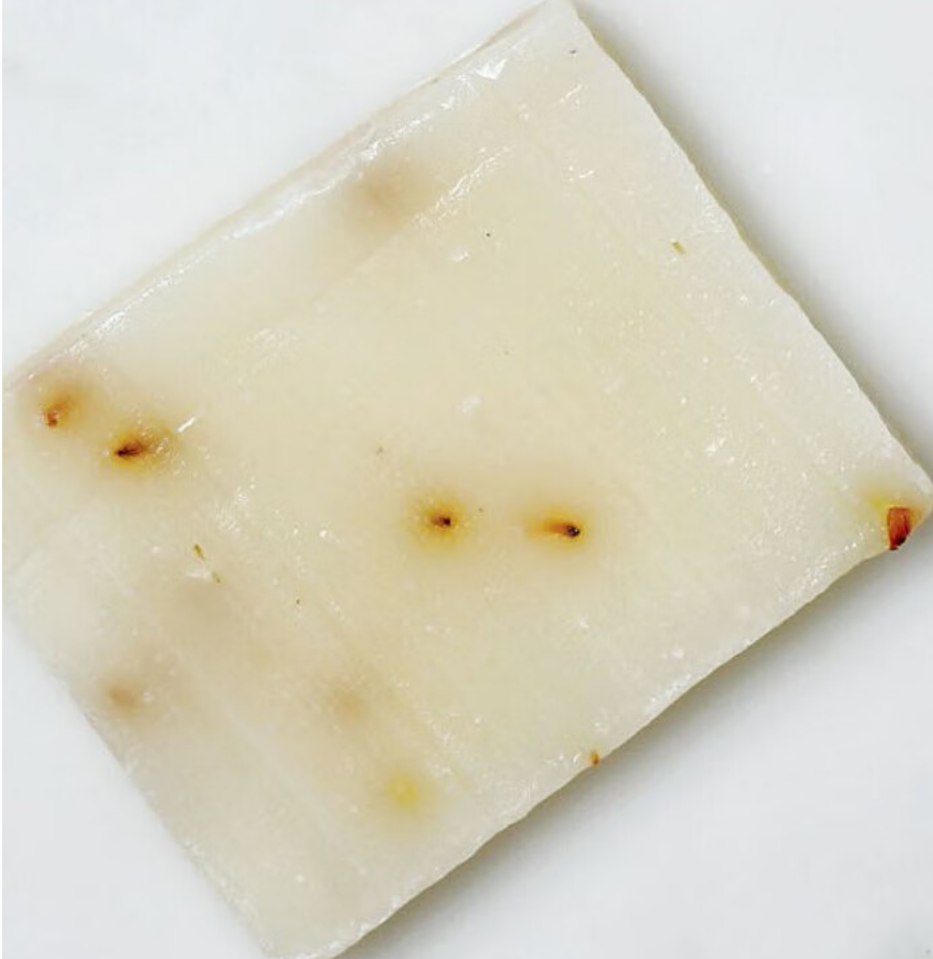 | 肥皂可能是最古老的护肤产品之一。虽然有些洁面皂很温和，但大多数皂类的 `pH` 值还是偏高，并且用其洗完脸后感觉很干 |
| 卸妆水   | 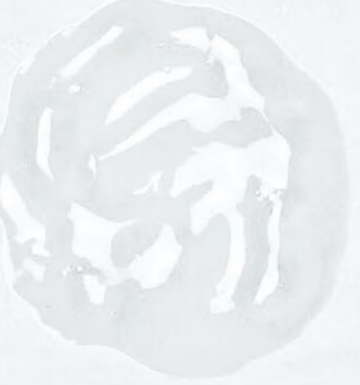 | 非常温和，但是不同产品的效果差异很大                     |
| 卸妆油 | 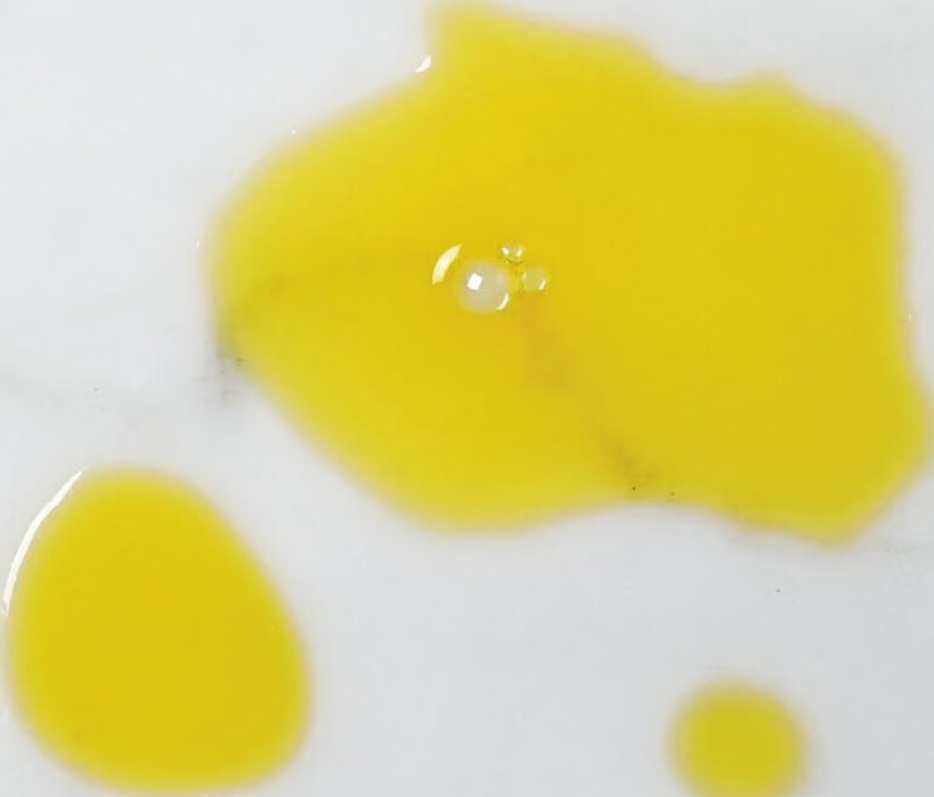 | 能洗掉各种污垢的产品，记住要使用那种洗完后脸上不会残留油感的产品。如果有化妆，一般就是两步洁面法，先用卸妆油，然后用温和的洁面乳或洁面啫喱。卸妆油是帮助去除所有的污垢、灰尘甚至化妆品的清洁剂，洁面乳或洁面啫喱则会帮助去除卸妆油残留的多余油脂（实际我觉得没有化妆没必要使用） |
| 卸妆膏   | 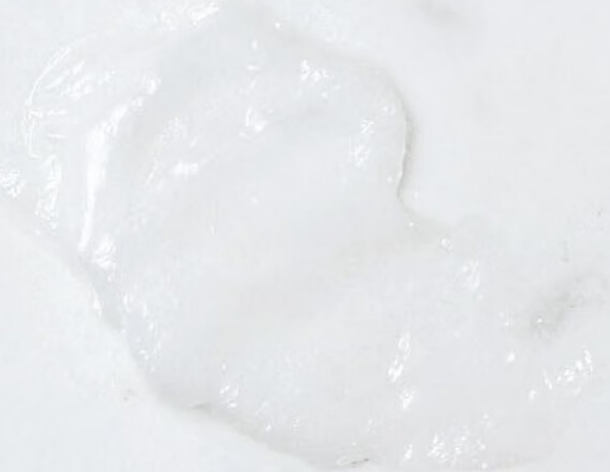 | 比卸妆油更方便携带，也不用担心它会漏出去      |
| 洁面湿巾 | 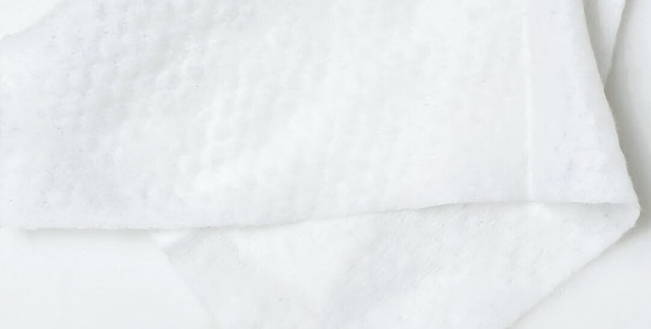 | 方便有效，不过我们建议你使用后快速冲洗一下脸，以确保你的脸上没有残留物。如果你经常出差或旅行，可以考虑用洁面湿巾来快速清洁皮肤。你也可以在健身包里准备一瓶卸妆水，用于健身后的快速洁面 |
| 洁面啫喱 | 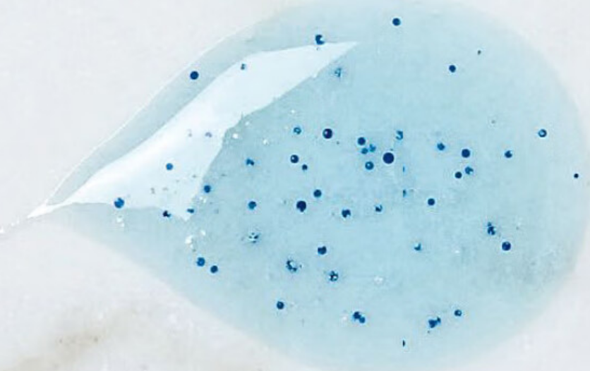 | 有些超级温和，有些可能是强力的痤疮清洁产品，甚至导致皮肤干燥和起皮，请仔细阅读产品标签 |
| 洁面膏   | 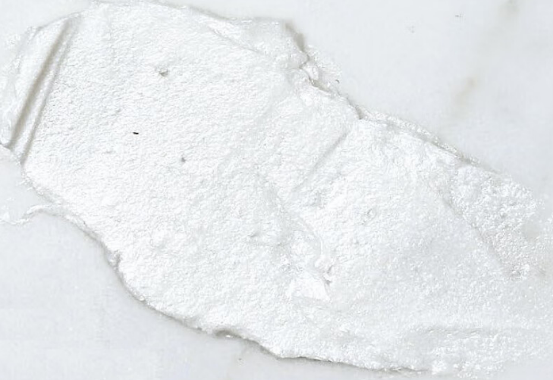 | 经典的膏状产品，清洁效果非常好，但脸洗完后可能会感觉太干了，所以请仔细检查成分表 |
| 洁面粉   | 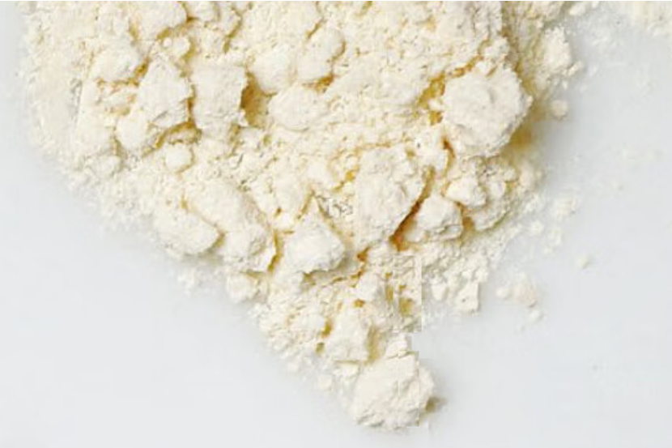 | 有效、温和，自带一点磨砂作用，小心粉末撒出来容易搞得一团糟 |
| 洁面工具 | 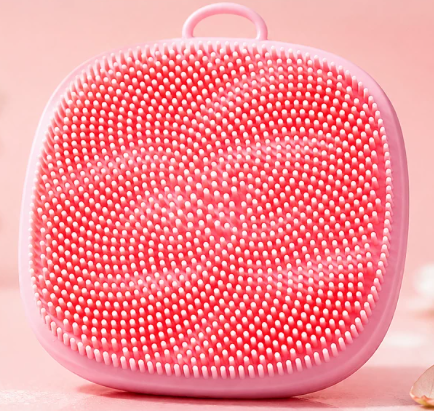 | 声波洁面刷、电动洁面刷、硅㬵洁面刷、手动洁面刷、魔芋海绵刷 疯狂的宣传语随处可见。你们中的大多数人可能已经对“光泽度增加 542%！”或“让时间倒流！”这样的字眼习以为常了。但是，在一些听起来很疯狂的说法背后偶尔也会有一些令人惊讶的细节和有趣的研究。实际上，科莱丽（`Clarisonic`）的团队做了不少有关洁面刷的有趣研究。在一项研究中，测试者在脸上涂抹了大量的灰尘和污垢，然后比较使用和不使用洁面刷的清洁效果。这项研究证实，声波洁面刷的清洁程度要彻底得多。不过，我的洁面刷的充电器在哪儿…… 使用洁面刷是洁面步骤的重要补充，可以让你的温和洁面乳效果更好。声波洁面刷经过了最严格的测试和验证，是你的选择之一，但它也是最贵的洁面刷。也有更便宜的电动洁面刷、硅㬵刷及手动洁面刷。记住，要选柔和的软毛洁面刷！ |

### 3.2.保湿步骤

#### 3.2.1.理论解析

有这样一句“名言”：“朋友们，保持皮肤湿润！”虽然这句“名言”是我们编的，但再怎么强调保湿对皮肤健康的重要性都不为过。我们要清楚一点：一个基础的保湿产品并不会带来奇效。但可靠的保湿策略是强化皮肤屏障的第一步，好的皮肤屏障才可以有效地把好东西（水）留在皮肤里，把坏东西（一大堆过敏原及环境压力）隔绝在皮肤外。如果没有良好的皮肤屏障功能，你在皮肤上使用的所有昂贵的抗衰老产品都是浪费。

皮肤最重要的作用就是作为一道防线保护人体不受外来异物侵害，同时保持皮肤内的水分。但是，当角质层的含水量不足时，皮肤的屏障功能就会减弱。这时候就需要保湿产品了！好的保湿产品能补足皮肤急需的水分，同时能加强屏障功能。保湿产品可真多：精华露、精华液、乳霜、安瓿精华、凝霜等。这些产品都可用于保持皮肤水润。但过于丰富多样的产品却导致人们不知如何选择！

要了解保湿的长期重要性，我们应该先复习本书第一部分中的一些术语和概念。记住，你的皮肤就像洋葱一样有很多层，其中最外层叫角质层。大多数护肤品主要针对表皮的最外层（即角质层）起效。

- `皮肤屏障功能 1`：把坏东西挡在外面，让水留在里面角质层是皮肤的最外层，它是防止水分流失和抵御外来入侵者的第一道防线。简而言之，保湿产品可以帮助角质层发挥屏障作用
- `皮肤屏障功能 2`：亲水成分/水性成分健康的皮肤屏障功能的另一个成分是天然保湿因子（`NMFs`），它们存在于角质层的角质细胞中，占角质层干重的 `20%~30%`。这些亲水成分会使皮肤保持弹性。皮肤中还有一些对细胞正常更新很重要的酶，亲水成分对保持酶的活性也很重要。皮肤中常见的天然保湿因子有吡咯烷酮羧酸、乳酸、游离氨基酸和尿素。记住，`健康的细胞更新 = 健康的皮肤屏障 = 健康的皮肤`

你的角质层非常粗糙：外界过敏原、污染物、紫外线、气候变化，甚至是简单的老化都会对角质层造成损害，并阻止其正常地发挥屏障功能。你的皮肤屏障功能一旦受这些因素影响，皮肤就会干燥缺水、过敏，而干燥的皮肤会导致糟糕的长期影响。忽视保湿会使你的角质层陷入恶性循环：水分流失加剧，外界刺激物进入皮肤引发炎症，导致皮肤干燥问题更严重、更难吸收保湿成分。如果干燥状况没有得到及时改善，恶性循环会引发皮肤瘙痒、脱屑等短期问题，如果长期得不到改善，则会产生细纹和皱纹！由此可见，找到可靠的保湿方法，并随季节、年龄的变化对其不断调整是保持皮肤最佳状态的重要对策之一。

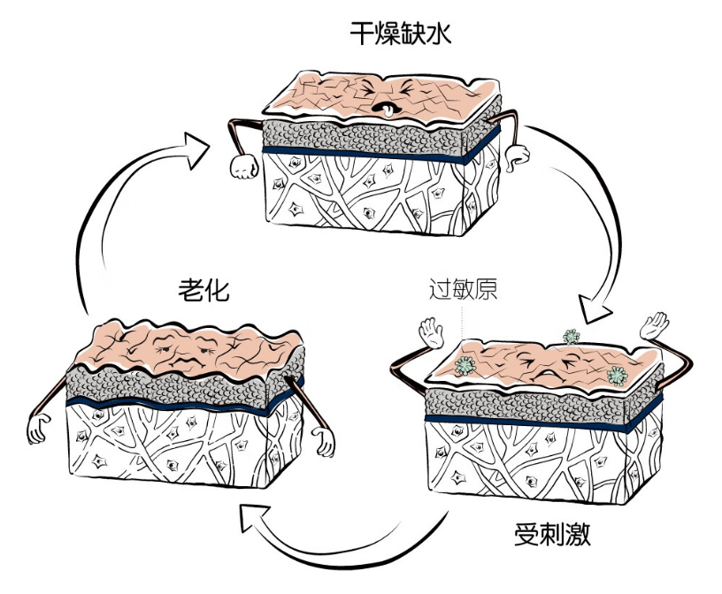

#### 3.2.2.核心成分

如何找到一款合适的保湿产品？这个问题可能会令你困惑烦恼，不过这其中还是有一些诀窍的。保湿产品中的不同成分可以根据性质分为三类：

- **保湿剂**：是一类可以“抓住水分”的成分，可以帮助皮肤维持健康的含水量，保证肌肤柔软、水润。皮肤自有一套水分维持系统，它由天然保湿因子构成，护肤品中的保湿剂可以补充、加强这个系统。保湿产品中的常见保湿剂有甘油、透明质酸、乙二醇类。保湿剂非常重要，许多护肤品都是以它们为基础调配的

  > [!IMPORTANT]
  >
  > 补充：含保湿剂的代表性产品推荐：化妆水、精华露、凝露、保湿精华液和大多数凝霜。

  | 类别                                 | 特点                                                         |
  | ------------------------------------ | ------------------------------------------------------------ |
  | 尿素（`相对分子质量：60`）           | 尿素是天然保湿因子中的一种。尿素除了能立即补水，长期使用还能增强屏障功能，它在这一点上与其他保湿剂不同。事实上，随着年龄的增长，尿素在身体护理方面会变得越来越有用。不过有些人会大喊：“尿素来自尿液！我可不要往脸上撒尿！”请放心，面霜中的尿素绝对不是提取自尿液 |
  | 乳酸（`相对分子质量：90`）           | 乳酸也是天然保湿因子的一种，它是一种用途广泛的成分，既是杰出的亲水保湿剂，也可用于化学去角质 |
  | 甘油（`相对分子质量：92`）           | 你会在很多护肤产品中发现甘油，原因是它有用！甘油小分子可以渗透进角质层间隙中的脂质混合物，赋予肌肤美丽、柔软、有弹性的质感 |
  | 泛醇（`相对分子质量：205`）          | 泛醇又称维生素原 `B` ，被认为兼具保湿剂和柔润剂的作用。它也有很好的舒缓作用 |
  | 㬵原蛋白（`相对分子质量：30 万`）    | 许多人可能将㬵原蛋白与抗衰老的宣传语联系在一起。然而，事实是外用的㬵原蛋白无法代替皮肤里的天然㬵原蛋白。不过，它的确是很棒的保湿成分 |
  | 透明质酸（`相对分子质量：2 万以上`） | 透明质酸可能是最赚钱的保湿成分！你应该听过各种广告宣传语，从“保湿”“让皮肤饱满”到“抗衰老”。市场上的绝大多数透明质酸是相对分子质量在 `200` 万以上的大分子，它们只会停留在皮肤表面，帮助肌肤全天保持水分。还有一些分子小得多的透明质酸。一些研究表明，小分子透明质酸可以穿透皮肤，使皮肤饱满、水润，甚至有抗衰老的效果。然而，小分子透明质酸会使某些人皮肤敏感。所以，就像我们常说的：一定要先进行斑贴试验 |

- **柔润剂**：柔润剂可以填补粗糙皮肤上的凹陷，立刻赋予皮肤柔软光滑的质感。这类成分通常是较轻质的油状物质，如霍霍巴油、辛酸/癸酸甘油三酯、角鲨烷、椰子烷。当然，最常见的柔润剂是面部皮肤分泌的！柔润剂在过去的十年里变得非常流行。因此，许多品牌都纷纷推出了“神奇的”、“含有丰富抗氧化成分”、“可以平复皱纹”、“让时间停止”、“持续改善皮肤” 的面部润肤油。这些产品确实能很好地帮助皮肤保湿，但不要把“逆转时间”的说法太当真

  > [!IMPORTANT]
  >
  > 补充：含柔润剂的代表性产品推荐：面部润肤油、精华油。
  >
  > 如有以下情形，可考虑使用面部润肤油：
  >
  > - “我喜欢现在用的保湿霜，但我的皮肤还是有点干”。皮肤是不断变化的。仅考虑压力、年龄、生活方式和激素等因素，你的保湿需求就会发生变化。你如果不想换掉保湿产品，同时又明白到了需要加强保湿的关头，那么可以考虑加几滴面部润肤油，简单的操作就会有奇效
  > - “我是干性皮肤，但又不至于是‘沙漠皮’，没到需要用凡士林或油膏的地步”。凡士林或厚重的封闭剂的肤感的确太差，更不用说那种“满脸油光、亮如灯泡”的样子现在已经不流行了。考虑一下用面部润肤油，它的质地更轻盈，和凡士林的性质相似，只不过效果略差
  > - “我的皮肤有点暗淡”。快速提升皮肤光泽度的方法是来几滴润肤油
  > - “我有粉刺，但粉刺药膏让我的皮肤很干燥，我现在的保湿产品也没什么用”。找一些轻盈的柔润剂，如亚油酸、偏酸性的植物油或角鲨烷
  >
  > “润肤油新手可以考虑角鲨烷”。你在玫瑰果油、西瓜籽油、摩洛哥坚果油或其他植物油之间难以抉择？绞尽脑汁之前不妨考虑一下角鲨烷，它是一种纯净的饱和烃。通俗地讲，这意味着它没有什么特别需要注意之处，不易引起皮肤刺激或痤疮。对所有皮肤类型的新手来说，它都很适合入门使用。
  >
  > 把润肤油放在它喜欢的地方——凉爽、黑暗、密封性好的地方。这是因为油容易氧化、酸败，酸败的油会变色并带有异味，氧化的油则最终会伤害你的皮肤。

  | 类别                                      | 特点（适合干性皮肤）                                         |
  | ----------------------------------------- | ------------------------------------------------------------ |
  | 甜扁桃仁油（甜杏仁油）                    | 质地轻薄温和，不饱和脂肪酸丰富，渗透性不错，封闭力中等；肤感顺滑不厚重，滋润但不会过于黏腻；很好推开，致敏性低，干皮日常基础保湿很合适；油皮少量可用；稳定性尚可，适合基础润肤、搭配其他修护油脂 |
  | 杏仁油（苦杏仁油，护肤多用脱毒版本）      | 注意：护肤用是精制脱毒苦杏仁油；富含油酸，滋润力比甜扁桃仁油更强一点，封闭中等；舒缓干燥粗糙；**不建议高浓度直接上脸**，刺激性略高于甜扁桃仁油；多用于配方少量添加，干皮适合作为复配油脂，不推荐纯油大面积涂抹 |
  | 摩洛哥坚果油（阿甘油）                    | 高油酸，封闭性中等偏强；滋润力优秀，改善干燥起皮、粗糙；含有维 `E` 抗氧化；肤感润，略厚重；非常适合干皮、秋冬、屏障干燥；油皮单用容易偏油，一般低比例复配 |
  | 鳄梨油（牛油果油）                        | 含大量油酸和植物甾醇，封闭较强；滋润度高，修护干燥屏障效果好，改善干皮脱皮；质地偏厚；干皮友好；油皮不建议单独大量用，容易闷；常添加在修护面霜、油类精华 |
  | 山茶花油（茶籽油）                        | 油酸含量很高，接近皮脂；渗透性好，封闭中等；肤感清爽润，不厚重，抗氧化；干皮四季可用，油皮少量也可；稳定性较好，传统以油养肤常用，改善干燥粗糙 |
  | 霍霍巴油（荷荷巴油）                      | 本质是液态蜡酯，不是甘油三酯；结构和人体皮脂非常接近，渗透性好，稳定性高、不易氧化；兼具柔润 + 轻度封闭，可调节皮脂，不容易闷痘；适合干皮、油皮、屏障受损肌；肤感润而不厚重，常用于以油养肤、护发 |
  | 夏威夷果油（澳洲坚果油）                  | 富含棕榈油酸，和人体皮脂脂肪酸相似；封闭中等偏强，滋润力好，渗透顺滑；可以软化干燥角质；干皮很适合；肤感温润，比 `GTCC` 厚重，油皮少量复配可行；抗氧化不错 |
  | 马鲁拉油                                  | 高油酸，封闭强，滋润力强，抗氧化能力优秀；修护干燥受损屏障，缓解粗糙干纹；质地偏厚重；优先适合大干皮、秋冬干敏；油皮不适合单用，容易油腻 |
  | 辣木籽油                                  | 质地轻薄，封闭偏弱，柔润顺滑，抗氧化；滋润力中等，保湿偏基础；干皮适合搭配高封闭油脂一起用；肤感清爽，不容易厚重；适合复配，不建议单独作为主力保湿油 |
  | 橄榄油（精制橄榄油，护肤级）              | 油酸为主，封闭中等偏强，滋润度不错；改善干燥；缺点：粗橄榄油刺激性高、容易氧化致敏，护肤只用精制款；干皮适合复配；不建议纯橄榄油长期上脸，易致痘、氧化变质 |
  | 乳母果油（乳木果油，液态 / 精制乳木果油） | 富含植物甾醇、饱和脂肪酸，封闭强，修护力强；强效改善干皮脱皮、紧绷，舒缓干燥屏障；常温精制液态款肤感润，固态乳木果膏更厚重；大干皮、屏障受损首选；油皮只能少量添加，纯用易厚重闷肤 |

  | 类别                          | 特点（适合油性皮肤）                                         |
  | ----------------------------- | ------------------------------------------------------------ |
  | 辛酸 / 癸酸甘油三酯（`GTCC`） | 中链合成酯，椰子 / 棕榈来源衍生物；质地清爽、铺展极好、无味，渗透快，封闭性偏弱；主要做柔润剂，用来提升乳液面霜顺滑度，也常做精油稀释载体；致痘风险很低，配方百搭，适合做轻薄护肤品基底 |
  | 椰子烷（`Cocoalkanes`）       | 椰子油氢化得到的烃类柔润剂，天然硅油替代品；肤感是丝滑干爽，上手之后快速变哑光，几乎无油光；封闭性弱，主打顺滑触感，不是强锁水；多用于轻薄乳液、精华、粉底，不闷痘，改善涂抹延展性 |
  | 黑茶藨子籽油 / 黑醋栗籽油     | 富含 `γ-亚麻酸`，不饱和脂肪酸丰富；质地轻薄，封闭偏弱，渗透快，不会厚重泛油；兼具舒缓抗炎，适合出油伴随泛红、不稳定的油皮；一般低比例复配，不建议高浓度单用，油脂容易氧化 |
  | 奇亚籽油                      | 高含量 `Omega-3`，质地轻薄水润感，封闭弱；肤感清爽，上脸油感停留短；抗炎修护，适合外油内干、屏障偏脆弱油皮；抗氧化但不耐存放，配方少量添加为主，不适合作为主力封闭油脂 |
  | 蔓越莓籽油                    | 富含不饱和脂肪酸与多酚；质地轻薄，油感轻，封闭弱；抗氧化、舒缓，油皮上脸不易闷、不易泛厚重油光；适合外油内干肤质，大多复配使用，不单独大量用 |
  | 月见草油                      | 富含 `γ-亚麻酸`；质地轻薄，封闭力弱；主打舒缓修护，适合出油伴随敏感、干燥泛红的油皮；氧化速度快，配方中低剂量添加，不建议纯油上脸，容易变质刺激 |
  | 葡萄籽油                      | 高亚油酸，质地非常清爽，渗透快，油感轻，封闭偏弱；抗氧化，肤感轻薄不厚重，油皮友好；致痘风险低；适合外油内干，缺点是容易氧化，稳定性一般，多作为复配柔润油脂 |
  | 大麻籽油（工业大麻籽油）      | 脂肪酸组成接近皮脂，亚油酸含量高；质地清爽水润，封闭弱；舒缓修护，调节皮脂，油皮、混油很适配；油感轻薄不闷闭口，适合外油内干屏障受损油皮；注意容易氧化，需做好防腐避光 |
  | 百香果油（西番莲籽油）        | 亚油酸丰富，质地轻薄顺滑，油感淡，封闭弱；铺展好，上脸很快吸收，不易泛油；抗氧化，适合油皮做辅助柔润，多用于复配，保湿力偏弱，不能单独用来强锁水 |
  | 仙人掌油（仙人掌籽油）        | 质地轻薄清爽，油感很淡，渗透迅速；富含 `维E`、植物甾醇，封闭弱；修护舒缓，适合油皮 / 混油，尤其外油内干；几乎没有厚重糊脸感，价格偏高，配方少量添加 |
  | 玫瑰果油                      | 高亚油酸、亚麻酸；质地轻薄，油感中等，封闭偏弱；修护、改善粗糙与色素沉着；油皮适合少量复配，不建议高浓度单用，容易氧化，部分人会闷闭口；更适合外油内干 |
  | 沙棘（`jí`）籽油              | 富含不饱和脂肪酸、类胡萝卜素、`维E`；有修护抗炎作用；颜色橙黄，油感中等，封闭中等；油皮只能低比例添加，不建议大量单用，容易染色、闷肤；适合出油伴随干燥泛红的屏障脆弱油皮 |
  | 角鲨烷                        | 烃类油脂，人体皮脂本身就含；亲肤性极强，温和低刺激；填补角质缝隙、修护屏障，轻薄封闭，锁水不错；丝滑不黏腻，敏感肌、医美术后友好；植物来源版本（橄榄/甘蔗）很常见，适配绝大多数肤质 |

- **封闭剂**：皮肤是抵御紫外线和污染物等外界侵害的屏障，但你的皮肤屏障有时候也需要一点额外的帮助。封闭剂就是协助皮肤更好完成任务的帮手。封闭剂通常是厚重的、像脂肪或蜡一样的物质，可以在皮肤上形成一层物理性的防水屏障，并把水分锁在皮肤内。常见的封闭剂包括凡士林、黄油等动物油，蜡和较厚重的硅油。以封闭剂为主的产品，如油膏，对极度干燥的局部皮肤十分有效

  > [!IMPORTANT]
  >
  > 补充：含封闭剂的代表性产品推荐：油膏、油脂、软膏。

  | 类别                          | 特点                                                         |
  | ----------------------------- | ------------------------------------------------------------ |
  | 矿脂（凡士林，外号 “老好人”） | 矿脂至今仍是封闭剂的黄金标准。近年来，一些过于恐惧化学品的人声称“凡士林会导致痤疮与癌症”。但事实是化妆品级的凡士林是高度提纯的，非常“干净”（没有潜在的刺激物和有害残留物），不会堵塞毛孔，但如果你懒得洗脸，它会和脸上没洗掉的灰尘、油脂混在一起，引起痤疮 |
  | 矿物油                        | 矿物油比凡士林更轻质，封闭性也没那么强，所以用它做成的乳霜也更轻薄。不同的成分对你最终用到的护肤品会产生多大的影响呢？这点很有趣！矿物油或矿脂的含量即使只改变了 `1%`，也会改变面霜的最终使用感 |
  | 乳木果油                      | 乳木果油通常呈固态，像黄油一样。它是一种很棒的多用途封闭剂，而且纯天然。在“纯净护肤”的浪潮中，你偶尔会看到“未经加工的乳木果油”。有些人认为“未经加工”就意味着“更安全”和不含可怕的化学成分。然而，事实是植物是复杂的有机体，未经加工的乳木果油可能含有刺激性成分。我们更推荐精制乳木果油，而且有很多不同的质地可供选择 |
  | 羊毛脂                        | 这种从羊毛中提取的封闭剂的效果非常好，不过，它可能引起某些人过敏，所以你需要购买医用级别的羊毛脂，并确保在使用前进行了斑贴试验 |
  | 蜡                            | 大自然中也有很多优秀的封闭剂，如蜂蜡、小烛树蜡、巴西棕榈蜡等。它们的主要缺点是质感像蜡烛一样又硬又厚。蜡类的熔点较高，所以不适合大量添加在产品中 |
  | 硅油/硅树脂/硅氧烷            | 硅油是一大类化合物的统称。但不管具体是哪种，它们都有一个共同而简单的特性 ———— 手感棒极了！它们既可以有效地封闭水分，同时又不会感觉特别厚重。如果你的皮肤油腻，那添加了硅油的水凝霜不仅可以很好地满足你的补水需求（无论是季节更替还是皮肤状况改变时），而且还不会让你觉得太油了。如何找到含硅油的凝霜？在成分表的前几个成分中找是否有 “xx 聚 xx 基硅油” 或 “有机硅交联聚合物” 之类的词吧 |

这三类成分协同作用，满足皮肤的保湿需求。了解这些成分是如何起作用的，并掌握它们相互搭配的平衡，是破解皮肤保湿难题的关键。

大多数保湿产品的功效测试包含两个关键值：

- 皮肤含水量：皮肤含水量是通过角质层水分测试仪测量的，这种手持设备会测量皮肤的电导率（也就是皮肤导电还是不导电），并出具皮肤含水量的测量结果。测试时，先在清洗过、涂过保湿产品的皮肤上测试含水量，几小时后再测一次，以此来评判产品的保湿效果
- 经皮水分散失（`TEWL`）：`TEWL` 用于衡量有多少水分通过你的皮肤蒸发到外部环境中。`TEWL` 评分越高，皮肤屏障越差。该方法可以有效地评估数个不同的护肤品。例如，测试者可以先人为提高一块皮肤的 `TEWL`，然后使用待测的保湿霜测试 `TEWL` 值降低了多少

> [!IMPORTANT]
>
> 补充：似乎有越来越多的产品专门针对特定的部位，如眼周、嘴唇、脖子、左屁股蛋...但这些产品真的都有必要吗？以下是一些针对特定部位的护理建议：
>
> - 手脚区域：这里的皮肤比较厚，所以如果你的手和脚都很干燥的话，可以使用封闭性强的保湿霜来防止皮肤干裂。这类产品的缺点：使用时经常感觉油乎乎、滑溜溜的，会影响抓握东西
> - 眼部区域：这里的皮肤更脆弱，角质层更薄，但它所需要的功效成分与面部其他区域基本相同。只要没有感觉到刺激，便可以把你的护肤产品直接用在眼周。当然，我们这里只是在讨论保湿需求，眼部抗衰老护理后面再说
> - 唇部区域：往往需要使用专用护理产品。一方面是因为唇部皮肤的角质层更薄，另一方面则是因为唇部皮肤完全没有皮脂腺和黑色素。凡士林、羊毛脂和其他厚重的封闭剂都有助于保护唇部皮肤免受外界伤害。鉴于唇部没有黑色素（没法靠黑色素抵御紫外线），你可以在白天使用有防晒功能的润唇膏
> - 屁股区域：护理你那宝贵的左屁股蛋得像你对待身体的其他部位一样，好好使用身体乳。我们发现，最近市面上涌现出许多昂贵的身体护理产品，但是相对来说，身体皮肤更经得起“摧残”，所以便宜的身体乳就够了。随着年龄增长，皮肤细胞的更新速度会变慢，皮肤干燥会成为你更大的问题，所以使用含有乳酸和尿素的身体乳吧，以帮助皮肤保湿和发挥屏障功能

#### 3.2.3.具体用法

| 产品类型         | 图片                                                         | 特点                                                         |
| ---------------- | ------------------------------------------------------------ | ------------------------------------------------------------ |
| 面部润肤油       | 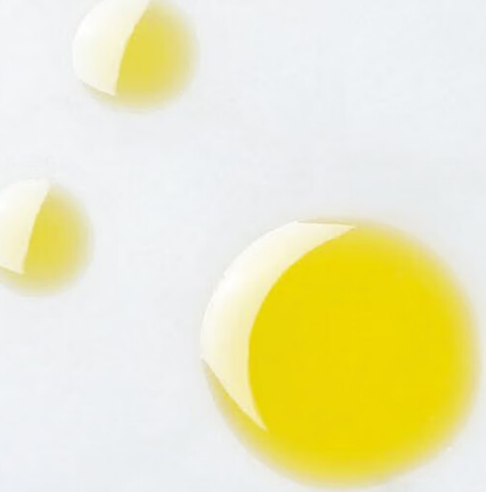 | 这种有助于润肤的产品可以给你的皮肤带来柔软的触感和健康的光泽 |
| 片状面膜         | 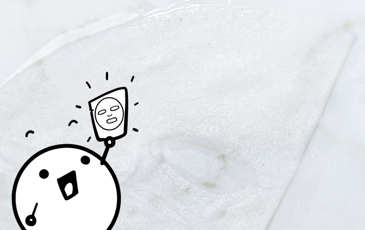 | 把你的皮肤“浸泡”在液体中，这是帮助皮肤吸收更多水分的一种高效方式 |
| 水凝霜           | 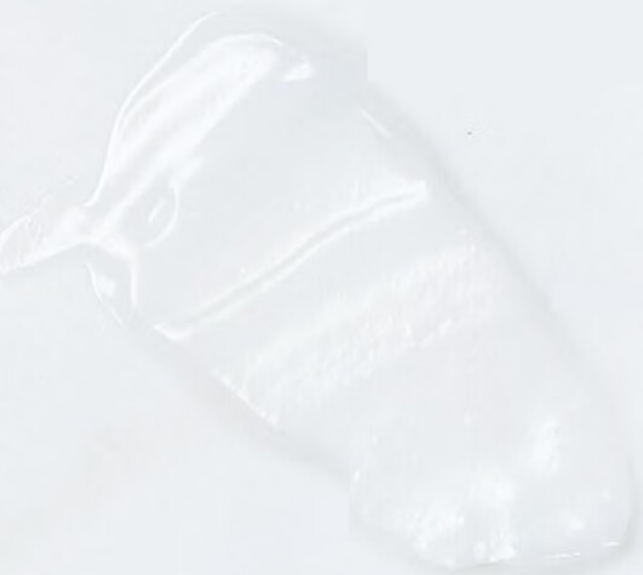 | 这种比较轻薄的保湿霜含有较少或更轻质的封闭剂，因而更适合油性皮肤使用 |
| 保湿精华（啫喱） | 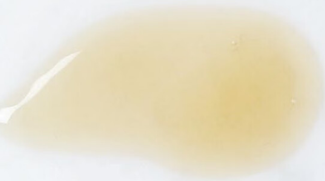 | 帮助皮肤补水的一种很好的产品                                 |
| 保湿喷雾与爽肤水 |  | 简单地给皮肤增加少量的水分和极少的功效成分                   |
| 乳霜             | 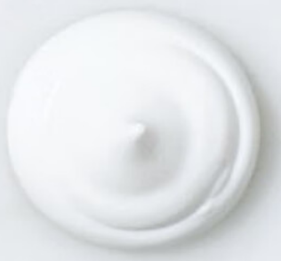 | 这种较厚重的保湿产品含有较多封闭剂（包括凡士林、油脂），对干性皮肤很有好处 |
| 油膏与乳膏       | 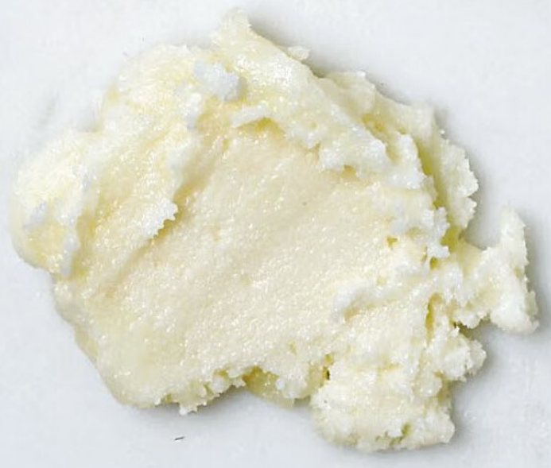 | 它们的封闭性极好，朋友们记住了！它们都是为容易出现局部干燥的人准备的强效、急救产品 |

主力产品指的是那些更传统的保湿产品，由保湿剂、柔润剂和封闭剂构成，既可以是流动的乳液，也可以是浓稠的乳霜。辅助产品通常只含有一类保湿成
分。如果你的化妆台上有辅助产品那就太棒了，当你觉得主力产品还不够保湿的时候，不必买新的，只要加上辅助产品一起用就行了。

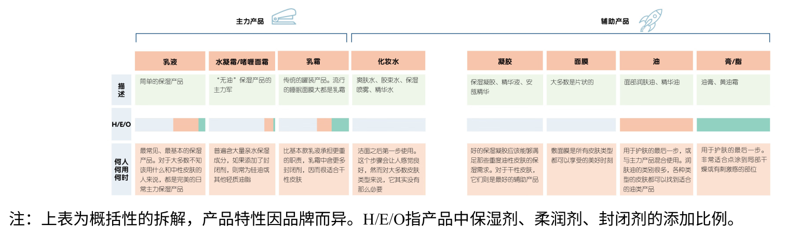

- 中性皮肤：选水凝霜或乳液，天赐肌肤！紧绷、干燥只是你偶尔或冬天才有的问题。简单的凝霜或乳液就够用了
- 我太干了：选啫喱、面霜和（或）油膏，适合你的方式是一层一层地叠加！在你出现问题、开始脱屑的局部皮肤上再加一层油膏
- 我有点油：选啫喱或水凝霜，如果你的脸上中午就开始泛油光，那你需要啫喱状产品；如果你出油不太严重或属于混合性皮肤，简单地用水凝霜就可以了
- 皮肤敏感：凡士林膏，你需要增强皮肤屏障功能，可以使用那些重点添加了神经酰胺、胆固醇、游离脂肪酸或舒缓成分的产品

### 3.3.防晒步骤

#### 3.3.1.理论解析

阳光是引起皮肤老化的外部凶手，这是有科学依据的。阳光引起的衰老被定名为“光老化”。光老化与众多皮肤表现有着广泛联系，包括过早出现的细纹和皱纹、肤质变化、皮革状外观、色素沉着，光老化还会直接引起 `DNA` 损伤。但一些人（包括我们俩）又极度向往那种日晒后的健康小麦色肤色。防晒霜并不是配方最棒的产品，它往往是黏糊、煞白、厚重、
油腻的，甚至还有股特殊的味道。在海滩上涂防晒霜并不会让人联想到迷人的迈阿密海滩生活，而是容易让人联想到一个鼻子白得发亮、总是散发着防晒霜气味的大叔。但只要找到最
适合你的防晒霜，就能解决这个问题了。从长远来看，更好的防晒习惯会塑造更好的皮肤，这才是真正的抗衰老！

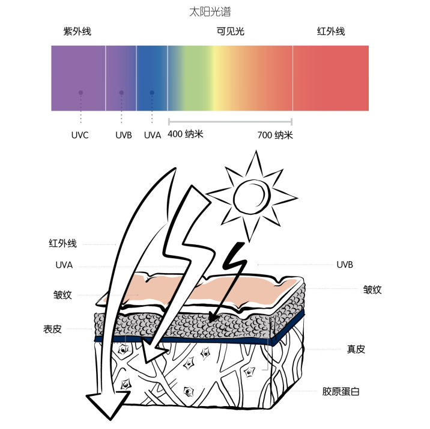

太阳是一个巨大的核反应堆，它辐射的光谱很广，包括可见光、红外线（能量）、紫外线。在这三种射线中，紫外线是造成皮肤损伤的主要射线，皮肤损伤的最终表现是过早的光
老化。实际上，紫外线有三种，了解它们的区别是有用的，因为防晒霜会针对不同紫外线发挥防护作用：

- `UVC`：三种紫外线中波长最短的一种，幸运的是，这种紫外线会被大气层过滤掉，因此我们可以放心地忽略它
- `UVB`：三种紫外线中波长居中，在能照射到我们皮肤的紫外线中，`UVB` 占 `5%`，与 `UVA` 相比，它的波长较短，因而只能到达表皮，`UVB` 会造成晒伤和延迟性晒黑（黑化），是皮肤癌的致病元凶，它的波长很短，这意味着它能量很高，高到可以直接伤害你的皮肤细胞乃至 `DNA`，这就是如果晒伤超过 `5` 次患黑色素瘤的风险会翻倍的原因
- `UVA`：三种紫外线中波长最长的，在能照射到我们皮肤的紫外线中，`UVA` 占 `95%`，`UVA` 可以一直到达真皮层，会造成深层光老化，加剧皮肤癌的严重程度，除了直接损伤外，`UVB` 和 `UVA` 还可导致产生更多自由基，从而诱发伤害。自由基极易参与化学反应，它们会无差别地攻击皮肤细胞、蛋白质、`DNA`，造成长期伤害

> [!IMPORTANT]
>
> 补充：我们注意到宣称产品“全光谱防护”已成为一种趋势。你不用过分担忧其他射线，也不必太在意这种宣传语。以下为你逐一解析。
>
> - `UVC` 防护： `UVC` 的热能比 `UVB` 还要高，所以这一定意味着 `UVC` 会引起更严重的晒伤，你是这样认为的吧？事实是 `UVC` 已经被平流层和臭氧层吸收了，所以不用理会它
> - 蓝光：需要保护自己免受手机和电脑的伤害吗？放心吧，电脑屏幕发射的蓝光远少于你在阳光下照到的蓝光。大多数声称能保护你免受蓝光影响的成分都是抗氧化剂，没什么新意可言。我们是不会专门买蓝光防护产品的
> - 红外线：红外线比 `UVA` 能穿透到皮肤更深处。一些研究表明，长期的红外线照射会损害皮肤。该怎么办呢？抗氧化剂可以抵御任何潜在的自由基损伤

可以这样便捷记忆，`B` 会 `Burn`（晒伤），`A` 会 `Aging`（老化）。

- 在山上，海拔越高意味着大气越稀薄，也意味着更多的紫外线暴露，你去滑雪的时候，千万要涂防晒霜
- 在飞机上，飞机飞得越高，紫外线肯定越强。如果在飞机上靠窗坐，需要担心紫外线过量吗？飞机窗戶由有机玻璃制成，它们确实能阻挡一部分紫外线，但仍会有一部分
  `UVA` 穿过它，你可以做的是拉下遮光板，戴上眼罩，服用大量褪黑素，涂上保湿霜，把自己遮挡严实，喝水，并好好休息
- 阴天，阴天指天空中的中低云层多于 `95%`，这时能照到皮肤的阳光当然也较少。不过，虽然可见光和红外线减少了，紫外线仍能损害你的皮肤。你仍需要使用防晒产品，特别是你外出活动时
- 少云，少云天气时会出现一种有趣的现象，当云恰好处于合适的位置或云虽然不完整但一块块的足够密集时，它们不仅会散射紫外线，还会使紫外线强度提高（可增加
  `25%`）
- 开车或室内工作，汽车玻璃或办公室、家里的玻璃窗可以阻挡 `UVB`，但不能阻挡 `UVA`，所以你仍然会被紫外线照射到，你的皮肤仍会老化

回顾防晒的历史可以发现，防晒更多是出于审美需要，而非防晒伤的需求。许多文化都有着对白皙皮肤的相同偏好。为了防止晒黑，古埃及人使用米糠、茉莉花和羽扇豆等天
然成分，古希腊人使用橄榄油。在缅甸，人们使用黄香楝粉（一种树皮磨碎后做成的膏状物）来让皮肤变光滑，防止痤疮及晒伤。一直到 20 世纪初，许多药剂师还会用橄榄油和扁
桃仁油来调配防晒霜。

`20` 世纪，防晒霜开始商品化，并加入了真正的防晒剂，如氧化锌和水杨酸苄酯。法国化学家、欧莱雅公司的创始人欧仁·舒勒（`Eugène Schueller`）首先研制出了真正的化学防
晒霜。我们还必须感谢奥地利化学家弗朗兹·格莱特（`Franz Greiter`），他不仅研发出第一个真正有效的防晒配方，还创造了今天仍在使用的防晒系数（`SPF`）。从古至今，除了外用防晒化妆品外，人们为了防晒也会穿着特定的服装。遮阳伞、软檐帽，再到可怕的皮制防晒面罩，这些都在史料上留下了图片和文字记载，由此可见，长久以来人们就知道阳光有多危险！

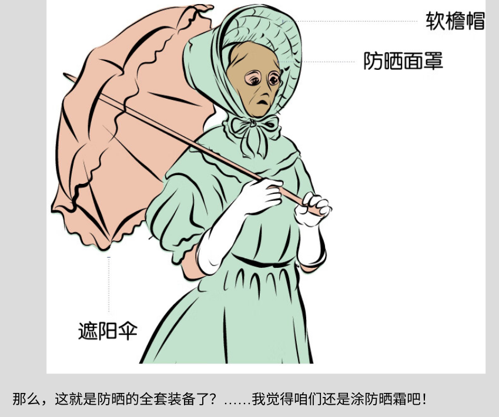

除了增加患皮肤癌的风险外，日晒也会造成皮肤老化，而且是皮肤老化的主要原因。紫外线对皮肤的伤害会导致一切你不想要的后果：下垂、粗糙、皮革样增厚、色素沉着、皱纹、暗沉等。阳光损伤皮肤时会触发皮肤中的炎症反应，使成纤维细胞被激活并开始分解㬵原蛋白。与此同时，皮肤还会启动另一种防御机制，表现为皮肤开始变厚，黑素小体过度产生而出现色素沉着。干燥、暗沉、粗糙和皱纹都是长期损伤的结果。即使是健康的日晒小麦色，也表明你的皮肤正在抵御阳光伤害。事实是，紫外线损伤是皮肤早衰的一个重要因素，并产生了一个专门的术语，光老化。

防晒霜可以吸收有害的 `UVA` 和 `UVB`，这样皮肤就因不会再吸收紫外线而受到保护了。很多人认为防晒霜只是物理性地阻挡阳光，但其实并非如此。防晒霜的防护原理是吸收紫外线后将吸收到的少量能量以热能的形式散发出去。在美国，因为防晒霜可以降低患皮肤癌的风险，所以它们是受美国食品药品监督管理局（`FDA`）监管的。你可以在美国市面上的防晒霜上看到“防晒剂含量”的标签，而不用在成分表的一堆乱七八糟的化学名词中寻找防晒成分。挑选适合自己的防晒霜时，记住要核对三个重要指标：

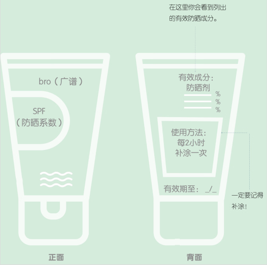

- **UVB 防护能力（SPF）**：`SPF` 值并不等同于防护力。比较 `SPF30` 和 `SPF15` 的防晒霜，人们会误以为前者的防护力是后者的两倍。但 `SPF` 值并不是这么计算的。`SPF15` 的真正含义是，在正确使用的情况下只有 `1/15，约 7%` 的 `UVB` 能透过防晒膜，也就是说它可以阻挡约 `93%` 的 `UVB`。同理，`SPF30` 的防晒霜可以阻挡 `1/30，约 97%` 的 `UVB`。所以，`SPF30` 的防晒能力并不是 `SPF15` 的 `2` 倍。一个有趣的事实！`SPF100` 的说法在欧盟是被禁止的，因为它有误导的嫌疑，暗示人们防晒霜可以阻挡 `100%` 的 `UVB`。`SPF` 值在实际生活中有什么用？日常生活中，我们建议选择 `SPF30〜50` 的防晒产品，这样容易使防护力与优秀质感达到平衡，但有的时候 `SPF30` 可能更理想。如果你选了高 `SPF` 值的防晒霜却被泛白、质地不好、刺激皮肤等问题困扰，那我们想再次告诉你，经常使用较低 `SPF` 值的防晒霜比偶尔用较高 `SPF` 值的防晒霜的防护效果更好。记住，质地为王
- **UVA 防护能力（PA）**：针对波长更长的 `UVA`，你同样需要适当的防护。`UVA` 不会晒伤皮肤，但它会比 `UVB` 穿透到皮肤更深层，它也是光老化的主要元凶。在美国，防晒霜上只有一个简单的“广谱 `bro`”字样表明它经过了 `UVA` 防护的功效测试。`SPF` 是一个全世界普遍使用的系数，但 `UVA` 防护的标识在各个国家、地区是不同的。中国、日本等国家使用 `PA` 值表示 `UVA` 的防护等级，其中 `PA+` 等级最低，`PA++++` 等级最高。在欧盟地区，一款防晒霜如果具有与 `PA+++` 防晒霜同等的防护等级，那么产品包装上会印有 `UVA` 标识
- **质地**：我们要告诉你一个真相，调配防晒霜就像在耳边嗡嗡作响又打不到的蚊子或脚心上的蚊子包，烦死人了。配方师在调配配方时面临着各种挑战，而你使用防晒霜时也能感受到它们的质地是多么难以掌控。很多防晒霜都会让人觉得油腻、厚重，让脸看起来像戴着白色面具。尽管防晒霜在保护皮肤方面有着诸多好处，但它太难相处了。这就是我们一直强调防晒霜的质地最重要的原因。如果要获得足够的防晒效果，需要用多少防晒霜呢？如果全身涂抹，大约需要半玻璃杯的量（`30` 克）；如果只用在脸部，大约需要一枚硬币的量（`1` 克左右）。牢记这个用量，同时也要牢记质地更好的防晒霜效果才更好，只有这样你才愿意每天使用，并且每 `2` 小时补涂一次。不要在高到离谱的 `SPF` 值上浪费金钱、精力，它的质地会让你难受到崩溃。好消息是，现在不再是“除了难用的防晒霜，别无选择”的时代了，市面上有各种各样供选择的防晒产品

> [!IMPORTANT]
>
> 补充：还有一些其他的光线可以简单讲讲
>
> - `UVC` 防护： `UVC` 的热能比 `UVB` 还要高，所以这一定意味着 `UVC` 会引起更严重的晒伤，你是这样认为的吧？事实是 `UVC` 已经被平流层和臭氧层吸收了，所以不用理会它
> - 蓝光：需要保护自己免受手机和电脑的伤害吗？放心吧，电脑屏幕发射的蓝光远少于
>   你在阳光下照到的蓝光。大多数声称能保护你免受蓝光影响的成分都是抗氧化剂，没什么
>   新意可言，我们是不会专门买蓝光防护产品的
> - 红外线：红外线比 `UVA` 能穿透到皮肤更深处。一些研究表明，长期的红外线照射会损
>   害皮肤。该怎么办呢？抗氧化剂可以抵御任何潜在的自由基损伤

> [!IMPORTANT]
>
> 补充：抗氧化精华液说它能阻止阳光伤害。难道抗氧化剂就是防晒霜吗？不，抗氧化剂并不等于防晒霜。但你可以这样理解
>
> - 防晒剂可以阻止自由基的产生
> - 抗氧化剂可以结合已产生的自由基
>
> 那么，防晒剂和抗氧化剂就可以组合在一起来生效，这样的效果就更好了。

> [!IMPORTANT]
>
> 补充：你是否曾对皮肤科医生是如何对肤色进行分类的感到好奇？
>
> 在菲茨帕特里克（`Fitzpatrick`）皮肤类型量表中，皮肤按肤色分为 `6` 个类型。这种划分看起来可能太宽泛了（谢天谢地，菲茨帕特里克博士没有试图推出粉底系列），但它实际上代表的是你的皮肤对阳光的反应。在量表中，肤色较浅的人（左侧）容易晒伤且患皮肤癌的风险较高，右侧的深肤色人群则更易晒黑而不是晒伤。总而言之，皮肤白皙的人容易晒伤且患皮肤癌的风险更高，皮肤较黑的人更容易晒黑而不易晒伤。所以不难想象，一支好的防晒霜需要适用于多种不同皮肤类型的人。
>
> 很重要的一点是，深肤色的人晒伤的概率更小，但这不意味着紫外线就不会伤害他们的皮肤。养成用防晒霜的习惯，远离皮肤癌！
>
> 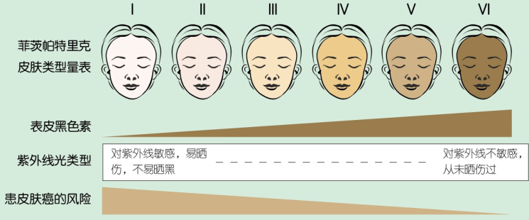

> [!IMPORTANT]
>
> 补充：根据 `FDA` 的规定，防晒霜在美国被认定为非处方药（`OTC`）。这意味着你在美国商店货架上找到的任何防晒产品都已通过了功效测试。自制防晒霜通常使用的是氧化锌，这是一种有效的广谱防晒剂。然而，如果没有适当的调配和正确的制造设备，氧化锌可能无法分散成一层均匀的薄膜，这会导致防晒霜在皮肤上留下一块块的痕迹，而且防护力不足。
>
> 我们在电商网站上看到了很多宣称安全、不含化学性防晒剂的防晒霜，但它们的保存方式很可疑，而且已经开始分层了。千万别使用没有防护力的防晒霜，患皮肤癌可不是开玩笑的！

#### 3.3.2.核心成分

防晒剂分为两类：有机（化学性）类和无机（物理性）类。化学性防晒剂是液态的，只能吸收紫外线；物理性防晒剂是固体的矿物，其防晒原理主要是吸收紫外线，同时也能反射和散射紫外线。化学防晒霜的质地更好，不容易留下白色痕迹，但并不适合每个人，因为可能会对一些人造成刺激。要想做出选择就得先了解你使用的防晒剂

- **有机（化学性）防晒剂**：

  - **美国批准的有机（化学性）防晒剂**，在这些化学性防晒剂中，能防护 `UVA` 的广谱防晒剂只有丁基甲氧基二苯甲酰基（阿伏苯宗）。另外，这些化学性防晒剂都是油溶性成分，这导致那些可怜的化学家必须要努力用一桶厚重的、难以搭配的、有时候不稳定的油状物去制造轻盈的、讨人喜欢的、可以一层一层叠加使用的防晒霜

      | 类别                             | 特点     |
      | -------------------------------- | -------- |
      | Avobenzone，丁基甲氧基二苯甲酰基 | 防护 UVA |
      | Homosalate，胡莫柳酯             | 防护 UVB |
      | Octisalate，水杨酸乙基己酯       | 防护 UVB |
      | Octocrylene，奥克立林            | 防护 UVB |
      | Oxybenzone，二苯酮 - 3           | 防护 UVB |
      | Octinoxate，桂皮酸盐             | 防护 UVB |

  - **亚洲和欧洲批准的有机（化学性）防晒剂**，这张表格列满了我们不能在美国使用的好东西。其中一些成分是水溶性的，所以你在欧洲和亚洲可以买到很轻薄的防晒霜，而美国的防晒产品就做不到这点。当然，这里所列的并不是这两个地区批准的所有防晒剂，我们只列出了最常见的一些欧莱雅公司的专利成分，即使在美国的防晒霜里也能找到它

      | 类别                                                       | 特点         |
      | ---------------------------------------------------------- | ------------ |
      | Tinosorb S，双 - 乙基己氧苯酚甲氧苯基三嗪                  | 防护 UVA/UVB |
      | Tinosorb A2B，三联苯基三嗪（在中国尚未获批准 —— 译者注）   | 防护 UVA/UVB |
      | Uvinul A Plus，二乙氨羟苯甲酰基苯甲酸己酯                  | 防护 UVA     |
      | Ecamsule, Mexoryl SX，对苯二亚甲基二樟脑磺酸（欧莱雅专利） | 防护 UVA     |
      | Uvinul T 150，乙基己基三嗪酮                               | 防护 UVB     |

- **无机（物理性）防晒剂**：两种物理性防晒剂在全世界范围内都可以使用，并常被推荐给敏感性皮肤人群，它们的另一个优势是不会面临会破坏环境或会渗入血液之类的争议。缺点是它们很容易在皮肤上留下白色的痕迹。如果经过了纳米化处理，泛白程度会有所减轻。但也有人担心纳米级的物理性防晒剂的安全性，不过这种担忧还没有被科学证实

    | 类别     | 特点           |
    | -------- | -------------- |
    | 二氧化钛 | 防护 `UVA/UVB` |
    | 氧化锌   | 防护 `UVA/UVB` |

#### 3.3.3.具体用法

| 产品类型      | 图片                                                         | 特点                                                         |
| ------------- | ------------------------------------------------------------ | ------------------------------------------------------------ |
| 防晒粉        | 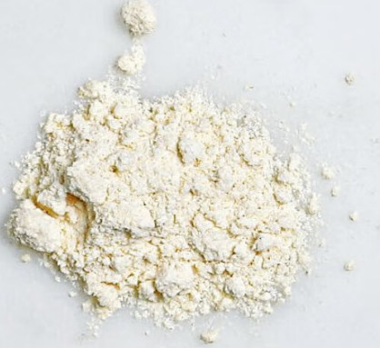 | 很方便，特别是对化妆的人来说，但想要用它均匀地遮盖面部还是有难度的，我们不会选择防晒粉，因为根本不知道得用多少才能达到足够的防护效果。有时候，在你的底妆下加一层防晒霜是最好的办法 |
| 防晒棒/防晒膏 | 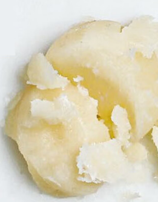 | 压缩型产品，适合旅行时携带，防晒棒太适合旅行时携带了。嘴唇防晒也用得上，但会有油腻感 |
| 有色防晒      | 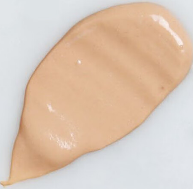 | 化妆时也许还可以兼作粉底                                     |
| 防晒霜/防晒乳 | 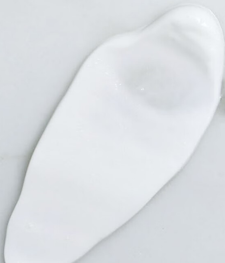 | 适合每天使用，最基本的两种防晒产品。不同产品的质地差异很大，注意分辨其中含有什么防晒剂，这样会帮你排除一些产品以缩小选择范围 |
| 防晒油        | 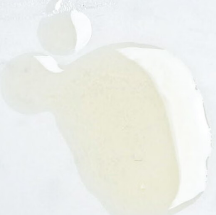 | 帮你轻松获得“被阳光亲吻”后的色泽，缺点是包装很容易漏油，很适合在海滩上使用，或为了获得美丽的皮肤光泽的人使用。和其他油类产品一样，防晒油不是最适合旅行的产品，准备好面对油渍（漏油）吧。 |
| 防晒喷雾      | 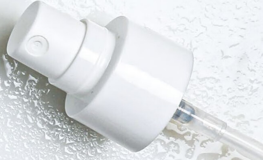 | 操作简单、易于补涂，但可能让人觉得太干燥。最好是先把喷雾喷在手心里，再涂到皮肤上，这样比直接喷更均匀。清爽，适合重复使用。要知道，在防晒性能测试中，测试人员是先将防晒喷雾喷在手上，再涂到身体上，这样才能掌握合适的用量，并把防晒喷雾用得均匀，所以不要把防晒喷雾直接喷在身体上。 |
| 防晒服        | 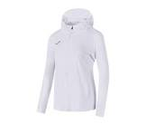 | 防晒服也要进行防晒功效测试以得到 `UPF` 系数。`UPF` 系数代表对 `UVA` 和 `UVB` 的共同防护能力指标，计算方法是在给定剂量的紫外线照射时测量有多少紫外线穿透了防晒服（只要是紫外线都算进去）。例如，`UPF10` 意味着有 `1/10` 的紫外线穿透了防晒服，`UPF20` 意味着有 `1/20` 的紫外线穿透了防晒服，依此类推，`UPF` 值越高，代表防晒服的防护效果越好。对于长时间在戶外活动的人来说这很重要 |
| 遮阳伞        | 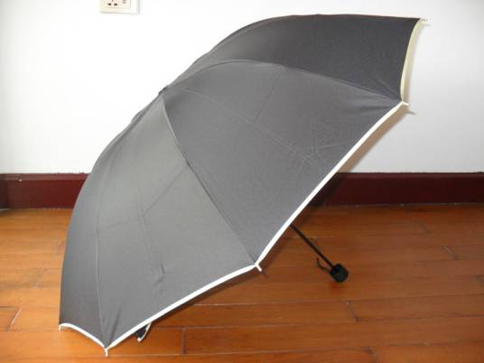            | 我们常听到这样的问题：“我如果坐在遮阳伞下，没有涂抹防晒霜，那我也算是做了防晒，对吗？”有趣的是，的确有人把防晒霜和遮阳伞的防晒效果进行了比较。强生公司就对此进行了一项对比试验，试验地点是阳光明媚的得克萨斯州。研究者把试验者分成两组，一组只涂防晒霜，另一组只用遮阳伞。他们发现，相比涂防晒霜的人，会有更多坐在伞下的人晒黑和晒伤。这是为什么呢？即使你坐在阴影里，你的身体也仍然暴露在紫外线下，因为紫外线会被地面等反射。总而言之，使用遮阳伞时，阴影确实可以提供一些防晒效果，但这种防晒措施的防护力并不全面 |

## 4.功效成分

### 4.1.高级护肤

如果你想在基础护肤之上更进一步，那就会用到活性成分，它们可谓护肤界的“当红明星”。它们通常价格昂贵、包装精美，还都声称是“青春源泉”。功效产品主打活性成分，专门针对并改善你可能正忧心的皮肤问题，如细纹、皱纹、肤色暗沉、肤质粗糙和色素沉着。

如果你已经搞定了三大基本方面（洁面、保湿、防晒），那么说明你已经有了一个可靠的护肤程序，活性成分的加入则会让这个护肤程序 **锦上添花**。活性成分的技术含量较高且种类繁多，所以本书会花一半的篇幅去讲它们。活性成分有助于对抗皱纹、色素沉着，改善皮肤粗糙，但它们由于功效多样，可以被做成各种剂型的产品，你往往需要多尝试才能找到适合自己需求的搭配方法。

每一种针对皮肤问题的功效成分或精华液背后其实都藏着“英雄”成分，我们化学家称其为活性成分。活性成分能给皮肤带来长期功效，使品牌方得以宣称“留住青春”“容光焕发”。护肤品行业充斥着这些强力成分，但人们却很难搞清楚这些成分到底对皮肤有什么用。很多活性成分的功效分类并不明确，因此你会发现有些成分身兼多职，而另一些成分的分类仅体现了它们真实效用的冰山一角。看看下图中混乱的指示箭头，你就会明白活性成分有多么令人费解！

只是几种活性成分就已经让你眼花缭乱了，更不用说还有成千上万种鱼龙混杂的活性成分，这可不是闹着玩的。怎么会变成这样？你最喜欢的精华液中的活性成分通常都符合以下宣传套路：

- **异域传说法**。有时候，一个引人入胜的起源故事就足以让你坚信某种花草提取物是你命中缺失的奇迹创造者。所以，用它来解决痤疮、炎症和色素沉着等皮肤问题，看看效果如何吧。这些产品往往被宣传得神乎其神，但实际效用却令人失望
- **涓滴效应法**。如果某种成分在食品、医药或航天工程（没开玩笑！）中颇有声誉，那为什么不试着把它放到保湿霜里呢？这些成分对皮肤的实际效用常常言过其实
- **广撒渔网法**。也有些成分是专门为了声称的功效而设计的，所有你能想到的护肤效用，这些成分全被拿来试过。这就是某种成分会同时兼具多种功效的原因，这使得理解活性成分难上加难

如你所见，即使不考虑皮肤问题和皮肤类型，单单是选择正确的活性成分就已经需要做很多功课了。更何况活性成分中充斥着大量不管用的成分，这使得情况愈加复杂了。我们可以详细地列出护肤品活性成分花名册，但那样的话，这本书就会变成一部厚厚的百科全书，还是为大自然多留几棵树吧。

### 4.2.检测手段

我们所说的“已证实有效”是什么意思呢？其实，科学家们有很多不同的方法来测试活性成分，以验证它们对皮肤的真正效用，以下是最常见的几种：

- **体外培养**：该方法是在试管或细胞培养皿中测试活性成分。有时，该方法被用来研究某种成分对某些特定的皮肤细胞（如成纤维细胞）的作用。人们也会通过这种方法来观察某种成分是否能作为抵御自由基的抗氧化剂。该方法的缺点是无法模拟这些成分被皮肤吸收后到达目标细胞的方式，所以可以把它看作是一个类似酸碱测试的初步测试，为某种成分是否需要进行更多测试提供指示
- **离体皮肤**：该方法是在一块离体的皮肤上测试单一或复配的活性成分，通常使用的是猪或人的皮肤。之所以在众多动物中选择猪，是因为猪的皮肤与人类的非常相似。有时也会使用整形手术“用剩下的”人体皮肤。由于使用了真正的皮肤，我们可以通过该方法更好地了解活性成分或其复配成分是如何与皮肤相互作用并被皮肤吸收的。该方法的最大缺点是只能将皮肤“保鲜”一段时间，所以这种测试方法的时长通常不能超过 2 周。想要了解活性成分的长期功效，两周可不太够
- **活体动物**：该方法是在活体动物身上进行成分测试。不要激动！如今的大多数活体动物试验都被严格限制，且通常只用于学术研究。该方法可以帮助我们了解某种成分能如何减少紫外线辐射或加速伤口愈合，但因为将动物数据转化为人体数据并不容易，所以归根结底这种方法并不是很好。你可以放心，如今美容行业里涉及的动物试验越来越少了。我们都很爱小动物的
- **活体人体**：现在，我们来到了最理想的测试场景——在真实的人类受试者身上进行测试！但这也是最昂贵的方法，意味着没有多少活性成分能够最终得到人体临床试验的机会，也意味着数据可靠性会存在很大差异。不过，测试护肤品成分并没有测试药物那样严格的要求。所以，每当评估护肤品成分时我们都觉得自己像乞丐，四处讨要可靠性还过得去的数据来协助评估它们的功效

评估临床试验时的两个重要考量标准：

- 测试对象的数量：我们通常会寻找至少 `30` 个测试对象。这实际上并不多，但与某些仅有 `5` 个测试对象的研究相比，我们觉得 `30` 个还算不错
- 是否有空白对照：研究中，经过活性成分处理的皮肤需要和不含活性成分的配方处理过的皮肤进行对比。这是找出某种活性成分对皮肤的影响的最直接方法。如果没有空白对照组，就没有比较的基线，所以在研究中做到这点对我们极其重要

### 4.3.四大巨头

- **化学去角质成分**：包括甘醇酸（乙醇酸）、乳酸和杏仁酸（扁桃酸）等在内的酸类，可以温和地去除累积过多的死皮细胞
- **类维生素 A**：这类成分是全能型选手
- **维生素 C**：长期抗衰老功效中的主要抗氧化剂
- **烟酰胺**：使肌肤更莹亮、滋润的最佳辅助成分

> [!IMPORTANT]
>
> 补充：当然除了重点在于成分，还要看其他考虑标准。
>
> - **浓度**：如果说看完本书你需要记住什么的话，那就是适当的用量才能奏效。剂量就是万能药！这点尤其适用于专门为解决各种皮肤问题而出现的重要护肤成分
> - **耐心**：心急吃不了热豆腐。这些活性成分需要持续使用，通常 `4` 周左右（有些甚至需要几个月！）才能看出一定效果。尽管“一觉醒来就能见证奇迹”听起来很诱人，但太过美好的承诺就是虚幻
> - **刺激**：护肤产品很容易让人产生买买买的冲动！抗皱，买它！白到发光，买它！于是你的护肤程序中突然涌入了 `10` 种活性成分，接着你的皮肤开始经受各种刺激。这可不是你想要的结果。接下来你得把所有时间都花在让皮肤恢复正常上，反而顾不上那些好东西了
> - **叠加**：护肤的顺序一般是从水性产品到油性产品。功效护肤环节也遵循少即是多的原则。可靠的、`4` 步或 `5` 步护肤程序基本可以满足你的需求，特别是当你用的成分能同时解决多种皮肤问题时。少即是多
> - **分子**：以维生素 `C` 为例，它有各种衍生物，但接下来你会看到我们花大量的笔墨解释为什么左旋抗坏血酸（`L-AA`）是其中最好的。并不是所有的维生素 `C` 都是一样的，维生素 `C` 的类型很重要

#### 4.3.1.化学去角质成分

##### 4.3.1.1.理论解析

自从圣艾芙（`St. Ives`）杏子磨砂膏开始流行（真是暴露年龄），我们就被告知了去角质的重要性。人们一直以来都觉得只要搓洗就能拥有有光泽的、如婴儿般柔软的肌肤。但是物理去角质并不是唯一（有时也不是最好的）能有效去除死皮细胞并保持皮肤更新和健康的方法。来认识一下化学去角质（俗称“刷酸”）成分吧，这些成分可以削弱那些顽固的、死皮赖脸的死皮细胞之间的化学键，使皮肤恢复光滑、细腻的状态。接下来我们会全面地介绍去角质以及如何安全使用化学去角质成分，让你的皮肤尽享“酸爽”一刻！

为了让皮肤保持健康和年轻，角质必须不断地脱落。但随着年龄的增长，这种细胞更替的过程会逐渐变慢，导致皮肤暗沉、粗糙。这就是去角质的意义所在，它可以帮你清除那些旧细胞中的“钉子戶”。

健康的皮肤会产生健康的脱屑，脱屑是鲜嫩的皮肤细胞向外层移动、老旧细胞脱落的过程。这实际上是你的皮肤新陈代谢的过程。健康角质层中细胞的更替周期为 `2〜3` 周，你的整层表皮只需要大约 `7` 周就能全部更新！

皮肤的新陈代谢（周转率）对皮肤健康至关重要。脱屑过程会因为衰老、环境压力和缺水干燥而减慢。一旦这个更替过程变慢，就会进入一个糟糕的恶性循环：`肤质粗糙 → 屏障功能受损 → 脱水 → 细胞更替的过程进一步减慢`。也就是说，你的皮肤会变得粗糙，会脱皮且暗沉。

谈去角质自然避不开化学去角质成分，“化学”意味着它们是酸性分子。酸类成分可以削弱累积的死皮细胞之间的纽带（一种叫作角质桥粒的蛋白质，记住这个知识点，万一有奖知识问答用得上呢），有助皮肤恢复健康的周转率。去除表层细胞在短期内能够让你的肌肤更光滑。从长远来看，某些化学去角质成分还可以帮助解决色素沉着、痤疮，甚至㬵原蛋白流失的问题！有意思吧？所以让我们来看看哪种化学去角质成分适合你。

你想过谁是第一个把酸涂在脸上的勇士吗？人们使用酸类物质美化肌肤已经有很长的历史了。古埃及的女性会使用富含乳酸的酸牛奶让肌肤变光滑。古希腊、古罗马及各游牧文明都有自己独特的去角质配方。中世纪时，醋和葡萄酒被当作美容品使用。虽然我们不确定它们是否用于去角质，但我们可以将其视作最早被提及的化学去角质成分，因为葡萄酒的 `pH` 值通常在 `2.5~4.5` 之间，并且它含有酒石酸，而酒石酸正是果酸的一种（不算是上乘的）！我们现在已经拥有更好的果酸了，所以葡萄酒还是留着喝吧！

但是直到 `19` 世纪末，果酸才开始受到关注，当时，酚类、间苯二酚、水杨酸等已作为第一批针对黄褐斑和雀斑等皮肤问题的化学换肤剂风靡一时了。果酸只能算是后起之秀，因为它直到 `20` 世纪 `80` 年代才流行起来。

##### 4.3.1.2.核心成分

化学去角质成分包括三个类别，且都是弱酸，它们的区别在于分子结构不同。幸亏这三个类别的功能也各不相同，这样你就不用受堪比催眠术的化学术语的折磨了。

- **基础中的基础，α-羟基酸，果酸，AHA（甘醇酸、乳酸、杏仁酸、苹果酸、酒石酸）**：果酸类别中包括 `甘醇酸、乳酸、杏仁酸、苹果酸、酒石酸`。这些都是水溶性的弱酸，在这些酸中，我们只关注三种，`甘醇酸、乳酸、杏仁酸`。这三者的主要区别在于分子大小不同，这个区别有助于你选择适合自己的果酸伴侣。这三种果酸在改善肌肤色素沉着、促进㬵原蛋白生成、减少细纹和皱纹方面的功效已经得到了长期的验证
- **油性皮肤专家，β-羟基酸，水杨酸，BHA（水杨酸）**：没错，这类化学去角质成分中只包括 `水杨酸`，微溶于油的特性使得水杨酸能够深入毛孔。此外，它还是一种抗菌及抗炎成分，对于发炎、易生痤疮的油性皮肤来说，水杨酸是理想的选择
- **新生代，温和型多羟基酸，PHA（葡糖酸内酯、乳糖酸）**：这位是？没错，多羟基酸是个“新人”。`PHA` 通常指的是两种分子，`葡糖酸内酯、乳糖酸`，其中葡糖酸内酯在护肤品中更常见，据说它能带来超好的化学去角质体验，甚至还有保湿的功效，能够为肌肤补水并锁住水分。它还十分温和，不像其他成分那样会引起皮肤光敏感。有些数据显示葡糖酸内酯甚至有助于治疗痤疮，并且未来还会有更多的数据。总而言之，如果你是干性皮肤、敏感性皮肤，或者前两类酸的使用效果对你都不理想的话，葡糖酸内酯是个不错的选择

> [!IMPORTANT]
>
> 补充：如果你尝试的是稍高浓度的酸，那么皮肤有轻微的刺痛感是正常的，但要是觉得自己仿佛是在给毛孔除魔（感觉疼痛难忍），那绝对是不正常的。在 `Instagram` 这个迷幻的网络世界里，我们总能看到一些人滥用化学去角质成分的可怕场面。有时候，我们会看到一些“网红”对着自己的脸又磨又刷，恨不得洗掉一层皮，直到让脸看起来比砂纸还粗糙，这场面实在令人咋舌。一般在家刷酸后，短暂的轻微刺痛是完全正常的，但你的脸肯定不该红得跟龙虾似的且一直很疼。

> [!IMPORTANT]
>
> 补充：其他去角质成分，这里进行了补充。
>
> - “酵素去角质是怎么回事？去角质凝㬵又如何？”酵素去角质产品中用的不是果酸、水杨酸、多羟基酸，一般使用的是菠萝中的菠萝蛋白酶或木瓜中的木瓜蛋白酶。酵素去角质产品的忠实拥护者们认为，这类产品具有化学去角质产品的所有功效，且丝毫没有刺激性（主要营销点是“温和”）。有一项研究声称 `1%` 的木瓜蛋白酶的功效优于 `5%` 的乳酸。还有人声称鱼卵（是的，你没看错）精华比 `4%` 的甘醇酸更温和有效。有关酵素去角质的研究稀少，所以产品背后的大部分数据来自制造商和产品营销。但是，如果你的皮肤喜欢甘醇酸产品，那就没必要为了三文鱼鱼卵精华而心动
> - `21` 世纪初，去角质凝㬵曾非常流行。还记得商场化妆品专柜里那些过分热情的工作人员把一种“神奇”的凝㬵涂在你的皮肤上然后搞出恶心的死皮细胞小球吗（现在的美博会有的时候也有这种场景）？虽然某些去角质凝㬵产品确实含有少量果酸，但它们本质上属于物理去角质产品。那些小球是膨胀的纤维（通常是纤维素），可以帮助你以最温和的方式甩掉已经松脱的死皮。在所有物理去角质产品中，它是最温和（因为太温和了，所以不是特别有效）的一种

在选择酸的时候，分子的大小很重要。分子越小，活性越强。但如果你以前从未使用过化学去角质成分，那么一开始就用 `30%` 的甘醇酸去角质无异于自行车两侧的辅助轮还没拆就想骑独轮车。“化学家的刷酸上手指南”，它可以帮助你找到理想的起点，告诉你如何升级。

化学去角质成分非常受欢迎，各种各样的产品中都有它们的身影。它们最常出现在洗面奶、爽肤水、精华液、面霜、洁面湿巾和面膜中，几乎涵盖了所有的产品类型！我们不建议你使用含有化学去角质成分的洗面奶，因为它并不是最有效的化学去角质产品类型。对于其他的化学去角质产品类型，你需要考虑三点：

- **浓度**。没错！重要的事情说三遍，又碰到了我们最喜欢的化学家准则，记得查看浓度。果酸的浓度通常很高。没错，浓度是非常关键的，如果你看到的产品上没有注明酸的浓度，那么就不要浪费时间了。为了保证有效的日常刷酸，看看标签上有没有以下这些描述
  - **AHA 常规浓度**：`5%〜10%` 的甘醇酸、`8%` 的乳酸和杏仁酸（国内许可的护肤品果酸浓度不超 `6%`）
  - **BHA 常规浓度**：`0.2%〜2%` 的水杨酸
  - **PHA 常规浓度**：`10%` 的葡糖酸内酯
- **产品的 pH 值**。果酸或多羟基酸类产品的 `pH` 值越低，效果越好。当然，也不是一味地低就好。要维持“良好的功效”和“该死的，太刺痛了”之间的平衡。大多数人在使用 `pH` 值 `3.5` 左右的酸时，既可以享受去角质的好处，皮肤也几乎不会受到刺激
- **辅助成分**。每个伟大的配方无疑都需要一个伟大的配角才能真正闪耀！以下是你需要在标签上寻找的两种辅助成分
  - **pH 调节剂**：这类成分至关重要，包括氢氧化钠、氢氧化钾和三乙醇胺等。没有它们，你的果酸产品的 `pH` 值会极低。我说的低是 `pH` 值为 `1` 甚至更低。所以，如果某个产品一点儿调节剂都不用，那可真够粗制滥造的。我们的建议是，不能说直接走人，只能说赶紧跑！把这些产品留给皮肤科医生和美容医师用吧
  - **舒缓成分**：某些产品会加入“舒缓剂”来缓解酸对皮肤的刺激，让你的刷酸体验更愉悦。如果你想要体验一些舒缓功效，可以找找 `红没药醇（洋甘菊提取物）、金盏菊、积雪草`

##### 4.3.1.3.具体用法

该怎么刷酸呢？这里简单说一下步骤：

1. **合适环境**：在晚上居家环境，有些酸是不能见光的，最好还是晚上在家这种环境比较合适

2. **按肤质选**：这里有个图可以进行参考，根据自己的肤质去选对应的酸就好了

   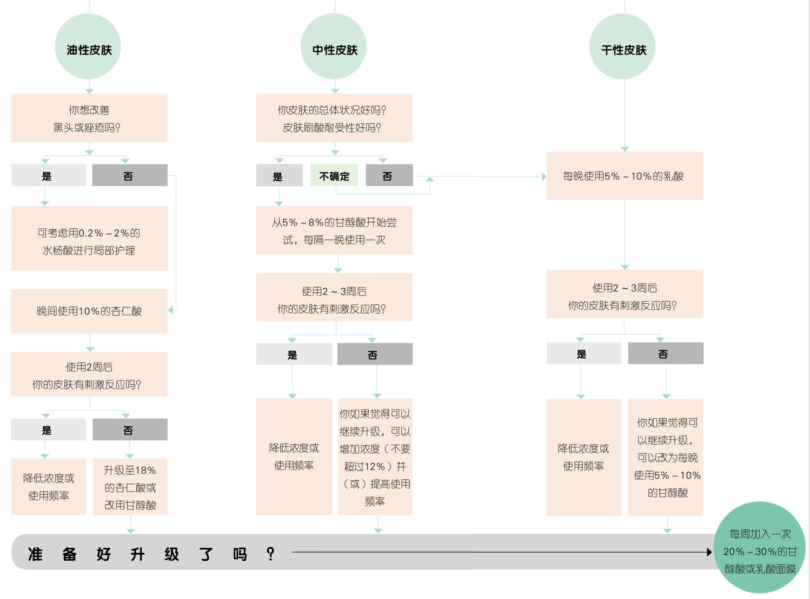

3. **首先洁面**：先用 **温和的氨基酸洁面 ** 洗掉油脂、防晒、灰尘，用干净毛巾/洗脸巾轻轻按干，脸上保持干爽再上酸。洁面这方面其实也可以考虑使用 `泥面膜` 和 `含酒精爽肤水`。这些产品可以去除脸上多余的油脂，因此，在刷酸之前使用它们是很不错的选择。过量的油脂和污垢会阻碍酸类成分的渗透，所以先使用泥面膜或爽肤水，即便不使用浓度更高的酸类产品，刷酸的效果也会增强。但别让泥面膜在脸上停留太久，`5~10` 分钟就够了

4. **局部保护**：如果你脸上有很干燥或较敏感的区域，或者是有一道小伤口，你可以在使用功效成分之前在这些地方涂上凡士林或油膏，这样酸就不会碰到这些敏感区域了

5. **建立耐受**：在晚上居家环境进行下面的测试

   - 先耳后/下颌线进行局部测试，等 `24–48` 小时，无红、肿、持续刺痛再上脸
   - 短接触法（最安全）：涂上酸，`5–10` 分钟洗掉，一周 `1` 次，连续 `2–3` 周没问题，再改成过夜驻留
   - 从局部到全脸，从低频率慢慢加，不要上来天天全脸刷

6. **使用产品**：一般分为两种，化学去角质或者物理去角质

   - **化学去角质**：化学去角质成分通常都添加在高含水量配方中。也就是说，你的 `刷酸棉片、爽肤水、精华液`，应该是您 **洁面** 后 **夜间常规护肤** 的第一步或第二步。浓度在 `10%` 以下的果酸产品可以每天使用。如果你对较低的浓度也很敏感，那就每两晚用一次。其实也可以考虑一下高浓度面膜，加大你使用的酸类产品的浓度（`≥20%`）是一个提升去角质效果的好方法。这些浓度更高的酸类产品应该用作可冲洗面膜，且每周使用不超过一次
   - **物理去角质**：化学去角质可以让死皮松脱，从而让皮肤变得更光滑、更有光泽。但随着年龄的增长，你的皮肤会变得顽固，即便在化学去角质的作用下废旧的角质细胞也不易离去。这时可以使用温和的物理去角质产品去除那些已经松脱的皮肤细胞，如柔软的 `鬃毛洁面刷、魔芋海棉`（这些在之前的洁面步骤中有提到过，可以回去重新观看），效果都很好。别用 50 号的砂纸、杏仁或核桃壳制作的磨砂膏。现在没必要再来这老一套了

7. **过度刺激**：刷酸后你可能会有三种表现

   - <u>皮肤麻痒、刺痛、干燥、泛红</u>。好吧！你的皮肤已经受刺激了。别管那些活性成分了，做好基础的洁面、保湿和防晒，把精力集中在恢复皮肤健康上吧（皮肤一旦有第一种表现，停止使用所有活性成分，专心恢复皮肤健康）。化学灼伤和晒伤很相似，受到刺激的皮肤会整片泛红、刺痛、麻痒，严重的化学灼伤还，会导致肤色暗沉、肤质粗糙。
   - <u>皮肤看起来很好</u>！好极了！继续努力
   - <u>毫无变化</u>。记住，至少要四周才能看到明显的变化。但也许是时候升级了！使用下面的酸度阶梯来帮助你选择更高阶的刷酸方案吧
     - 第一阶段：从 `10%〜14%` 的葡糖酸内酯开始
     - 第二阶段：`10%` 的杏仁酸
     - 第三阶段：`5%〜10%` 的乳酸
     - 第四阶段：`5%〜10%` 的甘醇酸

8. **日常保护**：最后还有一点非常重要，日常记得涂防晒霜！大多数酸都会让您的皮肤更容易受到日照损伤。当然，无论你是否刷酸，都应该养成良好的防晒习惯。防晒（霜）每天涂一涂，永远不用考虑打肉毒（素）

> [!IMPORTANT]
>
> 补充：它们既然是酸，那为什么只带走那些应该脱落的老旧细胞，而不会带走那些健康细胞呢？好问题！简言之，因为它们没有渗透到足够深的地方去破坏不该被弄断的化学键，否则就是刷酸过度。如果你过度刷酸，它们就会触及不该被去除的细胞，而这就是皮肤出现刺激反应的原因。
>
> 因此为什么有些人听到刷酸就感觉比较危险，是因为刷酸过度会引起毁容这种严重后果。

#### 4.3.2.类维生素 A

##### 4.3.1.1.理论解析

`类维生素 A` 也叫 `维生素 A 衍生物`，是王牌功效护肤成分。自被发现以来，这一大类成分一直扮演着护肤品王者的角色，用于解决包括 `脸部痤疮、色素沉着、细纹皱纹` 在内的一切皮肤问题。但是 `类维生素 A` 也有一些缺点，它们的副作用也很显著，包括 `皮肤泛红、起皮、刺痛`。如果使用得当，`类维生素 A` 的大部分副作用都可以被控制在最低限度，这样你就能安心享受它的所有抗衰老功效了。接下来，我们会先介绍 `类维生素 A` 的分类，然后带你弄清商店中不同类型的 `类维生素 A` 的区别，如何找到最适合你的肌肤需求的类型，以及实现功效最大化、刺激最小化的 `类维生素 A` 的用法和用量。

在讨论类 `维生素 A` 对皮肤的诸多功效之前，我们必须先来讲讲㬵原蛋白的故事。提到抗衰老，你可能在你的抗皱面霜的标签上见过“㬵原蛋白”这个词。这是因为㬵原蛋白，更准确地说是㬵原蛋白流失是导致衰老的罪魁祸首。

㬵原蛋白占皮肤干重的 `75%` 左右。得益于紧密的三重螺旋结构，㬵原蛋白肩负着维持皮肤整体结构完整性的重任。因此，㬵原蛋白的流失是产生皱纹和皮肤松弛的根本原因。

接下来有请成纤维细胞登场，它们不仅在伤口愈合方面发挥着至关重要的作用，还会分泌原㬵原酶。原㬵原酶是一种前体物质，扮演着建筑基石的角色，它们彼此交联后就会生成最终产物，㬵原蛋白。

**㬵原蛋白 = (纤维细胞 -> 原㬵原酶) + 纤维细胞**

事实上，`类维生素 A` 的历史可追溯到古埃及时期。当时，古埃及人会吃富含 `维生素 A` 的肝脏来治疗夜盲症。`视黄醇（维生素 A）` 的历史则可追溯到第一次世界大战时期，当时的研究表明，缺乏 维生素 `A` 会导致皮肤干燥和患毛发角化病。

然而，直到 `20` 世纪 `60` 年代后期，艾伯特·克里格曼（`Albert Kligman`）博士、詹姆斯·富尔顿（`James Fulton`）博士和格德·普莱维希（`Gerd Plewig`）博士才发明了 `维 A 酸`。艾伯特·克里格曼是一位颇受争议但多产的皮肤学领域的先驱，他首次揭穿了巧克力导致痤疮的谣言，研究了痤疮的各个阶段，并创造了“光老化”这个术语。

纯净护肤”运动引发了“何为真正安全的成分”的诸多猜测。如果你上网搜索一下，你会发现有些品牌宣称不再使用视黄醇，因为它被认定具有危险性。这一说法源自怀孕期间过量摄入 `维生素 A` 会导致胎儿先天缺陷的事实。因此，如果你在备孕，医生是不会给你开 `口服异维 A 酸` 的。外用 `类维生素 A` 的风险要小得多，但医生仍会相当谨慎并通常建议孕妇“避免使用 `类维生素 A`。所以，你如果怀孕了或正在备孕，先咨询一下医生需要避免使用哪些护肤成分。对于其他人，`类维生素 A` 通常是安全的！

皮肤中含量最丰富的㬵原蛋白，`I 型㬵原蛋白` 的寿命大约 `30` 年。这就意味着随着年龄增长，旧的㬵原蛋白会发生变性并彼此交联，导致㬵原蛋白断裂（也就是皱纹、松弛，以及一切让你头疼的问题），日晒损伤的积累和时间流逝都会加剧这种情况。更糟糕的是，成纤维细胞很难完全清除这些㬵原蛋白变性，而这些变性的旧㬵原又无法被利用到新的㬵原蛋白中，从而破坏了真皮结构的完整性。一旦㬵原蛋白发生断裂，就会出现一个空位，导致成纤维细胞无法黏附，也就无法顺利地伸展和发出信号促进前㬵原生成。因此，㬵原蛋白断裂也是引发自然衰老的皱纹的一个根本原因。

别绝望！好消息是，`类维生素 A` 可以拯救这一切。`类维生素 A` 与皮肤的 `维 A 酸受体（RAR）` 相互作用，刺激㬵原蛋白生成，促进成纤维细胞增殖，并预防㬵原蛋白降解。在众多抗衰老成分中，`类维生素 A` 是唯一经过验证既能保护㬵原蛋白，又能促进其生成的全能型成分。

等一下，”你可能会说，“听起来 `类维生素 A` 好像真的无所不能。我也要‘上车’！”好吧，金无足赤。使用 `类维生素A` 确实会面临一些难处和烦恼。在大多数情况下，这类成分并没有那么稳定，而且很容易降解（这给化学家带来更多难题）。它们还有臭名昭著的副作用，如皮肤脱皮、敏感和泛红，这些确实劝退了很多人。最后还有一点要谨记，并不是所有的 `类维生素 A` 的性质都差不多，但只要稍加指导，你就会发现这类活性成分可以让你终身受益。

> [!IMPORTANT]
>
> 补充：脱皮是视黄醇的标志性副作用之一，也是一部分人对于尝试它心有顾虑的原因之一。有一些散布恐惧的文章声称视黄醇会永久削薄你的皮肤。甚至还有些人说视黄醇会破坏皮肤屏障功能。尽管听起来有违常理，但持续使用视黄醇的确会让你的真皮和表皮增厚，从而改善皮肤的锁水能力和屏障功能。所以，坚持住！经历了最初的“视黄醇之苦”后，剩下的都是甜美的功效了。

##### 4.3.1.3.核心成分

差不多是时候给 `类维生素 A` 下个定义了。`类维生素 A` 这个术语实际上是所有你能在市面上买到的 `维生素 A 族 ` 成分的总称，如 `维 A 酸、视黄醇、视黄醇棕榈酸酯` 都属于 `类维生素 A` 这个大家族。市面上有这么多 `类维生素 A`，我们怎么才能记住它们呢？通常我们可以把它们分成三类：处方类、非处方、护肤品。

- **处方类**：走，去拜访皮肤科医生！这种药你需要去一趟皮肤科医生的办公室才能拿到它们。这些类维生素 A 通常用于治疗中度到重度的痤疮。如果你的痤疮已经严重到很难控制，那么我们强烈建议你去找一个好的皮肤科医生。皮肤科医生不仅能够对你的痤疮做出诊断，还能为你量身定制治疗方案

  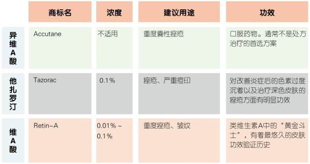

- **非处方**：一起去药店吧！阿达帕林最近变为非处方类成分真是让人兴奋。作为 `类维生素 A` 家族的新晋成员，这种 `合成类维生素 A` 已被证明比 `维 A 酸` 更温和，但在改善轻、中度痤疮方面同样有效。甚至有数据表明，它有助于淡化痘印。在使用保湿霜之前涂阿达帕林凝㬵，虽然 `阿达帕林` 比 `维 A 酸` 更温和，但我们依然建议最好将其与好用的舒缓保湿霜搭配使用，以将其造成的干燥感或潜在的刺激性降至最低

  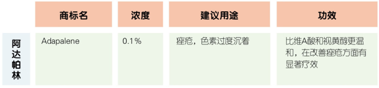

- **护肤品**：让我们去购物！由于 `视黄醇` 和 `视黄醛` 都算不上稳定的活性成分，所以很多公司都开发了各自的不同版本
  以实现三个主要目标，(1)更高的稳定性 (2)更低的刺激性 (3)更长的有效期。在这些新一代 `类维生素 A` 中最受关注的是 `羟基频哪酮` 和 `补骨脂酚`（一种植物基成分）。下表展示了各成分经初步测试有效的浓度水平，但我们不得不指出，包括这两种成分在内的所有新型活性成分仍然需要大量的数据，以便我们真正了解其工作机制以及随之而来的护肤功效。虽然还没有最终结论，我们还是推荐无法使用视黄醇和视黄醛的人群尝试这些替代品。和视黄醇相比，视黄醛实际上更有效。遗憾的是，你很难找到视黄醛这种成分，因为它比视黄醇更不稳定。因此，在能够从护肤品商店买到的 `类维生素 A` 中，视黄醇是名副其实的“黄金斗士”，并且还有大量数据支持其有效性。长期数据显示，视黄醇能够有效改善皱纹乃至色素沉着问题，但它确实不是个好相处的活性成分，容易导致皮肤泛红、起皮、干燥、刺痛等，所以要想把它加入你的护肤程序中，需要从低浓度开始，循序渐进。一旦了解了自己的皮肤对视黄醇的反应，你将享受所有功效

  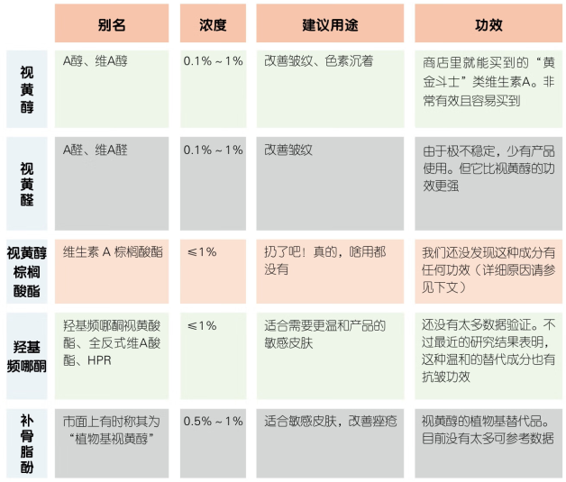

> [!IMPORTANT]
>
> 补充：`视黄醇棕榈酸酯` 其实就是 `维 A 酸` 和 `棕榈酸` 的结合体。当视黄醇过剩时，皮肤就会自然
> 地将其以视黄醇棕榈酸酯这种“休眠”形式储存起来。视黄醇棕榈酸酯之所以引人关注，是因为它比视黄醇稍微稳定一些，因此很容易进行复配，但这也是它的唯一优势。视黄醇棕榈酸酯很难给皮肤带来 `类维生素 A` 的战斗力，因为它的皮肤渗透性不太好。更糟糕的是，它到达 `维 A 酸` 受体的过程要久得多：必须先从视黄醇棕榈酸酯转化为视黄醇，然后转化为视黄醛，最后转化为 `维 A 酸`。所以，它被认为是市面上功效最弱的 `类维生素 A`。视黄醇棕榈酸酯是视黄醇的前体，它没有真正的生物活性，只是视黄醇过多时的一种储存
> 形式，这家伙是 `类维生素 A` 大家族中功效最低的一个。

> [!IMPORTANT]
>
> 补充：不要被“化妆品级”的说法骗了，视黄醇实际上是一种强效分子。它虽然在护肤品中炙手可热，但你需要下一番功夫才能从鱼目混珠的产品中辨别出好的产品。最重要的考量之一是视黄醇不是一种很稳定的分子（这是整个 `类维生素 A 家族` 的大问题），视黄醇对光、空气、热非常敏感。将含有视黄醇的产品暴露在这样的环境中可能会导致视黄醇过早失活，使它根本来不及对你的皮肤发挥作用。
>
> 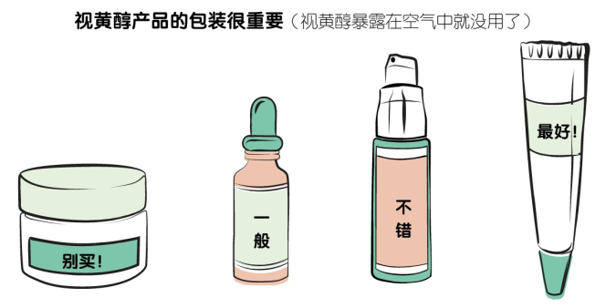
>
> - **包装**：包装是选购视黄醇产品的一个决定性的因素，因为包装可以尽可能减少产品与空气接触，并防止产品暴露在光照下，从而保证产品的正常保质期。带有细小管口的铝管包装的氧气暴露量最少，是最好的包装形式；其次是真空泵瓶；滴管瓶就很一般了，虽然它可以减少光照，但每次你打开瓶子的时候产品还是会暴露在空气中；普通罐装绝对不行
> - **搭配**：读到这里，你应该可以看出“浓度是关键”是我们最喜欢的“化学家十诫”之一，它尤其适用于视黄醇这样的强力活性成分。选择清楚注明视黄醇浓度（我们建议最好是 `0.1%~1%`）的产品。另外，注意寻找好的辅助成分。烟酰胺是另一种受化学家们欢迎的活性成分，它已被证实可以降低视黄醇的刺激性。我们喜欢这两者结合的产品
> - **储存**：所有不稳定的活性成分都可以考虑“吸血鬼”储存法：将类维生素 A 储存在凉爽、黑暗的地方，避免阳光直射以延长保质期。
> - **使用**：视黄醇的最佳使用浓度是 `0.1%~1%`。最重要的是尽量减轻使用它所导致的皮肤脱皮、敏感和泛红的痛苦，一般的方法是循序渐进。如果你是新手，从 `0.1%~0.3%` 浓度的视黄醇用起。每周试着使用 `2~3` 次，并观察皮肤的反应。如果有轻微的脱皮或泛红，但没有长时间的刺痛感，就可以继续使用。记住每个人的皮肤是不同的，因此对成分的耐受性也不同。有些人可能需要连续数年使用 `0.1%` 的浓度，然后才能开始慢慢提高浓度

##### 4.3.1.3.具体用法

- 新手：从 `0.1%~0.3%` 的浓度开始。每周使用 `2~3` 次，直到你的皮肤适应
- 老手：你已经用到了 `0.5%~1.0%` 的浓度。不过，在皮肤适应之前，还是先从每周使用 `2~3` 次开始
- 敏感：有时候敏感皮肤就是用不了视黄醇！寻找替代品吧，比如羟基频哪酮或补骨脂酚
- 痤疮：去药店找非处方类合成 `类维生素 A —— 阿达帕林`

#### 4.3.3.维生素 C

##### 4.3.1.1.理论解析

护肤品行业中的 `维生素 C 类` 产品已经多到让人觉得品牌方在这一领域里已经做不出什么新花样了。事实上并不是这样！`维生素 C` 是护肤界的“全能选手”。几十年的临床试验证明，`维生素 C` 能够有效抑制自由基、促进㬵原蛋白合成并提亮肤色。当然，`维生素 C 类` 产品并不像看上去那么简单。你知道护肤品中含有多种 `维生素 C 类` 成分，并且这些成分并不相似吗？你知道优质的 `维生素 C 精华液` 闻起来像热狗吗？好吧，让我们深入研究一下这个化学家最喜欢的护肤成分！

维生素 C（抗坏血酸）对皮肤有三个主要作用：预防衰老、改善肤色不均、减少细纹皱纹。总的来说，`维生素 C` 是一种非常有效的局部抗氧化剂。

抗氧化剂（`AOX`）在美容和食品行业中都快要被说烂了，但大多数人并不理解它的真正含义。抗氧化剂是防止自由基造成氧化损伤的成分。听起来是不是很熟悉？如果你回头看看有关防晒的部分（参见此处），可能就能想起自由基了。问题是，自由基无处不在。它们甚至在人体自身的细胞功能中发挥着重要作用。但就皮肤而言，自由基是一种高度活性分子，因阳光照射、`红外线 A`、香烟烟雾、压力等因素而产生。给你讲个故事来解释自由基对细胞的损伤，怎么样？

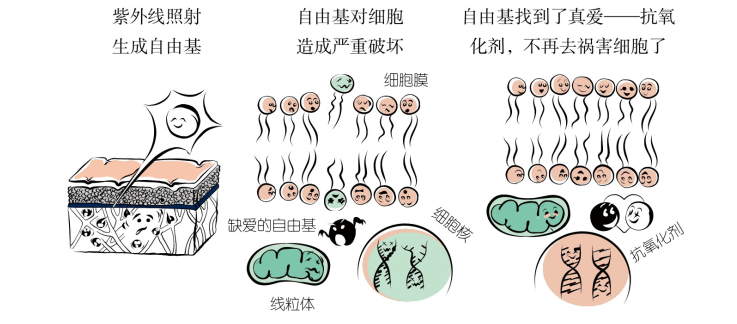

很久以前，过多的阳光导致皮肤中产生了自由基。自由基非常不稳定，时刻都在想方设法找到自己丢失的电子，与之重新结合。于是，它们对皮肤细胞及其主要组成——细胞核、线粒体和细胞膜大打出手，导致皮肤细胞死伤惨重。自由基直到找到了抗氧化剂才平静下来，皮肤细胞和整个皮肤王国终于迎来了和平、宁静。

> [!IMPORTANT]
>
> 补充：趣味知识！早在 `维生素 C` 被用于护肤之前，`18` 世纪的航海者就发现足量摄入水果可以预防坏血病。事实上，“抗坏血酸（`ascorbic acid`）” 这个名词正是来源于坏血病的拉丁名 `scorbutus`。`维生素 C` 在 `20` 世纪初被鉴定、分离、合成。然而，直到 `20` 世纪 `90` 年代初，`维生素 C` 才开始进入护肤品领域。`1992` 年，修丽可（`Skinceuticals`）的创始人谢尔顿·皮纳尔（`Sheldon Pinnell`）博士率先研制出了著名的维生素 CE 阿魏酸复合修护精华液，并获得了专利（现已过期）。自那时起，`维生素 C 精华液` 就成了许多人抗衰老护肤程序中的 “常驻嘉宾”。

> [!IMPORTANT]
>
> 补充：日本有一类产品叫作“药用化妆品（`quasi-drugs`）”。在我们看来，这一类别的出现是因为有人曾说：“就功能而言，它有点像药物，但我们真的不想处理批准万艾可之类的东西所需的大量文书工作。”对于消费者来说，这意味着这一类产品比普通的化妆品拥有更多的测试及功效验证。在日本，美白产品非常受欢迎，且属于“药用化妆品”类别。其中，`维生素 C` 及其一些衍生物也因为非常有效而成为这一类别中的“重量级选手”。所以，心有疑虑的人不妨记住，这一类成分在日本是获得批准的！

我们的皮肤拥有自带的天然抗氧化剂：`辅酶 Q10、谷胱甘肽过氧化物酶、超氧化物歧化酶、维生素 E、尿酸、类胡萝卜素、黑色素、维生素 C`。听起来耳熟吗？没错，你也可以在护肤品中找到这些东西。这会让你自然而然地认为，所有在皮肤中发现的东西都对皮肤护理有好处，但事实并非如此。所有这些活性物质都需要经过测试，才能被证明确实能够渗透到目标部位并给皮肤带来益处。这就是 `左旋维生素 C（L-AA，即纯维生素 C）` 是最好的护肤类抗氧化剂的原因，它也是少数被证明具有局部抗氧化作用的成分之一。

`维生素 C` 不仅是一种抗氧化剂，还是一种极好的亮肤成分。万能的 `维生素 C` 还被证明不管是单打独斗还是与其他提亮成分配合使用，都可以有效改善黄褐斑及色素过度沉着。

此外，这种多功能分子甚至被证明可以促进㬵原蛋白合成（至于为什么，你应该关心㬵原蛋白，参见此处）。其实，鲜有成分能被证实可以促进㬵原蛋白生成。㬵原蛋白是皮肤结构完整性的支柱，所以，这就解释了为什么维生素 C 还能帮助减少细纹和皱纹。

简言之，`L-AA` 提供的三个主要好处是光保护、提亮肤色、促进㬵原蛋白生成。有了这三个好处，`L-AA` 不仅可以预防衰老，还能直接对抗衰老。它既能在短期内明显地提亮肤色，还拥有长期抗衰老的功效。

> [!IMPORTANT]
>
> 补充：人类和豚鼠都属于少数不能自己制造 `维生素 C` 的哺乳动物，这就是富含 `维生素 C` 的饮食如此重要的原因。

##### 4.3.1.2.核心成分

在我们开始之前，这里有一个快速解读成分标签的小提示。如果你不确定哪些成分是 `维生素 C 家族` 的，找名字里有 “抗坏血” 三个字的成分就行了。没错，`维生素 C` 实际上是整个分子家族的总称。我们刚才所说的那些好处呢？实际上说的是 `L-AA`。你其实能在护肤品中找到很多其他 `维生素 C 衍生物`。到目前为止，这些衍生物的功效都比不上 `维生素 C`。但是，其中有些还是很不错的，很适合想要尝试更稳定、更温和的 `维生素 C 类成分` 的人。如果你对 `维生素 C 衍生物` 感到好奇，这就来啦。

`维生素 C` 有“三宝”（好处），(1)提亮 (2)光保护 (3)促进㬵原蛋白生成，我们可以据此来区分这些衍生物。当然，还有很多好处没有列出，但这三种是最常见的，下次你选购 `维生素 C` 产品时就会发现。`L-AA` 的 `pH` 值较低，所以即使是 `5%` 的低浓度也不是所有人都能适应。下页的表格可以帮你寻找能有效替代 `维生素 C` 的 `维生素 C 衍生物`。

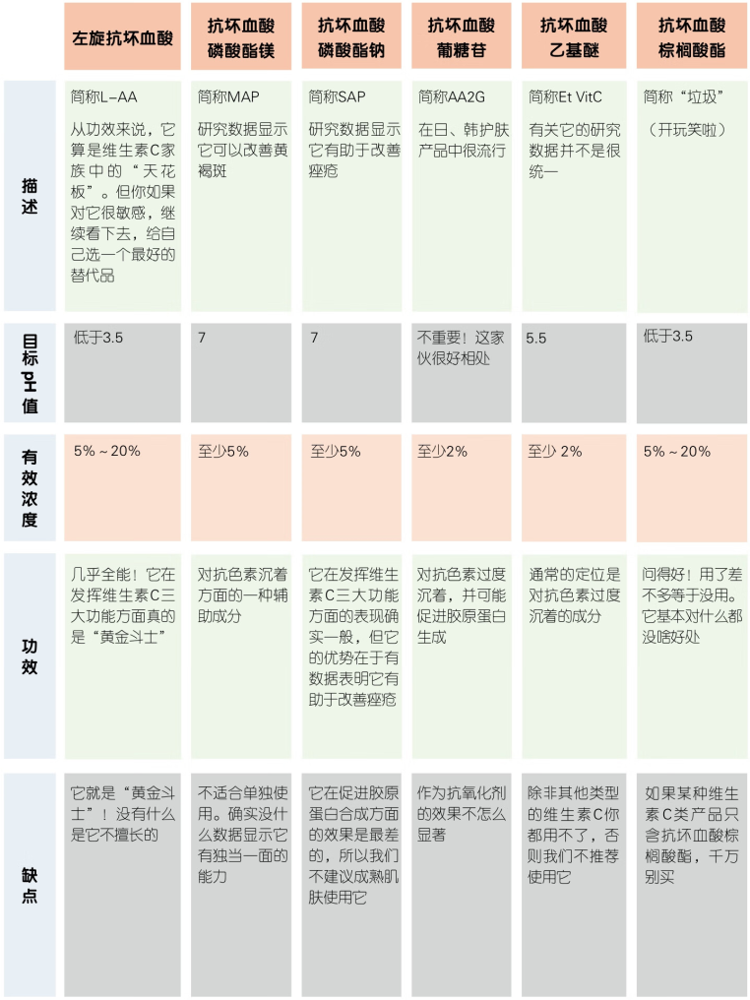

> [!IMPORTANT]
>
> 补充：认识 `维生素 C` 的最佳搭档：`维生素 E` 和阿魏酸。你有没有想过为什么 `维生素 C` 要和 `维生素 E` 及阿魏酸搭配使用？`维生素 E（成分名为生育酚）` 和阿魏酸也是抗氧化剂，三者可以产生协同效应。在 `维生素 C 精华液` 中加入 `维生素 E` 和阿魏酸，不仅可以减缓 `维生素 C` 降解，还可以增强配方整体对抗自由基的能力。除了这些积极的副作用，这种搭配在嗅觉方面还有一个比较奇怪的副作用，肉味。没错，这并不是你的错觉。谁能想得到呢？“青春之泉”闻起来竟是一股热狗味！

##### 4.3.1.3.具体用法

`L-AA` 类产品非常不稳定。三大因素，阳光、水、氧气极易加速 `L-AA` 降解，更别说还有温度能够加速 `维生素 C` 降解的整个过程。所以，这意味着我们化学家必须在 `维生素 C` 的配方上多一些创意。这就是你能在市面上找到各种各样的 `维生素 C` 产品的原因。

| **类型**               | **不在实验室如何鉴别**                               | **优点**                                                     | **缺点**                                                     | **专业提示**                                                 |
| ---------------------- | ---------------------------------------------------- | ------------------------------------------------------------ | ------------------------------------------------------------ | ------------------------------------------------------------ |
| **传统精华液（水基）** | 成分表第一种成分是水，即为水基精华液                 | 容易上手，最简单，使用方法和所有水基精华一样，推荐大多数人使用 | 保质期不理想，`维生素 C` 稳定性差；需阴暗凉爽处储存，每次用完拧紧瓶盖；闻起来像热狗 | 水基精华液应在洁面后的第一步使用                             |
| **硅基/油基精华液**    | 成分表第一种成分不是水，且含有角鲨烷或硅油等油性成分 | 比水基更稳定，`维生素 C` 以细小 `L-AA` 颗粒悬浮在油中        | 肤感粗糙、偏油腻，不是第一次用就会喜欢                       | 油基是例外，在爽肤水或保湿精华之后使用，避免厚重硅脂阻碍其他成分吸收 |
| **粉类产品**           | 粉状形态本身不难辨认                                 | 目前为止最稳定的类别；按活性成分含量算相对便宜               | 使用时容易弄脏梳妆台                                         | `L-AA` 水溶性，溶解到爽肤水或精华液中使用效果最佳；务必快速核对成分表 |

> [!IMPORTANT]
>
> 补充：不管你选择什么样的产品，稳定性都是最重要的。把产品放在容易遗忘的角落，直到春季大扫除才发现，我们也干过这样的事。但是，`维生素 C` 是一种开封后就应该尽快用完的产品。刚开始它应该是淡黄色，即使变得有点像橘色，它仍然是有效的，但这是在提醒你快点用完。和上等威士忌的颜色一样了？那么就换新的吧。

如果你不知道如何开始，或者在 `维生素 C` 之旅中感觉有点找不着北，不妨考虑以下问题它应该用在护肤程序的哪一步？`维生素 C` 应该用在你早上洁面后的第一步——在使用保湿霜和防晒霜之前用。如果你原意，也可以晚上使用它！刚开始用什么好？可以从 `5%` 的低浓度 `L-AA` 精华液开始。

准备好升级了？试试 `L-AA` 浓度为 `15%` 的经典 `维生素 C`、`维生素 E`、阿魏酸复配精华液。`15%` 会不会刺激性太强了？别担心！`5%` 的 `L-AA` 精华液依然是有效浓度。如果你觉得 `5%` 还是很刺激，那么是时候寻找其他 `维生素 C 类分子` 了。

你最关心的皮肤问题是抗衰老吗？建议你尝试抗坏血酸磷酸酯钠。你最关心的皮肤问题是色素沉着吗？建议你尝试抗坏血酸葡糖苷。

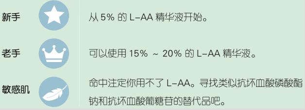

#### 4.3.4.烟酰胺

##### 4.3.1.1.理论解析

快看看你所有护肤品的成分表。你可能会震惊于烟酰胺在你的日常护肤中出现的次数。烟酰胺是 `维生素 B3`，也叫 `维生素 PP` 的一种衍生物，对皮肤的好处不胜枚举。几十年来，它一直默默扮演着辅助性的配角，但近年来它终于得到了应有的关注。虽然并非烟酰胺的所有作用机制都已被完全了解，但人们已经发现它可以帮助控油、强化皮肤屏障，甚至对抗色素沉着。下面，让我们一起来认识一下护肤界的终极活性 “变色龙” 烟酰胺。

烟酰胺很容易复配，所以各类产品中都常常添加这种活性成分作为一种“保底功效”。近年来随着烟酰胺越来越受欢迎，各类产品——精华液、修复液、保湿霜，甚至身体乳中都出现它的身影。这很棒，因为烟酰胺的功效可不少。但是，很多产品中都有烟酰胺，所以它的实际用途令人十分费解。因此，要想好好地利用烟酰胺，首先要弄清楚它到底是干什么用的。

烟酰胺是怎样发挥作用的？这一机制尚未被彻底理解，但不乏一些令人欣喜的发现。你应该注意到了，书中几个部分的主基调都很统一，化学家最喜欢的活性成分都是多功能的。烟酰胺当然也不例外。

遗憾的是，与其他活性成分相比，对烟酰胺在“皮肤生物学”方面的研究不是很详尽。科学实际上是相当复杂的。烟酰胺与新陈代谢直接有关（还有人记得高中生物里的卡尔文循环吗？）。简单来说，这意味着烟酰胺碰巧与很多生物途径有关。不仅如此，它的抗糖化功效也被广泛研究。

糖化是一种涉及游离糖的反应，该反应最终会生成晚期糖基化终末产物（英文缩写为 `AGE`，有衰老的意思）。而且，这个首字母缩略词正如字面上看起来一样吓人，因为这些 `AGE` 会削弱皮肤组织的弹性，影响血管、肌腱和某些特定疾病。

##### 4.3.1.2.核心成分

| 成分   | 特点                                                         |
| ------ | ------------------------------------------------------------ |
| 烟酰胺 | （1）烟酰胺能加强健康的皮肤屏障并改善肤质。研究表明，面霜的烟酰胺浓度只需达到 `2%` 就能长期改善皮肤含水量和皮肤整体屏障功能。这对大干皮的人来说真是个天大的好消息 （2）增强皮肤屏障功能意味着你的皮肤即便在寒冬也能更好地锁住水分。目前的普遍理论是，烟酰胺能够促进角蛋白和神经酰胺的合成，这两种物质都对健康的皮肤屏障有重要作用。烟酰胺是一种油性皮肤调节剂。控油是件非常令人沮丧的事，因为几乎没什么东西能够做到长期控油。事实上，大多数控油产品都只是利用吸油粉控油。好消息！烟酰胺正是少数几种只要坚持按照 `2%~4%` 的局部浓度使用就能够长期调节皮脂状态的成分之一。这其实也在意料之中，还有研究表明，烟酰胺能够有效改善痤疮，甚至还能收敛毛孔。烟酰胺是如何做到这一点的还不太清楚。皮脂的产生是一个复杂的过程，最近有一些研究试图了解烟酰胺在这个长达 `10` 页的生物途径中的哪一步发挥了作用，我们期待结果能早日揭晓 （3）烟酰胺可以帮助解决讨厌的色素沉着。临床研究证明，烟酰胺可以在低至 `2%` 的局部浓度下有效地改善色素沉着。烟酰胺针对的生物途径使得它的提亮功效很特殊。大多数用于提亮的超级明星成分，对苯二酚、曲酸和 `维生素 C` 的角色是酪氨酸酶抑制剂，但是烟酰胺和它们不同，烟酰胺其实是在更后面的步骤中发挥作用以阻止色素转移的。它以黑素小体为目标，阻止这些细胞转移色素。也就是说，烟酰胺和其他超级明星成分不是竞争关系，而是协同关系，可以让产品事半功倍。好处真不少，是吧？它还能更好。从化学家的角度来看，在所有的活性成分中，烟酰胺是最温和的一个，也就是说，用它配制任何产品都很容易，面霜、凝㬵、精华液、爽肤水都行。所以，在日常护肤中加入烟酰胺基本上能让所有人获益。那么，让我们看看如何在日常护肤中最好地利用这种“宝藏”成分吧   烟酰胺已被证明只需 `2%` 的浓度即可生效，但其实很多测试是在 `4%` 的浓度下进行的，所以对于大多数人来说，浓度为 `4%~5%` 的烟酰胺产品是不错的选择。如果你是敏感肌，`2%` 的烟酰胺浓度是很好的起点。由于烟酰胺与大多数活性成分复配良好，所以很多品牌都会直接将其添加到各种产品中。一定要记得查看你看中的产品的成分列表，以便大致了解你现在的护肤程序中已经使用了多少烟酰胺。 |
| 泛醇   | 最近，一些品牌开始推销烟酰胺浓度为 `10%` 或更高的精华液产品。这着实有些过犹不及了！虽然烟酰胺很温和，但如果添加到完全没有必要的高浓度，它一样会对皮肤产生刺激。请谨慎决定是否要使用这些高浓度的产品。当我们谈到皮肤护理的 `ABC` 时，`B` 通常指的是 `维生素 B3` 的衍生物，烟酰胺。但是，护肤界还有另一种值得注意的 `B 族维生素`。我们在保湿那一部分曾提到过 `维生素原 B5 泛醇`，它就是一种很好的保湿成分，具有多种补水功效 泛醇有个特质，它是一种非常黏稠的物质！所以，含有大量泛醇的面霜通常非常厚重、黏腻。幸好低剂量的泛醇也是有效的，你可以把它看作保持皮肤稳定和滋润的一点额外补充。总而言之，虽然泛醇和烟酰胺都属于 `B 族维生素` 的衍生物，但它们的作用天差地别，不过它们都能很好地与其他成分搭配使用，对你的皮肤屏障大有益处 |

烟酰胺似乎真的无所不能：它可以为干燥、受损的皮肤巩固健康的皮肤屏障，帮助油性皮肤控油，甚至有助于解决讨厌的色素沉着和肤色不均的问题。所有这些功效都只需要 `2%~5%` 的浓度。那么，我们该如何在护肤程序中加入这种成分呢？检查你现在的护肤程序先查看你已有产品上的标签，你可能会惊讶地发现不少护肤品中都含有这种成分。在护肤程序中融入烟酰胺的关键在于确保你最终没有叠加使用过多的烟酰胺。烟酰胺实在是太多才多艺了，以致你很容易过度使用它，甚至可能没注意到脸上的 `8` 层产品都含有烟酰胺。在你的保湿霜中加入烟酰胺，烟酰胺的优点之一就是能和所有成分和睦相处。与其在护肤程序中使用单一的烟酰胺精华液，不如试一下化学家最喜欢的做法——把烟酰胺加到保湿霜里，这还可以节省一步护肤程序呢。时间就是金钱啊！

##### 4.3.1.3.具体用法

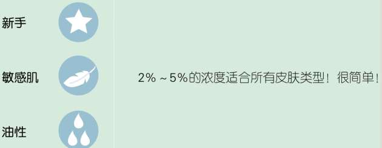

### 4.4.其他种类

护肤品行业一直在搜寻下一个“奇迹”成分。除了我们刚刚讨论过的“四巨头”之外，还有成千上万的活性成分正在以“你必须拥有的青春之泉”为卖点来营销（当然还有一大波正在赶往营销的路上）。这种情况就很复杂了。这些成分覆盖了从有效植物性成分到纯蛇油的所有类别，如各种各样的植物性成分，甚至胎盘这样奇异的东西！这个类别的信息纷繁复杂，让我们一起捋一捋，看看这座“秘密花园”里究竟有些什么。

| 成分                       | 抗衰老             | 舒缓               | 抗氧化             | 保湿               | 改善痤疮          | 皮肤功效                                                     | 产品提示                                                     |
| -------------------------- | ------------------ | ------------------ | ------------------ | ------------------ | ----------------- | ------------------------------------------------------------ | ------------------------------------------------------------ |
| 蜂毒                       | 广泛证实，需多验证 | x                  | x                  | x                  | **x，但很有潜力** |                                                              |                                                              |
| 咖啡因                     | 广泛证实，需多验证 | x                  | x                  | x                  | x                 | 它虽是“网红”，但不算是很好的成分。咖啡因是护肤品中相当普遍的一种成分，但意外的是并没有什么数据表明它有很多功效。所以，别太相信咖啡因眼霜的宣传，对含咖啡因的纤体身体乳更是要打一个大问号 |                                                              |
| 积雪草                     | x                  | 广泛证实，很有潜力 | x                  | x                  | x                 | 这种神奇的舒缓成分甚至对伤口愈合有一定的功效                 | 这是一种热门成分，你会发现许多舒缓类精华液和面霜都以它为主要成分。但复杂的是，很多成分都来自积雪草，这些成分有的是直接提取物，有的是经过分离得到的化合物（如羟基积雪草苷）。以下是我们对这些成分的总结，你可以选用含有我们所推荐成分的精华液或保湿霜，且该成分需要位于成分表的前半部分 - 选这些：羟基积雪草苷、积雪草皂苷、积雪草酸、羟基积雪草酸 - 别选这些：积雪草提取物、积雪草汁 |
| 辅酶 Q10（CoQ10）           | x                  | x                  | 广泛证实，很有潜力 | x                  | x                 |                                                              |                                                              |
| 表皮生长因子               | 广泛证实，需多验证 | x                  | x                  | x                  | x                 | 表皮生长因子（EGF，别名“丁丁美容”）年，EGF 开始流行，一部分原因是这种面部美容方式在好莱坞明星中非常盛行，还有部分原因是它有个相当糟糕的绰号（我们知道你一定很好奇）。根据网上的说法，它的秘密成分是刚做过包皮环切手术的婴儿的包皮干细胞（这就是你们想要的答案！）。保险起见，让这阵风再刮个 5 年，看看它是否能得到真正可靠的科学支持，然后再考虑是否“上车” |                                                              |
| 半乳糖酵母样菌发酵产物滤液 | 广泛证实，需多验证 | x                  | x                  | x                  | x                 | 半乳糖这又是什么？这种成分实际上正是 SK-II 公司著名的专利成分“Pitera”的真面目。你也可以在很多韩国美妆产品中找到它。这也是一种令人困惑、功效全面的成分。根据现有的临床证据，它的主要功效是通过调节皮脂生成来使肤质变得细腻光滑 | 它需要排在成分表的前 `4` 位，这样才能保证其添加浓度足以生效 |
| 洋甘菊                     | x                  | 广泛证实，很有潜力 | x                  | x                  | x                 | 这种植物性成分的主要作用是舒缓皮肤。有趣的是，有些研究表明它还可以缓解色素过度沉着。总之，它是个很棒的辅助成分（趣味知识！成分表中的大多数植物性成分都是亲水性的，但是洋甘菊是一种独特的、具有清淡怡人香气的深蓝色精油） | 一定要找含有红没药醇而不是洋甘菊提取物的产品。红没药醇可能没有其他流行的竞争对手那么引人注目，但它是经过长期验证有效的可靠成分！洋甘菊是油性的，所以你会在很多舒缓保湿霜中看到它 - 选这些：红没药醇 - 别选这些：洋甘菊花精油 |
| 绿茶提取物                 | x                  | 广泛证实，很有潜力 | x                  | x                  | +                 | 你可能也发现了很多产品都有关于绿茶提取物的神奇功效的宣传语。但事实是，临床测试显示绿茶提取物只有两种功效，舒缓和抑制炎症性痤疮（这点很意外）。很多产品都吹捧绿茶含有抗衰老成分，具有各种绝妙的抗氧化功效。但这点尚未在体外试验之外获得证实 | 个问题很难回答！很多来源不同的绿茶提取物的成分名称完全相同，这有点像看看谁用的绿茶成分的形式最有效的竞猜游戏 - 选这些：表没食子儿茶素没食子酸酯（`EGCG`）、位于成分表的前半部分的茶树叶提取物 - 别选这些：茶树叶汁 |
| 乳酸杆菌发酵产物           | 广泛证实，需多验证 | x                  | x                  | x                  | x                 | 它和其他相关的乳酸菌成分是“改善皮肤微生物群”的宣传语中最常提到的一些成分。最好把它看作一种拥有强大屏障功能的辅助成分，它可以帮助你的皮肤长期锁住水分 |                                                              |
| 硫辛酸                     | x                  | x                  | 广泛证实，很有潜力 | x                  | x                 |                                                              |                                                              |
| 低分子量透明质酸           | 广泛证实，很有潜力 | x                  | x                  | **x，但很有潜力**  | x                 | 作为一种颇受欢迎的保湿成分，透明质酸通常是一种非常大的分子，它位于皮肤表面，能够锁住水分。不过有一些抗衰老产品使用了小得多的透明质酸，并将其定位为一种抗衰老成分，依据是更小的透明质酸能更深入、更有效地使皮肤丰满起来。确实有很多数据支持这一说法。它的缺点？有些人会对它有些敏感。所以，使用前一定要进行斑贴试验 |                                                              |
| 麦卢卡蜂蜜                 | x                  | 广泛证实           | x                  | 广泛证实，很有潜力 | x                 |                                                              |                                                              |
| 水飞蓟                     | x                  | 广泛证实，很有潜力 | 广泛证实，很有潜力 | x                  | x                 | 这是最有趣的植物性成分之一！它对局部皮肤的功效有大量数据支持，事实上，有一项研究表明局部外用 `1.4%` 的水飞蓟素产品可以减轻色素过度沉着，其效果与抗色素成分对苯二酚的效力相当。甚至有一项研究证明它能够针对糖化途径起到强力的抗衰老作用 | - 选这些：水飞蓟提取物、水飞蓟果提取物 - 别选这些：水飞蓟籽油 |
| 肽（胜肽）*                | 广泛证实，很有潜力 | 广泛证实，很有潜力 | x                  | x                  | x                 | 从消费者的角度来考虑，这是一个很难说清楚的成分。它的抗皱功效有很多有趣的数据支持，但这些数据通常都受专利保护，而且对于外行来说很难解读 | 如果想尝试此类产品，我们的建议是选其中研发更成熟的成分，如基肽（`Matrixyl`）和黑洛西（`Haloxyl`） |
| 蜂胶提取物                 | x                  | x                  | x                  | 广泛证实，很有潜力 | x                 |                                                              |                                                              |
| 蜂王浆                     | x                  | x                  | x                  | 广泛证实，很有潜力 | x                 |                                                              |                                                              |
| 超氧化物歧化酶（SOD）      | x                  | x                  | 广泛证实，很有潜力 | x                  | x                 |                                                              |                                                              |
| 蜗牛黏液                   | 广泛证实，需多验证 | 广泛证实，需多验证 | x                  | 广泛证实，很有潜力 | x                 | 据说蜗牛黏蛋白能治疗痤疮、消除皱纹、改善肤质、补水，并且搞不好还能带来世界和平？事实是，并没有任何科学研究支持这些说法。它作为额外添加的保湿剂还不错，但不管怎么说它都算不上必须拥有或必须尝试的成分 | 嗯，如果你想要更明显的功效，还是去别处看看吧。不过，我们强烈建议大家看看黏蛋白是如何提取出来的，那是个相当有趣的视频 |
| 姜黄                       | x                  | 广泛证实，很有潜力 | 广泛证实           | x                  | x                 | 姜黄在印度传统医学中经常用到，它似乎在所有方面都有功效，据说它能抗氧化，舒缓皮肤，对抗色素沉着、痤疮丙酸杆菌，你能想到的方面它都有。从现代临床研究来看，姜黄在作为舒缓剂方面的效用最好，它也可能有抑制炎症性痤疮的功效（对抑制炎症性痤疮这点请持保留态度） | 经过分离的化合物和提取物比精油的浓度更高、刺激性更低（选这些：四氢姜黄素、四氢姜黄素二乙酸酯、姜黄根提取物。别选这些：姜黄精油） |

> [!IMPORTANT]
>
> 补充：上面表格中 `x` 代表尚无证实，而其中的肽取决于肽的种类，并不是所有肽的功效都是一样的！

> [!IMPORTANT]
>
> 补充：我们认为，舒缓成分就是视黄醇、甘醇酸这类强力、速效的活性成分的重要对抗者。皮肤受到过度刺激会出现反复的炎症和干燥，这些对皮肤的长期护理十分不利。所以，护肤程序中有一些好的舒缓成分是很重要的。除了植物提取物外，我们还推荐你尝试一下尿囊素和㬵态燕麦粉，它们其实是经 FDA 认可的非处方类成分，具有皮肤保护剂的功能。经证实，积雪草、洋甘菊和水飞蓟都有一些额外功效，如抗氧化或提亮肤色。

> [!IMPORTANT]
>
> 补充：其他活性成分主要来自哪里？
>
> - 植物：洋甘菊、姜黄、积雪草...
> - 微生物：乳酸菌、半乳糖酵母样菌发酵产物滤液...
> - 动物：蜗牛黏蛋白、羊毛脂、蜂类产品...
> - 蜂类：
>   - 麦卢卡蜂蜜：因可促进伤口愈合的特性而广受欢迎，但这种受欢迎只是为了给它在护肤品市场上的名气造势，所以别太把它当回事
>   - 蜂㬵：被韩国美妆市场炒热的成分。大多数研究都是在体外、动物或开放性伤口试验中进行的，我们不清楚这种成分对皮肤有什么实际影响
>   - 蜂王浆：用于保湿
>   - 蜂毒：常被定位为抗衰老成分，少数有趣的临床研究使用蜂毒治疗痤疮。说到底，它仍然是相当神秘的成分，它的很多数据都是受专利保护或保密的

> [!IMPORTANT]
>
> 补充：抗氧化剂是一类时尚的护肤成分，它的灵感往往来自食品。这导致护肤品中常常含有各种各样的植物性抗氧化成分，包括常见的蓝莓提取物及其他怪异的成分。别忘了，抗氧化剂的首选还是 L-AA，但还有一些替代品也值得留意！我们的建议是每天早上护肤时使用抗氧化剂，并且用在防晒霜之前
>
> - 白藜芦醇：它是在葡萄中发现的抗氧化剂。许多品牌标榜自己的产品含有白藜芦醇，但真实添加量并不足以产生任何实际效果。可以选择具有更多皮肤科学背景的品牌，且产品中白藜芦醇的浓度要达到 0.5%左右
> - 硫辛酸：一项权威的研究表明 5%的硫辛酸可以有效地减少光老化的痕迹。鉴于硫辛酸需要高浓度才有效，我们不建议选择硫辛酸排在成分表第 5 位之后的产品
> - 辅酶 Q10：它也被称为泛醌，是人体细胞功能中自带的且不可分割的一部分，是皮肤抵御外部干扰的天然防御系统的重要组成部分。辅酶 Q10 的局部外用浓度需要达到 0.5%，而且最好与维生素 E 搭配使用
> - 超氧化物歧化酶：它也是一种酶，是人体自带的抗氧化防御系统的一部分。虽然它是一种很流行的成分，但我们还在观望中。它具有促进伤口愈合和舒缓的特性，但这些数据均来自受损皮肤，目前它的美容功效尚未完全明确。不管怎么说，它不是我们首选的护肤抗氧化剂

最好把这些活性成分看作最佳配角，虽然它们在特定问题方面的功效可能不如“四巨头”成分，但它们提供的间接好处可能有助于舒缓皮肤或增强核心有效成分的功效。在查看成分表时，请记住以下 5 点：

- 分子 > 提取物 > 汁。一般来说，我们按照这种顺序进行有效性排名。举个例子，如果你想找一款舒缓、抗炎的植物性产品，那么比起洋甘菊提取物，我们更推荐含有红没药醇（洋甘菊提取物中的有效护肤成分）的产品。同理，你如果看中了积雪草的舒缓功效，最好选择羟基积雪草苷，积雪草提取物也可以，但是最好不要选积雪草汁
- 浓度！浓度对提取物来说同样重要！但提取物的浓度通常参差不齐。一般来说，产品所宣称的提取物至少应该排在成分表的前半部分。清楚地标明成分的品牌值得加分！要的就是透明
- 谨慎对待“富含 xyz”的提取物！在前文中，我们用一些数学题说明了我们为什么最讨厌这种宣传语。“富含……”这类宣传语听起来很不错，但稍加审视就会发现它其实没什么内涵。“富含维生素 C”和“5%L-AA”就是不一样
- 鸡尾酒效应。通常，搭配使用有效成分会产生协同效应。（比如，你可能觉得搭配使用两种有效成分会得到 1+1 = 2 的功效，但协同效应的存在意味着结果可能是 1+1 > 2）。这就是我们喜欢那些对其专利混合物做了临床试验的品牌的原因
- 不要轻信最新潮流。有很多领域都在进行激动人心的新研究，皮肤微生物群就是其中之一。但是，产品通常比科学超前 3 步！如果你发现市场上出现了一个前所未有的护肤新潮，我们通常会建议你等待数据更可靠的第 2 代或第 3 代

> [!IMPORTANT]
>
> 补充：护肤品行业一直在追逐最新、最棒、最吸引人的新潮流。这点我们懂，这正是选购护肤品的乐趣之一。不过，让我们对这些新潮流做个化学家取样测试，看看哪些是“潜力股”，哪些只是“高纯度废话”。我真的应该担心吗？很大一部分新潮流都源于恐吓心理战术。例如，“你知道这个东西实际上是在压榨你的㬵原蛋白，导致你的脸早衰吗？别慌，我们给你介绍一个奇迹成分”。有些恐吓确实有据可依，但有些则完全是夸大其词。
>
> 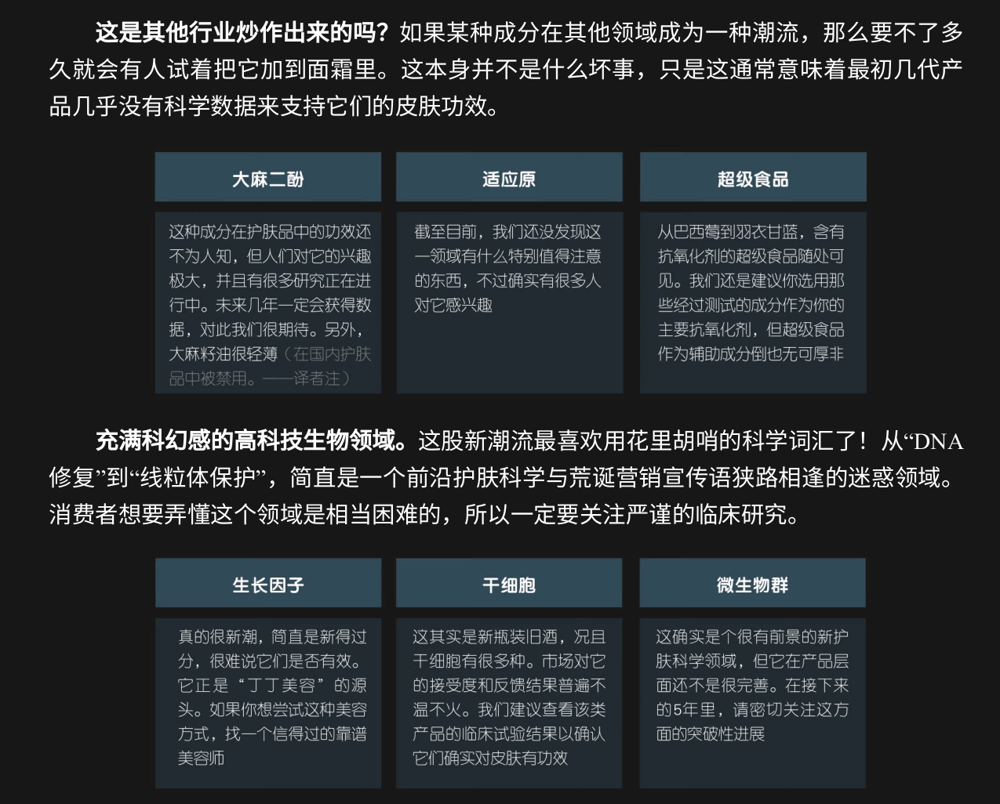

> [!IMPORTANT]
>
> 补充：辟谣！如果看到以下任何一种宣传语，请使劲挑起你高度怀疑的眉毛。任何涉及“细胞改善”或“一晚见效”之类的宣传语都需要谨慎对待。
>
> - 即刻焕活
> - 只需一周即可抹去
> - 岁月痕迹
> - 修复 DNA 损伤
> - 激活能量产品
> - 肌肤即刻亮白
> - 为线粒体供能
> - 24K 肌肤纯享
> - 靶向成纤维细胞

## 5.肤类针对

虽然前面已经详细讲解了三个基础护肤步骤和一些常见的特殊成分，但是针对不同肤质类型的皮肤需要进行针对处理。

### 5.1.中性皮肤

待补充...

### 5.2.油性皮肤

- **寻找平衡点**，油性皮肤很难处理，而且还常常出现过度清洁和保湿不足的情况，需要寻找平衡点
- **洁面啫喱**，油性皮肤人群的最大特点是要么总觉得一天至少要洗 2 次脸，要么就是会用那种洗完后因过分干净而导致皮肤极干燥的洗面奶。但你可能没意识到过度清洁会削弱皮肤的保湿能力，让你的皮肤陷入麻烦。如果你常遇到这个问题，那就试试更温和且用后皮肤不那么干燥的洗面奶吧，2 周之后再评估一下皮肤的反应。这么做你的皮肤很有可能会在午后就开始出油，坚持几周，让皮肤适应一下。椰油酰胺丙基甜菜碱是个不错的起点，它是一种优异的表面活性成分，并且不容易残留在皮肤上
- **水凝霜还是 100% 水基的保湿啫喱呢**，你可能觉得自己并不需要额外的水分，但油性皮肤并不等于水润的皮肤。如果你这样认为，只能说明你还没有意识到皮肤已经处于缺水状态。你一定得用保湿剂 —— 含有最低浓度的轻薄油类或硅树脂的保湿啫喱即可。事实上，硅树脂更温和，能让皮肤呈现一种哑光感。如果你的皮肤特别油或你所在的地方气候非常潮湿，那么 100% 水基的保湿啫喱就可以满足你的补水需求。许多油性皮肤的人都在尝试使用控油类的保湿霜和防晒霜。这些产品通常含有大量吸油粉。虽然这些吸油粉可以让你在晚餐时脸上不泛油光，但这些成分始终是治标不治本。
- **化学防晒霜选欧洲的还是亚洲的呢**，我们一直在提醒大家要用防晒霜，尽管这些唠叨像用指甲刮黑板一样烦人，但防晒真的很有必要。一定要使用化学防晒霜，因为它的质地更轻薄，更适合油性皮肤。亚洲的防晒霜在配方上考虑到了更潮湿的气候，所以有一些很不错的质地轻盈的产品！

### 5.3.干性皮肤

- **诀窍就是叠涂**，这个技巧对于干性皮肤而言就是妙计
- **卸妆油还是洁面膏呢**，干性皮肤人群有项优势，那就是有好几种洁面方式可以尝试。温和的表面活性剂、卸妆油、洁面膏都是不错的起始点，它们既可以温和地清洁皮肤，又不会加剧皮肤干燥。卸妆油和洁面膏还有个加分项，能够轻松卸掉持久型化妆品
- **保湿霜**，不论是霜、油还是油膏，叠涂就是了！对于干性皮肤来说，水基补水产品很重要，但是那些油类和油膏类产品的锁水功能同样重要。所以，你得成为一个叠涂大师。根据经验，第一层永远是水基产品，比如保湿精华水和精华液，然后再叠涂一层更厚重一些的、具有封闭效果的保湿霜。我们建议你手边最好再备一款油膏类产品，以便局部护理那些烦人的、极干燥的地方
- **无酒精的化学防晒霜与物理防晒霜** 小心 “干爽” 或 “哑光” 防晒霜，这类产品往往含有变性酒精和吸油粉等，会让你的皮肤在中午就开始发干。快速浏览一下成分表，确保酒精没排在成分表太靠前的位置。物理防晒霜也值得一试，它们的质地会更厚重。只要记得在皮肤上进行斑贴试验即可，因为并不是所有的物理防晒霜的成分都一样，有些不会让你过敏，其他的则未必

### 5.4.混合皮肤

- **复杂问题复杂解决**，对混合性皮肤人群而言，挑选护肤产品是一件极痛苦的事！既要担心局部起皮，还得防止中午就开始出油
- **温和的洁面啫喱或洁面乳**，对你来说，合适的洁面产品首先应该足够温和，而不是优先强调针对油性区域的强效清洁力，以防刺激你的干性皮肤区域。如果你觉得有必要增强清洁力，可以考虑使用洁面刷
- **低封闭性的保湿霜**，许多“无油”保湿霜实际上还是添加了油性成分，比如二甲基硅油这类的轻型封闭剂。这些水凝霜产品很适合作为主要的轻薄保湿霜使用。可以考虑使用油膏类产品缓解局部干燥。避免各种声称“吸油”的保湿霜，因为它们会使皮肤变得更干燥
- **防晒**，这类产品没有统一的选择标准。找一款足够轻薄、让你能够经常使用的防晒霜，尽量别用那些容易引起干燥的、含有大量酒精或吸油粉的防晒霜
- **值得考虑的关键成分**，有一些成分值得考虑一下。烟酰胺，我们的朋友——烟酰胺不仅能长时间锁住皮肤水分，还能调节皮脂生成，这对混合性皮肤人群来说简直太适合了！杏仁酸，不要担心使用果酸会加剧皮肤干燥的同时还搞不定你的油性区域。杏仁酸的平衡性保持得相当好，既不会刺激干性皮肤，也可以和混合性皮肤友好相处

### 5.5.敏感皮肤

- **大多数人都会经历皮肤刺激**，旅行、天气变化、高浓度的功效护肤成分或单纯的老化都可能使皮肤变得敏感。皮肤受到刺激的典型症状包括持续性刺痛、疼痛、泛红、肤质改变及长痘。在皮肤受到刺激的情况下，比起选用化学去角质成分或 `类维生素 A` 这些更强力的活性成分，最重要的应该是优先处理受损的皮肤屏障
- **可以尝试的舒缓成分**，皮肤保护剂，胶态燕麦粉和尿囊素的口碑一直不错，`FDA` 将它们归类为皮肤保护剂成分。这些成分对于缓解皮肤刺激有长期功效。植物性舒缓剂，护肤品中有很多植物性舒缓剂值得尝试！其中有一些是化学家的挚爱，比如羟基积雪草苷和红没药醇

## 6.常见问题

有时你的皮肤会发生 `180°` 转变：莫名其妙地变得很干，或搬到一个温暖的城市后突然就变成大油皮了。下面我们会介绍一些典型场景，以及我们化学家是如何应对这些恼人时刻的。这部分的重点是让你建立信心，相信自己有能力根据需要调整并重建自己的护肤程序。你就是自己的皮肤专家！

| 洁面过程中或洁面后                                           | 洁面后                                                       | 洁面后                                                       |
| ------------------------------------------------------------ | ------------------------------------------------------------ | ------------------------------------------------------------ |
| 场景一 “好疼”                                                | 场景二 “我感觉皮肤很干”                                      | 场景三 “感觉好像没洗干净或刚洗完没多久又出油了”              |
| 你的皮肤可能只是不喜欢这款产品里的表面活性剂。试试含其他表面活性剂的低 pH 值洗面奶 | 你用的洗面奶的清洁力可能太强了，换一款所含表面活性剂更温和的。可以试试卸妆油或洁面膏 | 你需要清洁力更强的洗面奶。这会有一个试错过程，但从椰油酰胺丙基甜菜碱试起是比较保险的。你也可以试着用清洁设备来提升清洁力 |

| 场景一 “保湿效果不够”                                        | 场景二 “太厚重了，一到下午我的脸就太油了”                    | 场景三 “刚开始感觉挺滋润的，但到了下午就开始发干”            |
| ------------------------------------------------------------ | ------------------------------------------------------------ | ------------------------------------------------------------ |
| 随便叠涂一层保湿精华液或润肤油都可以，视个人喜好而定。如果皮肤出现局部干燥，别忘了你的好朋友——油膏类产品或药用油膏 | 用点轻薄的。看看产品成分表，了解一下保湿剂、油类成分和封闭剂之间的大致比例。选择保湿剂占比更高的产品，比如精华水或啫喱 | 保湿产品的成分比例可能不对。你应该保持同等级别的补水效果，但可能需要更多的柔润剂/封闭剂来帮助皮肤锁住水分 |

| 场景一 “太油腻了”                            | 场景二 “太刺激了”                                            | 场景三 “我觉得我的毛孔都被堵死了，我不想再用它了”            |
| -------------------------------------------- | ------------------------------------------------------------ | ------------------------------------------------------------ |
| 从亚洲和欧盟地区的防晒产品中寻找质地更轻薄的 | 换一个防晒体系吧。如果你目前用的是化学防晒霜，可以试试物理防晒霜，看看你的皮肤有什么反应 | 试试低 SPF 值的产品。找到一款你愿意坚持使用的产品是很重要的，这样你才能从中获得适当的保护 |

| 场景一 “干冷季节”                                            | 场景二 “干热季节”                                            | 场景三 “潮热季节”                                            |
| ------------------------------------------------------------ | ------------------------------------------------------------ | ------------------------------------------------------------ |
| 由于日照较少，又极易引发皮肤干燥，所以这类天气的主题是滋养。此外，日照较少的情况很适合对抗色素沉着。尝试将卸妆油、油膏、针对色素沉着的活性成分加入你在干冷天气下的护肤程序。最好降低你的果酸用量 | 这类天气的复杂之处在于你既需要质地轻薄的护肤产品，也需要补水。过于水基的保湿剂在这种天气下不好使。干热天气时可以尝试一下这些护肤产品：轻薄的物理防晒霜、洁面乳、轻薄的润肤油和 `维生素 C` 精华液 | 水的季节。这种天气是各种功效护肤都可以出色发挥的黄金季节，所以是时候拿出各种各样的抗衰老精华液和精华水了。试试以下产品：轻薄的化学防晒霜、洁面啫喱、保湿啫喱、抗衰老精华液和精华水。中午用胶束水和爽肤水补一下水即可 |

## 7.核心问题

### 7.1.痤疮护理

#### 7.1.1.理论解析

很多人都是因为出现痤疮而开始关注自己的皮肤的。很多人都饱受青春期痤疮的折磨，有同感吗？烦人的是，痤疮甚至会持续骚扰你的皮肤直到 40 多岁。中度到重度痤疮问题需要皮肤科医生帮助才能真正解决。药店里可以帮助你应对痤疮的局部外用药有成千上万种，所以让我们试着去理解这个庞大的品类，过滤掉无益于痤疮的东西，构建一套用于改善痤疮的护肤基本规则。

别信那些说细菌繁殖是导致痤疮的根本原因的鬼话。过去，很多人认为痤疮是由一种叫 **痤疮丙酸杆菌** 的细菌过度繁殖造成的，这种误解导致了各种各样口服或局部外用抗生素的治疗方法。最后，人们发现痤疮丙酸杆菌只是冰山一角，单靠针对痤疮丙酸杆菌的疗法解决不了问题。所以，让我们再深入一点，看看痤疮的主要生长部位，皮脂腺。

皮脂腺对皮肤健康至关重要，因为它们能够分泌抗菌脂质、上调抗氧化剂、维持促炎、抗炎反应、分泌皮脂。但是，由于两个特殊的原因，皮脂腺同时也非常适合痤疮生长。

- **烦人激素**：雄激素上升会促进皮脂分泌，正因如此，痤疮才成为青春期的典型标志。雄激素负责皮脂腺生长和皮脂生成，而皮脂正是引发痤疮的主要物质。雄激素还会导致细胞过度增殖（也就是过度的细胞生长），从而导致毛囊堵塞，雪上加霜
- **引发炎症**：皮脂腺确实有促炎性脂质，这有助于皮肤的防御机制，但也会使痤疮加剧恶化。事实上，即使痤疮丙酸杆菌没有过度繁殖，促炎性脂质也会导致痤疮

这一切都意味着痤疮丙酸杆菌更像是皮脂腺闹脾气的结果，而不是原因。结论是，痤疮是一种非常复杂的问题，不是简单靠一天洗四次脸或用超高浓度的局部外用药物就能解决的。我们现在了解到的是 **痤疮是由基因遗传、激素失调、生活压力等多种因素引起的，并且和雄激素及促炎性脂质有关**。正是这许多影响因素导致治疗痤疮的过程既令人沮丧又漫长，并且需要大量的耐心、做功课及不断试错。

当你试图从网络中寻找痤疮的相关信息，转了一圈，最后你可能会怀疑自己得了 **真菌性痤疮（也就是马拉色菌毛囊炎），引起这种感染的真菌是一种叫马拉色菌的酵母菌**，虽然听起来很恶心，但马拉色菌其实是我们皮肤自带的微生物群的一分子。尽管这种酵母菌的失衡有可能导致看似痤疮的皮肤问题，但网络上没有告诉你的是，没有皮肤科医生的帮助，真菌性痤疮很难确诊。所以，当你上网搜索后得出自己得了真菌性痤疮的结论，并且想要自己解决顽固性痤疮，还是赶紧去找皮肤科医生吧。别为了避免患真菌性痤疮而改变你的护肤程序，目前还没有明确的结论指明哪些成分对真菌性痤疮有效。

药店柜台里大量的痤疮外用药很可能搞得你眼花缭乱。在解析这些成分、宣传语和配方之前，让我们先看看下面这些与我们在书中其他地方提到的内容似乎相矛盾的观点：

- **治疗痤疮通常需要多种成分搭配使用。** 你很可能需要将多种成分组合在一起才能解决痤疮问题。和其他功效护肤方法一样，使用抗痤疮类产品时要循序渐进。在尝试加入下一种有效成分之前，先花点时间看看你的皮肤对上一种成分有什么反应
- **不要过分控油**。很多抗痤疮类产品都是“无油”的，经常宣称自己减油或控油。但是，所有的皮肤都需要油类，即使你有痤疮也一样！记住，不要滥用那些控油产品。受痤疮影响的痘痘肌非常脆弱，易受损伤，所以不要每天洗很多次脸，不要过于频繁地使用泥面膜，也不要反复涂抹吸油粉
- **尽量不要碰患处**。我们知道有时候你就是忍不住想挤破痘痘。如果你实在忍不住，请先洗手，确保手上没有细菌，或者干脆让专业人士，皮肤美容医师来处理
- **含活性成分的洗面奶很有帮助**。经过证实，洗面奶中的活性成分有助于改善痤疮。这意味着你的护肤程序中又多出了添加一种抗痤疮成分的步骤，毕竟多种活性成分搭配使用对控制痤疮是很重要的
- **最终目的是都是为了达成四个目标**。
  - 健康的细胞新陈代谢，以加速痤疮患处愈合
  - 抗菌，以尽可能抑制痤疮丙酸杆菌过度繁殖
  - 含有舒缓成分，让皮肤在痤疮和强效外用药的影响下保持平稳状态
  - 含有淡化痘印的成分
  - 如果你用的是处方类外用药就更好了！皮肤科医生不仅会为你开有针对性的处方类外用药，还会检查你的护肤程序。你去皮肤科做检查时可以带上自己的护肤品，这样医生可以顺便看看你的护肤程序是否合适
- **绿茶提取物**。正在寻找一款用来加强你的抗痤疮护肤方法的舒缓产品吗？试试绿茶提取物吧。和许多植物提取物一样，这种成分也具有抗氧化和舒缓作用，这两种好处可以减轻痤疮的严重程度。真是个不错的成分！

> [!IMPORTANT]
>
> 补充：我们前面提到过，痤疮问题很难仅靠药店的外用药解决。如果痤疮很严重，难以控制，皮肤科医生才是你真正的救星，他们可以指导你进行处方治疗。让我们看一下什么情况下应该去看皮肤科医生吧！如果你正在经历以下任何一种情况，立刻去找皮肤科医生。
>
> - 药店的外用药引发严重刺激
> - 长期使用的外用药不管用了，痤疮问题无法得到改善
> - 痤疮急剧恶化
> - 痤疮数量正在增加
> - 患处出现红肿或有触痛感
> - 皮肤深处有痤疮病变
>
> 如果你觉得皮肤科医生没有给出有效建议，或处方不太管用怎么办？虽然我们确实想要提醒你谨记“心急吃不了热豆腐”，但如果你已经坚持了六个月还是没有任何改善，我们也想提醒你，听听别的意见也没什么不好。

#### 7.1.2.核心成分

一线主力。

| 成分           | 浓度      | 描述                                                         | 化学家的备注                                                 |
| -------------- | --------- | ------------------------------------------------------------ | ------------------------------------------------------------ |
| **阿达帕林**   | 0.1%      | 一种新型非处方类维生素 A，在对抗痤疮方面有很不错的数据支持，但副作用远小于维 A 酸 | 与过氧苯甲酰有潜在协同效应。可以在日常护肤中尝试将两者搭配使用 |
| **过氧苯甲酰** | 2.5%～10% | 非处方类成分，局部功效很好。睡一觉枕套都能被漂白             | 随着过氧苯甲酰变成非处方类成分，想要用到 10% 的最高浓度也不是什么稀奇想法。但有些研究表明，更多不见得就是更好。5% 是个不错的起点，可以单独局部外用，以缓解轻度痤疮及抑制痤疮产生 |
| **壬二酸**     | 20%       | 这种成分在对抗炎症后产生的色素沉着方面也有大量的数据支持，可以一石二鸟 | 20% 浓度的壬二酸很难在商店买到（现在很容易在网上买到 —— 译者注），10% 浓度的倒是很常见。不过，10% 浓度的壬二酸更适用于抑制痤疮，而不能有效对抗已有的痤疮 |

二线辅助。

| 成分                 | 浓度 | 描述                             | 化学家的备注                                                 |
| -------------------- | ---- | -------------------------------- | ------------------------------------------------------------ |
| **抗坏血酸磷酸酯钠** | 5%   | 精华液中常用的维生素 C 衍生物    | 对于易发痤疮的人群来说，如果想要在日常护肤中加入维生素 C 类成分，选它可以一石二鸟 —— 同时改善色素沉着和痤疮 |
| **茶树精油**         | ≤10% | 一种意想不到的、能抑制痤疮的精油 | 这种精油经提纯后会对皮肤造成很强的刺激，所以一定要适当稀释。可以局部使用。5% 的茶树精油的效果与 5% 的过氧苯甲酰的效果相当，但需要使用较长时间才能见效 |

化学去角质成分。

| 成分       | 浓度         | 描述                                                         | 化学家的备注                                                 |
| ---------- | ------------ | ------------------------------------------------------------ | ------------------------------------------------------------ |
| **水杨酸** | 0.5%～2%     | 非处方类药物常用成分。在各类护肤产品中都会添加               | 通常用作辅助成分，与其他局部外用药搭配使用比较好。从低浓度试起。直接在痤疮患处使用 2% 的高浓度水杨酸会使皮肤变得很干，可能会加重痤疮炎症。试一下其他酸类成分，寻找不会让皮肤太干的替代品 |
| **果酸**   | 每天 5%～15% | 果酸包括甘醇酸、乳酸和杏仁酸等，可以加速细胞更新，有助于缩短治疗周期 | 通常用作辅助成分，与其他局部外用药搭配使用比较好             |

#### 7.1.3.具体用法

- 日间护肤程序，有两个步骤可以加入抗痤疮类成分，基础护肤中的洁面步骤以及功效成分。白天尽量使用 **水杨酸** 和 **过氧苯甲酰** 等简单的成分。痤疮患者总是故意忘记使用防晒霜。我们理解防晒霜的质地、油光和油腻感真的让你很想逃避它，但是防晒霜对痤疮的后期愈合真的很重要。过多的阳光照射会导致患处变暗沉，最重要的是，很多抗痤疮成分会让你对阳光更敏感，所以一定要用防晒霜，朋友们！如果你实在介意防晒霜的油腻感，可以考虑不涂保湿霜，这样可以让整个护肤的感受更清爽。**洁面产品 → 功效护肤产品 → 保湿产品（可选） → 防晒产品**
- 夜间护肤程序，阿达帕林或其他类 `维生素 A` 很适合添加到夜间皮肤护理中。这些成分往往更强效，可能会刺激皮肤或导致干燥，在护肤程序中加入舒缓精华液有助于解决这个问题。**洁面产品 → 舒缓精华液（可选） → 功效护肤产品 → 保湿产品**

> [!IMPORTANT]
>
> 补充：还有一些尚无定论，痤疮是一种慢性的、极不稳定的自发性疾病，它仿佛被施加了巫术。下面列出了一些传言中有助缓解痤疮的外用成分及饮食指南，但实际上并没有可靠的相关研究或证明其有效性的确凿证据（每个人的护肤效果都不一样，如果不喝牛奶对你有用，那就坚持下去）。
> - 硫黄
> - 柳树皮提取物
> - 金缕梅提取物
> - 蛋清
> - 牙膏
> - 不吃乳制品
> - 不吃糖
> - 不吃巧克力
>

### 7.2.色素沉着

#### 7.2.1.理论解析

色斑、晒斑、黄褐斑、肤色不均……无论困扰你的色素沉着问题是什么，我们都感同身受。色素沉着偏偏是最顽固、最难解决的皮肤问题之一，通常要用掉一大堆产品，再加上不懈的努力才能看到显著成效。但是努力终会有回报，所以让我们开始构建你的护肤程序来解决这个顽固的皮肤问题吧。

在深入研究对抗皮肤色素不均的复杂策略之前，让我们先看一下色素沉着是如何形成的。这个过程其实很简单，所以我们会快速从生物学的角度进行介绍，以便讲到策略时你既能够知其然，也能够知其所以然。先来认识一些关键角色。

- **黑色素细胞**。黑色素细胞是表皮最深处的皮肤细胞，简单来说，它就是皮肤的“一站式色素商店”。每个黑色素细胞都能通过一个名为“黑色素生成”的过程来合成黑色素，并在对其进行“包装”后运送到皮肤表层，如此一来，黑色素就变成了可见的色素沉着

- **酪氨酸酶**。酪氨酸酶是黑色素生成过程中重要的酶类之一，它直接影响着黑色素的产生速度，速度对黑色素生成至关重要。肤色不均、黄褐斑和色素沉着都与黑色素生成过快有关

- **外部诱因**。黑色素生成过程会受到一些外部因素的影响，这些外部因素会引起一部分黑色素细胞加速生成，从而导致肤色不均和烦人的暗斑

  - **过度暴露在紫外线下**：说到色素沉着，太阳可是你的“头号敌人”！它是引起不必要的色素沉着的主要原因，会导致黑色素过量产生并且分布不均

  - **炎症**：刺激和炎症是色素沉着过度的关键诱因。事实上，化学换肤术或激光治疗都可能引起炎症愈后色素沉着的副作用

  - **激素**：我们的激素会影响黑色素生成，这就是有些女性会在怀孕期间或之后出现黄褐斑的原因

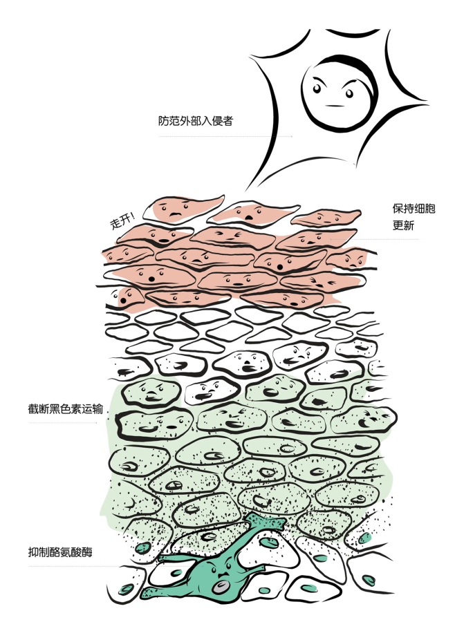

色素沉着问题没有快速的解决方法，这多少有点令人沮丧。但好消息是，全面的、坚持不懈的护肤程序可以有效地解决由晒伤、衰老、痤疮瘢痕和其他因素造成的暗斑。全面且有效的对抗色素沉着的护肤程序囊括了可能影响黑色素生成的步骤和因素。以下是帮你在这场对抗中获胜的 4 个步骤：

- **防范外部入侵者**。最好的进攻就是好好防守
- **让你的酪氨酸酶冷静一下**。减缓色素生成
- **延缓黑色素向外层皮肤运输**。黑色素在到达外层皮肤前是不可见的。只要没人看得见，它就不存在
- **确保你的细胞更新保持在最佳状态**。化学去角质成分能更快地去除老化、暗沉的皮肤，帮助淡化暗斑

#### 7.2.2.核心成分

这些成分已经经过测试，被证实具有抗色素过度沉着的功效。使用这些成分需要注意不要过量，以免刺激皮肤。许多产品所用的都是有效成分混合物，所以我们建议你选的产品至少含有以下主要化合物中的一种。

| 成分               | 化学家备注                                                   | 目标浓度                 |
| ------------------ | ------------------------------------------------------------ | ------------------------ |
| 对苯二酚（氢醌）   | 公认的抗色素活性成分“优等生”。对苯二酚的相关知识可参阅第 187 页的“成分解析” | 2% 及以上                |
| 熊果苷             | 从化学角度来讲，它是对苯二酚的近亲                           | 2% 及以上                |
| 氨甲环酸（传明酸） | 它虽然在美国市场上相对较新，但在亚洲已经流行多年。趣味知识：它还有口服药片和注射形式，用来治疗黄褐斑 | 3% 及以上                |
| 曲酸               | 这种化合物相当不稳定。如果你发现自己的产品从白色变成棕色后又变成了黑色，那就扔了吧 | 2% 及以上                |
| 鞣花酸             | 这是一种很难处理的成分。它非常罕见，你通常只能看到它的提取物形式，比如石榴提取物 | 1% 或排在成分表前半部分  |
| 间苯二酚           | 指代具有类似化学结构的所有成分，也用于化学换肤术             | 通常是专利混合物的一部分 |

谁不喜欢能同时解决多种皮肤问题的成分呢？以下成分可以很好地辅助其他提亮成分，你可以根据自己的皮肤需要来选择。

| 成分      | 化学家备注                                                   | 目标浓度              |
| --------- | ------------------------------------------------------------ | --------------------- |
| 壬二酸    | 它是近年来非常受欢迎的成分，不仅有抗色素的数据支持，还有治疗痤疮的数据支持 | 10% ~ 20%             |
| L‑AA      | 我们很喜欢，因为它可以从多方面对抗色素过度沉着。它既可以预防氧化损伤，又可以抑制酪氨酸酶的活性 | 5% ~ 20%              |
| 类维生素 A | 这位护肤“巨星”还需多做个介绍吗？查阅有关类维生素 A 的部分（从第 111 页开始），找到最适合你的类型 | 取决于类维生素 A 的种类 |

总的来说，再好的功效成分在单独使用时也很难搞定色素沉着这种顽固、复杂的皮肤问题。最有效的策略是把护肤程序的各个步骤都考虑周全。除了主要的功效成分，你还需要考虑其他 3 类辅助功能：预防损伤、阻止黑色素转移到皮肤表层、化学去角质。

**预先防损伤**，解决色素沉着的最佳方法就是预防色素沉着啊，朋友们！在“皮肤生物学基础”部分（参见此处），我们讲了紫外线和炎症等外部因素是如何激发色素沉着的。所以不难理解，色素沉着护理中极重要的一部分就是在那些讨厌的斑点完全演变为色素沉着之前处理好它们。以下是可以帮助你的产品以及选购它们时的注意事项：

|                | 防晒霜                                                       | 抗氧化剂                                                     | 舒缓成分                                                     |
| -------------- | ------------------------------------------------------------ | ------------------------------------------------------------ | ------------------------------------------------------------ |
| **为什么重要** | 看到这里，你应该已经意识到养成良好的防晒习惯对于预防色素沉着是多么重要了。如果你正在做抗色素医疗美容，那么涂防晒霜就更加重要了 | 抗氧化剂和防晒霜是完美搭档，可以增强抑制自由基生成的能力。L‑AA 是我们最喜欢的抗氧化剂，它还是一种酪氨酸酶抑制剂 | 炎症是色素沉着的一大来源，所以尽可能让皮肤保持舒缓放松的状态是预防色素沉着的简单方法之一。有很多很棒的植物性舒缓成分，但它们各不相同 |
| **选购指南**   | 请翻到第 074～075 页查看如何选择日常防晒霜                   | 抗坏血酸（维生素 C）、生育酚（维生素 E）、硫辛酸、白藜芦醇   | 红没药醇、积雪草（羟基积雪草苷、积雪草苷）、尿囊素、黄瓜提取物等 |

**逮住黑色素**，当然，只靠活性成分抑制酪氨酸酶总会有达到饱和的一天。所以，为了提高酪氨酸酶的效率，你可以将目标转移到不必要的色素身上，让它到不了皮肤表面就行了。黑色素是在表皮的最深处产生的，但它只有经过转移过程被向上运输后才会变成可见的色素。

|            | 概况                                                         | 浓度                                                         |
| ---------- | ------------------------------------------------------------ | ------------------------------------------------------------ |
| **烟酰胺** | 谁能帮忙减缓黑色素转移过程？当然是我们的老朋友烟酰胺。它非常适合添加到你的抗色素日常护肤中，在增加功效的同时不会对你的其他提亮产品产生任何负面影响 | 2% ~ 5%。如今，许多产品的烟酰胺浓度都要比这高得多。一定要小心，不要因为使用的浓度过高而刺激皮肤 |

**化学去角质**，你的皮肤在不断更新换代，产生新的皮肤。所以，使用像果酸这样的化学去角质成分可以帮助你尽快摆脱那些烦人的色素异常。高浓度的化学去角质面膜和专业级别的换肤术都有助于更快地提亮并均匀肤色。当心！不要急于求成。对那些深色皮肤的人来说，过于刺激的换肤所引起的炎症后色素沉着尤其是个大问题，更不用说它会让换肤完全失去意义。所以，一定要让你的皮肤适应这些活性成分，而且要提防那些一上来就给你推销一些刺激性过强的东西的人。

|          | 概况                                                         | 浓度     |
| -------- | ------------------------------------------------------------ | -------- |
| **果酸** | 甘醇酸是果酸中抗色素沉着功效最好的，但是它可能并不适合所有人。查阅“化学去角质成分”部分，从中选择替代品 | 5% ~ 10% |

> [!IMPORTANT]
>
> 补充：对苯二酚是公认的对抗色素成分中的“黄金斗士”，但由于一些可怕的误解，它在某些圈子里备受争议。让我们来正视有关对苯二酚的流言吧！
>
> - 听说对苯二酚是处方类成分。对，也不对。你可以在附近的药店找到对苯二酚的浓度为 2% 的产品。但如果想要 4% 或更高的浓度，你就需要处方才能拿到了（国内许可的对苯二酚产品的浓度不超过 2%，且不论浓度高低，均为处方药。——译者注）
> - 对苯二酚真的会导致皮肤癌吗？假的！没有任何证据表明对苯二酚致癌，但是在没有监督的情况下，不要长期使用这种成分。它可能会刺激皮肤并产生副作用，如色素减退，即在原本的暗斑周围形成一圈浅色的皮肤
> - 使用要点是什么？即使不需要处方，我们还是强烈建议你咨询皮肤科医生以监测你的对苯二酚使用情况。最好是在医生的指导下使用，且不宜长期使用

> [!IMPORTANT]
>
> 补充：在过去的几十年里，“天然”一直是护肤品的热门概念。问题是，并不是所有的植物提取物都经过了严格的测试，有些压根儿没经过测试。有关植物提取物的另一个难题是，很难评估某个产品使用的有效成分是否达到了有效剂量。例如，熊果提取物是熊果苷的天然来源，但是仅仅从包装上无法判断提取物中含有多少熊果苷或产品中含有多少熊果提取物。可是，正是这种不确定性让一些不太负责任的品牌得以侥幸只用一丁点儿好东西。下面列出了化学家比较喜欢的植物性成分，它们的皮肤功效有相当数量的数据支持。这些植物性成分都是分离化合物的好帮手。不过，单独使用它们解决不了色素沉着问题。
>
> - 水飞蓟提取物
> - 甘草根提取物
> - 桑葚提取物
> - 熊果提取物
> - 白牡丹提取物
> - 余甘子提取物

#### 7.2.3.具体用法

- 日间护肤程序，我们在这里为你列出了基础的日间护肤程序，其中的关键策略是防止损伤，用到的两种关键产品是抗氧化精华液和优质的日常防晒霜。L‑AA 是抗氧化剂和酪氨酸酶抑制剂中的“优等生”，所以它是日间护肤的首选。你如果觉得它的刺激性太强，可以考虑用水飞蓟素、硫辛酸、白藜芦醇或抗坏血酸磷酸酯镁代替。防晒霜可以随意选你喜欢的，只要坚持每天用就行！防晒对于预防刺激色素沉着循环的损伤至关重要，因为许多美白产品的有效成分会使你的皮肤对阳光更加敏感。**洁面产品 → L‑AA（维生素 C）精华液 → 保湿产品 → 防晒产品**

  升级！有时候你就是想要更强效的！这些我们都懂，但别忘了抗氧化剂和防晒霜是重中之重，所以不要在添加其他美白成分时忘记这两步。你如果出现起皮的情况，换一种功效成分，不要放弃基础护肤步骤。尝试换一种更温和的美白成分，如壬二酸或甘草根提取物这样的植物性成分，也可以用含烟酰胺的保湿产品。**洁面产品 → L‑AA（维生素 C）精华液 → 壬二酸（可选） → 保湿产品 → 防晒产品**
- 夜间护肤程序，晚上正是强化有效成分改善色素沉着功效的关键时间段！**洁面产品 → 去角质成分（甘醇酸） → 抑制酪氨酸酶的功效成分 → 保湿产品（试试舒缓剂和烟酰胺）**

  - 去角质。甘醇酸是去角质领域的 “黄金斗士”。你如果觉得夜间护肤程序的强度有点超负荷了，这一步可以不必每天都做。

  - 抑制酪氨酸酶。晚上是整治过度活跃的酪氨酸酶的绝佳时机。谨记，很多强效的活性成分可能同时具有刺激性。下面列出了按照潜在刺激性强度排序的抗色素活性成分，不过很多抗色素精华液本身就含有酪氨酸酶靶向成分的混合物，所以把这个列表当作基础指南即可，但一定要进行斑贴试验

    - 低刺激性：甘草根、熊果、牡丹提取物

    - 中刺激性：熊果苷、曲酸、壬二酸、氨甲环酸（传明酸）、间苯二酚、抗坏血酸葡糖苷

    - 高刺激性：对苯二酚（氢醌）

  - 保湿。含有烟酰胺的保湿霜是很棒的选择。烟酰胺作用于黑色素运输的步骤而不是阻断酪氨酸酶，这意味着它可以提升精华液的效用

  以视黄醇为主的护肤程序。对于那些同时想要预防皱纹的人来说，将视黄醇用作夜间护肤程序的主要成分是个很好的选择。但别忘了，视黄醇需要一定的磨合时间（建立皮肤耐受），所以最好把它和舒缓精华液搭配使用。下次选购舒缓成分时，可以参照 “购物指南” 部分。**洁面产品 → 舒缓剂 → 视黄醇 → 含有烟酰胺的保湿产品**

### 7.3.抗皱衰老

#### 7.3.1.理论解析

这是一个整个地球上都没有能逆转时间的“奇迹圣杯”面霜的时代。既然我们明白这点，那么让我们来谈谈可怕的皱纹吧。实际上，有很多可靠的有效成分能有效预防皱纹形成及最大限度淡化皱纹。在日常的基础护肤产品（洗面奶、保湿霜、防晒霜）中加入一些抗皱有效成分，然后带着防皱、抗皱护肤方法会帮助你优雅地老去这一信念安心地睡觉吧。

引起衰老的主因有两个：太阳和时间。人只要活着就会发生的内在衰老叫自然老化，而由外部因素（主要是紫外线）引起的衰老叫光老化。从临床角度来说，自然老化与皮肤变薄及失去弹性有关，而光老化的特征则是更深的皱纹和松弛。我们的脸不可避免地会暴露在自然环境中，所以自然老化和光老化相互作用，导致产生诸如细纹、皱纹、松弛、慢性皮肤干燥和不必要的色素过度沉着等。真皮中的重要蛋白质肩负着撑起一切的重任。这些蛋白质的衰退是皮肤衰老的关键因素。

- **胶原蛋白**：这种蛋白质具有坚固的三重螺旋结构，是真皮中最重要的支撑性蛋白质
- **弹性蛋白**：这种蛋白质恰如其名，负责保持皮肤“Q 弹”的弹性。

这些蛋白质是各种衰老途径中的主要受害者，比如自由基损伤、过量糖分引起的糖化过程、弹性组织变性（弹性蛋白积聚）等。随着时间的推移，胶原蛋白会分解、变性，并发生交联积聚，还有过量的弹性蛋白堵在真皮层。这种内部结构的损伤会转化为各种肉眼可见的衰老迹象，比如皱纹和松弛。

我们已经了解了引起皮肤内在衰老的原因，但护肤品真能解决这种发生在皮肤深层的复杂问题吗？虽然胶原蛋白的含量是关键，但测量真皮深处的胶原蛋白不仅会造成伤害还很复杂，所以大多数护肤研究只能通过评估皮肤的各种力学性、功能性和视觉性特征来判断皮肤的总体质量。

抗衰老领域中有一点很恼人，那就是用富有创意的伪科学故事过分炒作产品，诸如装在神奇瓶子里的独角兽眼泪。想要从垃圾的海洋中找出宝石，有效的方法就是查证。那些领头羊品牌会开展研究，甚至会跟踪测试并证明自己产品的优势。让我们来学习所有可以测量皱纹的方法吧！

- **皮肤弹性测试仪**。这台漂亮的小仪器实际上是一个奇特的杯形吸盘，它将皮肤拉起，然后释放。科学家们通过测量皮肤被拉伸的距离和皮肤回到正常位置的速度，就能确定皮肤的紧致度和弹性。妙极了，对吧
- **Visia 皮肤检测仪**。它实际上是一个复杂的、校准精良的照相馆，可以拍出你的脸在不同光线下的高分辨率照片，缺点是会放大所有美颜相机的滤镜试图隐藏的东西，但它确实能让科学家计算出一些非常有用的数据，比如皱纹数量、肤色变化程度，甚至是晒伤程度
- **专家小组**。这些经过培训的人可以严谨地评估你的皮肤状况。虽然专家小组不像真正的仪器那样精确，但你会惊讶于他们的一致性。有这样的团队来评估产品真是太棒了

包含这些测量方法且设计严谨的临床研究是了解抗衰老产品作用机制的理想证据。遗憾的是，鲜有产品会真正使用这些工具。但你还有我们！让我们来揭开抗衰老神奇成分的真面目，为你构建一套抗衰老护肤程序吧。

#### 7.3.2.核心成分

无论你的目标是预防衰老还是寻求有效修护，你的核心护肤策略都应该是根据皮肤类型选择合适的 “四巨头” 成分（参见此处的介绍）。简单来说，“四巨头” 成分有效性的科学支持数据最多！让我们先来看几种护肤情况，再构建几套化学家推荐的 “对症下药” 的护肤程序，来个开门红。

> [!IMPORTANT]
>
> 补充：除了“四巨头”，肽也是抗衰老产品中最常见的成分之一。正如我们在“功效护肤”部分提到的，肽类中有大量难以驾驭的成分。肽类中的大多数成分受专利保护，唯一可用的数据都握在制造商手中。让我们来看看市面上常见的肽类：
>
> - **基肽 3000（Matrixyl 3000）**：你有可能在成分表里看到棕榈酰三肽-1 和棕榈酰四肽-7，也有可能在包装上直接看到有关它的宣称语。这是最著名的一类肽，由法国司达玛（Sederma）研究中心研制，已经有多个临床试验证实棕榈酰寡肽可以明显减少皱纹的出现
>- **黑洛西（Haloxyl）**：这是司达玛研究中心的另一经典之作！与棕榈酰寡肽不同的是，研究中心对黑洛西针对黑眼圈和眼周紧致等眼部问题进行了更有针对性的测试。要想找它的话，你可以在成分表上留意 N-羟基丁二酰亚胺、棕榈酰三肽-1 和棕榈酰四肽-7
> - **重组人表皮细胞生长因子（sh-Oligopeptide-1）**：它是宣称具有“生长因子”功效的产品中的主要成分之一。它可以单独使用，也可以与其他肽类混配。这种成分很有前景，但是由于它还没有经过太多的测试，所以我们建议将含有这种成分的产品搭配其他好的成分（如经证实有效的抗氧化剂）使用以获得更全面的抗衰老功效
>

#### 7.3.3.具体用法

- 阶段 1：预防衰老，你如果正处于二三十岁的年龄段，并且开始思索如何维持皮肤的最佳状态，那么预防衰老就是你的首要任务啦！日常抗氧化和防晒是预防衰老策略中的重中之重。试试从这里开始
  - **日间护肤程序**，洁面产品 → L-AA（维生素 C）精华液 → 保湿产品 → 防晒产品
  - **夜间护肤程序**，洁面产品 → 每周使用一次果酸去角质产品 → 含有烟酰胺的保湿产品
- 阶段 2：对抗细纹，你如果发现细纹开始蔓延，想要采取更有效的抗衰老方法，可以考虑在护肤程序中加入较低浓度的类维生素 A，如每周 2～3 次 0.3%的视黄醇。如果你的皮肤特别敏感，可考虑羟基频哪酮视黄酸酯或补骨脂酚等替代品。
  - **日间护肤程序**，洁面产品 → L-AA（维生素 C）精华液 → 肽 → 保湿产品 → 防晒产品
  - **夜间护肤程序**，洁面产品 → 每隔一晚使用果酸去角质产品 / 类维生素 A → 含有烟酰胺的保湿产品
  - **抗衰老专业提示**：
    - **专业提示 1**：在增加类维生素 A 用量的同时，不要忘了皮肤屏障功能的重要性。在适应过程中，轻微的刺激感和脱皮是正常的，但你的皮肤不应该一直处于泛红、发痒的受刺激状态。
    - **专业提示 2**：衰老的皮肤会有变干的趋势。试着寻找一种封闭性更强的保湿产品，比如成分表中凡士林或乳木果油含量较高的晚霜。
    - **专业提示 3**：选购时留意有效的宣传语！比起“93% 的使用者感觉皮肤更紧致了”，“8 周后皱纹改善 45%”这类宣传语会更好一些。含有神秘的独家成分但未宣称任何明确价值的产品，很可能无法给你想要的功效
    - **专业提示 4**：维生素 C 是抗氧化剂中的“黄金斗士”，但加入多种抗氧化剂的产品更有帮助。参见此处，了解一些我们最喜欢的抗氧化剂！好消息是，市场上许多富含抗氧化剂的产品都是混合制剂，所以你不必为层层叠加不同的产品费心了
- 阶段 3：升级到医疗美容护理，总的来说，医疗美容护理能在更短的时间内带给你更显著的效果。如果你决定选择医疗美容，那么术后皮肤护理有助于提升医疗美容的功效。
  - **恢复阶段**。如果你的皮肤在手术后非常不稳定，那就保持精简的护肤程序，专注于保湿和防晒。尿囊素和积雪草提取物等舒缓成分也有帮助
  - **让医疗美容疗效更进一步**。趣味知识！许多研究表明，在医疗美容的间歇期使用化学去角质产品很有用，能够有效提高医疗美容的换肤效果
  - **专业提示**：要想预防衰老，健康的生活方式很重要！不断有研究表明，高糖（碳水）饮食和吸烟不仅对健康有害，还会对皮肤的外观产生负面影响

> [!IMPORTANT]
>
> 补充：如果你准备用医疗美容方法改善皱纹的话，那么是时候去咨询皮肤科医生了。咨询的时候了解以下 3 种方法，和皮肤科医生一起探讨哪种方法适合你的皮肤类型和皮肤状态。
> - 激光疗法
> - 微针疗法
> - 肉毒杆菌毒素
>
> 等等！这些我都可以在商店里买到呀！没错，你确实可以找到很多声称“和医疗美容同样有效”的家用美容仪器。但是，一般来说它们并没有那么有效，有时甚至非常危险。
>
> - 微针我们坚决不同意！大多数商店里卖的微针美容仪都没有医疗美容所用的针那么细，扎得也没有那么深，所以效果好不到哪里去。它们造成的损伤很可能大于其带来的好处。此外，并非所有产品都被正确定位为一次性产品，所以卫生情况堪忧。如果你想尝试微针疗法，请咨询美容医师或皮肤科医生
>- 家用激光美容仪这种，一些高档的家用抗衰老激光产品可能有用，但无法与医疗激光美容仪相提并论。我们只建议你购买信誉好的、通过国家正规机构认证的品牌

> [!IMPORTANT]
>
> 补充：关于眼周问题的真相：鱼尾纹、下睑眼袋和黑眼圈是最复杂的皮肤问题。有几个非外源性因素对这些问题的严重性有明显的影响：基因、饮食、健康状况和骨骼结构。因此，你会发现很多眼霜的评价都褒贬不一。记住以下两点：
>
> - 临床试验在这里又是加分项了。眼周问题的数据量可能不如普通皮肤问题那么多，但这就是眼周问题的现实情况
> - 在眼周使用保湿霜或精华液没什么问题。但要小心那些流动性强的精华液，尤其要小心那些配方中含有果酸或视黄醇的
>
> 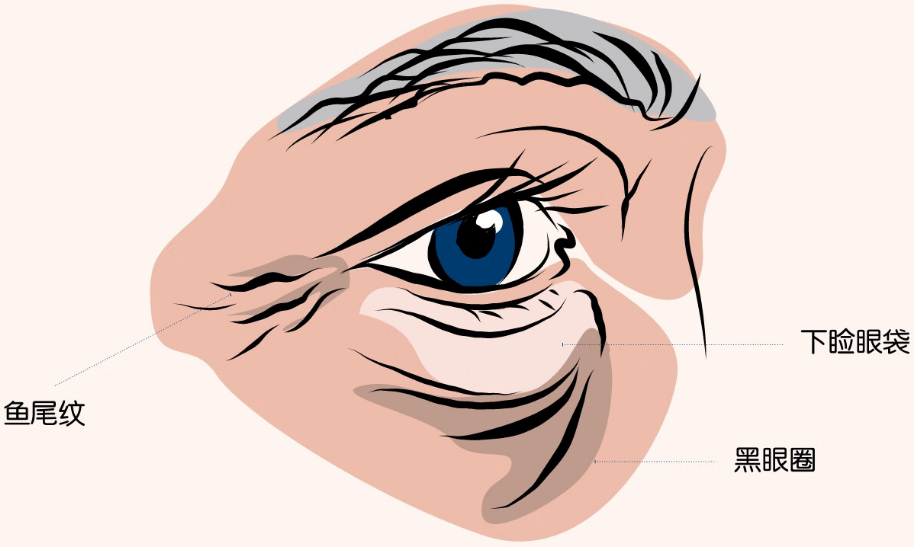
>
> 眼霜还有一个令人沮丧的特点：你可能已经注意到了，眼霜的价格差不多是等量面霜的 2 倍（有时甚至更高），但很多眼霜产品的定价其实并不合理。因此，临床治疗才格外重要。

## 8.其他问题

### 8.1.选购指南

#### 8.1.1.专卖店铺

这类渠道是指美妆产品专卖店，如丝芙兰（`Sephora`）和艾尔塔（`Ulta`）。

- **什么值得买？** 这类商店通常是买保湿霜、精华液、功效护肤品的好地方。像是维生素 C 类、酸类护肤品，你都可能在这类商店里找到想要的浓度，不过价格会比药妆店里的贵一点
- **什么不值得买？** 不建议在这里买防晒霜和祛痘产品。商店里的防晒霜肯定质感更好，但除非你特别喜欢那支昂贵的防晒霜，否则没有必要在这里消费，因为药妆店里有很多效果差不多的替代品

> [!IMPORTANT]
>
> 补充：价格荒谬可能是有点主观的评价。从化学家的角度来看，产品的定价是由无数因素共同决定的。价格低于 `50` 美元甚至远低于 `50` 美元的产品中也有效果良好、含有被证实的功效成分且浓度合适的。同时，在我们看来，某个产品如果拥有其宣称的独特功效成分所带来的护肤效果，且效果能够被精心设计的临床试验证实，那卖 `100` 美元也是合理的。真相是，让你花更多钱的往往是那些沉甸甸的、豪华的包装，而不是漂亮瓶子里的东西。这些瓶子可能让你觉得开心、惬意，但它们不是真正的护肤“功臣”。我们找不到任何理由去购买售价超过 `300` 美元的产品，因为这样的产品并不比配方良好、卖 `30` 美元的产品的效果强 `10` 倍。
>

#### 8.1.2.电商网站
一般来说，电商网站就是一片“狂野之地”，里面充斥着形形色色的护肤品，没有你买不到的，只有你想不到的。你既能买到极便宜但可疑的产品，也能直接买到化学原料，当然还有奇奇怪怪的国外产品。

- **什么是值得买？** 亚洲地区的防晒霜。如果你无法忍受防晒霜的油腻感，我们强烈建议你体验亚洲地区的防晒产品。亚洲的可用防晒剂比 FDA 批准使用的多，而且亚洲地区的防晒霜可以做得更贴肤、更轻盈。不过我们建议你快速检查一下成分表，因为酒精、香精和桂皮酸盐是亚洲防晒霜中的常见成分，虽然这些成分本身没问题，但可能有些人对它们敏感。我们通常喜欢用格调高雅的复合面部润肤油，以获得更全面的护肤功效。但是，对于刚开始尝试面部润肤油的人来说，电商网站是寻找单方润肤油的好地方。你可以尝试各种不同种类的单方润肤油，看看自己最喜欢哪一种
- **什么不值得买？** 别碰活性成分浓度太高的产品。你能在电商网站上买到极高浓度的活性成分（如 `70%` 的甘醇酸！），或是看着就不靠谱的廉价微针滚轮。如果有产品声称可以除疣或穿透皮肤，那购买它很可能是个糟糕的主意

> [!IMPORTANT]
>
> 补充：寻找广告宣传更透明、页面上有产品成分表的卖家。有些卖家会销售几年前生产的产品，所以留点儿神，买 “有效期至...” 清晰明了的产品。

#### 8.1.3.兼售药店
这种药店还不是普通的药店，而是兼售化妆品的药店。这类渠道包括西维斯（`CVS`）、沃尔格林（`Walgreens`），以及其他类似的超市，如塔吉特（`Target`）（国内内地暂无此类药店或类似的超市，故以下指导建议在内地暂不适用）。

- **什么是值得买？** 基本款的保湿产品和洁面产品。你也可以在这些店里找到很好的防晒霜和功效性的祛痘产品，比如含水杨酸的洗面奶
- **什么不值得买？** 如果你想买其他功效较强的、含非处方类活性成分（如 `维生素 C`、甘醇酸等）的产品，药店并不是理想之选。这里的产品所含的活性成分往往刚到起始有效浓度甚至更低。不过往好处想，你可以放心地在这里购买入门级的活性成分，如视黄醇。有时为了找到好的产品，做些功课还是有必要的

#### 8.1.4.工具仪器
无论在哪个购物渠道，你都能找到许多类型的护肤工具和仪器。近年来，护肤工具的种类似乎呈爆炸式增长，从简单的洁面海绵到 `LED` 光疗仪器，你可以买到各种各样的工具作为你的护肤程序的辅助。

- **洁面工具：** 市面上的热门护肤工具类型之一，从简单的魔芋海绵一直到高档的声波洁面刷。我们是这类工具的爱好者！它们是增强清洁力的好帮手，有了它们你就不用为了洗得更干净而使用清洁力过强的表面活性剂
- **按摩工具：** 过去几年，玉石滚轮、刮痧板等按摩工具很流行。把它们当作舒适的按摩工具，至于那些花哨的功效则要谨慎对待
- **光疗仪器：** 蓝光、红外线的美容效果已获得大量数据证实。然而，在我们写这本书的时候，还没有达到临床医用仪器效果的家用美容仪，所以我们不做推荐
- **电动洗脸刷**：通常有柔软的刷毛，可以提升洗面奶的清洁效果。需要充电
- **刮痧板**：用于消除淋巴水肿，以及所谓的面部按摩“排毒”
- **魔芋海绵**：一种由植物制成的海绵，用于轻柔擦洗皮肤。植物制品，可降解
- **光疗美容仪**：新兴美容领域。它在治疗痤疮、改善细纹和皱纹方面有效果
- **硅胶洁面刷**：提供温和的物理清洁方式。附加用途是可以用来清洗化妆刷
- **微针**：不要买这种工具。它宣称的“抗衰老效果”实际上是在医学临床中获得的，但医生使用的微针更长。一次性产品，用后即弃
- **玉石按摩滚轮**：建议仔细清洗，因为水晶和玉石会开裂，裂缝中会滋生细菌
- **微电流美容仪**：用于改善肤色、皮肤弹性、细纹和皱纹。并非所有设备的参数、效果都相同

### 8.2.解读宣传

选购准则中最重要的一条就是读懂、读透广告宣传语。护肤品通常都被大量的广告宣传语包装着，这些宣传语有的是有意义的，有的则不太行。

- **“纯净” 类宣传语**
  - **有机**：这种说法的意义不大。在美国，“有机”是由美国农业部认证的，而不是主管化妆品的 `FDA`。以植物为原料的产品的大多数原料是精炼过的，所以，我们认为农药残留的问题不用担心（在中国，化妆品监管中暂无有机认证，故无需考虑）
  
  - **天然**：“天然”是一种流行的广告宣传语。但是，记住这个重要的事实：天然成分从本质上讲并不比合成成分更安全或更有效
  
  - **纯素**：指配方中不含动物来源的成分。一般来说没什么问题，不过一些动物来源的成分对皮肤其实非常有益
  
  - **“不含” 清单**：当你看到各品牌的“不含”清单既冗长又相互矛盾时可能会感到困惑（和害怕）。但你要清楚一点，这些成分的危险性往往有被夸大之嫌。最合适的做法是关注产品的成分表里的哪些成分对你的皮肤有效和无效，而不是关注其他那些所谓的“品牌理念”
  
- **“无添加” 类宣传语**
- **不添加化学成分**：任何东西（包括水）都是化学物质。化学成分并没有广告里讲的那么可怕
  
- **不添加麸质**：你的皮肤并不像你的胃一样能吸收麸质衍生成分。所以，对麸质会引发其乳糜泻过敏反应的人来说，麸质对你的皮肤并没有伤害，因为乳糜泻仅涉及小肠（除非你是在吃护肤品）
  
- **不添加防腐剂**：朋友们，这类宣传语让我们很生气。护肤品必须要防腐。如果没有添加合适的防腐剂，产品里就会滋生细菌、真菌等各种有害的微生物
  
- **不含尼泊金酯**：曾经有一篇论文写到，在（女性乳腺癌患者的）乳腺组织内发现了尼泊金酯，因而每个国家都对其是否会引起乳腺癌进行了深入研究。但没有任何监管机构拿出了实质性证据。实际上，尼泊金酯是目前最温和的防腐剂之一，而且只需很少的量就能达到很好的防腐效果。一个不太好的事情是，你将来可能很难找到含有尼泊金酯的产品了，而品牌方现在也被逼着不得不寻找替代成分，但又找不到像尼泊金酯那样全面、温和的
  
- **未经动物试验**：我们都很爱动物，所以很高兴护肤品市场对这种宣传语越来越买账。好消息是，如今极少有化妆品成品需要进行动物试验了。但需要说明的是，化妆品原料的安全性和毒理试验仍然有很多是在进行动物试验的，而且这一现实并不像“马上停止动物试验”那么简单就能解决的，因为还要确保成分的安全性。逐步取消动物试验是科学家们正在积极研究的一大课题，仍然有许多工作要做
  
- **无油**：这类宣传语不受法规监管，这意味着品牌方可以自己决定如何定义“无油”产品。无油的概念很宽泛，可能是真的不含油相成分，也可能是产品名里没出现“油”这个字。例如，有些防晒霜喜欢宣称不含油，适合油性皮肤使用，但问题是它含有的化学性防晒剂本身就是油性的。另外，请记住这点，油只要用得恰当，油性皮肤也可能颇为受益

### 8.3.环保回收

很高兴看到越来越多的人会在购物时考虑到产品的价值观，希望为保护地球尽一份力。但是，就像其他领域觉醒的环保意识一样，在美容行业推行环保观念是很难的，何况还有行业自身特有的问题。在不给本书增加太多篇幅的情况下，我们简单谈谈化妆品与环保的一些基本情况。

- **微塑料**：21 世纪初，塑料磨砂微粒可能是很多人洗脸时都会用到的重要成分。相比杏核之类的天然磨砂颗粒，塑料颗粒是正圆形的，因此在使用时会更温和。但它们最终会被鱼吃掉，并对水生生物逐渐造成巨大伤害。好消息是，微塑料成了一个巨大的问题后，已有很多法律禁止个人护理产品中使用此类塑料磨砂微粒；坏消息是来自化妆品的微塑料只是冰山一角，一个令人惊讶的真相是，微塑料最大的来源并不是个人护理产品而是你穿的衣服。尽量穿天然材质的衣服，避免穿聚酯纤维、氨纶和莱卡衣服，因为这些化学纤维通常需要 `20` 年才能降解。购买天然/可生物降解织物，如棉、羊毛、人造丝。如果可能的话，最好买一些做工好、能穿很多年的衣服，这也是一种努力保护环境的行为。可别买 `574 289 571` 件廉价衬衫然后穿两年就扔掉
- **防晒霜**：气候变化是一个巨大的历史性问题。一些研究表明，某些化学性防晒剂特别是 `二苯酮-3` 和桂皮酸盐可能对珊瑚礁产生影响。防晒剂在海水变暖的过程中究竟起到了什么样的影响虽然还需要更多的数据证明，但有一种替代方案，你可以在海滩游玩或浮潜时改用防水的纯物理防晒霜
- **棕榈油**：说起棕榈油，许多人会不由自主地想到红毛猩猩。棕榈油涉及的产业极广，它不仅关系到护肤品产业，还关系到几乎所有工业产业。这种成本不高的原材料在现代人的日常生活中有着极大量的用途。你吃的薯片、用的洗发水，当然还有护肤品都要用到棕榈油。庞大的需求导致棕榈油产地的森林被砍伐和红毛猩猩的栖息地被破坏。好消息是一些组织正在为提升棕榈油生产的可持续发展而努力。最引人注目的组织是 “可持续棕榈油圆桌倡议会议”（[RSPO.org](https://RSPO.org)）。关于如何选购可持续棕榈油，可以查看相关网站
- **回收上**：购买护肤品时，你或许还会考虑包装可持续性的事情。原生塑料的用量正以惊人的速度增长，不过目前仍处于如何减少原生塑料消费及增加其回收处理的摸索阶段。在这里，我们简单介绍一下目前的可行措施。你可能会认为护肤品包装很容易回收，但这个过程实际上相当复杂。玻璃仍然是最容易回收的材料（我们说的是 “容易”，但更准确的描述是 “没那么复杂”），但问题是玻璃不是最好的护肤品包装材料。由于尺寸多样、混杂多种材料、含有多个部件的缘故，一般来说你无法回收下列化妆品的包装。建议你与各品牌方确认可操作的最佳回收方法
  - 口红管
  - 片状面膜包装，试用装小袋子
  - 大多数防晒霜软管
  - 许多洗面奶软管
  - 瓶口尖嘴塞和滴管瓶的橡胶头
- **可再收**：使用再生塑料是减少使用原生塑料的方式之一。一个吊诡之处是，再生塑料的使用成本比原生塑料高得多。我们期待在未来可以一起找到更经济的再生塑料的应用方式，并减少使用原生塑料。但目前很难说清是谁承担了更高的成本，是包装供应商、品牌方，还是护肤品用户？“那么，为什么我们不用生物降解材料呢”？趣味知识点！所有东西都是可生物降解的，但关键是 “这个东西需要多长时间才能被降解”。护肤品行业较难引入可降解包装，因为护肤品包装既要能承受生产线上的各种操作，又要保证里面的产品安全和稳定
  -  你可能偶尔会看到这个绿色标识。它不代表 “本产品可回收”，而是代表 “该公司为回收和可持续给予了财务支持”
  -  聚对苯二甲酸乙二醇酯（PET)：最常见的塑料。通常用于瓶、罐，如漱口水和化妆水瓶
  -  高密度聚对苯二甲酸乙二醇酯（HDPE)：用于洗发水瓶、沐浴露瓶、乳液瓶
  - 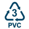 聚氯乙烯（PVC)和乙烯基：用于洗发水瓶或吸塑包装
  -  低密度聚乙烯（LDPE)：用于可挤压的软管
  -  聚丙烯（PP)：用于瓶盖、化妆品矮罐
  -  聚苯乙烯（PS)：通常不可回收，向本地回收中心咨询最佳做法
  -  其他（OTHER)塑料：向当地废弃物管理部门寻求处理建议

### 8.4.专业人士

#### 8.4.1.美容医生

作为化学家，我们所提供的意见是为了帮助你了解护肤品里含有什么成分，以及搭配各种护肤品。但这只是护肤专业知识的重要组成之一，许多其他领域的专家同样能够使你的护肤之路更顺畅。他们可以让你的护肤不再局限于家用美容产品，并在皮肤最糟糕的时候提供治疗。

有解决心理问题的心理治疗师，当然也有负责解决面部问题的治疗师，即美容皮肤科医生。他们日复一日地与皮肤打交道，定期去拜访美容皮肤科医生，他们就会像仙女教母一样对你皮肤出现的变化做出反应。美容皮肤科医生的执业范围包括从简单的面部美容到执行更复杂的医疗美容操作，如深度化学换肤、微针治疗等（这里所说的美容皮肤科医生的执业范围与国内的有一定差异）。

拜访美容皮肤科医生的理由：

- 非常需要一段 “自己想做什么就做什么” 的时间
- 定期拜访，比方说有人需要定期去清理黑头，对吧
- 化学换肤和医疗美容护理

拜访美容皮肤科医生之前需要了解这些：

- 美容皮肤科医生可能会推销他们认为好的产品。一种产品还可以试试，但试图让你买一整套？那不太行
- 并不是每位美容皮肤科医生都有能操作你想做的医疗美容项目的相应资质。你如果有明确想做的项目，需要自己预先查询一下谁有相应的资质

#### 8.4.2.皮肤医生

你有严重的痤疮需要一些指导？你怀疑自己可能有皮肤疾病？你只是想知道怀孕时应该用哪些护肤品？好吧，解答这些问题都需要皮肤科医生的参与。皮肤科医生会帮助你诊断皮肤疾病，包括湿疹、银屑病、痤疮、酒渣鼻等，并提供有针对性的处方治疗。他们的特别之处在于能够同时治疗疾病和教给你相应的护肤方法。你即使没有严重到需要看医生的皮肤问题，也应当每年去看一次皮肤科医生，让他们掌握你的痣的变化，确保它们不会转变为皮肤癌。

拜访皮肤科医生的理由：

- 有任何皮肤疾病，如湿疹、银屑病、玫瑰痤疮等
- 有痤疮问题
- 皮肤癌定期检查
- 做侵入性治疗，如激光和注射

拜访皮肤科医生之前需要了解这些：

- 确保皮肤科医生了解你的全部护肤程序和皮肤病史
- 如果是第一次去医院治疗痤疮，带上你正在使用的护肤品，这样皮肤科医生就能了解你目前的护肤程序

## 9.总结步骤

有关护肤程序，我们建议从护肤的三大核心，洁面步骤、保湿步骤、防晒步骤着手。记住，坚持精简的护肤程序比贸然使用含有多步骤的护肤程序更有帮助。少即是多，坚持是关键！

这三大核心一旦构建完毕，你就可以在此基础上逐渐加入有效成分并根据皮肤需求调整产品搭配；更重要的是，这样你就有了稳固的护肤基础，如果哪天你的皮肤突然闹脾气，你能知道哪些东西之前是有效的。所以，如果皮肤闹脾气了，回归基础就是了！

再加上痤疮护理、色素沉着、抗皱衰老的知识，现在您可以开始构建属于自己的护肤程序了。
