# 护肤流程

## 1.基础知识

### 1.1.皮肤结构

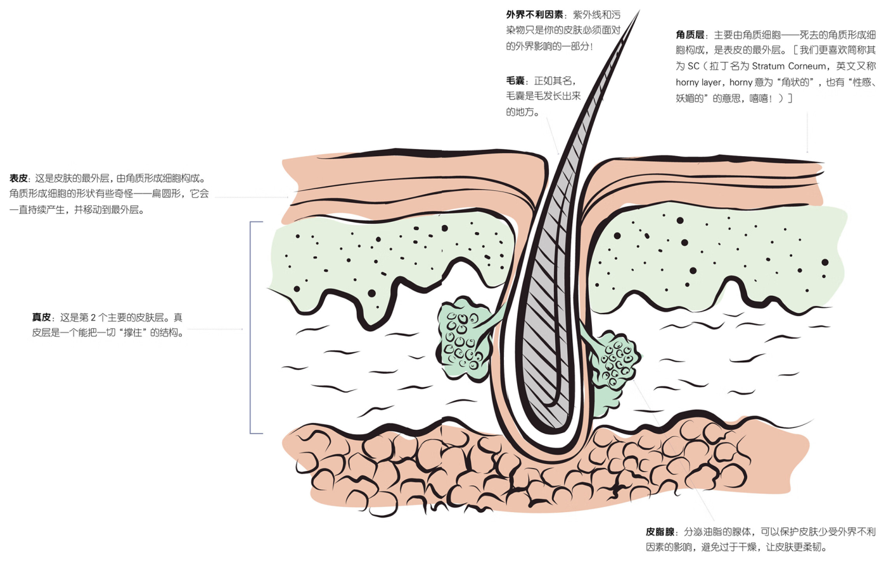

首先您需要了解皮肤结构，按照上图顺序可以简单分为以下的层级：

- **[外界]**：紫外线和污染物
- **[表皮]**：这里我们把角质层也纳入进去
  - **{酸性保护层和微⽣物群}**：⻆质层是偏酸性的，这使它成了 ⼀ 个强⼤的防御体系。告诉你⼀个有趣的事实，⽪肤的 `pH` 值影响着那些在 ⽪肤表⾯⽣存的微⽣物！有些理论认为，这就是⽪肤 `pH` 值升⾼会导致⽪肤不适甚⾄产⽣痤疮的原因
  - **{角质层}**：由死去的角质形成细胞，也就是角质细胞组成，也叫 `SC`
    - **(角质细胞)**：角质细胞组成，类似砖块的作用，由活去的角质形成细胞组成，一直产生移动到外层
    - **(脂质屏障)**：屏障主要有两个作用
      - **挡污**：脂质屏障负责阻挡住“坏家伙”（污染物、致病微 ⽣ 物），同时放进来“好⼈”（⽔）。这就是你听到的所有护肤评论⾥都会提及屏障功能（阻⽌⽔分从⽪肤中散失⽽导致⽪肤⼲燥）的原因。⽤更专业的话来说，脂质屏障的完整性对⽪肤健康⾄关重要，它也是⽪肤表⾯疏⽔的缘由。脂质屏障主要由 ==神经酰胺、游离脂肪酸、胆固醇、天然保湿因子== 构成
      - **保水**：虽然⻆质层的⼤部分成分是脂质，但为了维持正常功能，⻆质层还是需要保持⼀定的⽔分，来看看天然保湿因⼦（`NMFs`）吧。==尿素、乳酸、吡咯烷酮羧酸钠（PCA 钠）== 之类的物质，是⽪肤⾃然⽣成的保⽔成分，这些成分占⻆质层⼲重的 `20%〜30%`
    - **(黑色素细胞)**：负责生产皮肤中的色素。它们会产生黑素小体（里面装满色素的小囊泡），这是皮肤被晒伤后所产生的保护性防御反应。有时，严重的日晒和外界压力会引发过度的保护反应，导致产生雀斑和色素沉着。
      美白淡斑精华针对的就是这些 “小家伙”
  - **{透明质酸}**：这种很流⾏的护肤成分实际上就存在于你的⽪肤中，在表⽪和真⽪中都有。透明质酸可以⽀撑⽪肤结构，也可以“抓住”⽔分（保⽔）
  - **{角质形成细胞}**：表皮的主要构成细胞，从基底层不断分裂、向上移动，逐渐分化为角质细胞，最终形成角质层
- **[真皮]**：虽然护肤品那些令⼈兴奋的功效绝⼤多数都是在表⽪产⽣的，但真⽪也很重要。事实上所有负责“⽀撑”的重要结构都位于真⽪中，当“⽀撑”出现问题时，⽪肤的状态发⽣改变，如松弛、下垂，甚⾄是形成皱纹。告诉你⼀个有趣的真相，很多抗衰⽼成分的细胞试验⽤的都是真⽪层的细胞！
- **[毛囊]**：毛发的生长部位
- **[脂腺]**：与毛囊相连，分泌皮脂，润滑皮肤、维持屏障功能，分泌油脂的腺体，可以保护皮肤少受外界不利因素的影响，避免过于干燥，让皮肤更柔润

因此实际上，大部分护肤品都只 ==作用在以下三层：外界、表皮、真皮==。

### 1.2.皮肤类型

⼤多数⼈的⽪肤会呈现各种⽪肤类型，因为⽪肤状态是不断变化的，影响因素包括⽣活⽅式、⽓候、压⼒、激素、年龄等。随着这些变化的发 ⽣，你需要不断去调整⾃⼰的护肤程序。

| 皮肤类型   | 特点                                                         | 特点                                                         | 优点                                                         | 缺点                                                         |
| ---------- | :----------------------------------------------------------- | ------------------------------------------------------------ | ------------------------------------------------------------ | ------------------------------------------------------------ |
| 干性皮肤   | 表现为⽪肤紧绷、脱屑、粗糙、瘙痒、整体柔韧性⽋佳。原因很简单，⽪ 肤中没有⾜够的⽔分。⽤专业的话来讲就是当⻆质层中脂质屏障不完整时，⽔分从⽪肤中蒸发的速度会⽐正常情况下更快。这将导致⼀系列不良反应：死亡⻆质细胞的脱落变慢，导致⽪肤变厚（⽽且不再是丰盈、充满㬵原蛋 ⽩的良好状态）、粗糙、不平滑且暗淡。不幸的是，随着年龄增⻓，⽪肤会越来越⼲燥。但别怕！化学家的⼯作核⼼就是制造保湿产品，它们针对的正是⽪肤⼲燥问题。 | ⽪肤紧绷、⼲ 燥、脱屑、触感粗糙，甚 ⾄ 可能发痒。               | 极少产⽣痤疮和⿊ 头。如果你想叠⽤ 护肤品，完全可以 ⼀层⼜⼀层地涂。 | ⽪肤脱屑、不光滑、易产⽣细纹和皱纹。以下⼏ 个因素会使以上问题加剧：所在地的⽓候、⼏乎毫⽆⽔汽的⻜机舱、季节变化和年龄增 ⻓！ |
| 中性皮肤   | 拥有中性 ⽪ 肤实在是太幸运了。⽪ 肤状态刚刚好：不油、不 ⼲（既不 ⼲ 得掉 ⽪，也不太油腻），健康，⽔ 分充盈，⽪ 肤本 ⾝ 有弹性、亮丽。这是因为你的 ⽪ 肤 ⻆ 质层中 ⽔ 分的含量是别 ⼈ 梦寐以求的适中状态。幸运 ⼉，继续加油！不过，拥有中性 ⽪ 肤并不代表你永远不会遇到 ⽪ 肤问题，毕竟 ⽣ 活在不断向 ⽪ 肤发起挑战。但你的起点很 ⾼！ |                                                              |                                                              |                                                              |
| 油性皮肤   | 脸上油光锃亮，脑海中总是闪过“我是闪亮的灯泡”的念头。油性 ⽪ 肤的特点是 ⽪ 肤油脂（⽪ 脂，由扩 ⼤ 的 ⽪ 脂腺产 ⽣）分泌过多。⽪ 脂腺与 ⽑ 囊是连通的，这就是为什么痤疮（症状为 ⽑ 囊发炎）总是找上油性 ⽪ 肤的 ⼈。男性更容易是油性 ⽪ 肤，因为他们的睾酮 ⽔ 平更 ⾼。虽然你可能觉得过量的 ⽪ 脂很恶 ⼼，但它实际上对 ⽪ 肤的健康和免疫功能很重要。有了 ⽪ 脂，⽪ 肤才能产 ⽣ 脂溶性的抗氧化成分，才能形成抵抗有害微 ⽣ 物的屏障。对油性 ⽪ 肤的另 ⼀ 个误解是，油性 ⽪ 肤的 ⼈ 不需要 ⽤ 保湿霜。的确，⽪ 脂可以间接地保持 ⻆ 质层 ⽔ 分，但“⽪ 脂产 ⽣”和“⽪ 肤保湿”是两个独 ⽴ 的过程。能阻 ⽌⽪ 肤 ⽔ 分蒸发的是脂质屏障，但它与 ⽪ 脂腺（⽑ 囊旁）分泌出来的油脂 ⽆ 关（参考前 ⽂ 的 ⽪ 肤结构彩图，可以更好地分清 ⽪ 脂腺和脂质屏障）。所以，⽪ 肤排出更多的油脂并不会对 ⻆ 质层把 ⽔ 分保持在 ⽪ 肤 ⾥ 的能 ⼒ 有多 ⼤ 影响。⻓ 话短说，油性 ⽪ 肤也要注意保 ⽔。 | ⽪ 脂过多，容易 ⻓ 痘、⿊ 头，⽑ 孔粗 ⼤，下午时 ⽪ 肤会变得油光发亮，让 ⼈ 特别想 ⼀ 遍遍地洗脸。 | 油性 ⽪ 肤通常 ⽔ 分较为充 ⾜，因 ⽽ 不易产 ⽣ 细纹和皱纹问题。       | 经常会带来不便：烛光晚餐时的满脸油光、当众演讲前突然爆痘等。建议使 ⽤⼀ 些能适当遮油的产品。 |
| 敏感皮肤   | 说实话，⼈ 们现在并未充分了解敏感性 ⽪ 肤。就我们的讨论 ⽬ 的来说，它主要意味着“会对很多护肤产品产 ⽣ 不良反应”。专业 ⼈⼠ 也很难诊断和治疗敏感性 ⽪ 肤，因为在很多情况下，他们甚 ⾄ 很难确定它的根源。你要处理的可能是真正的 ⽪ 肤过敏，可能是产品引发的刺激，也可能是 ⾝ 体健康状况、⽣ 活 ⽅ 式或环境变化逐渐引起的特殊反应。很难治疗敏感性 ⽪ 肤的原因之 ⼀ 是，每个 ⼈ 都有各 ⾃ 不同的敏感引发原因。有些护肤产品宣称“不含致 ⽪ 肤敏感成分”，但事实是，任何成分（尤其是浓度较 ⾼ 时）都有可能引发敏感。在建 ⽴ 护肤程序的过程中，找到 ⽪ 肤的“痛点”和致敏条件可能需要漫 ⻓ 的时间！ |                                                              |                                                              |                                                              |
| 混合 ⽪ 肤 | 你可能同时觉得 ⽪ 肤很油和很 ⼲，搞不清楚到底怎么回事。说实话，这样的 ⽪ 肤状况是正常的。我们常说的“T 区”指的就是那些相 ⽐ 脸颊、下巴有更多 ⽪ 脂腺的区域。但是，对于真正的混合性 ⽪ 肤，“T 区”和“U 区”的差异更 ⼤。说到护肤，这种 ⽪ 肤实际上是最难处理的。通常来说，混合性 ⽪ 肤需要更多的精细护理，包括在不同区域使 ⽤ 不同产品。 | ⽪ 肤有很 ⼲ 的区域，同时还有 ⼀ 个很油的“T 区”。                  | 你会成为朋友中的护肤真相 ⼤ 师！拥有混合性 ⽪ 肤意味着你会了解市 ⾯ 上所有类型的护肤产品（是的，我们知道说这话相当 ⽋ 揍……）。 | 想 ⼀ 步到位找到同时解决 ⼲ 区 ⽪ 肤和油区 ⽪ 肤的不同需求的办法真的很难。逐渐习惯“重点护理 ⼲ 性区域”吧。 |

> [!IMPORTANT]
>
> 补充：其他少见类型的皮肤有湿疹、银屑病、玫瑰痤疮等，这些 ⽪ 肤病均须经正规 ⽪ 肤科医 ⽣ 诊断和治疗。

### 1.3.皮肤分区

| 区域名称 | 具体位置                          | 特点                                                         |
| -------- | --------------------------------- | ------------------------------------------------------------ |
| T 区     | 额头、鼻梁、下巴，呈 “T” 字形     | 皮脂腺密集，容易出油、毛孔粗大、长黑头和痘痘                 |
| U 区     | 两侧脸颊、眼周、唇周，呈 “U” 字形 | 皮脂腺较少，容易干燥、起皮、敏感，是需要重点保湿的区域       |
| V 区     | 下颌线到下巴的区域                | 容易因内分泌、清洁不到位等问题反复长痘，也就是常说的 “下巴痘” |
| C 区     | 颧骨到太阳穴的区域                | 是色斑、红血丝和敏感问题的高发区，也是紫外线伤害最明显的区域 |
| 眼周     | 上下眼睑和眼尾区域                | 皮肤最薄，皮脂腺最少，容易出现干纹、细纹、黑眼圈和眼袋       |
| 唇周     | 嘴唇周围的皮肤                    | 容易干燥、起皮，也可能因剃须刺激或食物残留而敏感、长痘       |

## 2.心理准备

1. **建⽴⾃⼰ 的护肤程序始于弄清成分**。每个⼈都有⾃⼰的⽪肤特点，搞清楚究竟什么对你有⽤的第⼀步是看懂成分表，这也能帮你弄清什么不适合你。
2. **坚持！坚持！坚持！** 护肤是⼀场⻢拉松，⽽⾮⼀场短跑。持续的好习惯将使这场⻓跑变得更棒。⼀夜之间就会发⽣奇迹，这种承诺着实诱⼈。但说实话，任何真实可 ⻅ 的护肤效果的背后都需要耐 ⼼ 和时间。在绝⼤多数临床试验中，“可⻅ 的⽪肤改善”的试验时间⾄少是 4 周。皱纹、炎症后⾊素沉着之类的问题要想看到显著改善效果，时间可能⻓达 12 周
3. **没必要太多步骤**。你朋友的 12 步护肤法并不⼀ 定就⽐你的精简护肤更有效。有没有效果还是得看⽤的是什么产品、究竟需要多少⽤量、是否坚持使⽤，以及个 ⼈的⽪肤特点
4. **浓度是关键**。挑选护肤产品时，要选择注明了活性成分浓度的产品。如果浓度过低，产品不会有任何效果；如果浓度过⾼，你得冒可能会刺激⽪肤的⻛险。记住，离开剂量谈什么都没⽤——毒性是这样，奇效也是这样
5. **东西再好也不能贪多**。在晚间护肤时⼀⼝⽓⽤ 上 10 种功效成分以期获得 10 种效果，听起来的确相当吸引⼈。然 ⽽，太多的功效成分只会增加⽪肤受刺激的 ⻛ 险
6. **对敏感性⽪肤来说，简简单单才是真**。敏感性⽪肤护理的关键就是越少越好、少即是多。10 步护肤法意味着有 10 个潜在的刺激来源，⽽且被⼀个个叠加起来了！如果你是敏感性⽪肤，⼀定要记住：护肤越简单就越能掌握主动权
7. **疼痛不 ⼀ 定是收获**。有些⽪肤护理很疼但很有效，但它们毕竟只占少数，⽽且有效的重要前提是这类操作⼀定是由持证的可靠医⽣或技师完成的。你⾃⼰在家进 ⾏护肤时不应该出现 ⽐“微微针刺感”更强烈的不适感。泛红、瘙痒、灼热都不意味着产品正在起效，这些是你的⽪肤在拉响的警报
8. **斑贴试验！斑贴试验！斑贴试验！** 即使你从来都没有⽪肤敏感，你也不能确定下次不会过敏。所以，在脸上使⽤任何⼀种新产品前都先在隐蔽处（如⼩臂）试⼀试吧
9. **护肤是很个⼈化的（这条倒是普适的）**。最后但同样重要的是，对你的朋友有效的东西未必对你也有效，反之亦然。这也是护肤如此令⼈抓狂的重要原因之⼀。有些产品在绝⼤多数⼈⾝上的效果都特别好，但对少数⼈就很刺激。别因为你的朋友讨厌某个产品，你就跟着唾弃它。还有，某个产品如果有刺激性，但在⽹上却炒得很热，千万别盲⽬尝试它。还是要听⾃⼰⽪肤的话

## 3.快速流程

无论市面上有多么繁杂的护肤品，暂且抛去神乎其神的功效用品，让我们只关注护肤的三个环节，也就是 ==洁面、保湿、防晒==。

### 3.1.洁面步骤

#### 3.1.1.简单人话

每个护肤程序都应该从洁⾯开始，以除去每天在⽪肤表⾯堆积的脏东西，洁⾯相当于给后续的护肤步骤准备好⼀张⽩纸。洁⾯也可以看作是⽪肤抗衰⽼的⼀步，因为⽩天堆积的污垢会刺激⽪肤，产⽣的⾃由基也会加速⽪肤衰⽼。这样看来洁⾯就没那么简单了。

> [!IMPORTANT]
>
> 补充：自由基，简单说就是缺少 `1` 个电子、结构不稳定的分子。分子本来电子成对才稳定；丢了一个电子之后，它会疯狂从周围其他细胞 “抢夺电子” 来补全自己。被抢走电子的细胞，自身结构就会受损，这个过程叫氧化，类似金属生锈、苹果切开后变黄。皮肤里自由基从几个方面来：
>
> - 紫外线（最主要）：日晒会大量催生自由基，一边刺激黑色素细胞分泌黑素小体（长斑变黑），一边直接破坏胶原蛋白
> - 外界污染、雾霾、二手烟，这里就是堆积污垢的来源
> - 熬夜、压力、炎症（皮肤长痘破损也会产生）
>
> 对皮肤的两大伤害：
>
> - 促黑、长色斑：自由基会刺激黑色素细胞过度活跃 → 大量生成黑素小体，加重色沉、雀斑、晒斑（刚好接上你上一段文字的知识点）
> - 老化：攻击角质细胞、胶原蛋白，让皮肤松弛、细纹、发黄、粗糙
>
>
> 人体本身也会少量产生自由基，少量是正常代谢，过量自由基才是皮肤的麻烦。靠抗氧化成分（维 C、维 E、麦角硫因、阿魏酸、谷胱甘肽等）。抗氧化剂可以主动给出电子，牺牲自己，把不稳定的自由基中和掉，不让它攻击皮肤细胞，减少黑色素刺激、延缓老化。

洁⾯可能是最被低估的护肤⽅法。即使你是最爱⼲净的⼈，污垢还是会每天堆积在你的脸上。算算你每天⽤⼿碰脸的次数，每天要在脸上涂多少护肤产品，更别说还得算上⾛过⾏驶的汽⻋、吸烟者、建筑⼯地之类的次数了。⽇复⼀⽇，每个这样的时刻都会使你的脸上增加微⽣物、污染物、灰尘，甚⾄压⼒源。⻓期的脏污积累并不会真的让你脏到⻓⾍，但会加速⽪肤⽼化。好消息是，去除这些污垢很简单，洁⾯就可以了！

你的脸就是会变脏，这是⾃然⽽然发⽣的。变脏不仅是因为⽪肤在⽇常⽣活中沾染了污垢，也是因为⽪肤⾃⾝也会脱落死细胞、分泌汗液和油脂。后者是⽪肤⾃然更新的过程，它保证了⽪肤成为⼀道保护健康的屏障，可以持续地抵御外界危害。换句话说，你在蜕⽪，这也没关系！但是，想想你打扫屋⼦时扫出的⼀团团絮状灰尘……很多灰尘其实来⾃你⾃⼰！别把锅甩给你养的猫！

把洁⾯当作⽪肤抗衰⽼的⼀步来操作。你可能会把洁⾯与卸妆产品联系起来，或者认为洁⾯是为了预防痤疮这个“⽼冤家”，洁⾯的作⽤不⽌如此。那些微⼩的脏污会不断累积，导致肤质变差、肤⾊不均，甚⾄ 可能会刺激⽪肤。肆⽆忌惮的污染物如果不加以控制，则会引发⼀系列的⾃由基损伤，并最终导致衰⽼。你没看错，洁⾯产品发挥着防⽌⽪肤衰⽼的作⽤。

把洁⾯作为你的护肤程序的第⼀步。开诚布公地说吧：如果你不是为了构建⼀个属于⾃⼰的护肤程序，你不会读这本书。所以，咱们还是先确保起点就正确——把脸洗⼲净！在⼀张没洗过的脸上使⽤护肤产品可能会让脸更容易吸附污垢，更别提污垢下⾯还有⼀些你压根⼉不想要的微⽣物。这样做除了会引发⽪肤问题，还会让护肤产品更难起效。总⽽⾔之，如果你想构建⼀个有效的护肤程序，绝不能跳过洁⾯这 ⼀ 步。所以，咱们还是从⼀张⼲净的“⽩纸”开始吧！

对了，一般来说，建议每天保持早晚洗两次脸的习惯，每次洗都使用洁面产品加保湿产品，油皮可以稍微在中午用清水多洗一次，并且薄涂一次保湿产品（后续保湿环节介绍）。

#### 3.1.2.科学原理

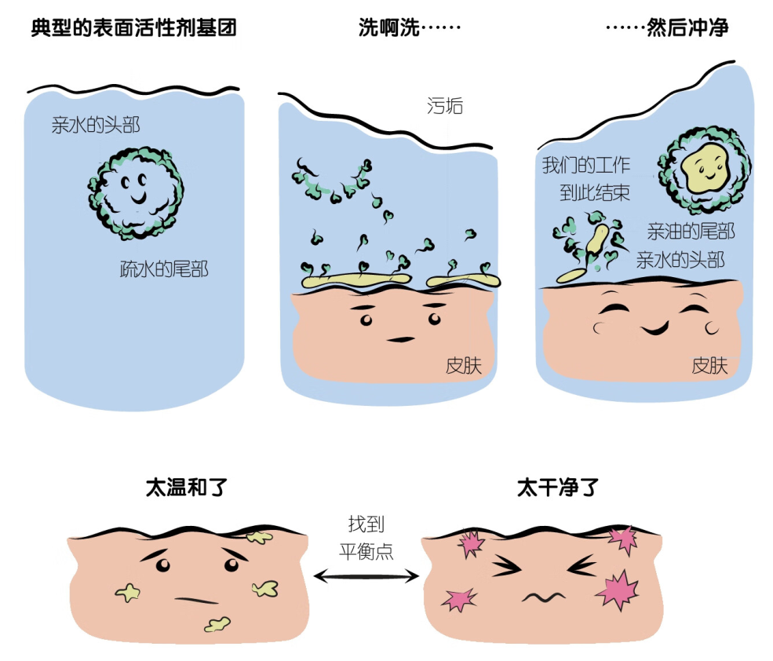

任何洁⾯产品，不管其形态是皂、凝㬵、油还是泡沫，它们的清洁功效都来⾃ **表⾯活性剂**。这些可爱的“⼩家伙”有亲⽔（易与⽔结合）的头部和疏⽔（不易与⽔结合）的尾部，这种“⼀体⼆⽤”的特性使得它们天⽣就是清洁⾼⼿：抓住灰尘和污垢，然后借助⽔流把脏东西从脸上“拽”下来。在洁⾯产品中，表⾯活性剂分⼦会聚集在⼀起形成⼀团团的㬵束，当你在脸部涂上洁⾯产品后打圈摩擦时，这些㬵束就会与油脂相互作⽤并彼此紧紧抓牢，最后通过冲洗把污垢带⾛。这听起来挺简单的，对吧？其实说简单，却⼜不简单。

相对来说，科学还是⽐较简单易懂的（我们希望如此！），但调配完美的洁⾯产品可就有点艺术味了。理想的洁⾯产品应该只结合并带⾛污垢⽽不会影响⻆质层。但有些表⾯活性剂并不是解决问题的⾼⼿。⼀些看似强效的表⾯活性剂实际上会与 ⻆质层的蛋⽩质和脂质相结合，使你在清洁⽪肤后会感觉⼲得要脱⽪了。有些⼈会把这种“⽪都没了”的感觉误认为是超级⼲ 净，这可不对！

除了与⻆质层相互作⽤外，洁⾯产品还有可能会破坏⻆质层的酸性保护膜。酸性保护膜并不是⼀层实际的膜，⽽是指⻆质层的弱酸性环境，这种酸性环境也与⻆ 质层的整体健康有关。事实上，较⾼的⽪肤 `pH` 值（碱性较高）会导致⽪肤菌群紊乱，这也是湿疹和特应性⽪炎等⽪肤问题的特征之 ⼀。不幸的是，许多洁⾯产品，包括好的肥皂都有很⾼的 `pH` 值，这会刺激到那些⽪肤受损的⼈。

这⾥就需要化学家来为你⽀招了！你在市场上看到的每种洁⾯产品都经过了化学家的上百次试验，他们会精⼼平衡洁⾯产品的稳定性、辅助成分、清洁能⼒、潜在刺激性和使⽤感。所以请继续阅读！我们将为你介绍⼀些需要注意的关键成分，这样你也可以在洁⾯产品“闯关游戏”中⼤显⾝⼿。

洁⾯产品的类型真是太多了！不过你只需要记住⼀点：不管是哪种产品，诀窍都是寻求平衡。合适的洁⾯产品会恰好满⾜你的⽪肤需求，在清洁⼒和温和性之间实现平衡。那么，究竟该如何找到最适合⾃⼰的洁⾯产品呢？这⾥就该我们登场啦！我们建议你先熟悉常⻅的表⾯活性剂，然后检查 pH 值，最后⽤⼀ 些辅助产品强化洁⾯效果，⽽不是直接选⽤更强⼒的洁⾯产品。

| 类别                                                         | 特点                                                         | 适合人群                         | 不适合人群                                                   | 如何挑选                                                     |
| ------------------------------------------------------------ | ------------------------------------------------------------ | -------------------------------- | ------------------------------------------------------------ | ------------------------------------------------------------ |
| **皂基**                                                     | 清洁力极强，但 `pH` 值高到可以让皮肤脱屑                     | 中性和油性皮肤类型人群           | 干性、敏感性皮肤，以及有湿疹等角质层问题的人群               | 成分表靠前的位置会出现氢氧化钠或氢氧化钾，化学家们用它们和脂肪酸制造出皂基 |
| **硫酸盐**                                                   | `pH` 值中，泡沫很丰富，清洁力极强                            | 几乎所有的皮肤类型人群           | 对硫酸盐类表面活性剂敏感的人群（如果你不确定自己是否对其过敏，可以感觉洁面后皮肤是否特别干） | 月桂醇硫酸酯钠（SLS）和月桂醇聚醚硫酸酯钠是这类成分中最主要的两种，相较而言，后者对皮肤更友好 来认识⼀下 **⽉桂醇硫酸酯钠（SLS）**，它是任何宣称“温和、⽆硫酸盐”的洁⾯产品都会避开的清洁成分。许多洁⾯产品⾥加 `⼊SLS` 的原因是它很廉价，同时清洁⼒也不错。⼏乎可以说它的清洁⼒太好了，好到可以在刺激性试验中作为阳性对照（以⼀种可控的⽅式⽤⾼浓度的 `SLS` 刺激⽪肤，然后在受损的⽪肤上进⾏产品测试，看⽤或不⽤产品时是否影响⽪肤恢复）。 |
| **椰子甜菜碱**                                               | 最常见的温和表面活性剂，对皮肤友好，清洁力强，泡沫适中       | 所有寻求更温和产品的皮肤类型人群 | 讽刺的是，有些人可能对它过敏                                 | 全称是椰油酰胺丙基甜菜碱，有时化学家会简称其为 “椰子甜菜碱”  |
| **其他温和的表面活性剂： （1）椰油酰异硫酸钠 （2）葡糖苷（椰油基葡糖苷、月桂基葡苷） （3）椰油酰乙酸酯和氨基酸** | 试过所有最常见的表面活性剂，但仍然没有找到你的真爱？试试这里的吧 | 皮肤敏感或长期干燥的人群         | 喜欢丰富、绵密泡沫的人群，因为这类表面活性剂通常是少泡或无泡的 | 椰油酰异硫酸钠、葡糖苷（椰油基葡糖苷、月桂基葡苷）、椰油酰乙酸酯和氨基酸是这一类中的常见成分，它们通常被搭配在一起使用 |

如果你是敏感性⽪肤或有⻓期的⽪肤⼲燥、银屑病、湿疹等问题，那么仔细检查你的洁⾯产品的 `pH` 值永远不会有坏处。⽪肤的天然酸性保护膜（`pH` 值通常在 `5.5` 左右）是⽪肤微⽣物群和⽪肤整体健康的重要组成部分。虽然科学家还没完全搞清微⽣物群和⽪肤 `pH` 值的复杂关系，但还是尽量使⽤标明“`pH` 对⽪肤友好”（`pH` 值⼩于 `6`）的洁⾯产品吧。但是，根据 `pH` 值选择洁⾯产品总是正确的吗？事实上，健康的⽪肤有⾃我调节 `pH` 值的能⼒。所以，如果你有中性、健康的⽪肤，但你喜欢 `pH` 值较⾼的洁⾯ 产品也不⽤⼤惊⼩怪！对于那些⽪ 肤受损的⼈来说，`pH` 值才是更值得慎重考虑的因素。

#### 3.1.3.常见产品

| 产品类型 | 图片                                                         | 特点                                                         |
| -------- | ------------------------------------------------------------ | ------------------------------------------------------------ |
| 洁面皂   | 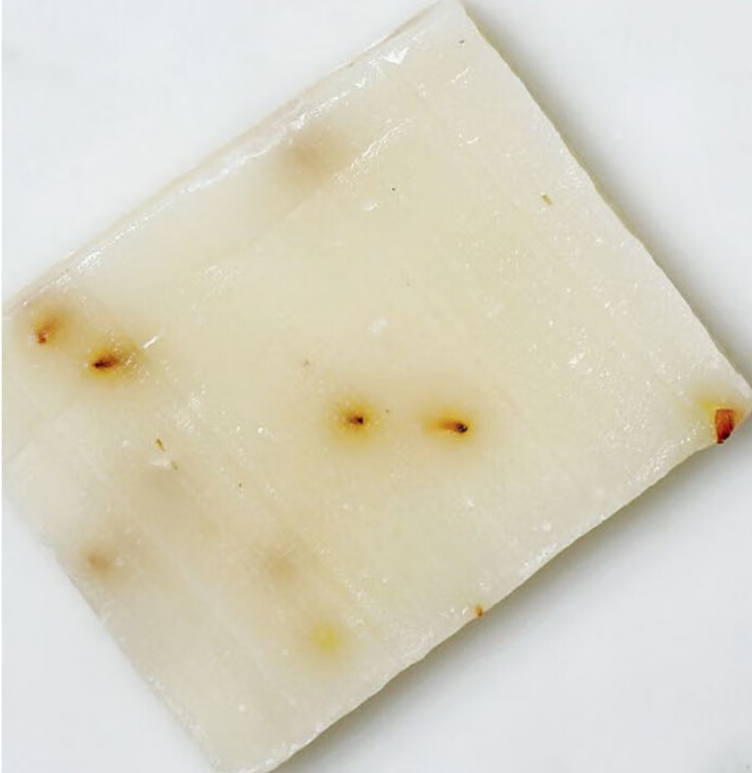 | 肥皂可能是最古⽼的护肤产品之 ⼀。虽然有些洁⾯皂很温和，但⼤多数皂类的 `pH` 值还是偏⾼，并且⽤其洗完脸后感觉很⼲ |
| 卸妆水   | 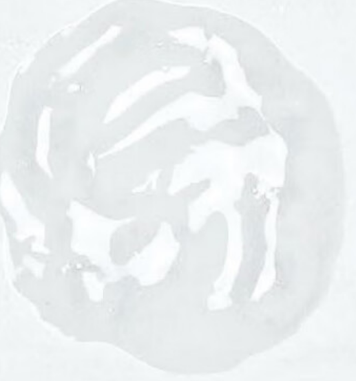 | ⾮常温和，但是不同产品的效果差异很⼤                       |
| 卸妆油 | 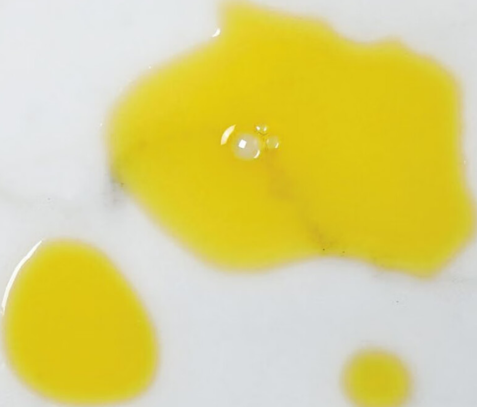 | 能洗掉各种污垢的产品，记住要使⽤那种洗完后脸上不会残留油感的产品。如果有化妆，一般就是两步洁⾯法，先⽤卸妆油，然后⽤温和的洁⾯乳或洁⾯啫喱。卸妆油是帮助去除所有的污垢、灰尘甚⾄化妆品的清洁剂，洁⾯乳或洁⾯啫喱则会帮助去除卸妆油残留的多余油脂（实际我觉得没有化妆没必要使用） |
| 卸妆膏   | 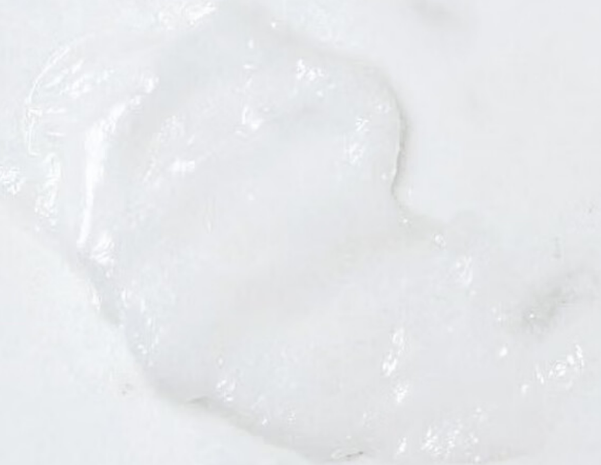 | ⽐卸妆油更⽅便携带，也不⽤担⼼它会漏出去                   |
| 洁⾯湿⼱ | 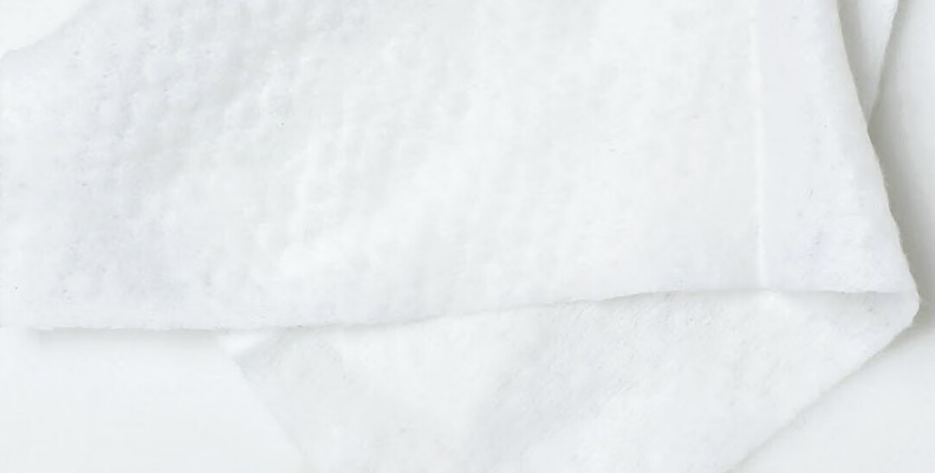 | ⽅便有效，不过我们建议你使⽤后快速冲洗⼀下脸，以确保你的脸上没有残留物。如果你经常出差或旅⾏，可以考虑⽤洁⾯湿⼱来快速清洁⽪肤。你也可以在健⾝包⾥准备⼀瓶卸妆⽔，⽤于健⾝后的快速洁⾯ |
| 洁⾯啫喱 | 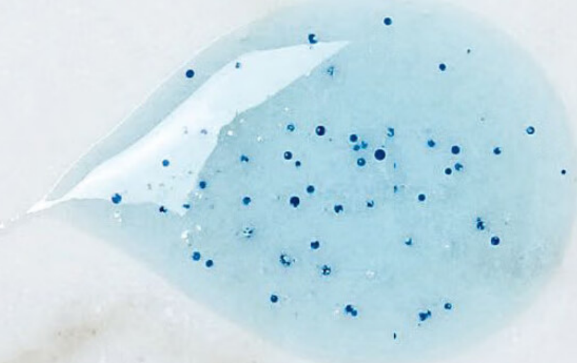 | 有些超级温和，有些可能是强⼒的痤疮清洁产品，甚⾄导致⽪肤⼲燥和起⽪，请仔细阅读产品标签 |
| 洁⾯膏   | 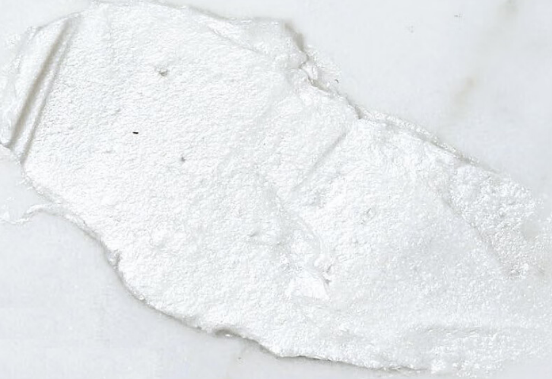 | 经典的膏状产品，清洁效果⾮常好，但脸洗完后可能会感觉太⼲了，所以请仔细检查成分表 |
| 洁⾯粉   | 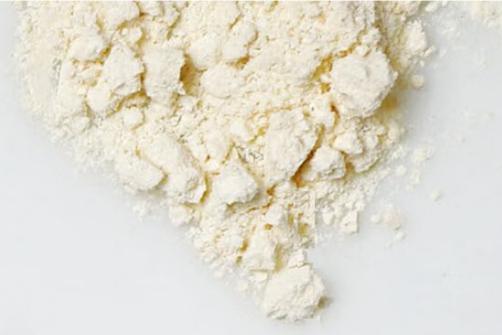 | 有效、温和，⾃带⼀点磨砂作⽤，⼩⼼粉末撒出来容易搞得⼀团糟 |
| 洁面工具 | 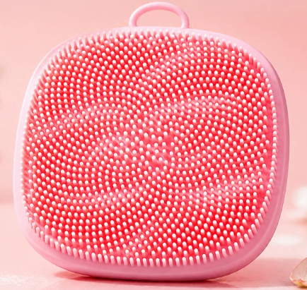 | 声波洁⾯刷、电动洁⾯刷、硅㬵洁面刷、⼿动洁⾯刷、魔芋海绵刷 疯狂的宣传语随处可⻅。你们中的⼤多数⼈可能已经对“光泽度增加 542%！”或“让时间倒流！”这样的字眼习以为常了。但是，在⼀些听起来很疯狂的说法背后偶尔也会有⼀些令⼈惊讶的细节和有趣的研究。实际上，科莱丽（`Clarisonic`）的团队做了不少有关洁⾯刷的有趣研究。在⼀项研究中，测试者在脸上涂抹了⼤量的灰尘和污垢，然后⽐较使⽤和不使⽤洁⾯刷的清洁效果。这项研究证实，声波洁⾯刷的清洁程度要彻底得多。不过，我的洁⾯刷的充电器在哪⼉…… 使⽤洁⾯刷是洁⾯步骤的重要补充，可以让你的温和洁⾯乳效果更好。声波洁⾯刷经过了最严格的测试和验证，是你的选择之⼀，但它也是最贵的洁⾯刷。也有更便宜的电动洁⾯刷、硅㬵刷及⼿动洁⾯刷。记住，要选柔和的软⽑洁⾯刷！ |

### 3.2.保湿步骤

#### 3.2.1.简单人话

有这样⼀句“名⾔”：“朋友们，保持⽪肤湿润！”虽然这句“名⾔”是我们编的，但再怎么强调保湿对⽪肤健康的重要性都不为过。我们要清楚⼀点：⼀个基础的保湿产品并不会带来奇效。但可靠的保湿策略是强化⽪肤屏障的第⼀步，好的⽪肤屏障才可以有效地把好东西（⽔）留在⽪肤 ⾥，把坏东西（⼀⼤堆过敏原及环境压 ⼒）隔绝在⽪肤外。如果没有良好的⽪肤屏障功能，你在⽪肤上使⽤的所有昂贵的抗衰⽼产品都是浪费。

⽪肤最重要的作⽤就是作为⼀道防线保护⼈体不受外来异物侵害，同时保持⽪肤内的⽔分。但是，当⻆质层的含⽔量不⾜时，⽪肤的屏障功能就会减弱。这时候就需要保湿产品了！好的保湿产品能补⾜⽪肤急需的⽔分，同时能加强屏障功能。保湿产品可真多：精华露、精华液、乳霜、安瓿精华、凝霜等。这些产品都可⽤ 于保持⽪肤⽔润。但过于丰富多样的产品却导致⼈们不知如何选择！

#### 3.2.2.科学原理

要了解保湿的⻓期重要性，我们应该先复习本书第⼀部分中的⼀些术语和概念。记住，你的⽪肤就像洋葱⼀样有很多层，其中最外层叫⻆质层。⼤多数护肤品主要针对表⽪的最外层（即⻆质层）起效。

- `⽪肤屏障功能 1`：把坏东西挡在外⾯，让⽔留在⾥⾯⻆质层是⽪肤的最外层，它是防⽌⽔分流失和抵御外来⼊侵者的第⼀道防线。简⽽⾔之，保湿产品可以帮助⻆质层发挥屏障作⽤
- `⽪肤屏障功能 2`：亲⽔成分/⽔性成分健康的⽪肤屏障功能的另⼀个成分是天然保湿因⼦（`NMFs`），它们存在于⻆质层的⻆质细胞中，占⻆质层⼲重的 `20%~30%`。这些亲⽔成分会使⽪肤保持弹性。⽪肤中还有⼀些对细胞正常更新很重要的酶，亲⽔成分对保持酶的活性也很重要。⽪肤中常⻅的天然保湿因 ⼦有吡咯烷酮羧酸、乳酸、游离氨基酸和尿素。记住，`健康的细胞更新 = 健康的⽪肤屏障 = 健康的⽪肤`

你的⻆质层⾮常粗糙：外界过敏原、污染物、紫外线、⽓候变化，甚⾄是简单的⽼化都会对⻆质层造成损害，并阻⽌其正常地发挥屏障功能。你的⽪肤屏障功能⼀旦受这些因素影响，⽪肤就会⼲燥缺⽔、过敏，⽽⼲燥的⽪肤会导致糟糕的⻓期影响。忽视保湿会使你的⻆质层陷⼊恶性循环：⽔分流失加剧，外界刺激物进⼊⽪肤引发炎症，导致⽪肤⼲燥问题更严重、更难吸收保湿成分。如果⼲燥状况没有得到及时改善，恶性循环会引发⽪肤瘙痒、脱屑等短期问题，如果⻓期得不到改善，则会产⽣细纹和皱纹！由此可⻅，找到可靠的保湿⽅法，并随季节、年龄的变化对其不断调整是保持⽪肤最佳状态的重要对策之⼀。

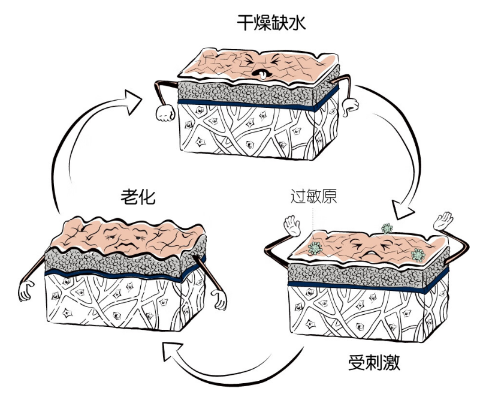

如何找到⼀款合适的保湿产品？这个问题可能会令你困惑烦恼，不过这其中还是有⼀些诀窍的。保湿产品中的不同成分可以根据性质分为三类：

- **保湿剂**：是⼀类可以“抓住⽔分”的成分，可以帮助⽪肤维持健康的含⽔量，保证肌肤柔软、⽔润。⽪肤⾃有⼀套⽔分维持系统，它由天然保湿因⼦构成，护肤品中的保湿剂可以补充、加强这个系统。保湿产品中的常⻅保湿剂有⽢油、透明质酸、⼄⼆醇类。保湿剂⾮常重要，许多护肤品都是以它们为基础调配的

  > [!IMPORTANT]
  >
  > 补充：含保湿剂的代表性产品推荐：化妆⽔、精华露、凝露、保湿精华液和⼤多数凝霜。

  | 类别                                 | 特点                                                         |
  | ------------------------------------ | ------------------------------------------------------------ |
  | 尿素（`相对分⼦质量：60`）           | 尿素是天然保湿因⼦中的⼀种。尿素除了能⽴即补⽔，⻓期使⽤还能增强屏障功能，它在这⼀点上与其他保湿剂不同。事实上，随着年龄的增⻓，尿素在⾝体护理⽅⾯会变得越来越有⽤。不过有些⼈会⼤喊：“尿素来⾃尿液！我可不要往脸上撒尿！”请放⼼，⾯霜中的尿素绝对不是提取⾃尿液 |
  | 乳酸（`相对分⼦质量：90`）           | 乳酸也是天然保湿因⼦的⼀种，它是⼀种⽤途⼴泛的成分，既是杰出的亲⽔保湿剂，也可⽤于化学去⻆质 |
  | ⽢油（`相对分⼦质量：92`）           | 你会在很多护肤产品中发现⽢油，原因是它有⽤！⽢油⼩分⼦可以渗透进⻆质层间隙中的脂质混合物，赋予肌肤美丽、柔软、有弹性的质感 |
  | 泛醇（`相对分⼦质量：205`）          | 泛醇⼜称维⽣素原 `B` ，被认为兼具保湿剂和柔润剂的作⽤。它也有很好的舒缓作⽤ |
  | 㬵原蛋⽩（`相对分⼦质量：30 万`）    | 许多⼈可能将㬵原蛋⽩与抗衰⽼的宣传语联系在⼀起。然⽽，事实是外⽤的㬵原蛋⽩⽆法代替⽪肤⾥的天然㬵原蛋⽩。不过，它的确是很棒的保湿成分 |
  | 透明质酸（`相对分⼦质量：2 万以上`） | 透明质酸可能是最赚钱的保湿成分！你应该听过各种⼴告宣传语，从“保湿”“让⽪肤饱满”到“抗衰⽼”。市场上的绝⼤多数透明质酸是相对分⼦质量在 `200` 万以上的⼤分⼦，它们只会停留在⽪肤表⾯，帮助肌肤全天保持⽔分。还有⼀些分⼦⼩得多的透明质酸。⼀些研究表明，⼩分⼦透明质酸可以穿透⽪肤，使⽪肤饱满、⽔润，甚⾄有抗衰⽼的效果。然⽽，⼩分⼦透明质酸会使某些⼈⽪肤敏感。所以，就像我们常说的：⼀定要先进⾏斑贴试验 |

- **柔润剂**：柔润剂可以填补粗糙⽪肤上的凹陷，⽴刻赋予⽪肤柔软光滑的质感。这类成分通常是较轻质的油状物质，如霍霍巴油、⾟酸/癸酸⽢油三酯、⻆鲨烷、椰⼦烷。当然，最常⻅的柔润剂是⾯部⽪肤分泌的！柔润剂在过去的⼗年⾥变得⾮常流⾏。因此，许多品牌都纷纷推出了“神奇的”、“含有丰富抗氧化成分”、“可以平复皱纹”、“让时间停⽌”、“持续改善⽪肤” 的⾯部润肤油。这些产品确实能很好地帮助⽪肤保湿，但不要把“逆转时间”的说法太当真

  > [!IMPORTANT]
  >
  > 补充：含柔润剂的代表性产品推荐：⾯部润肤油、精华油。
  >
  > 如有以下情形，可考虑使⽤⾯部润肤油：
  >
  > - “我喜欢现在⽤的保湿霜，但我的⽪肤还是有点⼲”。⽪肤是不断变化的。仅考虑压⼒、年龄、⽣活⽅式和激素等因素，你的保湿需求就会发⽣变化。你如果不想换掉保湿产品，同时⼜明⽩到了需要加强保湿的关头，那么可以考虑加⼏滴⾯部润肤油，简单的操作就会有奇效
  > - “我是⼲性⽪肤，但⼜不⾄于是‘沙漠⽪’，没到需要⽤凡⼠林或油膏的地步”。凡⼠林或厚重的封闭剂的肤感的确太差，更不⽤说那种“满脸油光、亮如灯泡”的样⼦现在已经不流⾏了。考虑⼀下⽤⾯部润肤油，它的质地更轻盈，和凡⼠林的性质相似，只不过效果略差
  > - “我的⽪肤有点暗淡”。快速提升⽪肤光泽度的⽅法是来⼏滴润肤油
  > - “我有粉刺，但粉刺药膏让我的⽪肤很⼲燥，我现在的保湿产品也没什么⽤”。找⼀些轻盈的柔润剂，如亚油酸、偏酸性的植物油或⻆鲨烷
  >
  > “润肤油新⼿可以考虑⻆鲨烷”。你在玫瑰果油、西⽠籽油、摩洛哥坚果油或其他植物油之间难以抉择？绞尽脑汁之前不妨考虑⼀下⻆鲨烷，它是⼀种纯净的饱和烃。通俗地讲，这意味着它没有什么特别需要注意之处，不易引起⽪肤刺激或痤疮。对所有⽪肤类型的新⼿来说，它都很适合⼊⻔使⽤。
  >
  > 把润肤油放在它喜欢的地⽅——凉爽、⿊暗、密封性好的地⽅。这是因为油容易氧化、酸败，酸败的油会变⾊并带有异味，氧化的油则最终会伤害你的⽪肤。

  | 类别                                      | 特点（适合干性皮肤）                                         |
  | ----------------------------------------- | ------------------------------------------------------------ |
  | 甜扁桃仁油（甜杏仁油）                    | 质地轻薄温和，不饱和脂肪酸丰富，渗透性不错，封闭力中等；肤感顺滑不厚重，滋润但不会过于黏腻；很好推开，致敏性低，干皮日常基础保湿很合适；油皮少量可用；稳定性尚可，适合基础润肤、搭配其他修护油脂 |
  | 杏仁油（苦杏仁油，护肤多用脱毒版本）      | 注意：护肤用是精制脱毒苦杏仁油；富含油酸，滋润力比甜扁桃仁油更强一点，封闭中等；舒缓干燥粗糙；**不建议高浓度直接上脸**，刺激性略高于甜扁桃仁油；多用于配方少量添加，干皮适合作为复配油脂，不推荐纯油大面积涂抹 |
  | 摩洛哥坚果油（阿甘油）                    | 高油酸，封闭性中等偏强；滋润力优秀，改善干燥起皮、粗糙；含有维 `E` 抗氧化；肤感润，略厚重；非常适合干皮、秋冬、屏障干燥；油皮单用容易偏油，一般低比例复配 |
  | 鳄梨油（牛油果油）                        | 含大量油酸和植物甾醇，封闭较强；滋润度高，修护干燥屏障效果好，改善干皮脱皮；质地偏厚；干皮友好；油皮不建议单独大量用，容易闷；常添加在修护面霜、油类精华 |
  | 山茶花油（茶籽油）                        | 油酸含量很高，接近皮脂；渗透性好，封闭中等；肤感清爽润，不厚重，抗氧化；干皮四季可用，油皮少量也可；稳定性较好，传统以油养肤常用，改善干燥粗糙 |
  | 霍霍巴油（荷荷巴油）                      | 本质是液态蜡酯，不是甘油三酯；结构和人体皮脂非常接近，渗透性好，稳定性高、不易氧化；兼具柔润 + 轻度封闭，可调节皮脂，不容易闷痘；适合干皮、油皮、屏障受损肌；肤感润而不厚重，常用于以油养肤、护发 |
  | 夏威夷果油（澳洲坚果油）                  | 富含棕榈油酸，和人体皮脂脂肪酸相似；封闭中等偏强，滋润力好，渗透顺滑；可以软化干燥角质；干皮很适合；肤感温润，比 `GTCC` 厚重，油皮少量复配可行；抗氧化不错 |
  | 马鲁拉油                                  | 高油酸，封闭强，滋润力强，抗氧化能力优秀；修护干燥受损屏障，缓解粗糙干纹；质地偏厚重；优先适合大干皮、秋冬干敏；油皮不适合单用，容易油腻 |
  | 辣木籽油                                  | 质地轻薄，封闭偏弱，柔润顺滑，抗氧化；滋润力中等，保湿偏基础；干皮适合搭配高封闭油脂一起用；肤感清爽，不容易厚重；适合复配，不建议单独作为主力保湿油 |
  | 橄榄油（精制橄榄油，护肤级）              | 油酸为主，封闭中等偏强，滋润度不错；改善干燥；缺点：粗橄榄油刺激性高、容易氧化致敏，护肤只用精制款；干皮适合复配；不建议纯橄榄油长期上脸，易致痘、氧化变质 |
  | 乳母果油（乳木果油，液态 / 精制乳木果油） | 富含植物甾醇、饱和脂肪酸，封闭强，修护力强；强效改善干皮脱皮、紧绷，舒缓干燥屏障；常温精制液态款肤感润，固态乳木果膏更厚重；大干皮、屏障受损首选；油皮只能少量添加，纯用易厚重闷肤 |

  | 类别                          | 特点（适合油性皮肤）                                         |
  | ----------------------------- | ------------------------------------------------------------ |
  | ⾟酸 / 癸酸⽢油三酯（`GTCC`） | 中链合成酯，椰子 / 棕榈来源衍生物；质地清爽、铺展极好、无味，渗透快，封闭性偏弱；主要做柔润剂，用来提升乳液面霜顺滑度，也常做精油稀释载体；致痘风险很低，配方百搭，适合做轻薄护肤品基底 |
  | 椰⼦烷（`Cocoalkanes`）       | 椰子油氢化得到的烃类柔润剂，天然硅油替代品；肤感是丝滑干爽，上手之后快速变哑光，几乎无油光；封闭性弱，主打顺滑触感，不是强锁水；多用于轻薄乳液、精华、粉底，不闷痘，改善涂抹延展性 |
  | 黑茶藨子籽油 / 黑醋栗籽油     | 富含 `γ-亚麻酸`，不饱和脂肪酸丰富；质地轻薄，封闭偏弱，渗透快，不会厚重泛油；兼具舒缓抗炎，适合出油伴随泛红、不稳定的油皮；一般低比例复配，不建议高浓度单用，油脂容易氧化 |
  | 奇亚籽油                      | 高含量 `Omega-3`，质地轻薄水润感，封闭弱；肤感清爽，上脸油感停留短；抗炎修护，适合外油内干、屏障偏脆弱油皮；抗氧化但不耐存放，配方少量添加为主，不适合作为主力封闭油脂 |
  | 蔓越莓籽油                    | 富含不饱和脂肪酸与多酚；质地轻薄，油感轻，封闭弱；抗氧化、舒缓，油皮上脸不易闷、不易泛厚重油光；适合外油内干肤质，大多复配使用，不单独大量用 |
  | 月见草油                      | 富含 `γ-亚麻酸`；质地轻薄，封闭力弱；主打舒缓修护，适合出油伴随敏感、干燥泛红的油皮；氧化速度快，配方中低剂量添加，不建议纯油上脸，容易变质刺激 |
  | 葡萄籽油                      | 高亚油酸，质地非常清爽，渗透快，油感轻，封闭偏弱；抗氧化，肤感轻薄不厚重，油皮友好；致痘风险低；适合外油内干，缺点是容易氧化，稳定性一般，多作为复配柔润油脂 |
  | 大麻籽油（工业大麻籽油）      | 脂肪酸组成接近皮脂，亚油酸含量高；质地清爽水润，封闭弱；舒缓修护，调节皮脂，油皮、混油很适配；油感轻薄不闷闭口，适合外油内干屏障受损油皮；注意容易氧化，需做好防腐避光 |
  | 百香果油（西番莲籽油）        | 亚油酸丰富，质地轻薄顺滑，油感淡，封闭弱；铺展好，上脸很快吸收，不易泛油；抗氧化，适合油皮做辅助柔润，多用于复配，保湿力偏弱，不能单独用来强锁水 |
  | 仙人掌油（仙人掌籽油）        | 质地轻薄清爽，油感很淡，渗透迅速；富含 `维E`、植物甾醇，封闭弱；修护舒缓，适合油皮 / 混油，尤其外油内干；几乎没有厚重糊脸感，价格偏高，配方少量添加 |
  | 玫瑰果油                      | 高亚油酸、亚麻酸；质地轻薄，油感中等，封闭偏弱；修护、改善粗糙与色素沉着；油皮适合少量复配，不建议高浓度单用，容易氧化，部分人会闷闭口；更适合外油内干 |
  | 沙棘（`jí`）籽油              | 富含不饱和脂肪酸、类胡萝卜素、`维E`；有修护抗炎作用；颜色橙黄，油感中等，封闭中等；油皮只能低比例添加，不建议大量单用，容易染色、闷肤；适合出油伴随干燥泛红的屏障脆弱油皮 |
  | ⻆鲨烷                        | 烃类油脂，人体皮脂本身就含；亲肤性极强，温和低刺激；填补角质缝隙、修护屏障，轻薄封闭，锁水不错；丝滑不黏腻，敏感肌、医美术后友好；植物来源版本（橄榄/甘蔗）很常见，适配绝大多数肤质 |

- **封闭剂**：⽪肤是抵御紫外线和污染物等外界侵害的屏障，但你的⽪肤屏障有时候也需要⼀点额外的帮助。封闭剂就是协助⽪肤更好完成任务的帮⼿。封闭剂通常是厚重的、像脂肪或蜡⼀样的物质，可以在⽪肤上形成⼀层物理性的防⽔屏障，并把⽔分锁在⽪肤内。常⻅的封闭剂包括凡⼠林、⻩油等动物油，蜡和较厚重的硅油。以封闭剂为主的产品，如油膏，对极度⼲燥的局部⽪肤⼗分有效

  > [!IMPORTANT]
  >
  > 补充：含封闭剂的代表性产品推荐：油膏、油脂、软膏。

  | 类别                          | 特点                                                         |
  | ----------------------------- | ------------------------------------------------------------ |
  | 矿脂（凡士林，外号 “老好人”） | 矿脂⾄今仍是封闭剂的⻩⾦标准。近年来，⼀些过于恐惧化学品的⼈声称“凡⼠林会导致痤疮与癌症”。但事实是化妆品级的凡⼠林是⾼度提纯的，⾮常“⼲净”（没有潜在的刺激物和有害残留物），不会堵塞⽑孔，但如果你懒得洗脸，它会和脸上没洗掉的灰尘、油脂混在⼀起，引起痤疮 |
  | 矿物油                        | 矿物油⽐凡⼠林更轻质，封闭性也没那么强，所以⽤它做成的乳霜也更轻薄。不同的成分对你最终⽤到的护肤品会产⽣多⼤的影响呢？这点很有趣！矿物油或矿脂的含量即使只改变了 `1%`，也会改变⾯霜的最终使⽤感 |
  | 乳木果油                      | 乳⽊果油通常呈固态，像⻩油⼀样。它是⼀种很棒的多⽤途封闭剂，⽽且纯天然。在“纯净护肤”的浪潮中，你偶尔会看到“未经加⼯的乳⽊果油”。有些⼈认为“未经加⼯”就意味着“更安全”和不含可怕的化学成分。然⽽，事实是植物是复杂的有机体，未经加⼯的乳⽊果油可能含有刺激性成分。我们更推荐精制乳⽊果油，⽽且有很多不同的质地可供选择 |
  | 羊毛脂                        | 这种从⽺⽑中提取的封闭剂的效果⾮常好，不过，它可能引起某些⼈过敏，所以你需要购买医⽤级别的⽺⽑脂，并确保在使⽤前进⾏了斑贴试验 |
  | 蜡                            | ⼤⾃然中也有很多优秀的封闭剂，如蜂蜡、⼩烛树蜡、巴西棕榈蜡等。它们的主要缺点是质感像蜡烛⼀样⼜硬⼜厚。蜡类的熔点较⾼，所以不适合⼤量添加在产品中 |
  | 硅油/硅树脂/硅氧烷            | 硅油是⼀⼤类化合物的统称。但不管具体是哪种，它们都有⼀个共同⽽简单的特性 ———— ⼿感棒极了！它们既可以有效地封闭⽔分，同时⼜不会感觉特别厚重。如果你的⽪肤油腻，那添加了硅油的⽔凝霜不仅可以很好地满⾜你的补⽔需求（⽆论是季节更替还是⽪肤状况改变时），⽽且还不会让你觉得太油了。如何找到含硅油的凝霜？在成分表的前⼏个成分中找是否有 “xx聚xx基硅油” 或 “有机硅交联聚合物” 之类的词吧 |

这三类成分协同作⽤，满⾜⽪肤的保湿需求。了解这些成分是如何起作⽤的，并掌握它们相互搭配的平衡，是破解⽪肤保湿难题的关键。

⼤多数保湿产品的功效测试包含两个关键值：

- ⽪肤含⽔量：⽪肤含⽔量是通过⻆质层⽔分测试仪测量的，这种⼿持设备会测量⽪肤的电导率（也就是⽪肤导电还是不导电），并出具⽪肤含⽔量的测量结果。测试时，先在清洗过、涂过保湿产品的⽪肤上测试含⽔量，⼏⼩时后再测⼀次，以此来评判产品的保湿效果
- 经⽪⽔分散失（`TEWL`）：`TEWL` ⽤于衡量有多少⽔分通过你的⽪肤蒸发到外部环境中。`TEWL` 评分越⾼，⽪肤屏障越差。该⽅法可以有效地评估数个不同的护肤品。例如，测试者可以先⼈为提⾼⼀块⽪肤的 `TEWL`，然后使⽤待测的保湿霜测试 `TEWL` 值降低了多少

> [!IMPORTANT]
>
> 补充：似乎有越来越多的产品专⻔针对特定的部位，如眼周、嘴唇、脖⼦、左屁股蛋...但这些产品真的都有必要吗？以下是⼀些针对特定部位的护理建议：
>
> - 手脚区域：这⾥的⽪肤⽐较厚，所以如果你的⼿和脚都很⼲燥的话，可以使⽤封闭性强的保湿霜来防⽌⽪肤⼲裂。这类产品的缺点：使⽤时经常感觉油乎乎、滑溜溜的，会影响抓握东西
> - 眼部区域：这里的⽪肤更脆弱，⻆质层更薄，但它所需要的功效成分与⾯部其他区域基本相同。只要没有感觉到刺激，便可以把你的护肤产品直接⽤在眼周。当然，我们这⾥只是在讨论保湿需求，眼部抗衰⽼护理后面再说
> - 唇部区域：往往需要使⽤专⽤护理产品。⼀⽅⾯是因为唇部⽪肤的⻆质层更薄，另⼀⽅⾯则是因为唇部⽪肤完全没有⽪脂腺和⿊⾊素。凡⼠林、⽺⽑脂和其他厚重的封闭剂都有助于保护唇部⽪肤免受外界伤害。鉴于唇部没有⿊⾊素（没法靠黑色素抵御紫外线），你可以在⽩天使⽤有防晒功能的润唇膏
> - 屁股区域：护理你那宝贵的左屁股蛋得像你对待⾝体的其他部位⼀样，好好使⽤⾝体乳。我们发现，最近市⾯上涌现出许多昂贵的⾝体护理产品，但是相对来说，⾝体⽪肤更经得起“摧残”，所以便宜的⾝体乳就够了。随着年龄增⻓，⽪肤细胞的更新速度会变慢，⽪肤⼲燥会成为你更⼤的问题，所以使⽤含有乳酸和尿素的⾝体乳吧，以帮助⽪肤保湿和发挥屏障功能

#### 3.2.3.常见产品

| 产品类型         | 图片                                                         | 特点                                                         |
| ---------------- | ------------------------------------------------------------ | ------------------------------------------------------------ |
| ⾯部润肤油       | 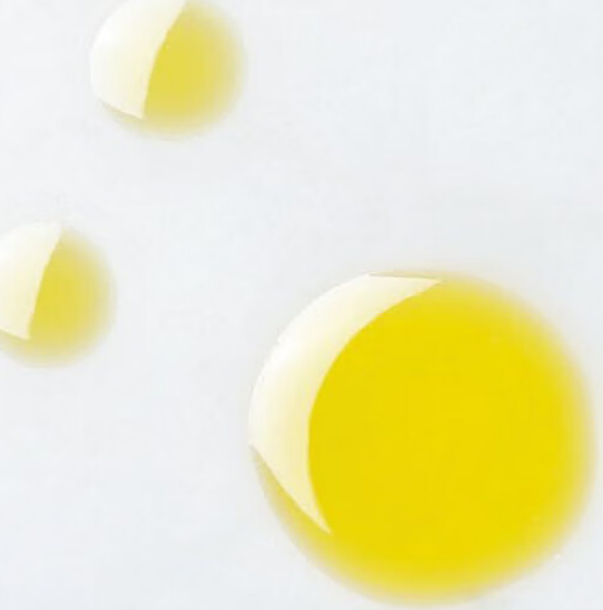 | 这种有助于润肤的产品可以给你的⽪肤带来柔软的触感和健康的光泽 |
| ⽚状⾯膜         | 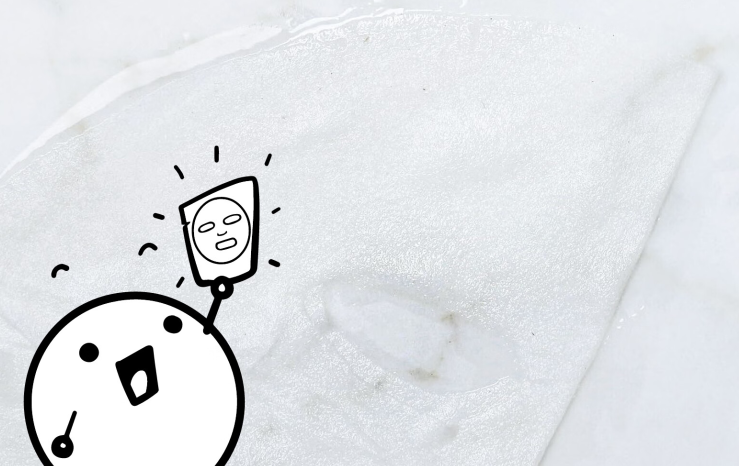 | 把你的⽪肤“浸泡”在液体中，这是帮助⽪肤吸收更多⽔分的⼀种⾼效⽅式 |
| ⽔凝霜           | 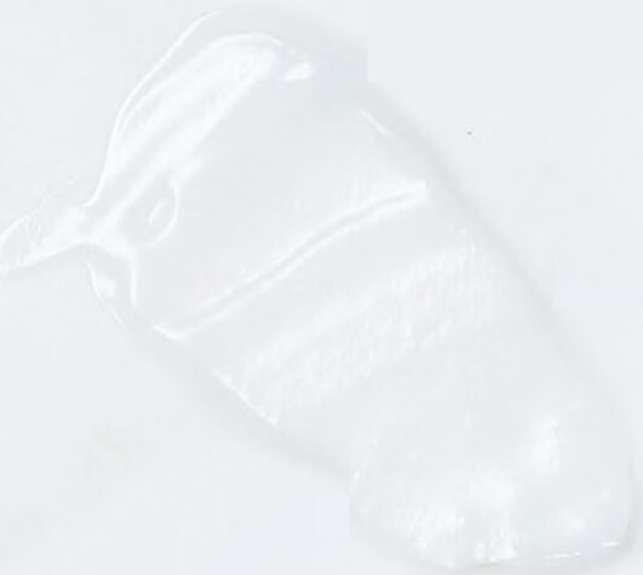 | 这种⽐较轻薄的保湿霜含有较少或更轻质的封闭剂，因⽽更适合油性⽪肤使用 |
| 保湿精华（啫喱） | 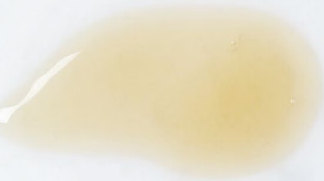 | 帮助⽪肤补⽔的⼀种很好的产品                                 |
| 保湿喷雾与爽肤⽔ |  | 简单地给⽪肤增加少量的⽔分和极少的功效成分                   |
| 乳霜             | 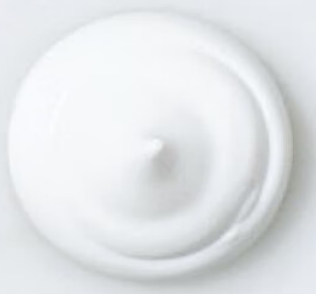 | 这种较厚重的保湿产品含有较多封闭剂（包括凡⼠林、油脂），对⼲性⽪肤很有好处 |
| 油膏与乳膏       | 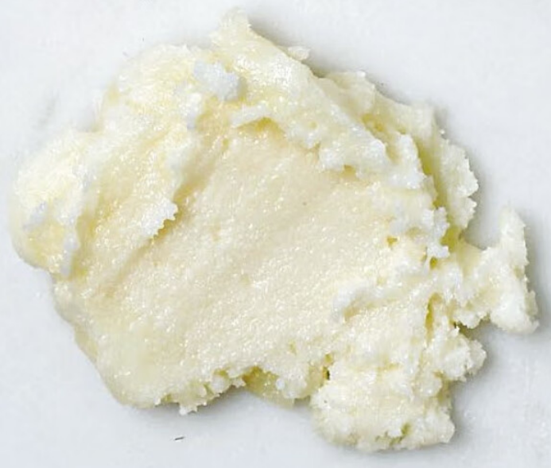 | 它们的封闭性极好，朋友们记住了！它们都是为容易出现局部⼲燥的⼈准备的强效、急救产品 |

主⼒产品指的是那些更传统的保湿产品，由保湿剂、柔润剂和封闭剂构成，既可以是流动的乳液，也可以是浓稠的乳霜。辅助产品通常只含有⼀类保湿成
分。如果你的化妆台上有辅助产品那就太棒了，当你觉得主⼒产品还不够保湿的时候，不必买新的，只要加上辅助产品⼀起⽤就⾏了。

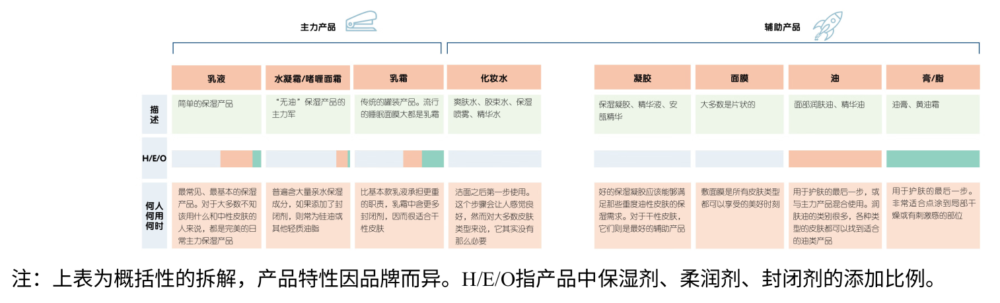

- 中性皮肤：选水凝霜或乳液，天赐肌肤！紧绷、干燥只是你偶尔或冬天才有的问题。简单的凝霜或乳液就够用了
- 我太干了：选啫喱、面霜和（或）油膏，适合你的方式是一层一层地叠加！在你出现问题、开始脱屑的局部皮肤上再加一层油膏
- 我有点油：选啫喱或水凝霜，如果你的脸上中午就开始泛油光，那你需要啫喱状产品；如果你出油不太严重或属于混合性皮肤，简单地用水凝霜就可以了
- 皮肤敏感：凡士林膏，你需要增强皮肤屏障功能，可以使用那些重点添加了神经酰胺、胆固醇、游离脂肪酸或舒缓成分的产品

### 3.3.防晒步骤

#### 3.3.1.简单人话

阳光是引起⽪肤⽼化的外部凶⼿，这是有科学依据的。阳光引起的衰⽼被定名为“光⽼化”。光⽼化与众多⽪肤表现有着⼴泛联系，包括过早出现的细纹和皱纹、肤质变化、⽪⾰状外观、⾊素沉着，光⽼化还会直接引起 `DNA` 损伤。但⼀些⼈（包括我们俩）⼜极度向往那种⽇晒后的健康⼩⻨⾊肤⾊。防晒霜并不是配⽅最棒的产品，它往往是黏糊、煞⽩、厚重、
油腻的，甚⾄还有股特殊的味道。在海滩上涂防晒霜并不会让⼈联想到迷⼈的迈阿密海滩⽣活，⽽是容易让⼈联想到⼀个鼻⼦⽩得发亮、总是散发着防晒霜⽓味的⼤叔。但只要找到最
适合你的防晒霜，就能解决这个问题了。从⻓远来看，更好的防晒习惯会塑造更好的⽪肤，这才是真正的抗衰⽼！

#### 3.3.2.科学原理

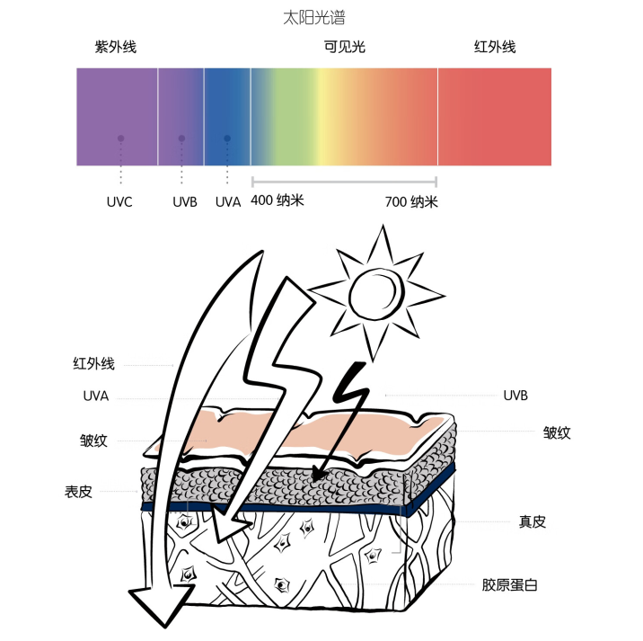

太阳是⼀个巨⼤的核反应堆，它辐射的光谱很⼴，包括可⻅光、红外线（能量）、紫外线。在这三种射线中，紫外线是造成⽪肤损伤的主要射线，⽪肤损伤的最终表现是过早的光
⽼化。实际上，紫外线有三种，了解它们的区别是有⽤的，因为防晒霜会针对不同紫外线发挥防护作⽤：

- `UVC`：三种紫外线中波⻓最短的⼀种，幸运的是，这种紫外线会被⼤⽓层过滤掉，因此我们可以放⼼地忽略它
- `UVB`：三种紫外线中波⻓居中，在能照射到我们⽪肤的紫外线中，`UVB` 占 `5%`，与 `UVA` 相⽐，它的波⻓较短，因⽽只能到达表⽪，`UVB` 会造成晒伤和延迟性晒⿊（⿊化），是⽪肤癌的致病元凶，它的波⻓很短，这意味着它能量很⾼，⾼到可以直接伤害你的⽪肤细胞乃⾄ `DNA`，这就是如果晒伤超过 `5` 次患⿊⾊素瘤的⻛险会翻倍的原因
- `UVA`：三种紫外线中波⻓最⻓的，在能照射到我们⽪肤的紫外线中，`UVA` 占 `95%`，`UVA` 可以⼀直到达真⽪层，会造成深层光⽼化，加剧⽪肤癌的严重程度，除了直接损伤外，`UVB` 和 `UVA` 还可导致产⽣更多⾃由基，从⽽诱发伤害。⾃由基极易参与化学反应，它们会⽆差别地攻击⽪肤细胞、蛋⽩质、`DNA`，造成⻓期伤害

> [!IMPORTANT]
>
> 补充：我们注意到宣称产品“全光谱防护”已成为⼀种趋势。你不⽤过分担忧其他射线，也不必太在意这种宣传语。以下为你逐⼀解析。
>
> - `UVC` 防护： `UVC` 的热能⽐ `UVB` 还要⾼，所以这⼀定意味着 `UVC` 会引起更严重的晒伤，你是这样认为的吧？事实是 `UVC` 已经被平流层和臭氧层吸收了，所以不⽤理会它
> - 蓝光：需要保护⾃⼰免受⼿机和电脑的伤害吗？放⼼吧，电脑屏幕发射的蓝光远少于你在阳光下照到的蓝光。⼤多数声称能保护你免受蓝光影响的成分都是抗氧化剂，没什么新意可⾔。我们是不会专⻔买蓝光防护产品的
> - 红外线：红外线⽐ `UVA` 能穿透到⽪肤更深处。⼀些研究表明，⻓期的红外线照射会损害⽪肤。该怎么办呢？抗氧化剂可以抵御任何潜在的⾃由基损伤

可以这样便捷记忆，`B` 会 `Burn`（晒伤），`A` 会 `Aging`（⽼化）。

- 在⼭上，海拔越⾼意味着⼤⽓越稀薄，也意味着更多的紫外线暴露，你去滑雪的时候，千万要涂防晒霜
- 在⻜机上，⻜机⻜得越⾼，紫外线肯定越强。如果在⻜机上靠窗坐，需要担⼼紫外线过量吗？⻜机窗⼾由有机玻璃制成，它们确实能阻挡⼀部分紫外线，但仍会有⼀部分
  `UVA` 穿过它，你可以做的是拉下遮光板，戴上眼罩，服⽤⼤量褪⿊素，涂上保湿霜，把⾃⼰遮挡严实，喝⽔，并好好休息
- 阴天，阴天指天空中的中低云层多于 `95%`，这时能照到⽪肤的阳光当然也较少。不过，虽然可⻅光和红外线减少了，紫外线仍能损害你的⽪肤。你仍需要使⽤防晒产品，特别是你外出活动时
- 少云，少云天⽓时会出现⼀种有趣的现象，当云恰好处于合适的位置或云虽然不完整但⼀块块的⾜够密集时，它们不仅会散射紫外线，还会使紫外线强度提⾼（可增加
  `25%`）
- 开⻋或室内⼯作，汽⻋玻璃或办公室、家⾥的玻璃窗可以阻挡 `UVB`，但不能阻挡 `UVA`，所以你仍然会被紫外线照射到，你的⽪肤仍会⽼化

回顾防晒的历史可以发现，防晒更多是出于审美需要，⽽⾮防晒伤的需求。许多⽂化都有着对⽩皙⽪肤的相同偏好。为了防⽌晒⿊，古埃及⼈使⽤⽶糠、茉莉花和⽻扇⾖等天
然成分，古希腊⼈使⽤橄榄油。在缅甸，⼈们使⽤⻩⾹楝粉（⼀种树⽪磨碎后做成的膏状物）来让⽪肤变光滑，防⽌痤疮及晒伤。⼀直到20世纪初，许多药剂师还会⽤橄榄油和扁
桃仁油来调配防晒霜。

`20` 世纪，防晒霜开始商品化，并加⼊了真正的防晒剂，如氧化锌和⽔杨酸苄酯。法国化学家、欧莱雅公司的创始⼈欧仁·舒勒（`Eugène Schueller`）⾸先研制出了真正的化学防
晒霜。我们还必须感谢奥地利化学家弗朗兹·格莱特（`Franz Greiter`），他不仅研发出第⼀个真正有效的防晒配⽅，还创造了今天仍在使⽤的防晒系数（`SPF`）。从古⾄今，除了外⽤防晒化妆品外，⼈们为了防晒也会穿着特定的服装。遮阳伞、软檐帽，再到可怕的⽪制防晒⾯罩，这些都在史料上留下了图⽚和⽂字记载，由此可⻅，⻓久以来⼈们就知道阳光有多危险！

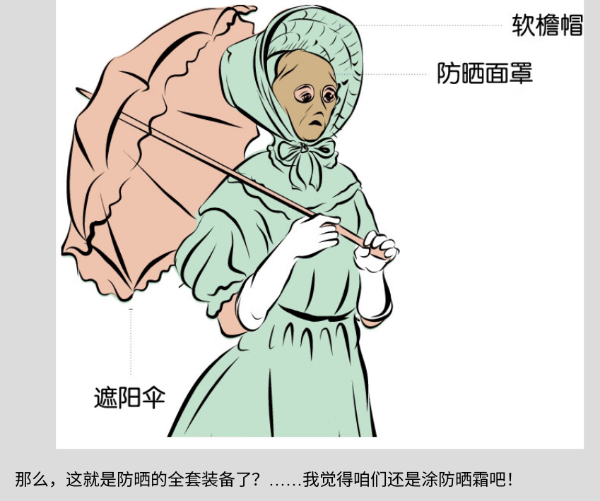

除了增加患⽪肤癌的⻛险外，⽇晒也会造成⽪肤⽼化，⽽且是⽪肤⽼化的主要原因。紫外线对⽪肤的伤害会导致⼀切你不想要的后果：下垂、粗糙、⽪⾰样增厚、⾊素沉着、皱纹、暗沉等。阳光损伤⽪肤时会触发⽪肤中的炎症反应，使成纤维细胞被激活并开始分解㬵原蛋⽩。与此同时，⽪肤还会启动另⼀种防御机制，表现为⽪肤开始变厚，⿊素⼩体过度产⽣⽽出现⾊素沉着。⼲燥、暗沉、粗糙和皱纹都是⻓期损伤的结果。即使是健康的⽇晒⼩⻨⾊，也表明你的⽪肤正在抵御阳光伤害。事实是，紫外线损伤是⽪肤早衰的⼀个重要因素，并产⽣了⼀个专⻔的术语，光⽼化。

防晒霜可以吸收有害的 `UVA` 和 `UVB`，这样⽪肤就因不会再吸收紫外线⽽受到保护了。很多⼈认为防晒霜只是物理性地阻挡阳光，但其实并⾮如此。防晒霜的防护原理是吸收紫外线后将吸收到的少量能量以热能的形式散发出去。在美国，因为防晒霜可以降低患⽪肤癌的⻛险，所以它们是受美国⻝品药品监督管理局（`FDA`）监管的。你可以在美国市⾯上的防晒霜上看到“防晒剂含量”的标签，⽽不⽤在成分表的⼀堆乱七⼋糟的化学名词中寻找防晒成分。挑选适合⾃⼰的防晒霜时，记住要核对三个重要指标：

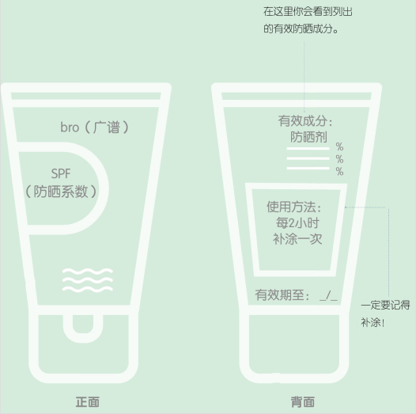

- **UVB 防护能⼒（SPF）**：`SPF` 值并不等同于防护⼒。⽐较 `SPF30` 和 `SPF15` 的防晒霜，⼈们会误以为前者的防护⼒是后者的两倍。但 `SPF` 值并不是这么计算的。`SPF15` 的真正含义是，在正确使⽤的情况下只有 `1/15，约 7%` 的 `UVB` 能透过防晒膜，也就是说它可以阻挡约 `93%` 的 `UVB`。同理，`SPF30` 的防晒霜可以阻挡 `1/30，约 97%` 的 `UVB`。所以，`SPF30` 的防晒能⼒并不是 `SPF15` 的 `2` 倍。⼀个有趣的事实！`SPF100` 的说法在欧盟是被禁⽌的，因为它有误导的嫌疑，暗⽰⼈们防晒霜可以阻挡 `100%` 的 `UVB`。`SPF` 值在实际⽣活中有什么⽤？⽇常⽣活中，我们建议选择 `SPF30〜50` 的防晒产品，这样容易使防护⼒与优秀质感达到平衡，但有的时候 `SPF30` 可能更理想。如果你选了⾼ `SPF` 值的防晒霜却被泛⽩、质地不好、刺激⽪肤等问题困扰，那我们想再次告诉你，经常使⽤较低 `SPF` 值的防晒霜⽐偶尔⽤较⾼ `SPF` 值的防晒霜的防护效果更好。记住，质地为王
- **UVA 防护能⼒（PA）**：针对波⻓更⻓的 `UVA`，你同样需要适当的防护。`UVA`不会晒伤⽪肤，但它会⽐ `UVB` 穿透到⽪肤更深层，它也是光⽼化的主要元凶。在美国，防晒霜上只有一个简单的“⼴谱 `bro`”字样表明它经过了 `UVA` 防护的功效测试。`SPF` 是⼀个全世界普遍使⽤的系数，但 `UVA` 防护的标识在各个国家、地区是不同的。中国、⽇本等国家使⽤ `PA` 值表⽰ `UVA` 的防护等级，其中 `PA+` 等级最低，`PA++++` 等级最⾼。在欧盟地区，⼀款防晒霜如果具有与 `PA+++` 防晒霜同等的防护等级，那么产品包装上会印有 `UVA` 标识
- **质地**：我们要告诉你⼀个真相，调配防晒霜就像在⽿边嗡嗡作响⼜打不到的蚊⼦或脚⼼上的蚊⼦包，烦死⼈了。配⽅师在调配配⽅时⾯临着各种挑战，⽽你使⽤防晒霜时也能感受到它们的质地是多么难以掌控。很多防晒霜都会让⼈觉得油腻、厚重，让脸看起来像戴着⽩⾊⾯具。尽管防晒霜在保护⽪肤⽅⾯有着诸多好处，但它太难相处了。这就是我们⼀直强调防晒霜的质地最重要的原因。如果要获得⾜够的防晒效果，需要⽤多少防晒霜呢？如果全⾝涂抹，⼤约需要半玻璃杯的量（`30` 克）；如果只⽤在脸部，⼤约需要⼀枚硬币的量（`1` 克左右）。牢记这个⽤量，同时也要牢记质地更好的防晒霜效果才更好，只有这样你才愿意每天使⽤，并且每 `2` ⼩时补涂⼀次。不要在⾼到离谱的 `SPF` 值上浪费⾦钱、精⼒，它的质地会让你难受到崩溃。好消息是，现在不再是“除了难⽤的防晒霜，别⽆选择”的时代了，市⾯上有各种各样供选择的防晒产品

> [!IMPORTANT]
>
> 补充：还有一些其他的光线可以简单讲讲
>
> - `UVC` 防护： `UVC` 的热能⽐ `UVB` 还要⾼，所以这⼀定意味着 `UVC` 会引起更严重的晒伤，你是这样认为的吧？事实是 `UVC` 已经被平流层和臭氧层吸收了，所以不⽤理会它
> - 蓝光：需要保护⾃⼰免受⼿机和电脑的伤害吗？放⼼吧，电脑屏幕发射的蓝光远少于
>   你在阳光下照到的蓝光。⼤多数声称能保护你免受蓝光影响的成分都是抗氧化剂，没什么
>   新意可⾔，我们是不会专⻔买蓝光防护产品的
> - 红外线：红外线⽐ `UVA` 能穿透到⽪肤更深处。⼀些研究表明，⻓期的红外线照射会损
>   害⽪肤。该怎么办呢？抗氧化剂可以抵御任何潜在的⾃由基损伤

> [!IMPORTANT]
>
> 补充：抗氧化精华液说它能阻⽌阳光伤害。难道抗氧化剂就是防晒霜吗？不，抗氧化剂并不等于防晒霜。但你可以这样理解
>
> - 防晒剂可以阻⽌⾃由基的产⽣
> - 抗氧化剂可以结合已产⽣的⾃由基
>
> 那么，防晒剂和抗氧化剂就可以组合在⼀起来⽣效，这样的效果就更好了。

> [!IMPORTANT]
>
> 补充：你是否曾对⽪肤科医⽣是如何对肤⾊进⾏分类的感到好奇？
>
> 在菲茨帕特⾥克（`Fitzpatrick`）⽪肤类型量表中，⽪肤按肤⾊分为 `6` 个类型。这种划分看起来可能太宽泛了（谢天谢地，菲茨帕特⾥克博⼠没有试图推出粉底系列），但它实际上代表的是你的⽪肤对阳光的反应。在量表中，肤⾊较浅的⼈（左侧）容易晒伤且患⽪肤癌的⻛险较⾼，右侧的深肤⾊⼈群则更易晒⿊⽽不是晒伤。总⽽⾔之，⽪肤⽩皙的⼈容易晒伤且患⽪肤癌的⻛险更⾼，⽪肤较⿊的⼈更容易晒⿊⽽不易晒伤。所以不难想象，⼀⽀好的防晒霜需要适⽤于多种不同⽪肤类型的⼈。
>
> 很重要的⼀点是，深肤⾊的⼈晒伤的概率更⼩，但这不意味着紫外线就不会伤害他们的⽪肤。养成⽤防晒霜的习惯，远离⽪肤癌！
>
> 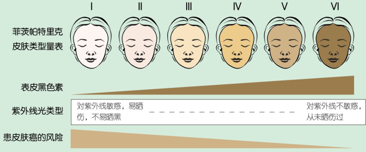

> [!IMPORTANT]
>
> 补充：根据 `FDA` 的规定，防晒霜在美国被认定为⾮处⽅药（`OTC`）。这意味着你在美国商店货架上找到的任何防晒产品都已通过了功效测试。⾃制防晒霜通常使⽤的是氧化锌，这是⼀种有效的⼴谱防晒剂。然⽽，如果没有适当的调配和正确的制造设备，氧化锌可能⽆法分散成⼀层均匀的薄膜，这会导致防晒霜在⽪肤上留下⼀块块的痕迹，⽽且防护⼒不⾜。
>
> 我们在电商⽹站上看到了很多宣称安全、不含化学性防晒剂的防晒霜，但它们的保存⽅式很可疑，⽽且已经开始分层了。千万别使⽤没有防护⼒的防晒霜，患⽪肤癌可不是开玩笑的！

> [!IMPORTANT]
>
> 补充：防晒剂分为两类：有机（化学性）类和⽆机（物理性）类。化学性防晒剂是液态的，只能吸收紫外线；物理性防晒剂是固体的矿物，其防晒原理主要是吸收紫外线，同时也能反射和散射紫外线。化学防晒霜的质地更好，不容易留下⽩⾊痕迹，但并不适合每个⼈，因为可能会对⼀些⼈造成刺激。要想做出选择就得先了解你使⽤的防晒剂

- **有机（化学性）防晒剂**：

  - **美国批准的有机（化学性）防晒剂**，在这些化学性防晒剂中，能防护 `UVA` 的广谱防晒剂只有丁基甲氧基二苯甲酰基（阿伏苯宗）。另外，这些化学性防晒剂都是油溶性成分，这导致那些可怜的化学家必须要努力用一桶厚重的、难以搭配的、有时候不稳定的油状物去制造轻盈的、讨人喜欢的、可以一层一层叠加使用的防晒霜

      | 类别                             | 特点     |
      | -------------------------------- | -------- |
      | Avobenzone，丁基甲氧基二苯甲酰基 | 防护 UVA |
      | Homosalate，胡莫柳酯             | 防护 UVB |
      | Octisalate，水杨酸乙基己酯       | 防护 UVB |
      | Octocrylene，奥克立林            | 防护 UVB |
      | Oxybenzone，二苯酮 - 3           | 防护 UVB |
      | Octinoxate，桂皮酸盐             | 防护 UVB |

  - **亚洲和欧洲批准的有机（化学性）防晒剂**，这张表格列满了我们不能在美国使用的好东西。其中一些成分是水溶性的，所以你在欧洲和亚洲可以买到很轻薄的防晒霜，而美国的防晒产品就做不到这点。当然，这里所列的并不是这两个地区批准的所有防晒剂，我们只列出了最常见的一些欧莱雅公司的专利成分，即使在美国的防晒霜里也能找到它

      | 类别                                                       | 特点         |
      | ---------------------------------------------------------- | ------------ |
      | Tinosorb S，双 - 乙基己氧苯酚甲氧苯基三嗪                  | 防护 UVA/UVB |
      | Tinosorb A2B，三联苯基三嗪（在中国尚未获批准 —— 译者注）   | 防护 UVA/UVB |
      | Uvinul A Plus，二乙氨羟苯甲酰基苯甲酸己酯                  | 防护 UVA     |
      | Ecamsule, Mexoryl SX，对苯二亚甲基二樟脑磺酸（欧莱雅专利） | 防护 UVA     |
      | Uvinul T 150，乙基己基三嗪酮                               | 防护 UVB     |

- **⽆机（物理性）防晒剂**：两种物理性防晒剂在全世界范围内都可以使用，并常被推荐给敏感性皮肤人群，它们的另一个优势是不会面临会破坏环境或会渗入血液之类的争议。缺点是它们很容易在皮肤上留下白色的痕迹。如果经过了纳米化处理，泛白程度会有所减轻。但也有人担心纳米级的物理性防晒剂的安全性，不过这种担忧还没有被科学证实

    | 类别     | 特点           |
    | -------- | -------------- |
    | 二氧化钛 | 防护 `UVA/UVB` |
    | 氧化锌   | 防护 `UVA/UVB` |

#### 3.3.3.常见产品

| 产品类型      | 图片                                                         | 特点                                                         |
| ------------- | ------------------------------------------------------------ | ------------------------------------------------------------ |
| 防晒粉        | 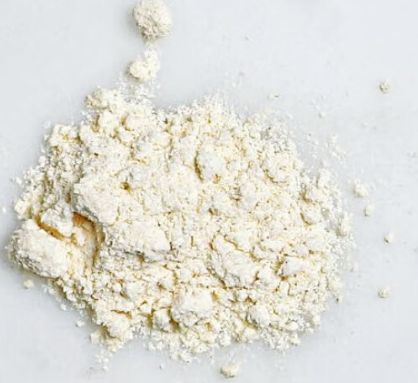 | 很⽅便，特别是对化妆的⼈来说，但想要⽤它均匀地遮盖⾯部还是有难度的，我们不会选择防晒粉，因为根本不知道得⽤多少才能达到⾜够的防护效果。有时候，在你的底妆下加⼀层防晒霜是最好的办法 |
| 防晒棒/防晒膏 | 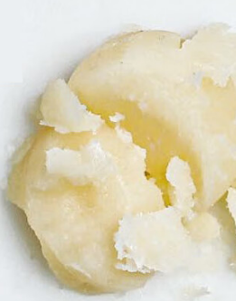 | 压缩型产品，适合旅⾏时携带，防晒棒太适合旅⾏时携带了。嘴唇防晒也⽤得上，但会有油腻感 |
| 有⾊防晒      | 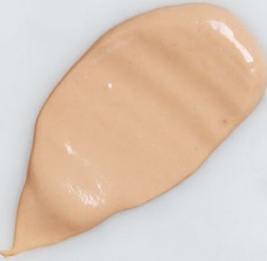 | 化妆时也许还可以兼作粉底                                     |
| 防晒霜/防晒乳 | 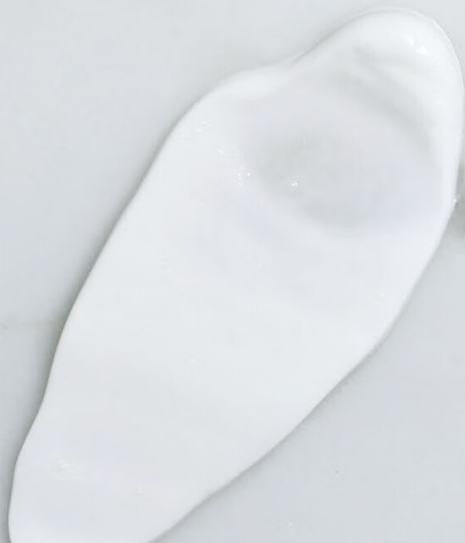 | 适合每天使⽤，最基本的两种防晒产品。不同产品的质地差异很⼤，注意分辨其中含有什么防晒剂，这样会帮你排除⼀些产品以缩⼩选择范围 |
| 防晒油        | 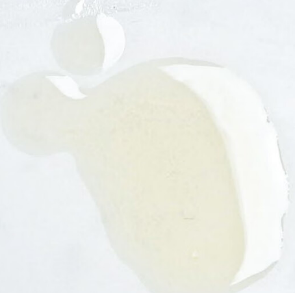 | 帮你轻松获得“被阳光亲吻”后的⾊泽，缺点是包装很容易漏油，很适合在海滩上使⽤，或为了获得美丽的⽪肤光泽的⼈使⽤。和其他油类产品⼀样，防晒油不是最适合旅⾏的产品，准备好⾯对油渍（漏油）吧。 |
| 防晒喷雾      | 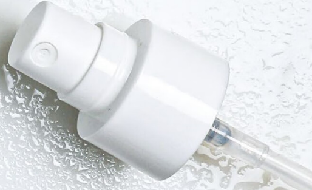 | 操作简单、易于补涂，但可能让⼈觉得太⼲燥。最好是先把喷雾喷在⼿⼼⾥，再涂到⽪肤上，这样⽐直接喷更均匀。清爽，适合重复使⽤。要知道，在防晒性能测试中，测试⼈员是先将防晒喷雾喷在⼿上，再涂到⾝体上，这样才能掌握合适的⽤量，并把防晒喷雾⽤得均匀，所以不要把防晒喷雾直接喷在⾝体上。 |
| 防晒服        | 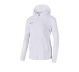 | 防晒服也要进⾏防晒功效测试以得到 `UPF` 系数。`UPF` 系数代表对 `UVA` 和 `UVB` 的共同防护能⼒指标，计算⽅法是在给定剂量的紫外线照射时测量有多少紫外线穿透了防晒服（只要是紫外线都算进去）。例如，`UPF10` 意味着有 `1/10` 的紫外线穿透了防晒服，`UPF20` 意味着有 `1/20` 的紫外线穿透了防晒服，依此类推，`UPF` 值越⾼，代表防晒服的防护效果越好。对于⻓时间在⼾外活动的⼈来说这很重要 |
| 遮阳伞        | 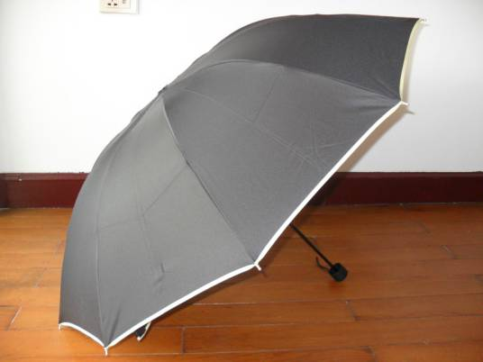            | 我们常听到这样的问题：“我如果坐在遮阳伞下，没有涂抹防晒霜，那我也算是做了防晒，对吗？”有趣的是，的确有⼈把防晒霜和遮阳伞的防晒效果进⾏了⽐较。强⽣公司就对此进⾏了⼀项对⽐试验，试验地点是阳光明媚的得克萨斯州。研究者把试验者分成两组，⼀组只涂防晒霜，另⼀组只⽤遮阳伞。他们发现，相⽐涂防晒霜的⼈，会有更多坐在伞下的⼈晒⿊和晒伤。这是为什么呢？即使你坐在阴影⾥，你的⾝体也仍然暴露在紫外线下，因为紫外线会被地⾯等反射。总⽽⾔之，使⽤遮阳伞时，阴影确实可以提供⼀些防晒效果，但这种防晒措施的防护⼒并不全⾯ |

## 4.功效成分

### 4.1.高级护肤

如果你想在基础护肤之上更进⼀步，那就会⽤到活性成分，它们可谓护肤界的“当红明星”。它们通常价格昂贵、包装精美，还都声称是“⻘春源泉”。功效产品主打活性成分，专⻔针对并改善你可能正忧⼼的⽪肤问题，如细纹、皱纹、肤⾊暗沉、肤质粗糙和⾊素沉着。

如果你已经搞定了三⼤基本⽅⾯（洁⾯、保湿、防晒），那么说明你已经有了⼀个可靠的护肤程序，活性成分的加⼊则会让这个护肤程序锦上添花。活性成分的技术含量较⾼且种类繁多，所以本书会花⼀半的篇幅去讲它们。活性成分有助于对抗皱纹、⾊素沉着，改善⽪肤粗糙，但它们由于功效多样，可以被做成各种剂型的产品，你往往需要多尝试才能找到适合⾃⼰需求的搭配⽅法。

每⼀种针对⽪肤问题的功效成分或精华液背后其实都藏着“英雄”成分，我们化学家称其为活性成分。活性成分能给⽪肤带来⻓期功效，使品牌⽅得以宣称“留住⻘春”“容光焕发”。护肤品⾏业充斥着这些强⼒成分，但⼈们却很难搞清楚这些成分到底对⽪肤有什么⽤。很多活性成分的功效分类并不明确，因此你会发现有些成分⾝兼多职，⽽另⼀些成分的分类仅体现了它们真实效⽤的冰⼭⼀⻆。看看下图中混乱的指⽰箭头，你就会明⽩活性成分有多么令⼈费解！

只是⼏种活性成分就已经让你眼花缭乱了，更不⽤说还有成千上万种⻥⻰混杂的活性成分，这可不是闹着玩的。怎么会变成这样？你最喜欢的精华液中的活性成分通常都符合以下宣传套路：

- **异域传说法**。有时候，⼀个引⼈⼊胜的起源故事就⾜以让你坚信某种花草提取物是你命中缺失的奇迹创造者。所以，⽤它来解决痤疮、炎症和⾊素沉着等⽪肤问题，看看效果如何吧。这些产品往往被宣传得神乎其神，但实际效⽤却令⼈失望
- **涓滴效应法**。如果某种成分在⻝品、医药或航天⼯程（没开玩笑！）中颇有声誉，那为什么不试着把它放到保湿霜⾥呢？这些成分对⽪肤的实际效⽤常常⾔过其实
- **⼴撒渔⽹法**。也有些成分是专⻔为了声称的功效⽽设计的，所有你能想到的护肤效⽤，这些成分全被拿来试过。这就是某种成分会同时兼具多种功效的原因，这使得理解活性成分难上加难

如你所⻅，即使不考虑⽪肤问题和⽪肤类型，单单是选择正确的活性成分就已经需要做很多功课了。更何况活性成分中充斥着⼤量不管⽤的成分，这使得情况愈加复杂了。我们可以详细地列出护肤品活性成分花名册，但那样的话，这本书就会变成⼀部厚厚的百科全书，还是为⼤⾃然多留⼏棵树吧。

### 4.2.检测效果

我们所说的“已证实有效”是什么意思呢？其实，科学家们有很多不同的⽅法来测试活性成分，以验证它们对⽪肤的真正效⽤，以下是最常⻅的⼏种：

- **体外培养**：该⽅法是在试管或细胞培养⽫中测试活性成分。有时，该⽅法被⽤来研究某种成分对某些特定的⽪肤细胞（如成纤维细胞）的作⽤。⼈们也会通过这种⽅法来观察某种成分是否能作为抵御⾃由基的抗氧化剂。该⽅法的缺点是⽆法模拟这些成分被⽪肤吸收后到达⽬标细胞的⽅式，所以可以把它看作是⼀个类似酸碱测试的初步测试，为某种成分是否需要进⾏更多测试提供指⽰
- **离体⽪肤**：该⽅法是在⼀块离体的⽪肤上测试单⼀或复配的活性成分，通常使⽤的是猪或⼈的⽪肤。之所以在众多动物中选择猪，是因为猪的⽪肤与⼈类的⾮常相似。有时也会使⽤整形⼿术“⽤剩下的”⼈体⽪肤。由于使⽤了真正的⽪肤，我们可以通过该⽅法更好地了解活性成分或其复配成分是如何与⽪肤相互作⽤并被⽪肤吸收的。该⽅法的最⼤缺点是只能将⽪肤“保鲜”⼀段时间，所以这种测试⽅法的时⻓通常不能超过2周。想要了解活性成分的⻓期功效，两周可不太够
- **活体动物**：该⽅法是在活体动物⾝上进⾏成分测试。不要激动！如今的⼤多数活体动物试验都被严格限制，且通常只⽤于学术研究。该⽅法可以帮助我们了解某种成分能如何减少紫外线辐射或加速伤⼝愈合，但因为将动物数据转化为⼈体数据并不容易，所以归根结底这种⽅法并不是很好。你可以放⼼，如今美容⾏业⾥涉及的动物试验越来越少了。我们都很爱⼩动物的
- **活体⼈体**：现在，我们来到了最理想的测试场景——在真实的⼈类受试者⾝上进⾏测试！但这也是最昂贵的⽅法，意味着没有多少活性成分能够最终得到⼈体临床试验的机会，也意味着数据可靠性会存在很⼤差异。不过，测试护肤品成分并没有测试药物那样严格的要求。所以，每当评估护肤品成分时我们都觉得⾃⼰像乞丐，四处讨要可靠性还过得去的数据来协助评估它们的功效

评估临床试验时的两个重要考量标准：

- 测试对象的数量：我们通常会寻找⾄少 `30` 个测试对象。这实际上并不多，但与某些仅有 `5`个测试对象的研究相⽐，我们觉得 `30` 个还算不错
- 是否有空⽩对照：研究中，经过活性成分处理的⽪肤需要和不含活性成分的配⽅处理过的⽪肤进⾏对⽐。这是找出某种活性成分对⽪肤的影响的最直接⽅法。如果没有空⽩对照组，就没有⽐较的基线，所以在研究中做到这点对我们极其重要

### 4.3.四个巨头

- **化学去⻆质成分**：包括⽢醇酸（⼄醇酸）、乳酸和杏仁酸（扁桃酸）等在内的酸类，可以温和地去除累积过多的死⽪细胞
- **类维⽣素 A**：这类成分是全能型选⼿
- **维⽣素 C**：⻓期抗衰⽼功效中的主要抗氧化剂
- **烟酰胺**：使肌肤更莹亮、滋润的最佳辅助成分

> [!IMPORTANT]
>
> 补充：当然除了重点在于成分，还要看其他考虑标准。
>
> - **浓度**：如果说看完本书你需要记住什么的话，那就是适当的⽤量才能奏效。剂量就是万能药！这点尤其适⽤于专⻔为解决各种⽪肤问题⽽出现的重要护肤成分
> - **耐⼼**：⼼急吃不了热⾖腐。这些活性成分需要持续使⽤，通常 `4` 周左右（有些甚⾄需要⼏个⽉！）才能看出⼀定效果。尽管“⼀觉醒来就能⻅证奇迹”听起来很诱⼈，但太过美好的承诺就是虚幻
> - **刺激**：护肤产品很容易让⼈产⽣买买买的冲动！抗皱，买它！⽩到发光，买它！于是你的护肤程序中突然涌⼊了 `10` 种活性成分，接着你的⽪肤开始经受各种刺激。这可不是你想要的结果。接下来你得把所有时间都花在让⽪肤恢复正常上，反⽽顾不上那些好东西了
> - **叠加**：护肤的顺序⼀般是从⽔性产品到油性产品。功效护肤环节也遵循少即是多的原则。可靠的、`4` 步或 `5` 步护肤程序基本可以满⾜你的需求，特别是当你⽤的成分能同时解决多种⽪肤问题时。少即是多
> - **分⼦**：以维⽣素 `C` 为例，它有各种衍⽣物，但接下来你会看到我们花⼤量的笔墨解释为什么左旋抗坏⾎酸（`L-AA`）是其中最好的。并不是所有的维⽣素 `C` 都是⼀样的，维⽣素 `C` 的类型很重要

#### 4.3.1.化学去⻆质成分

##### 4.3.1.1.核心成分

⾃从圣艾芙（`St. Ives`）杏⼦磨砂膏开始流⾏（真是暴露年龄），我们就被告知了去⻆质的重要性。⼈们⼀直以来都觉得只要搓洗就能拥有有光泽的、如婴⼉般柔软的肌肤。但是物理去⻆质并不是唯⼀（有时也不是最好的）能有效去除死⽪细胞并保持⽪肤更新和健康的⽅法。来认识⼀下化学去⻆质（俗称“刷酸”）成分吧，这些成分可以削弱那些顽固的、死⽪赖脸的死⽪细胞之间的化学键，使⽪肤恢复光滑、细腻的状态。接下来我们会全⾯地介绍去⻆质以及如何安全使⽤化学去⻆质成分，让你的⽪肤尽享“酸爽”⼀刻！

为了让⽪肤保持健康和年轻，⻆质必须不断地脱落。但随着年龄的增⻓，这种细胞更替的过程会逐渐变慢，导致⽪肤暗沉、粗糙。这就是去⻆质的意义所在，它可以帮你清除那些旧细胞中的“钉⼦⼾”。

健康的⽪肤会产⽣健康的脱屑，脱屑是鲜嫩的⽪肤细胞向外层移动、⽼旧细胞脱落的过程。这实际上是你的⽪肤新陈代谢的过程。健康⻆质层中细胞的更替周期为 `2〜3` 周，你的整层表⽪只需要⼤约 `7` 周就能全部更新！

⽪肤的新陈代谢（周转率）对⽪肤健康⾄关重要。脱屑过程会因为衰⽼、环境压⼒和缺⽔⼲燥⽽减慢。⼀旦这个更替过程变慢，就会进⼊⼀个糟糕的恶性循环：`肤质粗糙 → 屏障功能受损 → 脱⽔ → 细胞更替的过程进⼀步减慢`。也就是说，你的⽪肤会变得粗糙，会脱⽪且暗沉。

谈去⻆质⾃然避不开化学去⻆质成分，“化学”意味着它们是酸性分⼦。酸类成分可以削弱累积的死⽪细胞之间的纽带（⼀种叫作⻆质桥粒的蛋⽩质，记住这个知识点，万⼀有奖知识问答⽤得上呢），有助⽪肤恢复健康的周转率。去除表层细胞在短期内能够让你的肌肤更光滑。从⻓远来看，某些化学去⻆质成分还可以帮助解决⾊素沉着、痤疮，甚⾄㬵原蛋⽩流失的问题！有意思吧？所以让我们来看看哪种化学去⻆质成分适合你。

你想过谁是第⼀个把酸涂在脸上的勇⼠吗？⼈们使⽤酸类物质美化肌肤已经有很⻓的历史了。古埃及的⼥性会使⽤富含乳酸的酸⽜奶让肌肤变光滑。古希腊、古罗⻢及各游牧⽂明都有⾃⼰独特的去⻆质配⽅。中世纪时，醋和葡萄酒被当作美容品使⽤。虽然我们不确定它们是否⽤于去⻆质，但我们可以将其视作最早被提及的化学去⻆质成分，因为葡萄酒的 `pH` 值通常在 `2.5~4.5` 之间，并且它含有酒⽯酸，⽽酒⽯酸正是果酸的⼀种（不算是上乘的）！我们现在已经拥有更好的果酸了，所以葡萄酒还是留着喝吧！

但是直到 `19` 世纪末，果酸才开始受到关注，当时，酚类、间苯⼆酚、⽔杨酸等已作为第⼀批针对⻩褐斑和雀斑等⽪肤问题的化学换肤剂⻛靡⼀时了。果酸只能算是后起之秀，因为它直到 `20` 世纪 `80` 年代才流⾏起来。

化学去⻆质成分包括三个类别，且都是弱酸，它们的区别在于分⼦结构不同。幸亏这三个类别的功能也各不相同，这样你就不⽤受堪⽐催眠术的化学术语的折磨了。

- **基础中的基础，α-羟基酸，果酸，AHA**：果酸类别中包括⽢醇酸、乳酸、杏仁酸、苹果酸和酒⽯酸。这些都是⽔溶性的弱酸，在这些酸中，我们只关注3种——⽢醇酸、乳酸和杏仁酸。这三者的主要区别在于分⼦⼤⼩不同，这个区别有助于你选择适合⾃⼰的果酸伴侣。这3种果酸在改善肌肤⾊素沉着、促进㬵
  原蛋⽩⽣成、减少细纹和皱纹⽅⾯的功效已经得到了⻓期的验证
- **油性⽪肤专家，β-羟基酸，⽔杨酸，BHA**：没错，这类化学去⻆质成分中只包括⽔杨酸，微溶于油的特性使得⽔杨酸能够深⼊⽑
  孔。此外，它还是⼀种抗菌及抗炎成分，对于发炎、易⽣痤疮的油性⽪肤来说，⽔杨酸是理想的选择
- **新⽣代，温和型多羟基酸，PHA**：这位是？没错，多羟基酸是个“新⼈”。`PHA` 通常指的是两种分⼦，`乳糖酸` 和 `葡糖酸内酯`，其中葡糖酸内酯在护肤品中更常⻅，据说它能带来超好的化学去⻆质体验，甚⾄还有保湿的功效，能够为肌肤补⽔并锁住⽔分。它还⼗分温和，不像其他成分那样会引起⽪肤光敏感。有些数据显⽰葡糖酸内酯甚⾄有助于治疗痤疮，并且未来还会有更多的数据。总⽽⾔之，如果你是⼲性⽪肤、敏感性⽪肤，或者前两类酸的使⽤效果对你都不理想的话，葡糖酸内酯是个不错的选择

> [!IMPORTANT]
>
> 补充：如果你尝试的是稍⾼浓度的酸，那么⽪肤有轻微的刺痛感是正常的，但要是觉得⾃⼰仿佛是在给⽑孔除魔（感觉疼痛难忍），那绝对是不正常的。
> 在 `Instagram` 这个迷幻的⽹络世界⾥，我们总能看到⼀些⼈滥⽤化学去⻆质成分的可怕场⾯。有时候，我们会看到⼀些“⽹红”对着⾃⼰的脸⼜磨⼜刷，恨不得洗掉⼀层⽪，直到让脸看起来⽐砂纸还粗糙，这场⾯实在令⼈咋⾆。⼀般在家刷酸后，短暂的轻微刺痛是完全正常的，但你的脸肯定不该红得跟⻰虾似的且⼀直很疼。

## 5.流程步骤

