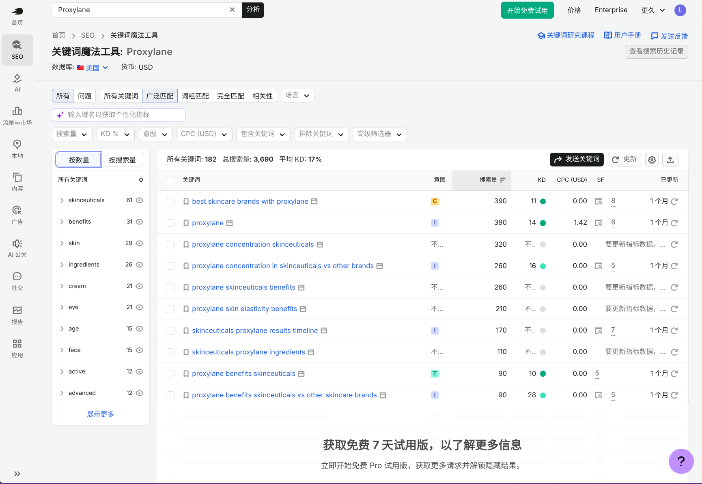
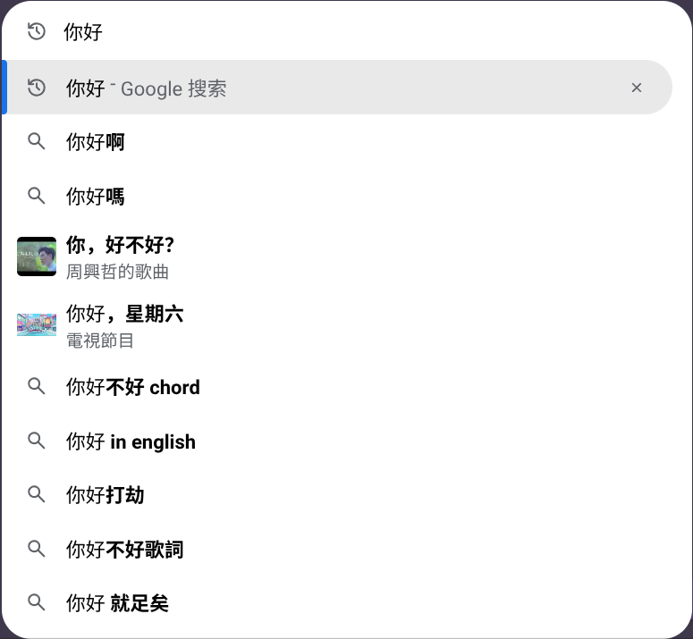
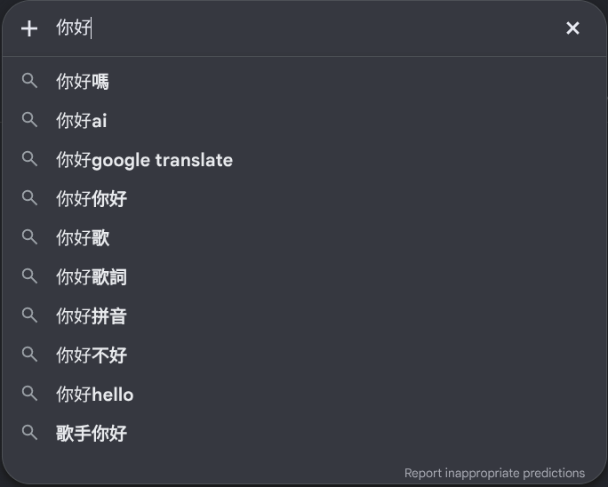
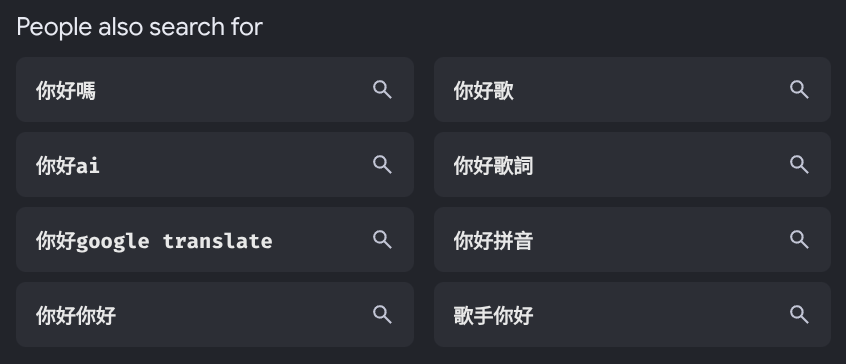
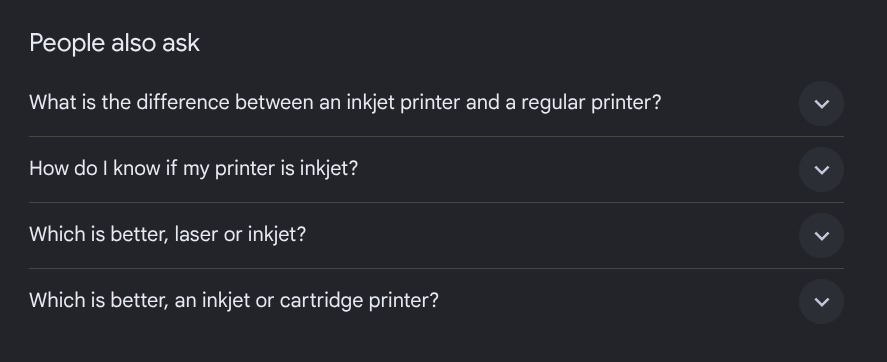
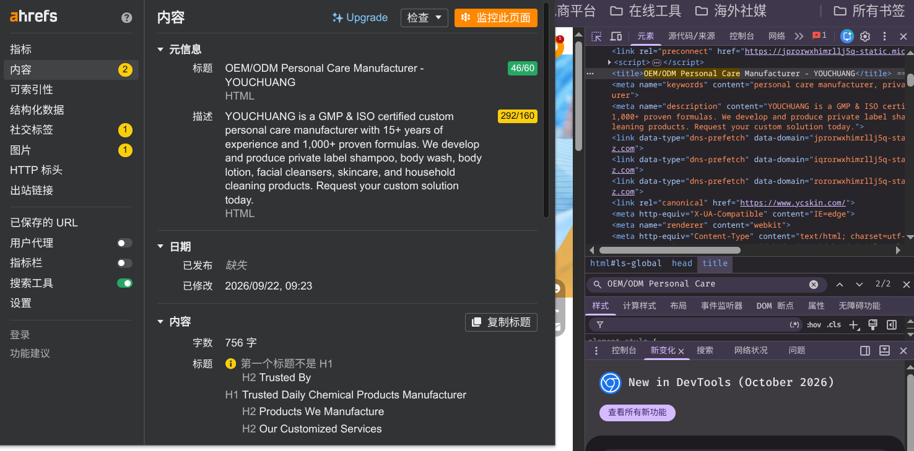

# 独立站点

## 1.信息搜集

### 1.1.服务商家

关于海外的独立站建设服务商，这里收集了一些公司用来进行咨询。

| 排名 | 公司名称           | 核心定位                                                     | 商谈结果                                                     |
| ---- | ------------------ | ------------------------------------------------------------ | ------------------------------------------------------------ |
| 1    | 宜选科技           | B2B 外贸独立站 + 谷歌 ADS/SEO 全案服务商，深耕工厂询盘赛道，是这个赛道的头部玩家 | 服务看起来都很好，但是来广州的业务员很奇怪，广州 `4000` 家护肤加工厂，叫他们找对标居然没有一家对标的说（给了两天时间去找） |
| 2    | 全球搜（GlobalSo） | 创贸旗下，谷歌一级代理，国内网点极多（近 200 运营中心），主打 B2B 工厂独立站 + 谷歌推广，传统工贸客户基数庞大 |                                                              |
| 3    | 天擎天拓           | 老牌大厂，谷歌 Premier Partner；B2B 外贸询盘业务成熟、标准化投放体系完善，全国网点多 |                                                              |
| 4    | 互旦科技（Hudoo）  | 总部苏州，Google/Linkedin 官方合作伙伴，11 城服务网点，独立站、谷歌投放、SEO、领英全链路，华东制造业客户多 |                                                              |
| 5    | 厦门第一页         | 谷歌 + 领英双一级代理，运营谷歌出海体验中心，深耕闽南、华东制造业 B2B，SEO + 领英广告是强项 |                                                              |
| 6    | 久歌网络           | Google 大中华区一级代理商，主打 B2B 询盘独立站、纯白帽 SEO，服务不少设备、制造类上市工厂客户 |                                                              |
| 7    | 易海创腾           | B2B 外贸独立站 + 谷歌 ADS/SEO 全案服务商，聚焦 B2B 工厂询盘独立站，全链路运营 |                                                              |
| 8    | 隽永东方           | B2B+B2C 双线，强项是 Shopify DTC 品牌站，B2B 询盘业务不是核心主线 |                                                              |

从这些服务商中可以套路出来一些信息，方便我们快速入门，待补充...

### 1.2.日常交流

根据整合资源来获取一些日常信息，代补充...

### 1.3.阿里巴巴

阿里本身也是做国际站的，可以找小二聊一下。

## 2.流量入口

### 2.1.搜索优化（SEO）

#### 2.1.1.工作机制

- **抓取（Crawling）**：
  - 抓取目的：谷歌将会使用蜘蛛 `GoogleBot` 工具，来找到并识别网页内容，了解互联网上新页面的出现和旧页面的更新
  - 抓取方式：会受到网站结构、页面数量、加载速度、爬取次数四个因素影响
    - 深度搜索：谷歌蜘蛛从网页上的链接进入其他网页，不断沿着链接抓取更多页面
    - 广度搜索：蜘蛛根据站点地图 `Sitemap` 来高效抓取整个网页，这个地址是可以被提交的
  - 抓取频率：抓取频率取决于网站的规模、更新频率、页面质量等，抓取统计信息越平稳，总量越来越高是最好的
- **索引（Indexing）**：
  - 索引目的：在抓取完内容后，搜索引擎后会对抓取好后的网页进行索引编制，其实这个动作就是在存储数据，使得其内容后续可以在用户的搜索结果中显示
  - 索引方式：谷歌后分析网页的内容，包括文字、图像、视频等信息，以及标签还有元数据这些网页标签数据，然后存储到谷歌的索引库中
  - 索引关键：网页被成功索引，取决于页面的内容质量、结构清晰（比如使用 `Ahrefs SEO Toolbar` 插件去检查）、标记文件（比如 `robots.txt` 禁止爬虫文件，`noindex` 标记等）
- **排名（Ranking）**：
  - 排名目的：用户搜索的时候，不能所有内容都看一遍才找到自己要的东西，必须要进行一个优先顺序的排行，也就是排名
  - 排名方式：当用户在谷歌中输入查询后，谷歌会从建立好的索引库中找到最相关的页面，并且按照一定的规则进行排名、分页提交给用户
  - 排名关键：这个因素比较多
    - 内容相关：页面内容是否符合用户的搜索意图（分为 `信息型、导航型、商调型、交易型` 四种）
    - 关键词语：页面是否针对用户的查询进行了关键词优化，标题、正文、图片、视频等的 `alt` 标签中是否包含相关关键词
    - 用户体验：页面加载速度、移动设备兼容、内容是否易读等（加载速度是最大因素）
    - 外部链接：高质量的外部链接可以提升页面的可信度和权威性
    - 用户行为：点击率、跳出率、停留率等
    - 算法更新：谷歌本身的算法也在不断更新，以便更快提高用户体验

#### 2.1.2.搜索意图

- **信息型 Informational**：想学习知识、找答案，例：`烟酰胺有什么功效`、`敏感肌怎么护肤` → 博客科普文章
  - 用户心理：我想知道...、教我怎么做...
  - 搜索目的：学习、解决问题、寻找答案。这是搜索量最大的一类
  - 典型关键：how to, what is，示例：what is an inkjet printer
  - 应对策略：写博客文章、教程、指南、百科问答，内容要详实、结构清晰，多用 “What”、“How” 开头的标题
- **导航型 Navigational**：想去指定网站 / 品牌页面，例：`XX 护肤品官网` → 品牌首页、登录页
  - 用户心理：带我去...
  - 搜索目的：用户已经知道自己要去哪个网站，只是懒得输网址，或者不记得具体 URL，习惯用 Google 当 “传送门”。
  - 典型关键：品牌词，品牌相关词，产品名 + 官网，示例：inkjet printer hp
  - 应对策略：这类词通常被品牌官网霸屏。确保自己的品牌词搜索第一名是自己的官网，并且有清晰的站内链接（Sitelinks），如果你不是该品牌，很难（也没必要）去争这些词
- **商调型 Commercial**：打算买，正在对比、看测评，例：`最好用的修护面霜推荐`、`A醇和视黄醇对比` → 测评、选购指南
  - 用户心理：哪个更好？、这东西值不值得买？
  - 搜索目的：用户想买东西，但还在犹豫、比较阶段。这是最有价值的流量入口之一
  - 典型关键：best, top, VS，示例：inkjet vs laser printer
  - 应对策略：写测评文章、榜单（Top 10 list）、对比文（X vs Y），客观公正地分析优缺点，帮助用户做购买决策
- **交易型 Transactional**：准备直接下单、完成动作，例：`买 B5 修护精华` → 产品详情页、下单页
  - 用户心理：快速购买，成交
  - 搜索目的：用户已经做好了决定，现在的动作就是要买、注册、下载
  - 典型关键：buy, price，示例：inkjet waterproof film transparent film for offset printing
  - 应对内容：直接上产品商详页、落地页。给用户大大的“购买按钮”、清晰的价格、信任背书（好评、退款保证），让用户以最少的点击完成购买

在谷歌搜索控制台中可以看到意图分类。

#### 2.1.3.质量权威

- **经验（Experience）**：展现真实的一手认知，要求创作者证明自身对话题的深度实践经历
  - 融入个人故事或实操案例（如："我曾用三个月优化独立站，发现其排名提升的规律..."）
  - 添加只有亲历者才能提供的细节（如具体时间节点、操作中的意外状况）
  - 警惕笼统空洞的描述，避免使用 "据专家说" 等模糊表述
- **专业（Expertise）**：在医疗、金融、法律等可能影响用户人生决策的 `"YMYL 领域"（Your Money or Your Life，即涉及金钱或人身安全的内容）`，专业背书尤为重要，谷歌会评估作者资质、机构权威性及信息时效性
  - 显性化展示资质证书（如：在作者简介注明 "注册会计师" 并附执业编号）
  - 引用权威信源（政府文件、顶级期刊论文等），避免依赖过时数据
  - 明确能力边界（如：营养师解读饮食建议时，应声明 "本文不替代医疗诊断"）
- **权威（Authoritativeness）**：权威性通过外部认可体现，包括高权重网站的反向链接、权威媒体的引用、行业奖项等
  - 通过客座文章或合作获取高质量外链
  - 在海外社媒如领英、`Reddit` 等平台持续输出深度观点，塑造行业 `KOL`（关键意见领袖）形象
  - 网站设计体现专业感（如：独立 "研究团队" 页面展示成员学术背景）
- **可信（Trustworthiness）**：从 `HTTPS` 安全协议到清晰的利益声明，每个细节都在传递可信度信号。
  - 作者身份可验证（提供可跳转的领英主页）
  - 定期更新内容时效性标注
  - 公开披露合作关系

#### 2.1.4.排名因素

- **内容质量和相关性质**：
  - 搜索意图：不能只关注关键词，要判断用户背后的真实需求，也就是搜索意图
  - 信息增益：你的内容是否提供了其他页面没有的独特价值？例如，原始研究、一手数据、专家访谈、独家案例、实操经验中的细节教训
  - 知识全面：是否覆盖了该主题下的所有关键子话题？一篇关于 “汽车保养” 的文章，不应只讲换机油，还应涵盖轮胎、刹车、冷却液等，可以使用 “关键问题/章节清单” 来检查
  - 原创程度：避免简单的信息拼凑或洗稿。谷歌可以识别内容的原创程度。即使是科普类内容，也应尝试用自己的语言、结构、案例重新组织
  - 结构思维：使用 `H1（主标题）、H2（主要章节）、H3（子章节）` 等标签，构建清晰的逻辑大纲，善用列表（有序/无序）、表格、引用块，让信息一目了然
  - 媒体类型：图片，使用原创或高质量、有版权的图片，务必填写 `Alt` 属性（描述图片内容，利于 `SEO` 和无障碍访问）；视频，嵌入教程、产品演示或讲解视频，能显著提升停留时间；图表，复杂数据或流程的可视化表达
  - 词语部署：自然出现，将主要关键词自然地融入，避免过度优化，不要强行堆砌关键词。使用同义词、相关词（`LSI`，潜在语义索引）来丰富内容，这些也可以用插件来检查
    - 标题标签：最重要，前置为宜
    - 元描述词：吸引点击的摘要，可包含关键词
    - 一级标题：唯一且概括全文，可以在文章中点题，有利于识别并且匹配
    - 正文内容：前 `100-150` 字要尽早点明主题
    - 子级链接：短小、包含关键词（如 `/coffee-grounds-uses`）
- **网站权威和外链质量**：
  - 高质反链：质量远大于数量，一个来自行业顶级媒体（如福布斯、`TechCrunch`）或权威机构（如 `.edu、.gov`）的链接，价值远超几百个垃圾论坛链接，渠道要尽可能多样化，好链的判断标准
    - 来源权威：链接源网站自身的权重（如 `Ahrefs` 的 `DR`，`Moz` 的 `DA`）高
    - 相关性高：链接源网站的主题与你的网站密切相关
    - 做流链接：这是传递权重的标准链接类型，`NoFollow` 链接（如大部分评论、付费广告）不传递权重，但能带来流量和品牌曝光
    - 位置自然：链接应出现在正文内容中，而非侧边栏、页脚或评论区（可以在每个页面的标题当中增加品牌名称）
  - 品牌信号：
    - 品牌搜索：直接搜索你的品牌名的人越多，谷歌越认为你是一个真实的品牌而非垃圾站
    - 非链引用：即使没有超链接，其他网站在文本中提及你的品牌（如 “据 XX 公司称……”），也是一种权威信号
    - 作者权威：如果内容署名是某个公认的行业专家，会提升整个页面的权威性
- **用户体验和技术优化**：
  - 网页速度：没有良好的用户体验，再好的内容也可能被用户快速关闭，这会向谷歌发出负面信号，核心网页指标与页面速度如下
    - LCP，最大内容绘制，Largest Contentful Paint：衡量主要内容（如大图、视频、文本块）加载并显示所需的时间。标准： ≤ 2.5 秒。
    - FID，首次输入延迟，First Input Delay / INP，与下一次绘制的交互，Interaction to Next Paint：衡量页面对用户首次点击、触摸或键盘操作的响应速度。标准：≤ 100 毫秒
    - CLS，累计布局偏移，Cumulative Layout Shift：衡量页面视觉稳定性。避免图片、广告或动态元素加载完成后突然移动，导致用户误点。标准：≤ 0.1
  - 技术支持：使用快速主机、压缩图片、启用浏览器缓存、移除阻塞渲染的 JS/CSS、使用 CDN
  - 移动支持：谷歌主要使用移动版页面内容进行索引和排名，这意味着移动端的体验至关重要，采用一套代码，根据屏幕尺寸自动调整布局，是首选方案
  - 安全可信：使用 `SSL` 证书加密网站，是基本的信任信号。谷歌会标记非 HTTPS 网站为 “不安全”，确保谷歌蜘蛛能顺利访问你的所有重要页面
  - 可抓取性：
    - robots.txt：正确配置，不要无意中屏蔽了重要目录或页面，但是也要屏蔽好一些不重要的内容，https://limou3434.github.io/work-blog-website/robots.txt
    - XML 站点地图：提交给谷歌搜索控制台，列出所有重要页面，帮助谷歌发现新内容，https://limou3434.github.io/work-blog-website/sitemap.xml
    - 避免重复内容：使用 `rel= "canonical"` 标签指定标准 `URL`，解决因参数、打印页面等产生的重复内容问题，可以在谷歌搜索控制中查看
    - 修复死链：大量 `404` 错误会损害用户体验和爬虫效率，使用 `301` 重定向将失效页面指向相关新页面，可以在谷歌搜索控制中查看

#### 2.1.5.制作导航



1. 确定目标关键词，例如：打印机

2. 明确客户的群体，例如：美国

3. 关键词挖掘筛选，例如：先根据搜索词的搜索量从上到下观看，先对关键词进行一个分类（可以先下载下来用 `AI` 分析一遍），这里我先用的免费版所以只能看到几个词，不过我也做了简单的分析，这个过程其实就是在做建立词库的工作
   - 打印机 + 对比
   - 打印机 + 附近
   - 打印机 + 品牌
   - 打印机 + 最佳
   - 打印机 + 型号
   - 打印机 + 耗材
   - 打印机 + 程序
   - 打印机 + 信息
   - 打印机 + 教程
   - 打印机 + 评测

4. 规划布局导航，例如：按照上面的搜索需求来进行建站导航是最符合用户需求的，直接按照经验来制作比较托大，一般来说，网站的导航权重是按照 `首页 -> 栏目 -> 目录 -> 内页` 来进行递减的，需要分配好每个步骤的优化程度。突出主题，做导航规划，例如下面这种导航就是按照用户需求来制作的

   ```mermaid
   graph TD
   	A[导航规划] --> home[首页]
       A --> B[打印机]
       B --> B1[品牌1]
       B1 --> B12[无线] & B11[手持]
       B11 --> B111[型号1]
       B11 --> B112[型号2]
       B --> B2[品牌2]
       B --> B3[品牌3]
   
       A --> C[耗材]
       C --> C1[墨水]
       C --> C2[墨盒]
       C --> C3[打印纸]
   
       A --> D[驱动]
       D --> D1[品牌1]
       D1 --> D11[型号下载]
       D --> D2[品牌2]
   
       A --> E[最佳]
       E --> E1[家用]
       E --> E2[性价比]
   
       A --> F[资讯]
       F --> F1[行业信息]
       F --> F2[公司动态]
       F --> F3[产品知识]
       
       A --> 视频 --> 教程 & 评测 & 维护
       A --> 服务 --> tob[b 端] & toc[c 端]
       A --> 关于我们
   ```

#### 2.1.6.长尾制章

`头部词` 对于新站点来说很难去快速做排名，因此在上面的热词排好顺序后，我们还需要选择一些 `长尾词`，这些词的优势在于：

- **竞争会比较小**：热门词的竞争对手多为大品牌或权威网站，而长尾词的竞争对手较少，中小网站更有机会排到首页
- **转化效率较高**：长尾词用户需求更明确，通常更接近购买行为
- **提升整体流量**：虽然单个长尾词搜索量有限，但多个长尾词叠加，能带来可观的流量

那么有哪些方式是可以获取到长尾词呢？

- **谷歌下拉**：就是在谷歌搜索框中，搜索某个关键词后，搜索引擎给出的长尾词

  

  

- **相关搜索**：`Perple also serch for` 搜索后，在排序好后的页面中也会弹出一些类似 “猜你喜欢” 的相关搜索词条

  

- **相关问题**：`People also ask` 也是存在于排序好后的排序页面中

  

- **词语工具**：就利用我们之前提到的 `Semrush` 即可

这样我们就可以搭建好我们的长尾词了，但是应该怎么使用呢？一般就是在写文章的时候使用

- **制定更新频率**：日更（`1-3` 篇）、周更（`3-7` 篇）
- **拉高内容质量**：准许 `EEAT` 标准就可以，然后结构一般如下
  - 全篇文章标题（`H1`）
  - 开头首段简介
  - 标准正文排版（`Hx`）
  - 素材种类丰富（`alt`）
  - 语法自然顺畅
  - 包含关键词语
  - 内部链接互跳（尽量靠前用户才能快速点击到，核心词 -> 首页；产品词 -> 详情页；需求词 -> 其他页；术语/经验/引用 -> 其他权威网站）
- **提交文章链接**：需要制作 `stie map`，如果没有就需要在网站后台去写地图生成的功能，这里面的链接的时间也是需要更新的，如果这些检查后是没有问题的就需要谷歌搜索控制中去提交 `site map`

#### 2.1.7.标题设置

标题经常会出现问题，例如：

- 只出现公司名称
- 堆积很多关键词
- 每个页面标题完全一样，没有自己的独立标题
- 直接复用首页关键词，导致夹带主页的标题

可以利用 `Ahrefs SEO Toolbar` 插件来检查一个页面是否做好标题优化。



每一个标题可以按照这种格式来制作：

- 格式要求：
  - 目标词 + 搜索需求词 + 公司名称
  - `60` 字符以内、避免堆砌、关键词直接可以用符号（`-`）分割开
- 页面目标词：Custom folding cartons
- 挖掘搜索需求词：去 `Semrush` 里去找就可以
  - custom printed folding cartons
  - customized folding cartons supplier
  - custom folding carton packaging
  - custom folding carton design
- 组合标题：

#### 2.1.9.移动适配

#### 2.1.10.打开速度

#### 2.1.11.浪费抓额


> 1. **建立高质量的反向链接（最高优先级）**：拥有高质量的反向链接表明您的企业可能具有权威性和知识性
> 2. **审查和更新内容**：定期对网站添加新内容，以向 Google 表明你的网站维护状态良好
> 3. **展示正面的用户评论和推荐** 展示用户评论或推荐。提供客户体验的示例，以便潜在用户了解期望的内容
> 4. **与专家合作** 可以寻求与你所在领域的知名专家合作
> 5. **填补知识空白** 借助主题研究工具，了解竞争对手可能错过了哪些子主题，据此开始创建填补这一空白内容，这是向 Google 展示你的专业知识的绝佳方式
> 6. **丰富你的内容类型** 你的内容不必只是文本，应该发挥创意并在网站上包含不同类型的内容，播客、视频、网络研讨会等
> 7. **保持技术 SEO** 网站的功能也被纳入 EEAT 中。如果你的网站无法正常运行并且用户体验很差，那么网站访问者就不太可能信任你，提升加载速度（尽可能在 `3s` 内完成，可以用开发者工具去完成，也可以在谷歌搜索控制中），网站结构清晰

### 2.2.引擎付费（SEM）


### 2.3.海外社媒（SMM）

首先就是需要了解各个社媒平台，并且对应的投流工具。

- Facebook｜ 脸书，综合社交平台 -> Meta Ads
- Instagram｜ 照片墙（简称 INS），图文 + 短视频社交 -> Meta Ads
- YouTube｜ 油管，长视频分享平台 -> Google Ads
- X（原 Twitter）｜ 推特，短文本实时社交 -> X Ads
- TikTok｜ 国际版抖音，短视频平台 -> TikTok Ads
- LinkedIn｜ 领英，职场商务社交 -> LinkedIn Ads
- Pinterest｜ 拼趣，灵感图片收集平台 -> Pinterest Ads
- Reddit｜ 红迪网，兴趣社区论坛 -> Reddit Ads
- Snapchat｜ 色拉布，阅后即焚图片社交 -> Snap Ads
- Tumblr｜ 汤博乐，轻博客平台 -> Tumblr Ads
- WhatsApp｜ 瓦次普，即时通讯工具 -> WhatsApp Business Platform
- Telegram｜ 电报，加密即时通讯 -> Telegram Ads
- Discord｜ 迪斯科，社群语音聊天平台 -> None

### 2.4.智能对话（GEO）


## 3.独立站点

### 3.1.域名注册

### 3.2.服务机器

### 3.3.建站方案

| 项目     | [WordPress](https://developer.wordpress.com/docs/glance/wordpress-and-wordpress-com/) | [Shopify](https://www.shopify.com/hk-en/ppc/online-store?term=shopify&adid=566072909668&campaignid=15433369410&branded_enterprise=1&BOID=brand&utm_medium=cpc&utm_source=google&matchtype=e&network=g&gad_source=1&gad_campaignid=15433369410&gbraid=0AAAAAC3QZJrzcYALtZ77QuWLhsOBnqxEg&gclid=CjwKCAjwgJHXBhBGEiwAHohJq8Ot7nHaP1skf9nAFmjaAkyeWQZ9qSIQmT6LZzrTtHQDNMLEDNgwMxoCwa0QAvD_BwE) | [Shoplazza](https://www.shoplazza.cn/free-trial?utm_id=20289646252&utm_source=google&utm_medium=cpc&utm_content=cn&utm_term=shoplazza&gad_source=1&gad_campaignid=20289646252&gbraid=0AAAAApIYtbcUuJjU8Vd3YVswFfDM6XuTn&gclid=CjwKCAjwgJHXBhBGEiwAHohJq98RpcnoXniUrGrOAsbgS5P1O_nwC1Y0n2P6RLK8fgon9uSembdIChoClCYQAvD_BwE) |
| -------- | ------------------------------------------------------------ | ------------------------------------------------------------ | ------------------------------------------------------------ |
| 方案类型 | 开源自建 CMS 商城                                            | 海外 SaaS 托管电商                                           | 国产出海 SaaS 托管电商                                       |
| 后台语言 | 可自由切换（英文 / 中文）                                    | 英文为主，有简中翻译包                                       | 原生中文后台，国内客服                                       |
| 所有权利 | 服务器、数据、源码自己持有                                   | 平台托管，无源码                                             | 平台托管，无源码                                             |
| 上手难度 | 高，需要懂主机、备份、排错                                   | 低，开箱即用                                                 | 很低，适配国内卖家操作习惯                                   |
| 搜索优化 | 自由度最高，适合长期谷歌自然流量、AI 搜索优化                | 成熟但底层结构有约束                                         | 基础 SEO 齐全，自定义空间弱于 WP                             |
| 投流适配 | 支持，需要插件手动配置像素 / 转化 API                        | 生态最成熟，像素、转化 API 一键对接，投流圈主流              | 一键集成广告像素，中文后台看投放数据                         |
| 成本构成 | 域名 + 服务器 + 付费主题 / 插件，弹性大                      | 订阅费 + App 插件费 + 额外交易手续费，长期成本偏高           | 订阅套餐，营销插件大多免费，成本一般低于 Shopify             |
| 适合赛道 | B2B 询盘站、品牌独立站、内容站、高度定制页面、长期做自然流量 | 欧美 B2C 精品 DTC、爆品测款、重度付费投放                    | 跨境铺货、一件代发、新手出海、预算有限、中文运维             |
| 常见短板 | 运维负担重、插件容易冲突、加载速度需要自己优化               | 定制受限、费用贵、风控严、国内客服支持弱                     | 第三方应用生态比 `Shopify` 少，海外本地化适配稍弱            |
| 支付物流 | 自己找服务商对接，自由度高                                   | 海外支付渠道非常丰富                                         | 适配国内货代、代发，主流海外支付齐全                         |

### 3.4.界面设计

可以先看看人家阿里国际站的基础功能，再看看其他服务商搭建下的基础功能，然后列出清单。

### 3.5.功能设计

## 4.业务对接

## 5.海外物流

## 6.选品分析

- 国家 -> 地区 -> 品类
- 品类 -> 国家 -> 地区
- `AIGC` 智能体综合分析（其实也是上述两个路径，但是多了 `AI` 赋能）
- 小赛道开始 -> 大赛道跟近


