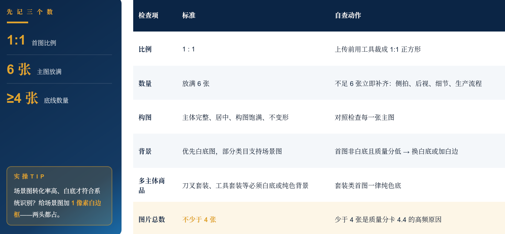
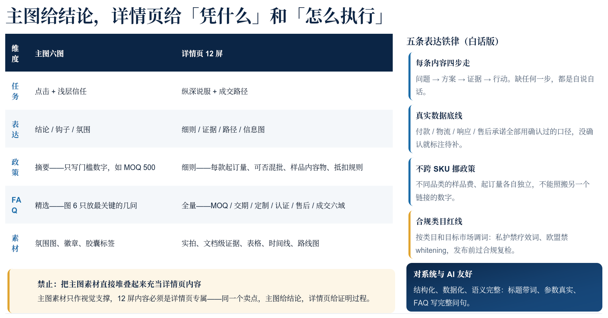
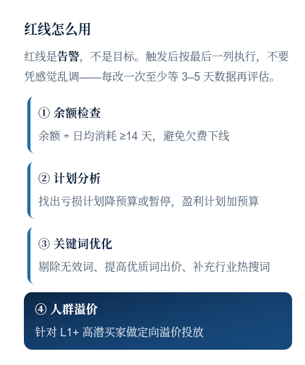
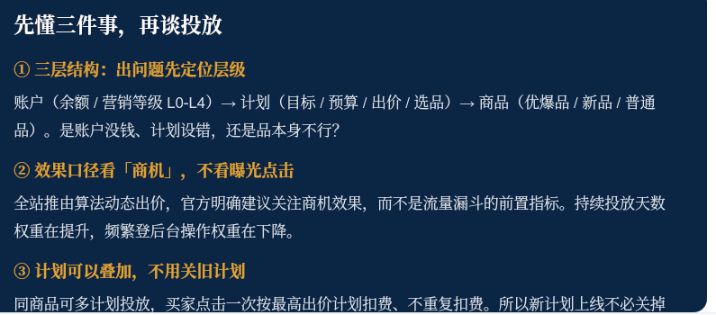
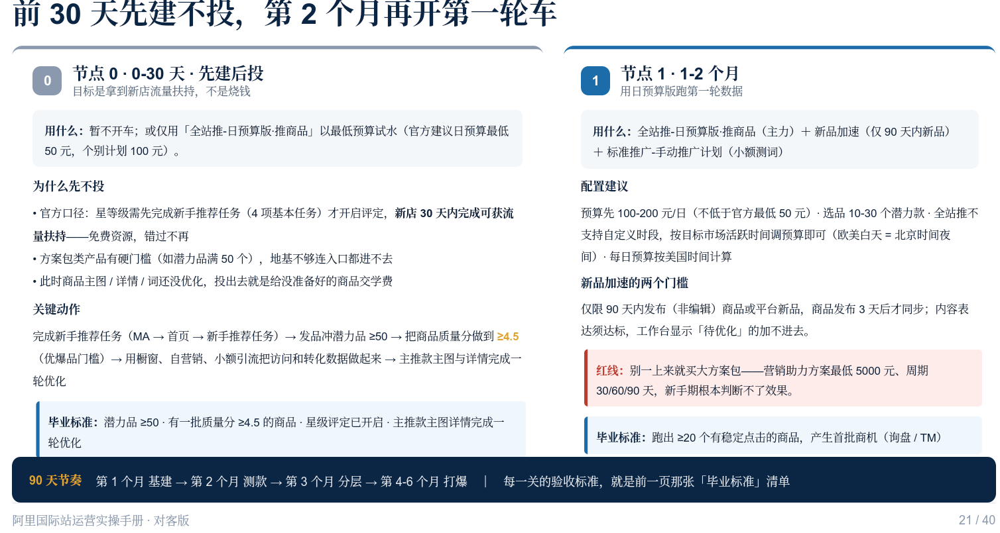
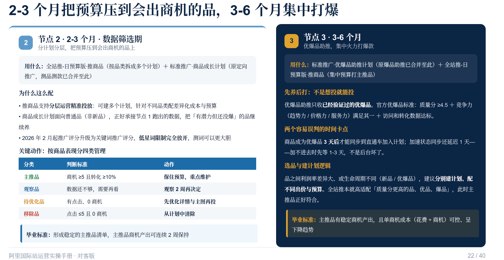
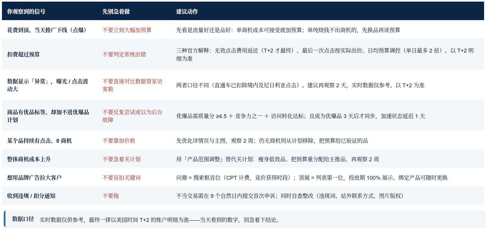
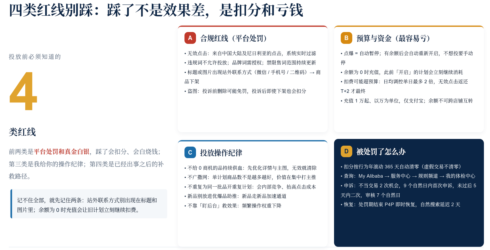

# 阿里国际

## 1.商品运营

### 1.1.商品类型

负责阿里国际站优品全链路打造，一般分为商机品和交易品，也因此分为两个赛道：

- 商机品赛道：
  - 指标：询盘人数、`TM` 咨询人数
  - 适合：非消费品行业、工厂、有设计定制能力
- 交易品赛道：
  - 指标：支付买家数、订单金额
  - 适合：快速消费品行业、贸易商、标品卖家

一般都是 `3:7` 分来铺品，看自己的选的赛道。

### 1.2.成长阶梯

并且根据下面条件来进行分级：

- 普通品：`已经发布的品类`
- 潜力品：`访客数 >= 1`
- 优质品：
  - 商机品：`质量分 >= 4.5` + `竞争力三选一` + `近 30 天 TM 和 询盘 >= 2`
  - 交易品：`质量分 >= 4.5` + `竞争力三选一` + `近 30 天 TM 和 询盘 >= 2` + `近 90 天支付买家 >= 1`
- 打爆品：
  - 商机品：`近 30 天 TM 和 询盘 >= 20` + `访客到商机转化率 >= 2%`
  - 交易品：`近 90 天支付买家 >= 5` + `访客到支付转化率 >= 1%`

> [!IMPORTANT]
>
> 补充：别为 `造爆品` 把商品全量改成交易品，会造出高支付买家数、低流量商机的假爆品。

### 1.3.商品质量

商品质量 `4.5` 是优品的入场券，不是加分项，系统按质量分决定要不要给你流量。卡在 `4.4` 的商家，九成问题出在图片上，先把图改好，比分头去改标题、改属性都快，改完一周后，回商品运营工作台复查质量分是否过 `4.5`。

- **图片质量异常**（出现频率最高）：含中文/牛皮癣水印、拼接图、首图非白底、图片少于 4 张。改法：逐条对照下面的首图规范清单，先把图片这关过掉
- **产品内容不匹配**：标题/属性/图片三者互相矛盾，买家看不懂你到底卖什么。改法：三者围绕同一核心关键词与卖点重写、重拍，保持一致
- **SKU 表达模糊**：没有具体参数值，属性与图片对不上，买家不敢下大单。改法：所有属性项全部填写不留空白，SKU 参数写具体数值
- **标题不达标**：堆砌关键词、缺核心词、重复啰嗦，系统认不出、买家搜不到。改法：核心词前置 + 属性词 + 场景词，含核心关键词、不堆砌、不重复
- **详情描述不完整**：只有一张长图、没有结构，B 端买家看不到他关心的信息。改法：覆盖产品参数/应用场景/包装物流/公司实力四块，结构化呈现

竞争力三选一，这也是质量的指标之一：

- **趋势力**：适合新品迭代快的行业，走行业定向征品发布新品获取趋势竞争力
- **服务力**：最稳，优先做行业服务认证绑定商品、半托管、远程质保/无忧退，证书是提升服务力最直接手段，一份证书最多关联 `5` 个产品（证书认证三步提升服务力，最直接的方式是 (1)查行业所需证书，证书中心 → 证书推荐 → 行业证书推荐 (2)上传证书并关联叶子类目，每个产品证书最多可关联 5 个 (3)上传后关联优爆品，证书中心 → 证书管理）
- **价格力**：暂未全量上线，以目前平台最新开放为标准，对标行业同款价格带定价，参考优价建议和行业征品价格

### 1.4.分配资源

按商品生命周期分配推广资源：

- **普通品**：全站推做新品加速，快速积累初始数据，搭配 `AI` 工具优化标题、主图、关键词
- **优质品**：全站推潜力成长，低成本拿访客商机，关键词推广补精准流量，冲刺优品
- **潜力品**：全站推优品助推稳住流量，叠加品牌广告锁定靠前位置，放大流量
- **打爆品**：品牌广告首位拦截抓意向买家，用品牌聚量低成本持续拿优质流量，守住爆品地位

## 2.主图详情

### 2.1.主图图片

阿里国际站商品图标准化逻辑为六图信任阶梯，对应买家下单前 6 层心理顾虑，6 张主图依次解决一个疑问，看完 6 张图引导买家发起询盘：

- **图 1｜ 值得点吗**：氛围主视觉 + 属性、MOQ 起订门槛，抓住搜索页第一眼吸引力
- **图 2｜ 真的有效吗**：双场景效果对比 + 卖点徽章，证明产品效果
- **图 3｜ 够得着吗/合作麻烦吗**：展示定制方案、MOQ、样品费政策，打消合作门槛顾虑
- **图 4｜ 这家接得住我的量吗**：车间、产线、质检实拍 + 产能数据，体现供货实力
- **图 5｜ 认证真的吗**：证书原件、随单文件展示，背书合规资质
- **图 6｜ 还有问题吗**：问答卡片 + 询盘引导按钮，承接意向、促发询盘 CTA

三大铁率：

- **点击卖点优先**：第一使命是在搜索结果里 0.5 秒抓住目标买家。卖点必须 「氛围感 × 文字」 结合 —— 只有氛围 = 空泛，只有文字 = 说明书感。氛围承载产品属性，文字点名卖点与承诺，两者不能拆开做。禁区：只有氛围没有卖点，或把说明书写进图里
- **真实数据素材**：MOQ/样品费/周期/产能/出口额/认证，一律用商家确认过的真实数据，禁止占位编造。真实素材（车间实拍、证书原件）禁染色、禁 AI 重绘；没有兑现能力的事，一个字都不要写。禁区：占位数字、AI 重绘证书、做不到的承诺
- **买家视角答疑**：FAQ 必须显式呈现完整问句（买家口吻），按认证/交期/MOQ/定制/售后五个疑虑域组织。答案数据化、结构化，既便于系统与 AI 语义抓取，也让买家一眼就找到答案。禁区：只写关键词、答非所问、答案里没有数字

如果点击率低就：

- 首图展示实际应用场景 而不是单纯白底产品图；可用加 1 像素白边框兼顾系统识别
- 加英文字幕说明核心卖点 把尺寸 / 材质 / 功能写上去，让买家 3 秒看懂
- 避免误导性词汇 LED 屏非 3D 显示就禁用「3D」—— 误导词会带来纠纷和降权
- A/B 测试保留 CTR 最高版本测不同主图的点击率，留最高的一版，其余全部下线

### 2.2.详情页面

详情页 12 屏，按 5 段式往下排。

详情页长图 12 屏

- S1 Hero 定位 — 主视觉 + 定位句
- S2 卖点证据三卡 — 3 个卖点 + 证据小标
- S3 规格参数表 — 真实参数两列，≤ 10 行
- S4 贴牌落地 — 换标对比/瓶型库/标签工艺
- S5 配方库与定制边界 — 能改什么、不能改什么
- S6 完整时间线 — 询盘到出货每节点天数 + 交付物
- S7 工厂实力 — 车间实拍 + 月产能 / 年出口
- S8 文件包与检测 — 证书原件 + 报告关键页 + 文件清单
- S9 下单路径 + 付款 — 路线图 + T/T / 信保 / L-C
- S10 物流与贸易条款 — 术语 / 港口 / 渠道 / 税费边界
- S11 FAQ 全量 — 六域完整问答，完整问句 + 数据化答案
- S12 咨询窗口 — 对接人 / 响应时效 / 渠道 + 行动按钮

5 段式：从 「来对了吗」 到 「怎么开始」，主图负责钩子，详情页负责纵深说服。9 屏内容必须是详情页专属，不能把主图素材堆起来充当详情页：

- 段 1 讲清产品（S1–S4） 买家心里问：来对地方了吗？能做成我的品牌吗？
- 段 2 证明能做（S5–S6） 买家心里问：我的配方能不能改？多久能出第一批货？
- 段 3 展示实力（S7–S8） 买家心里问：敢不敢把订单托付给你？认证是真的吗？
- 段 4 说清合作（S9–S11） 买家心里问：怎么下单、怎么付款、怎么运、有什么坑？
- 段 5 促成交（S12） 买家心里问：找谁对接、多快回复、下一步怎么开始？

## 3.广告投放

### 3.1.日常任务

| #    | 检查项              | 达标标准                              | 不达标怎么办                                              |
| ---- | ------------------- | ------------------------------------- | --------------------------------------------------------- |
| 1    | 余额充足度          | 余额 ÷ 日均消耗 ≥14 天                | 低于 7 天立即充值；余额 ≤0 即「已断粮」，立即充值恢复投放 |
| 2    | 消耗水平            | 对比店铺 / 行业 TOP5 / 类目均值       | 低于均值 → 查日预算是否设太低、计划是否撞顶               |
| 3    | 营销等级            | 是否达 L3 / L4                        | 若投放省心版 / 方案包，则不必强求                         |
| 4    | 全站推占比          | ≥ 80%                                 | 低于 80% → 把标准推广预算逐步迁移到全站推                 |
| 5    | 溢价状态            | 基础溢价 + 全站推新溢价是否开启       | 见溢价分层：金品在全站推开 L3+ 溢价，非金品无此权限       |
| 6    | 优质货盘 P 消耗占比 | ≥80%（优爆品 ≥30 个才考核）           | 优爆品 < 30 个属基数不足，随规模增长逐步转移预算          |
| 7    | 省心版状态          | 档位 / 购买时间 / 剩余天数 / 剩余预算 | 投放中且剩余 < 7 天 → 立即续费；< 30 天 → 提前安排        |
| 8    | 进阶版方案包状态    | 版本 / 周期 / 投放时间 / 剩余天数     | 按「投放开始时间 + 周期 × 1.2」核对，别误判超期           |

> [!IMPORTANT]
>
> 补充：全站推误区
>
> - 全站推有 7 天 5 商机冷启动期，这期间商机成本偏高属正常，别在第 3 天就判断计划失败或急着调价
> - 方案包周期以投放开始时间为准，不是采纳时间，最长可投日期 = 投放开始时间 + 周期 × 1.2（180 天包最长可投 216 天）

### 3.2.触碰红线

| 指标（店铺维度））          | 红线           | 处理动作                        |
| --------------------------- | -------------- | ------------------------------- |
| 预算使用率 < 70%             | 红色告警       | 查低消耗计划，< 20% 单独排查     |
| 预算使用率 > 100%            | 黄色提醒       | 预算撞顶，考虑加预算            |
| L1+ 占比 < 60%               | 红色告警       | 开 L1+/L3+ 溢价；调投放国家结构 |
| 优质货盘 P 消耗占比 < 80%    | ≥30 个优爆品时 | 把预算往优爆品转移              |
| 全站推消耗 = 0              | 红色告警       | 立即开启全站推                  |
| 点击率 / 转化率低于均值 80% | 红 / 黄色告警  | 按归因页排查；均值 80% 内不必慌 |

| 指标（计划维度））          | 红线 | 处理动作                              |
| -------------------- | ---- | ------------------------------------- |
| 计划预算使用率 < 20%  | 红色 | 出价过低或定向过窄：调出价 / 放宽定向 |
| 计划预算使用率 > 100% | 黄色 | 加预算或降低出价                      |
| 计划 L1+ 占比 < 40%   | 红色 | 开启买家层级溢价                      |

> ?
>
> 

### 3.3.成本判断

商机成本判断规则：对比基准为自身出价，而非类目均值。

核心阈值线：**自身平均出价 × 溢价上浮幅度 × 1.2 倍**，超过这条线才需要干预。

三档判定区间：

- **第一档 ｜≤ 类目均值：注意亮点** 出价策略高效，维持现有设置，不要因为花费偏少盲目压价
- **第二档 ｜ 均值~出价 × 溢价 × 1.2：合理区间** 成本高于行业参考值，但在 1.2 倍以内属于正常溢价区间，不同国家溢价差异大，不属于异常
- **第三档 ｜ 超过上限：需要关注** 超出 1.2 倍（开启 L3 + 溢价则为 1.5 倍）再进行调整，调整前优先核查转化率

> [!IMPORTANt]
>
> 补充：已开启 L3 + 买家溢价的店铺，阈值放宽至 1.5 倍。

> [!IMPORTANT]
>
> 补充：高于类目均值 ≠ 效果差，类目均值仅作为参考位置，不能当作成本目标线，盲目压价容易把优质计划压垮。

> [!IMPORTANT]
>
> 补充：归因判断逻辑，先看转化率，再定优化方向。转化率已优于类目均值、但商机成本偏高 → 真正原因是 「流量单价偏高」，不是转化率低。去改详情页、改主图是白忙；正确动作是调投放国家结构 + 提升优爆品占比
>
> - 不要单一看成本指标，需要结合转化率、L1 + 占比、商机质量综合评估
> - 全站推是系统自动出价，不存在关键词出价逻辑，无需手动调节 CPC
> - 两种无需紧张的场景：计划已暂停（属于历史数据）、冷启动阶段（样本量少，单个商机就会造成成本大幅波动）

### 3.4.买直通车

直通车全周期路线，从零投放到品牌期，每个阶段用什么车、为什么？

- 节点 0・0-30 天 ｜ 店铺基建期：暂不开车 / 最低预算试水 拿新店铺流量扶持，把地基铺好：完成新手任务、冲潜力品、把商品质量分做上去（目标为，节点 0 → 潜力品 ≥50，有一批质量分 ≥ 4.5 的商品）
- 节点 1・1-2 个月 ｜ 冷启测试期：日预算版 ・ 推商品 + 新品加速 + 手动测词 用最小的试错成本跑第一轮数据，找出哪些品有人点、哪些词有商机（目标为，节点 1 → 跑出 ≥20 个有稳定点击的商品）
- 节点 2・2-3 个月 ｜ 数据筛选期：推商品按品类拆多计划 + 商品成长计划 给商品分级，把预算从「广撒网」压到少数会出商机的商品上（目标为，节点 2 → 主推品商机产出连续 2 周保持）
- 节点 3・3-6 个月 ｜ 打爆放大期：优爆品助推 + 推商品集中打主推品 先养后打：只有验证过的优爆品才有资格进助推，集中火力做爆款（目标为，节点 3 → 单商机成本可控、且呈下降趋势）
- 节点 4・6 个月 +｜ 规模化与品牌期：多计划组合 + 方案包 + 问鼎 / 顶展 稳定放量，用品牌广告拉高客单、覆盖大买家（目标为，节点 4 → 多计划组合稳定，品牌广告完成评估）

> 补充：新账号没有历史数据是常态：前 `30` 天的首要任务不是「投得多」，而是把地基铺好、把数据喂对。

> ?
>
> 
>
> 
>
> 

| 计划类型                   | 官方定位 / 适用                                              | 关键门槛（官方口径）                                         | 建议启用                   |
| -------------------------- | ------------------------------------------------------------ | ------------------------------------------------------------ | -------------------------- |
| 全站推 - 日预算版 - 推商品 | 智能托管；有明确品类推广诉求、需集中投放的店铺；手动选品打造爆款、可分层多计划 | 日均预算模式；单计划最多 500 个商品；计划数不限              | 节点 1 起贯穿全程          |
| 全站推 - 新品加速          | 新品专属加速通道                                             | 仅 90 天内发布（非编辑）商品或平台新品；发布 3 天后才同步；内容表达须达标；90/180 天后自动剔除；不支持 L3 + 买家溢价 | 节点 1（有新发商品时）     |
| 全站推 - 省心版            | 营销全托管，零学习成本、零运营成本，周期性锁定预算           | 官方建议 L0-L1 层级使用                                      | 节点 1-2（不想手动运营时） |
| 全站推 - AI 智投（方案包） | 周期预算、算法自动投放，可获更多营销折扣                     | 2025-12-01 起暂停新购入口，需客户经理申请；日均预算最低约 200 元；周期不可改、不可全停、解冻后不可二次开启 | 节点 4（L2-L4 且有预算）   |
| 全站推 - 商品成交计划      | 以获取支付订单为最优目标的全自动工具                         | 只需设置预算，系统自动优化出价与选品                         | 节点 3-4（交易品）         |
| 全站推 - 推店铺 / 推工厂   | 推店铺 = 原全店推广；推工厂 = 工厂型商家获取 OEM / ODM 大买家 | 推店铺已下线、无新建入口（存量可用）；推工厂仅金品工贸一体 / 金品工厂，且该类目已发商品 ≥10 个 | 推店铺不可新建             |
| 标准推广 - 手动推广计划    | 关键词推广「按词找人」                                       | 单计划 ≤500 个关键词，每词设 1 个优品                        | 节点 1-4（测词 / 精准词）  |
| 标准推广 - 商品成长计划    | 原定向推广；测品测款已合并至此；面向普通品（非新品）         | 提供非新品的成长通道                                         | 节点 2                     |
| 标准推广 - 优爆品助推      | 原「爆品助推」合并；面向优爆品的打爆通道                     | 需优爆品：质量分 ≥4.5 + 竞争力之一 + 访问转化达标；成为优爆品 3 天后同步 | 节点 3                     |
| 标准推广 - 控成本计划      | 能力已整合到全站推与标准推广的商机成本出价                   | 不再支持新建；官方建议改用全站推日预算版（满足条件可享前 7 日成本保障赔付） | 不可新建                   |
| 品牌广告：问鼎 / 顶展      | 问鼎 = 搜索框首位（CPT 计费）；顶展 = 列表第一位 + 皇冠标，覆盖 PC / M 站 / APP | 问鼎部分渠道需金品工厂；顶展需全款到账 + 到投放期 + 绑定产品；顶展投放期 100% 可展示 | 节点 4                     |

> ?
>
> 
>
> 

## 4.业务接待

待补充...

## 5.店铺自检

### 5.1.率值检查

先算清哪个率低于均值，再决定改什么：

- 第一段 ｜ 访客 → 商机：
  - 监控指标：曝光量、点击率、访客数、询盘数、TM 咨询数
  - 优化方向：曝光不足 → 查 P4P 投放策略、关键词覆盖、商品池深度；点击率低于 1% → 改主图吸引力、标题 SEO、价格竞争力；转化率低于行业均值 → 查详情页质量、响应速度、信任背书
- 第二段 ｜ 商机 → 订单：
  - 监控指标：回复率、平均响应时长、沟通轮次、成单率
  - 优化方向： 响应超过 2 小时 → 建业务团队 SOP、时差覆盖、自动回复设置；沟通轮次超过 5 轮 → 提升需求挖掘能力与报价策略；成单率低 → 调整样品政策、付款方式、MOQ 灵活性
- 第三段 ｜ 订单 → 复购：
  - 监控指标：复购率、客单价提升幅度、客户生命周期
  - 优化方向：复购率低于 30% → 查产品质量稳定性、售后服务、客户关系维护是否到位；客单价无增长 → 做交叉销售、升级推荐、批量优惠策略
- 第四段 ｜ 复购 → 客户：
  - 监控指标：L3 + 买家占比、年采购额、战略客户数量
  - 优化方向：L3 + 买家少 → 精准人群定向、金品权益利用、定制化服务能力；大客户流失 → 提高老板介入频率、建专属服务团队、保障供应链稳定

### 5.2.漏斗检查

漏斗链路，四个率逐个和行业均值对比，哪一环明显低就补哪一环：

- 曝光 → 点击（点击率）：点击率 = 点击量 ÷ 曝光量，点击率低 → 主图四条
- 点击 → 访客（访客率）：访客率 = 访客数 ÷ 点击量，链接承接、进店引导、价格、SKU 排布
- 访客 → 询盘（询盘率）：询盘率 = 询盘数 ÷ 访客数，询盘率低 → 详情页 12 屏
- 询盘 → 订单（成单率）：成单率 = 订单数 ÷ 询盘数，成单率低 → 接待与样品政策

### 5.3.流量检查

| 类型           | 怎么判断                                        | 根因                                              | 优化动作                                                     |
| -------------- | ----------------------------------------------- | ------------------------------------------------- | ------------------------------------------------------------ |
| 高转化低流量   | 转化率高于行业均值，但访客数 / 询盘数远低于预期 | `P4P` 投入不足、关键词覆盖窄、商品池浅、星级偏低  | 高转化优品全开站推，预算 ≥ 均值 1.2 倍 Top200 搜索词，降权低 CTR 词 季度内优品数翻倍，建三层商品结构 星级补到三星，商机 / 交易双轮驱动 |
| 高流量低转化   | 曝光量和访客数充足，但询盘数和订单数偏少        | 主图认知断层、详情缺 `B` 端属性、响应慢、背书不足 | 主图照「优化四条」改，3 秒看懂 详情页补齐 5 项 B 端信息 5 分钟回复率 ≥ 90%，配自动回复 信任背书照清单逐项补齐 |
| 双低（新店常见） | 各项指标均低于行业均值，基础还没搭起来          | 店铺装修、商品数量、视频素材、预算都不到位        | 先做店铺装修 + 公司介绍 上传 ≥20 个产品，每个 6–12 张副图 做 3–5 个 30–60 秒演示视频 P4P 日预算 ≥$30，聚焦 5–10 个词 |
| 结构性失衡     | 某些维度极强，某些维度极弱，长短腿明显          | 资源和精力全押在一个维度上，短板拖着整体走        | 把资源从强项挪到弱项 定 3 个月能力提升路线图 每月设改进目标和验收标准 视频/多语言客服可考虑外包 |

### 5.4.打分检查

给自己的店铺打一个六维表评分，短板就是瓶颈。六个维度各打一分，画出来就是店铺的能力形状——最低的那一项，通常就是当前的增长瓶颈。优先级 = 高收益 + 低难度。先做这类，见效最快。

| 维度   | 衡量内容                                     | 打分公式（店铺值 ÷ 行业 TOP5 均值 × 10，封顶 10 分） |
| ------ | -------------------------------------------- | ------------------------------------------------ |
| 商品力 | 优品数量、爆品数量、新品上架频率、商品覆盖率 | (优品数 ÷ 行业 TOP5 优品数) × 10，封顶 10           |
| 营销力 | P4P 投入、品牌聚量、顶展资源、活动参与度      | (P4P 预算 ÷ 行业 TOP5 预算) × 10，封顶 10            |
| 交易力 | GMV、订单数、客单价、准时发货率              | (GMV ÷ 行业 TOP5 GMV) × 10，封顶 10                |
| 服务力 | 回复率、响应时长、好评率、纠纷率             | (回复率 ÷ 行业 TOP5 回复率) × 10，封顶 10           |
| 保障力 | 星等级、金品认证、信保额度、履约能力         | 星等级 × 2.5（三星 = 7.5 分，四星 = 10 分）        |
| 内容力 | 视频数量、详情页质量、主图专业度、多语言覆盖 | (视频数 × 2 + 详情页质量评分) ÷ 10 × 10          |

## 6.采购节日

时间线为 `08.01` 起备战、`08.25` 预热蓄水、`09.01` 正式开打。备战六步走，每一步都有时间节点和必须产出，不是到大促当天才动手。

- 08.01–08.31：备战窗口
  - 08.01–08.10 ① 市场与竞品调研，选品方向 + 差异化卖点清单
  - 08.05–08.15 ② 产品矩阵与方案，报名会场清单 + 主推商品清单
  - 08.10–08.22 ③ 店视觉氛围升级，统一主图/店招/详情页/视频视觉
- 08.25–08.31：预热蓄水
  - 08.25–08.31 ④ 精准引流与权重，预热期小预算测款，活动期放量
- 09.01–09.30：正式活动
  - 09.01–09.20 ⑤ 客户背调与转化，高潜客户画像与分层 + 定向邀约
  - 09.01–09.30 ⑥ 数据监控与沉淀，每天盯数据、每周复盘，沉淀可复用资产
- 步骤 + 必须产出（没有就等于没做）

> [!IMPORTANT]
>
> 补充：报名前必查的平台规则要点
>
> - 玩法：全店阶梯满折 / 满减；包邮、账期权益需提前校验库存
> - 会场与报名：核心会场为行业爆品 / 新商孵化 / 品牌专区；审核看近 30 天动销、好评、发货时效
> - 流量与权重：搜索 / 推荐加权；服务分（响应、纠纷）决定排序
> - 履约与售后：AG 履约要求物流轨迹签收合规；配置 AI 自动回复、FAQ 与客服夜间排班
