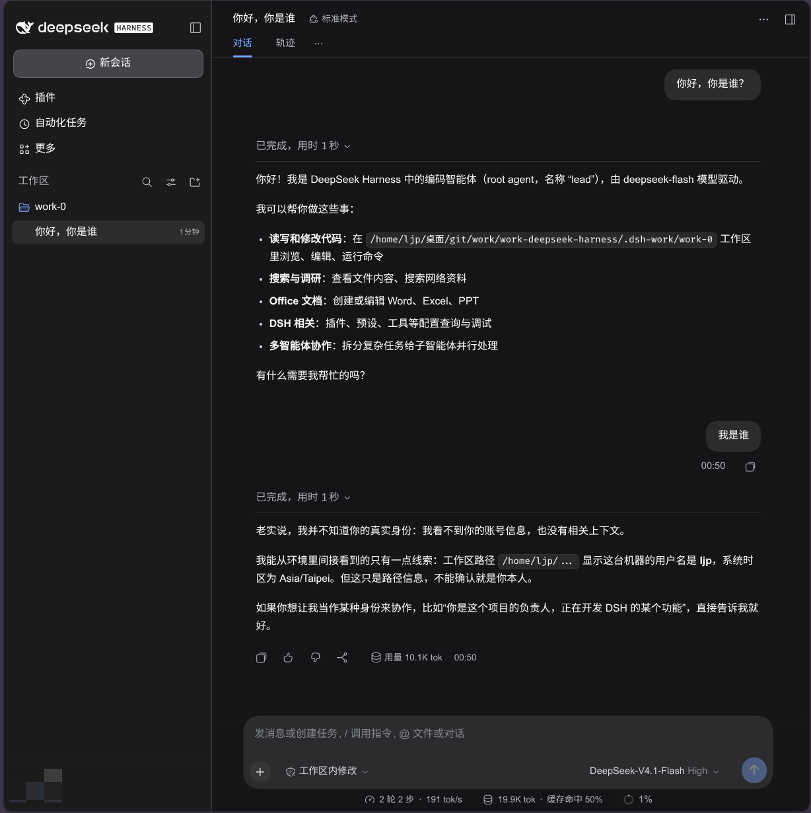
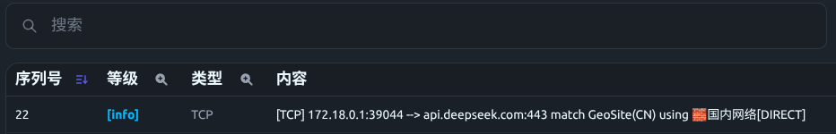
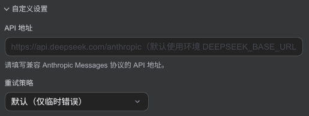
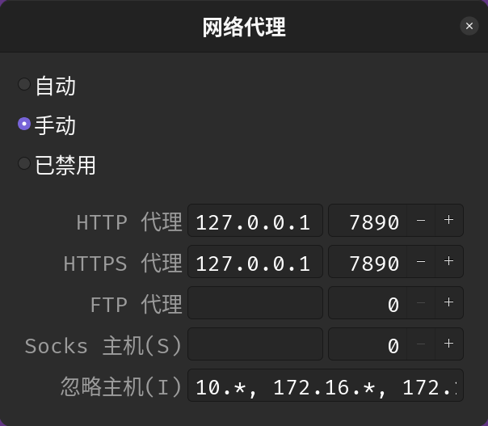
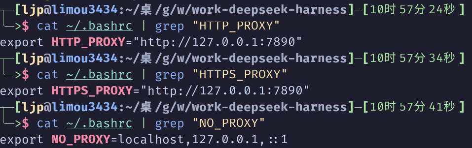

# DeepSeek

## 1.环境准备

### 1.1.发展历程

首先我们需要了解一下 [DeepSeek 官方 Github 仓库列表](https://github.com/deepseek-ai) `DeepSeek` 这 `47` 个仓库，是一整套自研大模型全栈体系，分成五大块，其中 `MoE` 专家模型是主线，大量底层 `CUDA/C++` 算子、分布式通信、存储全部自研，同时做多模态、`3D` 生成、数学证明、代码模型。下面按分类解读，对应你截图里所有仓库：

- **基础大模型仓库（核心对外可用的，模型权重+推理代码）**
  - **DreamCraft3D（2023-10）**：ICLR 2024，文 / 图生成 3D 模型，3D 生成、扩散模型
  - **DeepSeek-Coder（2023-11-02）**：初代代码专用模型
  - **DeepSeek-LLM（2023-11-29）**：早期基础稠密 LLM
  - **DeepSeek-MoE（2024-01-09）**：早期 MoE 原型（小 MoE，不是 V2）
  - **DeepSeek-VL（2024-03）**：初代视觉语言多模态（稠密，非 MoE）
  - **DeepSeek-Math（2024-04）**：初代数学专用模型
  - **DeepSeek-V2（2024-05）**：V2 版本 MoE 模型，老一代通用底座
  - **DeepSeek-Coder-V2（2024-06）**：第二代代码 MoE 大模型
  - **DeepSeek-Prover-V1.5（2024-08）**：定理证明模型 V1.5（Lean4）
  - **Janus（2024-10-17）**：统一多模态，理解 + 生成（any-to-any，文生图）
  - **DeepSeek-VL2（2024-12）**：MoE 版多模态图文模型（复用 V2 架构）
  - **DeepSeek-V3（2024-12-26）**：主力 MoE 大模型，出圈主力底座
  - **DeepSeek-R1（2025-01）**：基于 V3-Base，强化推理 / 思考
  - **Janus-Pro（2025-01-27）**：Janus 升级版（Janus 仓库同一个 repo）
  - **DeepSeek-Prover-V2（2025-04-30）**：新版定理证明，671B 大版本
  - **DeepSeek-V3.2-Exp（2025-09）**：V3 实验版本
  - **DeepSeek-Math-V2（2025-11-27）**：新一代数学模型，基于 V3.2-Exp
- **底层算力，算子库（GPU/NPU 内核，MoE 训练推理的地基，硬核底层），这一块是 DeepSeek 竞争力很强的部分，MoE 需要大量卡之间通信、高性能矩阵计算、注意力算子**
  - **FlashMLA（2025-02-24）**：多头隐式注意力 MLA 算子，开源周 Day1
  - **DeepEP（2025-02-25）**：CUDA MoE 专家并行通信库，开源周 Day2
  - **DeepGEMM（2025-02-26）**：GPU 高性能矩阵乘 GEMM 内核库，开源周 Day3
  - **3FS（2025-02-28）**：AI 分布式文件系统，开源周 Day5 收官
  - **DeepJIT（2026-04）**：xPU JIT 即时编译库，最早内置在 DeepGEMM 里，后续独立开源
  - **TileKernels（2026-04-23）**：TileLang 写的算子库，GPU 版本首发
  - **DeepSelect（2026-09-10）**：稀疏注意力 DSA、TopK 专家采样算子
  - **DeepEP-Ascend/DeepGEMM-Ascend（2026-09-30）**：昇腾 NPU 移植版本，同一天集中开源
- **训练&推理框架、算法实现（调度、流水线、推理引擎、研究实验）**
  - **DualPipe（2025-01）**：双向流水线并行算法，V3/R1 训练时，计算和通信重叠，提升训练吞吐
  - **profile-data（2025-03）**：V3/R1 计算通信重叠的性能分析数据、profiler 脚本**EPLB（2025-03）**：MoE 专家负载均衡器，训练时自动把 token 均衡分给各个专家，防止部分专家过载
  - **DeepSpec（2025-07）**：推测解码（Speculative Decoding）全套代码，研究加速解码的算法
  - **DeepInfer（2025-08）**：大规模生产推理框架，V3/R1 线上推理引擎，分布式、推测解码、KV 缓存调度，Apache2.0
  - **ESFT（2025-08）**：Expert Specialized Fine-Tuning，专家专精微调，单独微调 MoE 里面各个专家
  - **LPLB（2025-11）**：基于线性规划的 MoE 专家负载均衡器，训练时自动把 token 均衡分给各个专家，防止部分专家过载
  - **deepseek-recipe（2025-12）**：Rust 写的 tokenizer，和官方 API 完全对齐的编解码器
  - **Engram（2026-01）**：论文项目，基于可检索内存的稀疏大模型，长记忆、检索式上下文
  - **smallpond（2026-03）**：基于 DuckDB+3FS 的轻量数据处理框架，训练前做数据清洗、预处理
- **Agent 或应用框架、前端 Demo（上层应用，模型怎么和工具、人交互）**
  - **open-infra-index（2025-02）**：经过生产验证的 AI 基建工具合集，AGI 开发配套工具（开源周配套索引仓库）
  - **chat-demo（2026-04）**：最简单的对话前端 Demo，TypeScript，快速对接 DeepSeek API 做聊天页面
  - **deepseek-harness（2026-08-13）**：明星项目，一切皆插件的 Agent 运行框架。Agent 不再只是调用 LLM，插件可以提供 shell、文件读写、网页搜索、子 Agent、LSP 代码理解、审批流程；可以做编程 Agent、办公 Agent，TypeScript 写，可网页 / 桌面运行
    - **dsh-superagent-prototype（2026-09）**：更自主的智能 Agent 原型
    - **dsh-node-addon-require-builtin/dsh-libreoffice-kit（2026-09）**：Harness 的内部依赖组件（Office 文档处理、node 插件）
- **Awesome 合集（清单、教程、生态汇总，不是核心代码）**
  - **awesome-deepseek-integration（2025-03）**：DeepSeek API 接入各个软件的集成清单（LangChain、Ollama、各种应用）
  - **awesome-deepseek-coder（2025-11）**：DeepSeek-Coder 相关开源项目、工具清单
  - **awesome-deepseek-agent（2026-02）**：Agent 相关生态、项目、论文清单
- **其他内部，配套小仓库**
  - **DeepSeek-OCR（2025-01）**：OCR 视觉项目，光学识别、上下文压缩研究
  - **clangd-ascend（2025-09）**：昇腾平台的 clangd，代码静态检查、补全
  - **DeepSeek-OCR-2（2026-02）**：OCR 视觉项目，光学识别、视觉因果流研究

> [!IMPORTANT]
>
> 补充：`MoE = Mixture of Experts，混合专家模型`，是大模型的一种架构，`DeepSeek V2/V3/R1` 全都在用，是它们最核心的技术之一。通俗比喻，把模型想象成一整个专家团队：
>
> - 有很多个小专家（`Expert`），每个专家擅长不同方向，有的擅长数学、有的擅长写代码、有的擅长写文案、有的懂常识
> - 还有一个路由模块（`Router`），负责看你输入的问题，只挑选少数几个专家出来干活，剩下的专家直接休眠、不参与计算，流程是 `输入进来 → Router 打分 → 选出 Top-K 专家 → 送到选中专家计算 → 合并输出`，`DeepEP、EPLB、LPLB、DeepSelect` 全都是为 `MoE` 的路由、专家通信、负载均衡服务的
>
> 普通稠密大模型（比如 `Llama 70B`），您来任何问题，整个模型全部参数都要跑一遍。`MoE` 只激活一小部分专家参数，每次只用一部分算力。因此 `DeepSeek` 的参数量可以做得巨大，但每次推理成本低。比如 `DeepSeek-V3` 总共有 `671B` 总参数，但每次只激活 `37B`。总容量很大、能力很强，但跑起来的速度、显存开销接近一个小很多的稠密模型。
>
> 这种架构的缺点是，训练更难，容易出现专家不均衡（大家都挤去少数热门专家，别的专家躺平，叫专家坍缩），所以才需要负载均衡器 `PLB/LPLB`。分布式通信压力大，`token` 要在不同显卡上的专家之间来回搬运，所以需要自研的 `MoE` 通信库 `DeepEP`。同时，推理调度更复杂。

### 1.2.快速安装

`DeepSeek Harness, dsh` 是由 [DeepSeek AI](https://deepseek.com/) 开发的开源 `agent harness`（智能体框架）。它构建于一切皆插件的架构之上，由 [Cordis](https://github.com/cordiverse/cordis) 驱动（其设计参见论文 [A Programming Paradigm for Spatiotemporal Composability](https://arxiv.org/abs/2608.25512)），这个工具有一个 [完整文档](https://deepseek-harness.github.io/deepseek-harness/)。

其本身是命令行 `CLI` 程序，在 `Windows` 和 `Mac` 上有桌面程序，这里如果使用 `Linux` 系统的话，可以通过 `npm` 运行。安装 `Node.js` 后运行下面命令。

```bash
# 先查询当前最新版本是哪一个
$ npm view @deepseek-ai/dsh dist-tags
{ next: '0.2.2-rc.5', latest: '0.2.2-rc.5', alpha: '0.2.3-alpha.2' }

# 更新 nvm 版本
$ nvm install 24.9.0
$ nvm use 24.9.0

# 开始安装依赖
$ npm init -y
Wrote to /home/ljp/桌面/git/work/work-deepseek-harness/package.json:

{
  "name": "work-deepseek-harness",
  "version": "1.0.0",
  "description": "",
  "main": "index.js",
  "scripts": {
    "test": "echo \"Error: no test specified\" && exit 1"
  },
  "keywords": [],
  "author": "",
  "license": "ISC",
  "type": "commonjs"
}

$ npm install @deepseek-ai/dsh@0.2.2-rc.5
npm warn deprecated node-domexception@1.0.0: Use your platform's native DOMException instead

added 743 packages, and audited 744 packages in 2m

110 packages are looking for funding
  run `npm fund` for details

75 vulnerabilities (74 moderate, 1 high)

To address issues that do not require attention, run:
  npm audit fix

To address all issues (including breaking changes), run:
  npm audit fix --force

Run `npm audit` for details.

# 查看是否安装成功
$ ls
node_modules  package-lock.json  package.json
$ cat package.json
{
  "name": "work-deepseek-harness",
  "version": "1.0.0",
  "description": "",
  "main": "index.js",
  "scripts": {
    "test": "echo \"Error: no test specified\" && exit 1"
  },
  "keywords": [],
  "author": "",
  "license": "ISC",
  "type": "commonjs",
  "dependencies": {
    "@deepseek-ai/dsh": "^0.2.2-rc.5"
  }
}

# 启动 Web 指令（DSH_HOME 是 Harness 的自定义数据目录环境变量，不加它，程序固定去 ~/.dsh 读写数据）
$ DSH_HOME="$PWD/.dsh-data" ./node_modules/.bin/dsh web --no-open
dsh web: http://127.0.0.1:3080/?token=fWTBHdpaRx2LsEpE_cKAIZUshCf4FV8TAC53NyYXGPk
[llm-deepseek-api-key] model listing from https://api.deepseek.com/models loaded 2 model(s), skipped 0 row(s)
...

# 如果停止后执行这个指令就会发现已经修改好数据目录不会到处跑
$ ls -al
drwxrwxr-x    - ljp 25 11月 00:39 .dsh-data
drwxrwxr-x    - ljp 25 11月 00:37 node_modules
.rw-rw-r-- 447k ljp 25 11月 00:37 package-lock.json
.rw-rw-r--  320 ljp 25 11月 00:37 package.json
```

该命令默认会在 `http://127.0.0.1:3080` 启动 `Web UI`，本机启动时还会用默认浏览器打开页面。通过 `SSH` 连接远程服务器来启动时只打印宿主机 `URL`，因为本地转发地址由 `SSH` 客户端或编辑器持有。传入 `--no-open` 可仅运行服务器而不打开浏览器，详见 [Web UI 指南](https://github.com/deepseek-ai/deepseek-harness/blob/master/docs/user/guide/index.zh.md)。

> [!IMPORTANT]
>
> 补充：`@deepseek-ai/dsh` 这个 `npm` 包，是编译打包后的运行时产物（`dist`），不是原始源码（包里面不带大模型权重，模型是通过网络 `API` 对接，比如官方 `API` 或者本地 `Ollama/vLLM` 接口），里面核心是这些东西。
>
> - **Cordis 内核（最核心）**：插件化 runtime 调度内核，“一切皆插件” 的底层容器：负责插件加载、依赖注入、服务管理、Agent 循环调度、权限控制、事件总线
> - **CLI 入口（就是您调用的 dsh 命令）**
>   - 拉起本地 `web` 服务（`3080` 端口）
>   - 插件管理
>   - 还有 `headless` 后台执行、导出会话、配置管理等子命令
> - **内置基础插件（打包自带）**
>   - 文件读写插件、`Shell` 终端插件（沙箱执行命令）
>   - `Web` 搜索、页面抓取插件
>   - `LLM` 模型适配器插件（兼容 `OpenAI` 协议，`DeepSeek` 官方、`Ollama`、`vLLM` 都能接）
>   - 会话存储插件（保存对话历史、`Agent` 状态，存在 `~/.dsh`）
>   - 权限审批插件，Agent 要执行高危操作时弹窗让你确认
> - **打包好的 WebUI 前端资源**：`React` 写的页面静态资源，`Node` 服务直接 `serve` 出来，就是你浏览器打开的界面：聊天面板、插件市场、模型设置、日志查看、会话管理面板
> - **预设配置（Standard / PTC / Minimal / Creator），几套现成 Agent 模板**
>   - `Standard`，全能办公 / 编码 `Agent`（默认）
>   - `PTC`，代码专用 `Agent`
>   - `Minimal`，最简基准（只留 `bash` + 编辑器）
>   - `Creator`，方便你自己拼装插件自定义 `Agent`

## 2.快速体验

我们不用每次启动都写这么长的指令，可以添加一个启动脚本，然后修改一下 `package.json` 文件中的脚本指令。

```json
$ vim start.sh
$ cat start.sh
#!/bin/bash
export DSH_HOME="$PWD/.dsh-data"
./node_modules/.bin/dsh web --no-open

$ vim package.json
$ cat package.json
{
  "name": "work-deepseek-harness",
  "version": "1.0.0",
  "description": "",
  "main": "index.js",
  "scripts": {
    "test": "echo \"Error: no test specified\" && exit 1",
 	"start": "./start.sh"
  },
  "keywords": [],
  "author": "",
  "license": "ISC",
  "type": "commonjs",
  "dependencies": {
    "@deepseek-ai/dsh": "^0.2.2-rc.5"
  }
}

$ npm run start
```

初始启动完毕后，填写自己已经购买好的 `API-KEY` 即可。我的建议还是把控好每个工作区的目录比较好，我自己的习惯是使用 `work-x` 来命名工作区（不使用放在系统文档目录中的默认区域）。



基本的时候其实很简单，这里不多赘述，您研究一下这个 `UI` 界面即可（不懂问 `TA`）。

## 3.深入研究

这里要深入研究的话就需要参考下面三个文档：

- [基本使用](https://deepseek-harness.github.io/deepseek-harness/guide/quickstart)
- [开发指南](https://github.com/deepseek-ai/deepseek-harness/blob/master/docs/development.zh.md)
- [整体架构](https://github.com/deepseek-ai/deepseek-harness/blob/master/docs/architecture.zh.md)

### 3.1.网页操作

#### 3.1.1.接入模型

打开 `[设置 -> 模型]`，`DeepSeek` 卡片提供一个 `API` 密钥字段，可以输入密钥并且保存。密钥是只写的，保存后，页面只会收到脱敏描述符，永远不会收到明文密钥（其实是 `write-only`，您可以写入、保存密钥，但是保存之后，网页前端再也读不到完整明文密钥，不能把密钥原封不动拿回来展示，虽然 `UI` 确实可以读取到，但是读取到的不完全，不算完全的可读）。

密钥存储在 `$DSH_HOME/.credentials.yaml` 中（上面我部署的就会让 `$DSH_HOME=.dsh-data/`），`settings` 只保留它的凭据引用。保存了密钥且使用默认端点时（这里的端点值的是 `API` 服务地址，就是接收你发请求的服务器网址），`DeepSeek` 的模型跟随 `DeepSeek API` 发布的列表。

除此以外，这里也支持使用 `三方模型` 和 `本地模型`，详细的配置 [看这个文档](https://deepseek-harness.github.io/deepseek-harness/guide/providers)。

#### 3.1.2.网络代理

`DSH` 会把自身的出站请求——模型调用、`web` 搜索、页面抓取、走 `HTTP` 的 `MCP` 服务器，都经由标准代理环境变量所指定的代理发出。它在启动时读取这些变量，不需要其他配置。这方面我在调用本地 `dsh` 的时候，抓取到了我的代理日志确实是有 `DeepSeek` 的 `APi` 请求日志，和设置中的默认 `API` 地址是一致的。





> [!IMPORTANT]
>
> 补充：为什么浏览器走代理、终端却不走？这是最常见的意外，而且并非 `DSH` 特有。根本不存在一个所有软件都遵循的"系统代理"，实际上有三套互不相干的机制：
>
> - **操作系统的代理设置**：`Safari`、绝大多数 `macOS` 原生应用、`Chrome` 与 `Edge` 会遵守
> - **HTTP_PROXY / HTTPS_PROXY 环境变量**：`curl、git、npm、pip` 以及 `DSH` 会遵守
> - **TUN 模式（虚拟网卡）**：全局接管整个局域网所有设备的流量，对应用透明，所有程序都会遵守
>
> 因此这里我建议对于 `Linux`，比如 `Ubuntu` 来说，需要提前设置好操作系统和环境变量就足够了，`TUN` 模式对于不熟悉计算机网络的人来说太过复杂。
>
> 
>
> 
>
> `Clash` 这类代理软件里的系统代理开关通常只写第一套，浏览器会读到它，命令行工具则永远看不到。这就是为什么导出环境变量是一个独立步骤，也是为什么打开 `TUN` 模式后两者都能工作、且完全不需要变量。因此 `DSH` 不读取操作系统的代理设置，请导出环境变量，或使用 `TUN` 模式。
>
> 屏蔽列表中不需要列出 `localhost` 或 `127.0.0.1`（`dsh` 内部已经写死规则），`DSH` 始终绕过回环地址，否则它自己的 `Web UI` 与本地服务器都会经由代理并形成回环（造成卡死、连接超时、无限循环）。
>
> 这里为什么会卡死的原因是有一种特殊情况，正常来说网络流程是 `127.0.0.1:3080` 想发送到远方 `dsh api` 服务器做请求，代理捕捉这个 `http` 网络包，先发送给代理服务 `127.0.0.1:7890`，然后提交给提供代理服务商服务器，将请求代发送给 `dsh api` 服务器，然后获取到请求后返回响应给 `127.0.0.1:7890` 再转包给 `127.0.0.1:3080`。这里当然不会卡死，但是会出现下面这种情况。
>
> 1. 目标服务：`127.0.0.1:3080`，就是 `DSH` 自己，不一定是 `API` 服务
> 2. 交给代理服务：`127.0.0.1:7890`
> 3. 代理服务商服务器：去连 `127.0.0.1:3080`
> 4. ``DSH` 收到这个新进来的连接，又执行一模一样的逻辑：发起请求 → 丢给代理
> 5. 无限套娃：请求源源不断递归生成，直接占满连接、卡死

> [!IMPORTANT]
>
> 补充：对于代理协议来说通常会遇到两种协议，一种是 `HTTP`，另外一种是 `SOCKS`，两者的区别是 `HTTP` 代理只专门处理 `HTTP/HTTPS` 网页流量，`SOCKS` 是通用隧道，几乎所有 `TCP` 流量都能转发。但是现在的 `dsh` 貌似不支持，可以 [查看文档](https://deepseek-harness.github.io/deepseek-harness/guide/network-proxy#%E5%80%BC%E5%BE%97%E7%9F%A5%E9%81%93%E7%9A%84%E9%99%90%E5%88%B6)。 

但是有几条路径出于设计或运行时限制保持直连：

- **本机上的一切。**`loopback` 始终直连，`localhost`、整个 `127.0.0.0/8` 段、`::1` 与 `0.0.0.0`，代理无法有意义地访问一个只在本地监听的服务
- **模型编写的代码** Workflow worker 与 Node ptc-runtime 进程不接收代理配置，因此模型脚本读不到可能携带密码的代理 URL。直接请求必须自行配置所需代理，并继续受到执行沙箱的约束
- **使用情况遥测。** OTLP 导出器用的是 Node 自带的 HTTP 客户端，而不是代理所配置的那个，因此遥测直连；在禁止直连出网的环境里它只会失败。DSH 的任何功能都不依赖它。设 `DSH_TELEMETRY_MODE=DISABLED` 可完全关闭
- **`web_fetch` 访问字面量私网地址。** 形如 `http://10.0.0.5/` 的 URL 会被拒绝而非交给代理，与未配置代理时得到的拒绝相同

#### 3.1.3.档案切换

`profile` 是指每一套独立的 `插件+组件组合档案`，`dsh` 可以在启动之前，选择一个 `profile` 用来控制需要加载哪些插件、MCP、模型配置。但是密钥、聊天记录是在 `DSH_HOME` 顶层全局共享，不是跟着 `profile` 隔离，我们前面的 `dsh web` 其实就等价于 `dsh --profile web`。

#### 3.1.4.公开部署

如果需要公开部署（除非需要定制一个，否则没有必要），则可以 [参考这篇文档](https://deepseek-harness.github.io/deepseek-harness/guide/public-deployments)。

#### 3.1.5.界面操作

我觉得 `dsh web` 的页面需要稍微研究一下。

待补充...

### 3.2.开发工包

而 `dsh` 本身也可以作为一个服务通过本地 `sdk` 来给其他开发项目进行请求。不管是官方 `sdk` `profile`，还是你自己新建的自定义 `profile`，只要这个 `profile` 的插件树里面带上 `@deepseek-ai/dsh-sdk-app`，它就可以被 `Python SDK` 当做后端来连接。所以，在 [官方文档](https://deepseek-harness.github.io/deepseek-harness/guide/python-sdk) 中会有提及到这个东西。

待补充...

### 3.3.三方集成

> [!IMPORTANT]
>
> 补充：这里要分清楚一下概念 `MCP` 和 `插件` 的区别。
>
> - 一般来说 `MCP` 是其他三方平台提供的，分为客户端和服务端，服务端一般使用任意语言代码来编写，而客户端需要安装到智能体中，两者通过 `MCP` 协议来进行沟通，`MCP` 是在 `HTTP/stdio` 之上，定义了一套专门给大模型调用工具的标准化 `RPC`，解决 “工具发现、资源、生命周期、跨宿主兼容” 这些裸 `HTTP` 没有约定的问题
> - 而插件的话类似上面的开发工具包，是服务于单个平台的，比如 `dsh` 的插件通常都只能服务于 `dsh`，实际上只要开发得当，功能上可以和 `MCP` 的等价，但设计模型不是一回事
>
> 一般来说，`MCP` 会更加通用一些，耦合度底，但是可能无法获取到 `dsh` 一些深处的目录和配置。优先 `MCP`，除非您要深度绑定这个宿主的内部能力、只打算给这一个平台用，这时才写平台专属插件。

和 `sdk` 一样，这里要三方的 `MCP` 集成，需要一个插件 `@deepseek-ai/dsh-mcp-client`，`dsh` 这里的 [官方文档](https://deepseek-harness.github.io/deepseek-harness/guide/mcp-memory) 以一个长期记忆的 `MCP` 服务作为例子，这里我们先理清角色：

- `@deepseek-ai/dsh-mcp-client`：DSH 这边的 MCP 客户端插件（桥）
- `Memorix / Reference Memory / Engram`：三个独立的 M`CP Memory Server`（记忆服务），是分开的程序，不是 `DSH` 自带的
- `MCP, Model Context Protocol`：统一工具协议，`DSH` 作为客户端去连这些记忆服务器，拿到读写记忆的工具

接入之后，`DSH` 里会多出一组工具，名字格式：`mcp__服务名__工具名`，模型可以调用它们：写入记忆、搜索记忆、读取记忆。

待补充...

### 3.4.评审会话

这个 [文档](https://deepseek-harness.github.io/deepseek-harness/guide/schedule) 主要是做代码评审自动化的。当您的 `GitHub Pull Request` 从 `草稿 draft` 标记成 `准备评审 ready for review` 的时候，自动在 `DSH` 里面新建一个只读评审会话，让 `DSH Agent` 自动帮你评审这个 `PR`。

待补充...

### 3.5.定时提醒

这个 [文档](https://deepseek-harness.github.io/deepseek-harness/guide/schedule) 主要是 `DSH Web Profile` 自带的定时调度（`Schedule`）提醒自动化。让 `DSH` 记住定时任务，到点自动往指定对话里发一条提示指令，交给 `Agent` 去执行，不需要额外的外部 `webhook`、不需要 `GitHub`、不需要 `Python SDK`，原生集成在 `dsh web` 里面。可以让模型帮你创建，也可以在自动化页面手动新建定时任务。

待补充...

### 3.6.插件开发

这个 [文档](https://deepseek-harness.github.io/deepseek-harness/guide/plugin-market) 描述了如何自己做插件索引来让其他人可以在 `web` 页面中下载。其中插件索引是一个 `JSON` 文件（其实就在不同 `profile` 中的 `package.json` 里描述清楚了），列出可安装的 `DSH` 组合包（`bundle`）及其标题、图标、作者和版本。打开实验性的自定义插件索引组合包后，可以在插件页的发现标签页中浏览索引，并在确认后安装列出的版本。要发布索引，编写或生成一个索引文件，并把它和图标文件一起放到任意静态主机上。而如果需要自己开发插件，就需要查看这个 [文档](https://deepseek-harness.github.io/deepseek-harness/develop/basic/)。

待补充...

### 3.7.核心框架

参考 [文档](https://deepseek-harness.github.io/deepseek-harness/develop/framework/) 中讲到的 `dsh` 核心框架 `Cordis`。如果想了解 `DeepSeek Harness` 整体框架开发，则需要参考 [文档](https://deepseek-harness.github.io/deepseek-harness/reference/)。

待补充...

## 4.源码修改

待补充...