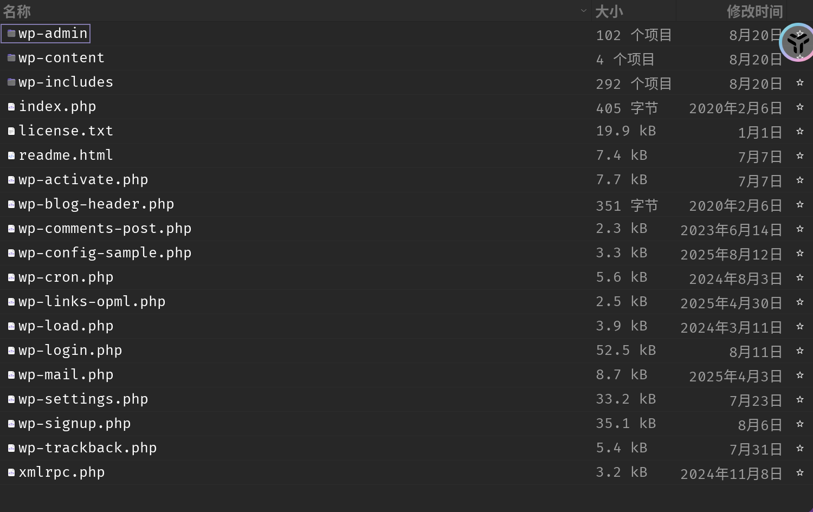
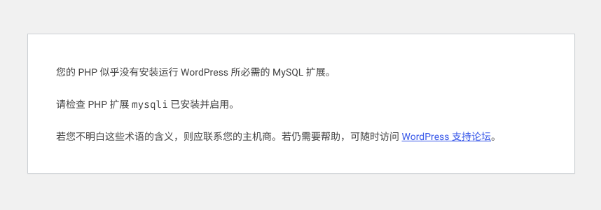
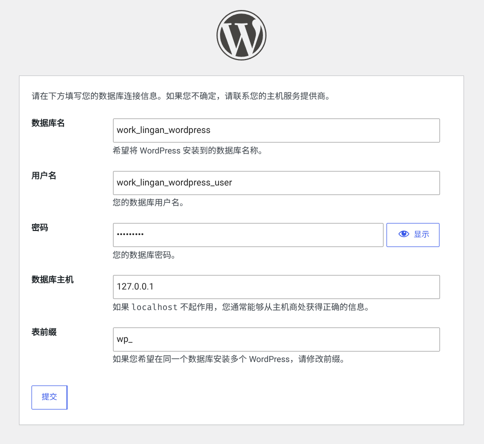
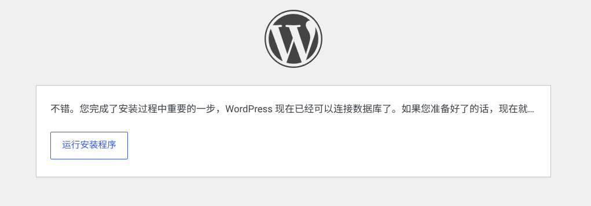
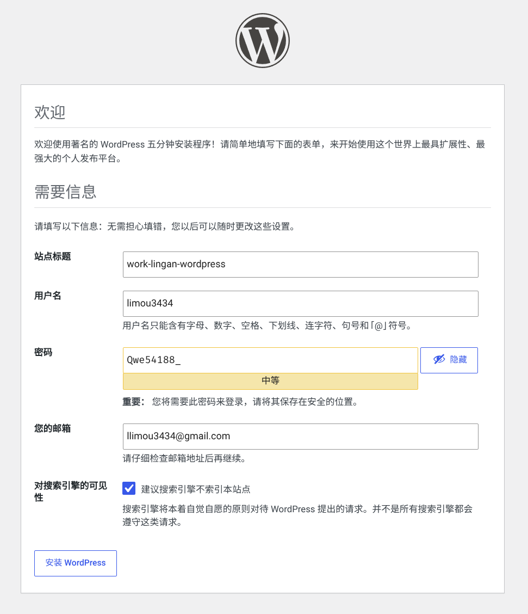
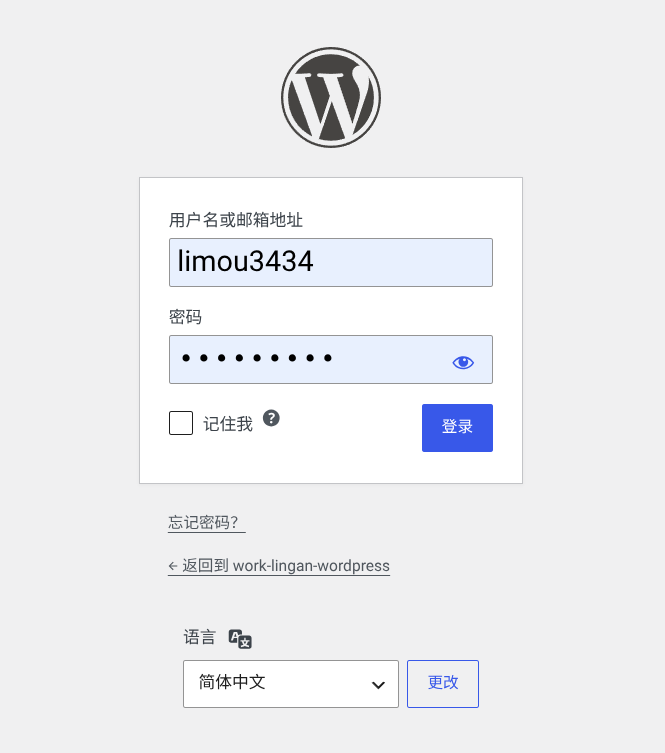
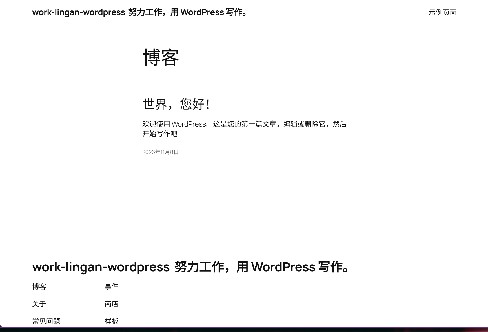
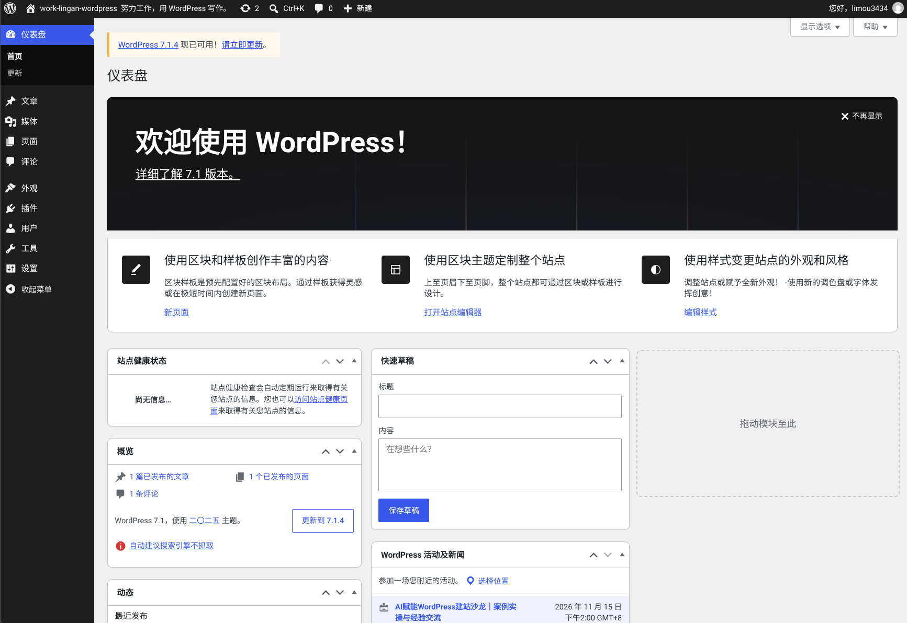

# Wordpress


## 1.环境准备

### 1.1.基础认知

`WordPress` 是全球占有率最高的开源 `CMS，内容管理系统`，`2003` 年发布，底层基于 `PHP + MySQL/MariaDB`，开源协议 `GPLv2`，全球超过 `40%` 网站都由它搭建，常用组合就是 `WordPress + WooCommerce`。

> [!IMPORTANT]
>
> 补充：具体需要区分两个东西。
>
> - **WordPress.org（自托管，你做独立站要用这个）**：程序免费下载，自己买服务器、域名，`100%` 掌控源码、数据、权限，自由度最高
> - **WordPress.com**：官方托管 `SaaS` 服务，不用自己买服务器，但功能、修改权限受限，不适合外贸独立站

> [!IMPORTANT]
>
> 补充：`MySQL` 最早是瑞典公司开发，后来被甲骨文 `Oracle` 收购。 很多开发者担心甲骨文会慢慢收紧开源政策，`MySQL` 的原作者 `Monty Widenius` 就基于 `MySQL` 源码，`fork` 出来了 `MariaDB`，保持完全开源。

> [!IMPORTANT]
>
> 补充：`WooCommerce` 是 `WordPress` 的电商插件，免费开源，是把 WordPress 网站变成在线商城的核心工具，也是外贸独立站（你做化妆品出海最常用）的主流方案。它原本是独立团队开发，现在归属 `Automattic`（也就是 [WordPress.com](https://WordPress.com) 背后的公司），协议 `GPLv2`，和 `WordPress` 生态深度绑定。

### 1.2.技术架构

在部署之前需要了解一下 `Wordpress` 的架构组织原理：

- **核心 Core（内核层）**：内核负责用户管理、文章/页面、媒体库、评论、菜单、REST API、更新机制，是基础骨架，不要随意修改内核代码，升级会覆盖
- **数据库 MySQL/MariaDB（数据层）**：所有文章、页面、设置、用户、插件数据全部存在数据库；访客访问页面时，PHP 读取数据库数据，实时拼接渲染成网页返回浏览器
- **主题 Theme（外观层）**：控制页面布局、配色、字体、移动端样式，文件放在 `wp-content/themes/`
- **插件 Plugin（扩展层）**：文件放在 `wp-content/plugins/`，用来新增能力，不改动内核
- **REST API（接口层）**：`WP` 原生自带接口，可以和前端、小程序、第三方 `CRM、ERP` 对接，前后端分离开发

我们现在先在本地进行初步的环境安装，我们先不看 `PHP` 的相关东西，先看看 [官方网站中下载下来的压缩包文件](https://cn.wordpress.org/download/) 中都有些什么文件（这里用的是 `7.1` 中国版）。



- 三个核心文件夹（最重要）
  - **wp-includes**：`WordPress` 内核底层库，全局函数、类、核心逻辑、数据库操作、工具函数全都在这里，绝对不要改这里的代码，版本升级直接覆盖，改完下次更新直接丢失，还容易出 `BUG`
  - **wp-admin**：后台管理面板，就是你登录 `/wp-admin` 看到的所有页面、菜单、设置界面的代码。你装插件、改商品、编辑文章、更新系统，访问的都是这里面的 `php`。正常 不要手动修改里面任何文件，升级 `WordPress` 的时候整个文件夹会被覆盖
  - **wp-content**：你以后改动最多的地方，这个是 `WP` 留给用户的目录，内核升级不会覆盖它，非常关键
    - `themes/`：主题放这里
    - `plugins/`：插件放这里（`WooCommerce` 就装在这）
    - `uploads/`：你上传的图片、产品图、附件自动存在这里以后你做二次开发、装主题插件，几乎只碰这个目录

- 根目录重点文件（挑关键）

  - **index.php**：网站入口文件！所有前端网页请求，最终都会走到这个文件，加载整个 WP 框架。

  - **wp-config-sample.php**：模板配置文件。你需要复制一份，重命名成 `wp-config.php`，然后在里面填写数据库账号、密码、数据库名，这是连接 MariaDB 的关键。

  - **wp-load.php**：加载 WP 核心环境的引导文件，大部分脚本都会先引入它

  - **wp-login.php**：登录页面，就是后台登录界面

  - **wp-cron.php**：WP 的定时任务（比如定时发邮件、定时清理、定时发布文章、Woo 订单状态任务）

  - **xmlrpc.php**：旧的远程接口，现在很多站为了防攻击直接关掉

  - **license.txt**：GPL 开源协议说明

  - **readme.html**：官方介绍文档

- 其他剩下的 `wp-xxx.php` 大多是独立功能页面：激活、评论、注册、设置页面等

网站用户的访问链路为：浏览器访问你的域名 → `Nginx` 转发到 `index.php` → `index.php` 引入 `wp-load.php` → 加载 `wp-includes` 内核 → 读取 `wp-config.php` 里面的数据库信息 → 连接 `MySQL/MariaDB` → 读取数据，再调用 `wp-content` 里的主题渲染页面。

> [!IMPORTANT]
>
> 补充：因此通过上面的读取我们很快就需要意识到几个问题：
>
> - **部署之前需要创建一个数据库，那么是选择 `MySQL` 还是 `MariaDB` 呢？**
>
>   优先选 MariaDB，MariaDB 是 MySQL 的开源分支，底层协议、基础语法、连接方式对 WP 完全兼容。版本推荐 `10.6 / 10.11`，稳定，WordPress、WooCommerce 全部适配，甲骨文维护的 MySQL 商业版权约束更重，而 MariaDB 完全开源，没有额外商业限制，海外建站圈子默认首选。不要混着用，数据库创建好之后，二者的数据文件不能直接互换，只要你是从零新建库，选 MariaDB 没有坑。不过！！！我要说不过了，现在的官方文档内写的是 `MySQL`，再加上我对 `MariaDB` 是有些部署续的，所以先使用 `MySQL` 一段时间试试吧
>
> - **运行之前本机电脑上需要安装和 `PHP` 相关的模块程序，但是貌似 `PHP` 有很多以 `php-` 开头命名的模块，这些模型为什么会被切分为那么多而不像其他语言一样只需要安装一个 `编译器/解释器 + 软件库管理器` 就足够了呢？**
>
>   这个是 PHP 历史形态 + Linux 发行包管理 + SAPI 模型 共同造成的，不是设计缺陷。PHP 本身自带大量内置扩展，但发行版（Debian/Ubuntu）选择拆包分发 PHP 内核本身是一个程序，它自带几十种扩展（mysql、gd、zip、curl 等）。但是 Ubuntu 源的维护策略，把扩展拆成独立 deb 包，理由是
>
>   - **最小化安装**：很多轻量业务根本不需要图片处理、压缩、xml 这些扩展，不拆包就会白白占用磁盘
>   - **安全隔离**：某个扩展有漏洞，只需要升级这个扩展包，不用整体升级整个 `PHP`
>   
>   - **多 SAPI 隔离**：`cli`、`fpm`、`libapache2-mod-php` 是三套不同的 `SAPI` 运行入口，用途完全不一样，所以拆成独立包
>   - **软件管理**：`php` 内核本身自带的功能（连数据库、图像处理），在 `Linux` 发行层被拆成独立包，`PHP` 的应用层包管理器是 `composer`（`WP` 本身基本不用 `composer`，很多 `WP` 插件生态也不用），简单一句话，不是 `PHP` 语言本身拆成很多块，是 `Ubuntu` 的打包方式把它拆碎了
>   - **整包编译**：如果你用源码编译 PHP，你可以一次性编译启用全部扩展，那就是一个单独的 php 程序，不会分成一堆包
>   
> - **官方下载的是压缩包，那么这个压缩包内的文件是不是就是 `Github` 上的最新版本呢？以后更新框架怎么办？只需要替换文件夹就可以了？是不是有些草率？**
>
>   可以手动替换，但不推荐直接粗暴覆盖，有坑，不是简单替换就完事，先说两种更新方式：
>
>   - 推荐方式：WP 后台图形化自动更新（最标准），WP 后台 → 仪表盘 → 更新，一键升级内核。它会自动处理文件替换、校验、权限、数据库版本迁移（WP 有时候会更新数据库表结构！这个是重点）
>   - 手动 zip 覆盖（你想的方式）：流程不是直接丢进去覆盖，先完整备份数据库 + 全部网站文件（重中之重），下载新版 zip，解压，删除旧的 wp-admin、wp-includes（不要直接覆盖！旧残留文件容易冲突），把新版的 wp-admin、wp-includes、根目录 php 文件放进去，千万不要覆盖 wp-content！主题、插件、上传图片都在这里，访问网站，WP 会自动检测数据库版本，执行数据库升级脚本。
>
>   关键点 WordPress 更新不只是改文件，偶尔会变更数据库表结构。只替换文件、没走数据库升级，网站会报错、功能异常
>
> - **WP 是啥？**：wp = WordPress 的简写，就是我们现在一直在聊的这个 CMS 程序

### 1.3.快速部署

既然如此，我们先安装一下数据库吧，这里我使用的是 `MySQL`，这方面就不介绍怎么安装了。

```sql
$ mysql -u root -p  
Enter password:  
Welcome to the MySQL monitor. Commands end with ; or \\g.  
Your MySQL connection id is 5340 to server version: 3.23.54  

Type 'help;' or '\\h' for help. Type '\\c' to clear the buffer.  

mysql> CREATE DATABASE work_lingan_wordpress DEFAULT CHARACTER SET utf8mb4 COLLATE utf8mb4_general_ci;
Query OK, 1 row affected (0.00 sec)

mysql> CREATE USER 'work_lingan_wordpress_user'@'localhost' IDENTIFIED BY 'Qwe54188_';

mysql> GRANT ALL PRIVILEGES ON work_lingan_wordpress.* TO 'work_lingan_wordpress_user'@'localhost';
Query OK, 0 rows affected (0.00 sec)

mysql> FLUSH PRIVILEGES;
Query OK, 0 rows affected (0.01 sec)   

mysql> EXIT  
Bye 
```

接下来就是来自官方的步骤了，先简单看一下不要先操作：

1. 如果你还没有下载并解压 `WordPress` 的压缩包，请立即进行下载和解压操作

2. 在您的 Web 服务器上创建一个数据库，同时创建一个拥有全部权限的 MySQL（或 MariaDB）用户，该用户可以访问和修改该数据库

3. （可选）找到并重新命名 `wp-config-sample.php` 为 `wp-config.php` ，然后编辑该文件（请参阅如何编辑 `wp-config.php` 文件），并添加你的数据库信息（如果您不喜欢重新命名文件，那么第三步是可以跳过这一步的。因为安装程序会自动创建 `wp-config.php` 文件，无需您手动操作）

   - `DB_NAME`，你在第二步为 `WordPress` 创建的数据库名称
   - `DB_USER`，你在第二步创建的 `WordPress` 用户名
   - `DB_PASSWORD`，你在第二步中为 `WordPress` 用户名选择的密码
   - `DB_HOST`，你在第二步确定的主机名（通常是 `localhost`，但不一定，请参考一些可能的 `DB_HOST` 值）。如果需要端口、套接字或管道，则在主机名后加上冒号（`:`），然后添加相关信息
   - `DB_CHARSET`，数据库字符集通常不应更改（参见编辑 `wp-config.php`）
   - `DB_COLLATE`，数据库的排序通常应保持空白（参见编辑 `wp-config.php`）

4. 将 `WordPress` 文件上传到您的 `Web` 服务器上的适当位置：

   - 如果您希望将 `WordPress` 集成到您域的名称服务器中（例如：https://example.com/），请将解压后的 `WordPress` 目录中的所有文件（不包括 `WordPress` 目录本身）复制到您的 `Web` 服务器的根目录中
   - 如果您希望在网站的目录下有一个名为 `blog` 的子目录，用于存放您的 `WordPress` 网站（例如：https://example.com/blog/），那么请在服务器上创建这个 `blog` 目录，并将解压后的 `WordPress` 文件通过 FTP 上传到该目录中

   注意：如果您的 `FTP` 客户端有将文件名转换为小写的功能，请确保该功能处于禁用状态

5. 通过访问网页浏览器中的 `URL` 来运行 `WordPress` 安装脚本。这个 `URL` 应该是你上传 `WordPress` 文件时的来源地址，这里我选择的是把解压后的目录文件放在我自己的家目录内部，然后直接用浏览器来访问就可以了 https://example.com/wp-admin/install.php 来安装了（这个安装原理是利用浏览器访问 `Nginx` 页面然后调用 `php` 代码，最终由 `php` 解释器来进行配置）

诶不过这个只是官方的演示例子，我们需要一个 `Nginx` 才可以，并且编写对应的配置文件。

## 2.快速体验

```nginx
# Nginx 负责监听 80/443 端口，接收浏览器请求
# 配置规则，遇到 .php 文件交给 php-fpm 解析执行，这就是 WP 生产环境标准搭配，你后面出海独立站就用这套
# php-cli 是 php 的命令行工具，同时也是解释器
$ sudo apt install nginx php8.1-cli php-fpm -y

# 配置站点，把根目录指向你的 wordpress 文件夹
$ sudo nano /etc/nginx/sites-available/work-lingan-wordpress
$ cat /etc/nginx/sites-available/work-lingan-wordpress
server {
    listen 3000;
    server_name _;
    root /home/ljp/work-lingan-wordpress/wordpress;
    index index.php index.html;

    location / {
        try_files $uri $uri/ /index.php?$args;
    }

    location ~ \.php$ {
        include snippets/fastcgi-php.conf;
        fastcgi_pass unix:/run/php/php8.1-fpm.sock;
    }
}

$ sudo ln -s /etc/nginx/sites-available/work-lingan-wordpress /etc/nginx/sites-enabled/

$ sudo chown -R www-data:www-data /home/ljp/work-lingan-wordpress/wordpress

$ sudo chmod -R 777 /home/ljp/work-lingan-wordpress/wordpress

$ sudo nginx -t
$ sudo systemctl restart nginx
```

然后就应该是访问 http://127.0.0.1:3000/wp-admin/install.php 来进行安装了，但是通常会出现下面问题。



这是因为我们还缺少一个 `php` 的模块，使用 `sudo apt install php8.1-mysql` 安装然后刷新浏览器即可出现下面页面进行对应的填写，最后运行安装程序即可。





再填写一些基本信息。





因此这里，我们很快就拥有了我们的前台和后台页面。





> [!IMPORTANT]
>
> 补充：这里可以自己研究一下，只有登陆了管理员帐号才看得到顶部的编辑等文字信息，如果直接登陆是没有顶部这些控件的。

> [!IMPORTANT]
>
> 补充：除此以外可以在其他服务商上面搭建，这里简单列出一下，可以 [看这个文章](https://developer.wordpress.org/advanced-administration/before-install/popular-providers/)，待补充...
>
> - 在 `Atlantic.net` 网站安装 `WordPress`
> - 在 `AWS` 上安装 `WordPress`
> - 在 `DigitalOcean` 平台上安装 `WordPress`
> - 在 `Linode` 上安装 `WordPress`
> - 在 `iPage Hosting` 上安装 `WordPress`
> - 在 `Microsoft Azure` 上安装 `WordPress`

> [!IMPORTANT]
>
> 补充：另外对于 `CMS` 系统来说，内容其实才是最重要的，所以如果单纯使用 `Git` 管理核心代码其实有些不够用，可以进一步看 [这篇文章](https://developer.wordpress.org/advanced-administration/before-install/development/) 来优化自己的工作流，待补充...

> [!IMPORTANT]
>
> 补充：以您的语言安装，需要 [看这个文章](https://developer.wordpress.org/advanced-administration/before-install/in-your-language/)，待补充...

> [!IMPORTANT]
>
> 补充：安装多个 `WP` 实例，需要看 [这个文章](https://developer.wordpress.org/advanced-administration/before-install/multiple-instances/)，待补充...

## 3.深入研究

### 3.1.项目配置

#### 3.1.1.服务配置

服务器配置涉及运行 `WordPress` 的托管环境。这包括 `Web` 服务器、文件和目录权限、数据库工具、邮件传输、域名路由以及托管控制面板等部分。一些服务器上的更改如果执行不当，可能会导致网站无法使用。在进行任何修改之前，请先查看相关页面。在修改文件或数据库时，请务必创建当前版本的备份。

- 请选择一个服务器主题。当你需要了解 `WordPress` 如何与 `Apache HTTPD` 或 `Nginx` 等服务器软件协同工作时，可以查看 [文档](https://developer.wordpress.org/advanced-administration/server/web-server/)
  - [Apache HTTPD / .htaccess](https://developer.wordpress.org/advanced-administration/server/web-server/httpd/) 文件包含了关于 `WordPress` 重写规则的说明，以及相关的 `Apache` 配置细节
  - [Nginx](https://developer.wordpress.org/advanced-administration/server/web-server/nginx/) 提供了关于 WordPress 的独立配置指南，包括单站点和多站点应用的配置示例
- 当 WordPress 无法写入文件、更新失败、上传失败，或者需要检查文件的归属和权限时，可以查看 [文档](https://developer.wordpress.org/advanced-administration/server/file-permissions/)
  - [Changing File Permissions](https://developer.wordpress.org/advanced-administration/server/file-permissions/) 部分解释了文件和目录权限的工作原理，以及这些权限如何影响到 `WordPress` 的更新、上传操作、插件、主题以及配置文件等功能的正常运行
  - [Emptying a Database Table](https://developer.wordpress.org/advanced-administration/server/empty-database/) 是指如何使用 `phpMyAdmin` 来删除某个表。在确认了正确的表名并创建了备份之后，才进行此操作
  - [Finding Server Info](https://developer.wordpress.org/advanced-administration/server/server-info/) 部分介绍了如何收集服务器的相关细节，比如 `PHP` 版本、服务器软件以及数据库版本，这些信息对于安装或故障排除非常有用
- 当 `WordPress` 的电子邮件无法可靠发送或传递时，可以查看 [文档](https://developer.wordpress.org/advanced-administration/server/mail/)
  - [Mail](https://developer.wordpress.org/advanced-administration/server/mail/) 一书解释了 `WordPress` 是如何通过服务器环境发送电子邮件的，同时指出了管理员在选择 SMTP 服务、邮件转发机制以及邮件送达能力时应该考虑的因素。
  - [Control Panels](https://developer.wordpress.org/advanced-administration/server/control-panel/) 控制面板涵盖了常见的托管控制面板工具，例如适用于 `cPanel、WHM、Plesk、WP Toolkit` 工具
- 当您需要获取用于安装或故障排除的 `PHP`、数据库、操作系统或服务器软件的相关信息时，可以查看 [文档](https://developer.wordpress.org/advanced-administration/server/server-info/)
- 当您的服务器提供了如 WP Toolkit、cPanel、WHM、Plesk 之类的工具时，可以查看 [文档](https://developer.wordpress.org/advanced-administration/server/control-panel/)

待补充...

#### 3.1.2.网站配置

待补充...

### 3.2.架构升级

代补充...

### 3.3.多站模式

代补充...

### 3.4.内部原理

#### 3.4.1.主题原理

更换主题其实不复杂，`WP` 自己内置了很庞大的主题市场，不过这里虽然标题讲 `Themes`，但正文重点讲的是主题运行所依赖的服务端技术栈。目的是让开发者、设计师、管理员统一认知，避免改个样式结果把站点搞崩。

```bash
$ ~/work-lingan-wordpress/wordpress/wp-content/themes$ ls
blogsy     skincare-cosmetic-store  twentytwentyfive  twentytwentythree
index.php  spa-parlor               twentytwentyfour  twentytwentytwo
$ ~/work-lingan-wordpress/wordpress/wp-content/themes$ cd twentytwentyfour/
$ ~/work-lingan-wordpress/wordpress/wp-content/themes/twentytwentyfour$ ls
assets  functions.php  parts  patterns  readme.txt  screenshot.png  style.css  styles  templates  theme.json
```

下面是主题的运作链路，当用户访问一个 `WordPress` 网站时，网络服务器会处理他们的请求，并将该请求转发给 `WordPress` 服务器。`WordPress` 的核心部分包含 `PHP` 脚本和数据库查询功能，它能够解析用户的请求，并获取相关内容与设置信息。所选主题的模板文件和样式被整合到内容中，最终生成的 `HTML、CSS 、JavaScript` 代码会被发送到用户的浏览器中。

| 底座组件       | 职责                                                         | 你本地环境的对应物                          |
| -------------- | ------------------------------------------------------------ | ------------------------------------------- |
| **Web 服务器** | Web 服务器（如 `Apache`、`Nginx` 等）负责处理接收到的 `HTTP` 请求，并展示网页内容，它们在将 `WordPress` 主题呈现给用户方面发挥着至关重要的作用 | `Nginx` `listen 3000`                       |
| **PHP**        | `PHP` 是一种用于构建 `WordPress` 的服务器端脚本语言。它负责处理请求、连接数据库，并根据主题文件、用户输入生成动态内容 | `php8.1-fpm` + `php8.1-mysql`               |
| **数据库**     | `WordPress` 依靠数据库来存储内容、设置以及主题数据，通常使用的是 `MySQL` 数据库，系统从数据库中提取信息，从而动态生成网页 | `work_lingan_wordpress` 库（`MySQL`）       |
| **文件系统**   | 文件系统用于存储主题文件、图片、`JavaScript` 代码和 `CSS` 样式文件，了解这些主题文件的结构与组织方式，对于主题的开发来说是非常重要的 | `/home/ljp/work-lingan-wordpress/wordpress` |

主题由五类文件各司其职构成，统一存放路径为 `wp-content/themes/主题名/`，下面是主题构成。

| 文件类型          | 作用                                                         | 改动风险                 |
| ----------------- | ------------------------------------------------------------ | ------------------------ |
| **PHP 模板**      | 模板文件决定了网页的布局与结构。主要的模板包括 `header.php`、`footer.php`，以及针对具体内容的各种模板，如 `single.php` 和 `page.php` | 中，属于主题自身逻辑     |
| **CSS 样式表**    | `CSS` 文件负责控制主题的外观呈现，样式在 `CSS` 文件中定义，这些样式决定了诸如颜色、字体和布局等元素的外观 | 低，样式层               |
| **JavaScript**    | `JavaScript` 文件提升了网站的互动性和功能性。这些文件可以嵌入到主题中，用于实现表单验证、动画效果以及 `AJAX` 功能等 | 中，易与插件冲突         |
| **functions.php** | `functions.php` 文件包含了一些 `PHP` 函数以及用于主题特定功能和自定义设置的代码。在这里，你可以添加各种操作、过滤器以及自定义函数，以调整主题的行为。 | **高**，改错直接致命错误 |
| **其他资源**      | 图片、字体、图标                                             | 低                       |

#### 3.4.2.插件市场

待补充...

### 3.6.安全问题

待补充...

### 3.7.性能优化

待补充...

### 3.8.调试测试

待补充...

### 3.9.网站资源

待补充...

## 4.源码修改

待补充...

