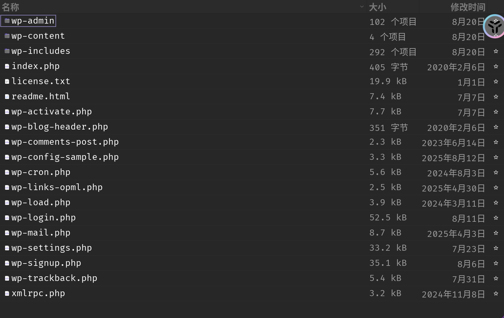
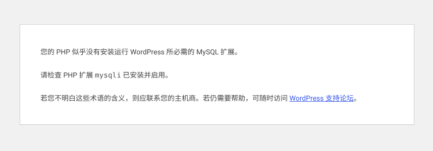
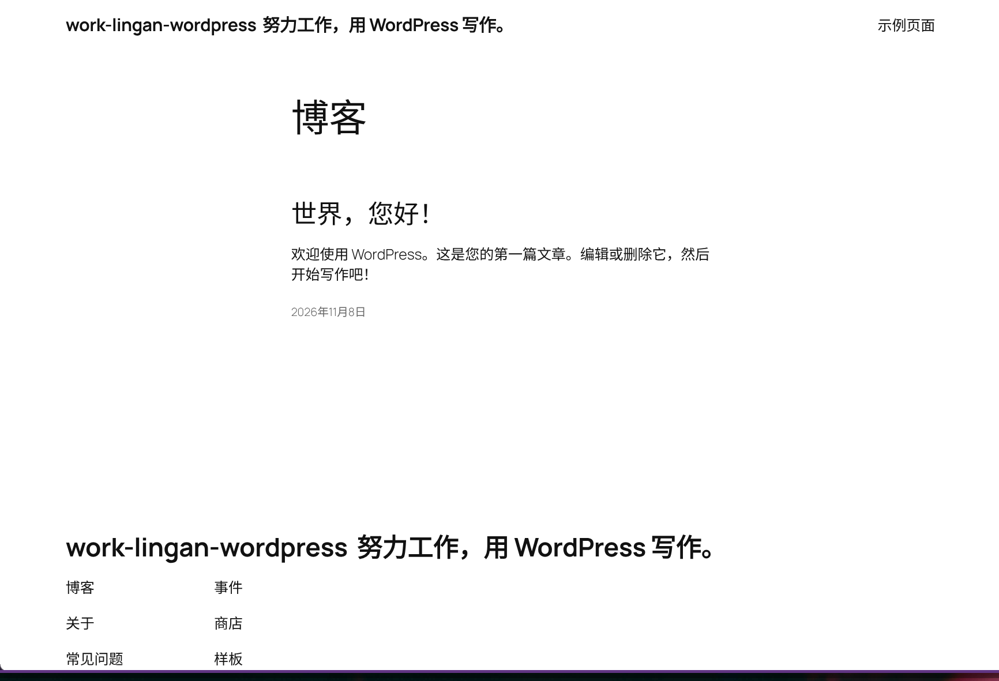
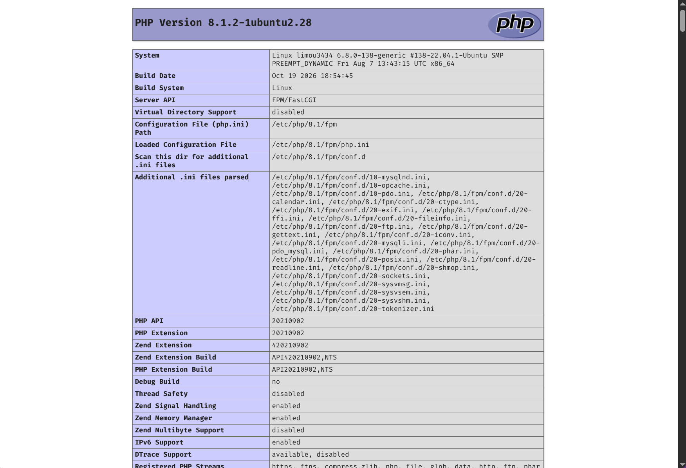
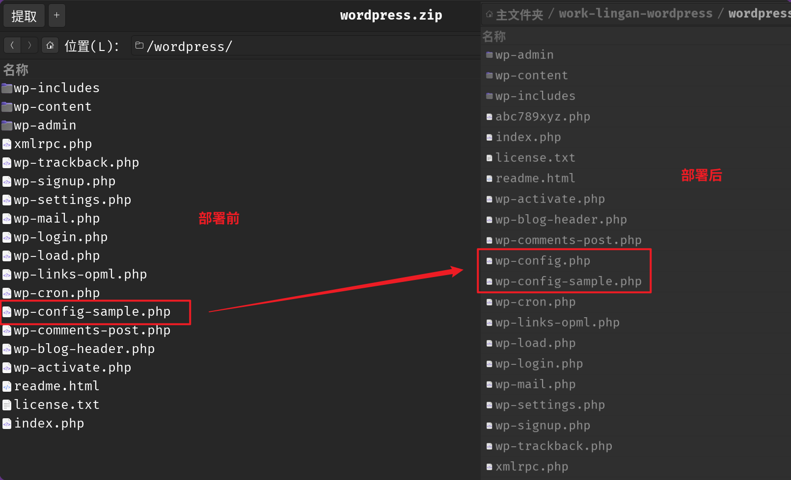
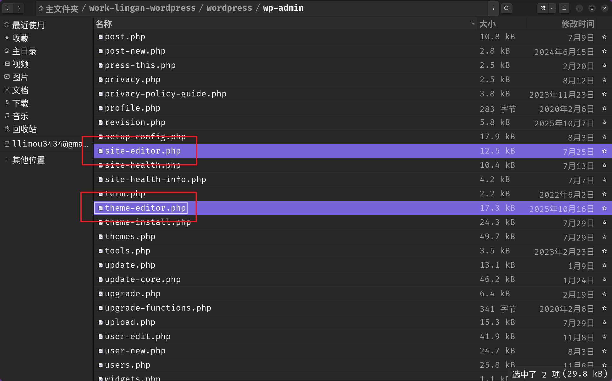
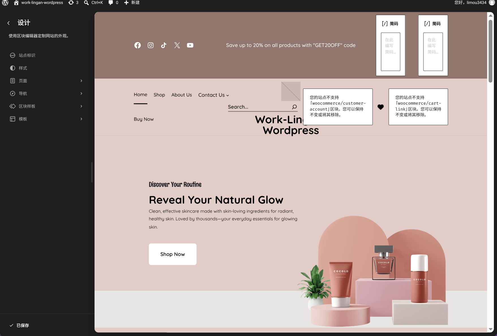
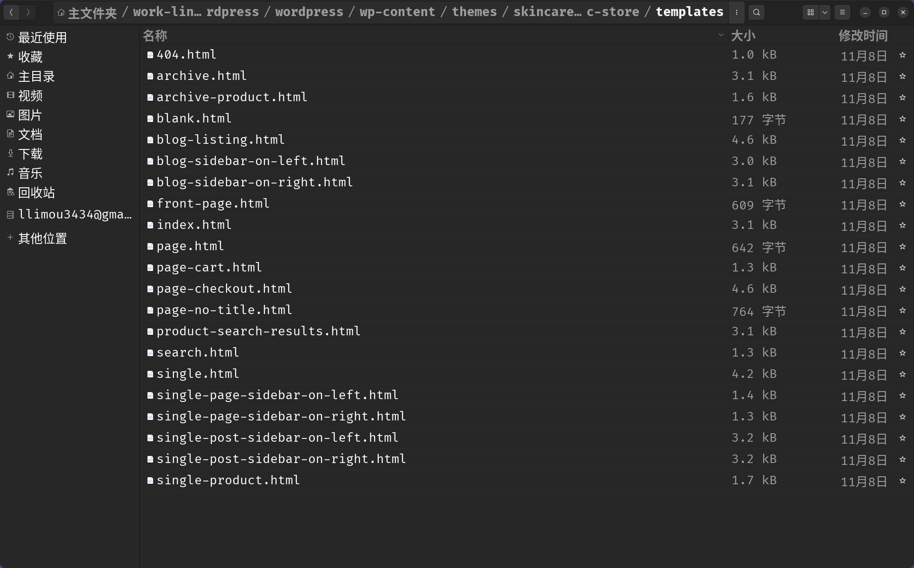
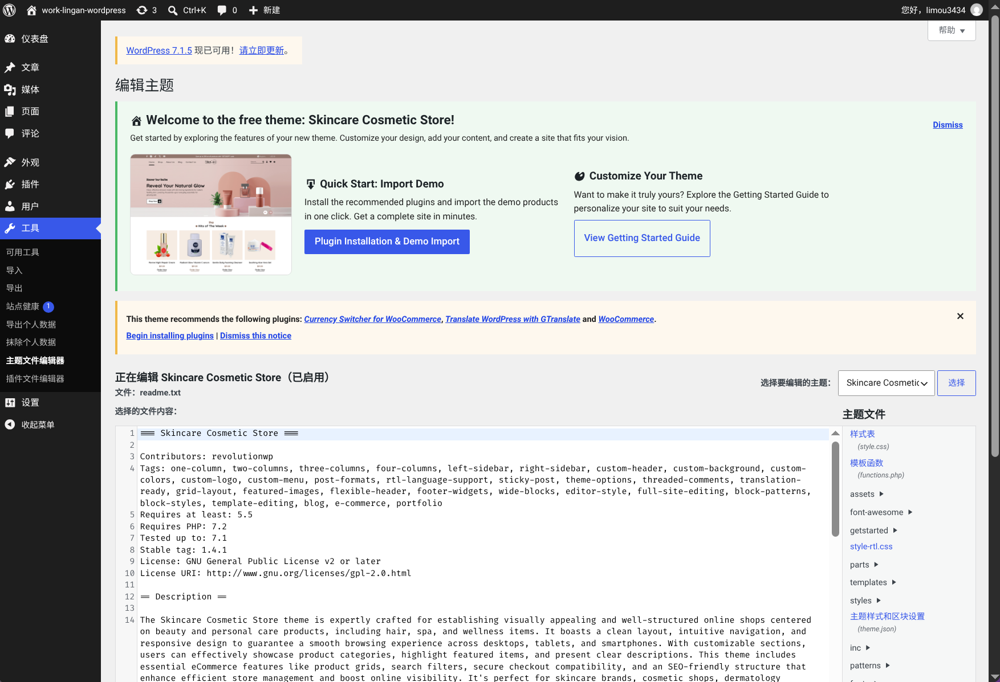
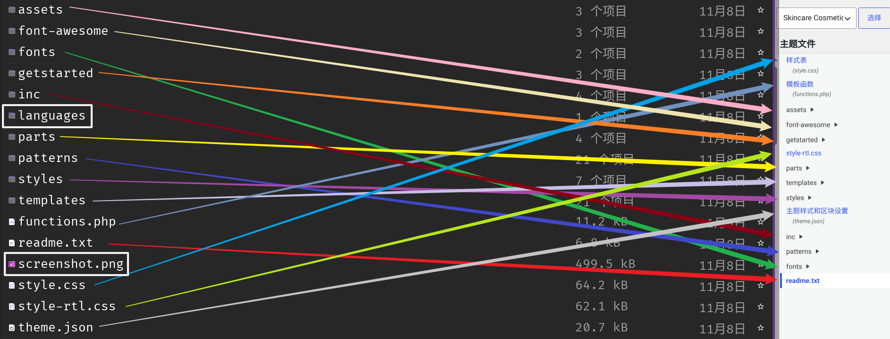

# Wordpress


## 1.环境准备

### 1.1.基础认知

`WordPress` 是全球占有率最高的开源 `CMS，内容管理系统`，`2003` 年发布，底层基于 `PHP + MySQL/MariaDB`，开源协议 `GPLv2`，全球超过 `40%` 网站都由它搭建，常用组合就是 `WordPress + WooCommerce`。

> [!IMPORTANT]
>
> 补充：具体需要区分两个东西。
>
> - **WordPress.org（自托管，你做独立站要用这个）**：程序免费下载，自己买服务器、域名，`100%` 掌控源码、数据、权限，自由度最高
> - **WordPress.com**：官方托管 `SaaS` 服务，不用自己买服务器，但功能、修改权限受限，不适合外贸独立站

> [!IMPORTANT]
>
> 补充：`MySQL` 最早是瑞典公司开发，后来被甲骨文 `Oracle` 收购。 很多开发者担心甲骨文会慢慢收紧开源政策，`MySQL` 的原作者 `Monty Widenius` 就基于 `MySQL` 源码，`fork` 出来了 `MariaDB`，保持完全开源。

> [!IMPORTANT]
>
> 补充：`WooCommerce` 是 `WordPress` 的电商插件，免费开源，是把 `WordPress` 网站变成在线商城的核心工具，也是外贸独立站（你做化妆品出海最常用）的主流方案。它原本是独立团队开发，现在归属 `Automattic`（也就是 [WordPress.com](https://WordPress.com) 背后的公司），协议 `GPLv2`，和 `WordPress` 生态深度绑定。

### 1.2.技术架构

在部署之前需要了解一下 `Wordpress` 的架构组织原理：

- **核心 Core（内核层）**：内核负责用户管理、文章/页面、媒体库、评论、菜单、REST API、更新机制，是基础骨架，不要随意修改内核代码，升级会覆盖
- **数据库 MySQL/MariaDB（数据层）**：所有文章、页面、设置、用户、插件数据全部存在数据库；访客访问页面时，PHP 读取数据库数据，实时拼接渲染成网页返回浏览器
- **主题 Theme（外观层）**：控制页面布局、配色、字体、移动端样式，文件放在 `wp-content/themes/`
- **插件 Plugin（扩展层）**：文件放在 `wp-content/plugins/`，用来新增能力，不改动内核
- **REST API（接口层）**：`WP` 原生自带接口，可以和前端、小程序、第三方 `CRM、ERP` 对接，前后端分离开发

我们现在先在本地进行初步的环境安装，我们先不看 `PHP` 的相关东西，先看看 [官方网站中下载下来的压缩包文件](https://cn.wordpress.org/download/) 中都有些什么文件（这里用的是 `7.1` 中国版）。



- 三个核心文件夹（最重要）
  - **wp-includes**：`WordPress` 内核底层库，全局函数、类、核心逻辑、数据库操作、工具函数全都在这里，绝对不要改这里的代码，版本升级直接覆盖，改完下次更新直接丢失，还容易出 `BUG`
  - **wp-admin**：后台管理面板，就是你登录 `/wp-admin` 看到的所有页面、菜单、设置界面的代码。你装插件、改商品、编辑文章、更新系统，访问的都是这里面的 `php`。正常 不要手动修改里面任何文件，升级 `WordPress` 的时候整个文件夹会被覆盖
  - **wp-content**：你以后改动最多的地方，这个是 `WP` 留给用户的目录，内核升级不会覆盖它，非常关键
    - `themes/`：主题放这里
    - `plugins/`：插件放这里（`WooCommerce` 就装在这）
    - `uploads/`：你上传的图片、产品图、附件自动存在这里以后你做二次开发、装主题插件，几乎只碰这个目录

- 根目录重点文件（挑关键）

  - **index.php**：网站入口文件！所有前端网页请求，最终都会走到这个文件，加载整个 WP 框架。

  - **wp-config-sample.php**：模板配置文件。你需要复制一份，重命名成 `wp-config.php`，然后在里面填写数据库账号、密码、数据库名，这是连接 MariaDB 的关键。

  - **wp-load.php**：加载 WP 核心环境的引导文件，大部分脚本都会先引入它

  - **wp-login.php**：登录页面，就是后台登录界面

  - **wp-cron.php**：WP 的定时任务（比如定时发邮件、定时清理、定时发布文章、Woo 订单状态任务）

  - **xmlrpc.php**：旧的远程接口，现在很多站为了防攻击直接关掉

  - **license.txt**：GPL 开源协议说明

  - **readme.html**：官方介绍文档

- 其他剩下的 `wp-xxx.php` 大多是独立功能页面：激活、评论、注册、设置页面等

网站用户的访问链路为：浏览器访问你的域名 → `Nginx` 转发到 `index.php` → `index.php` 引入 `wp-load.php` → 加载 `wp-includes` 内核 → 读取 `wp-config.php` 里面的数据库信息 → 连接 `MySQL/MariaDB` → 读取数据，再调用 `wp-content` 里的主题渲染页面。

因此通过上面的读取我们很快就需要意识到几个问题：
- **部署之前需要创建一个数据库，那么是选择 `MySQL` 还是 `MariaDB` 呢？**

  优先选 MariaDB，MariaDB 是 MySQL 的开源分支，底层协议、基础语法、连接方式对 WP 完全兼容。版本推荐 `10.6 / 10.11`，稳定，WordPress、WooCommerce 全部适配，甲骨文维护的 MySQL 商业版权约束更重，而 `MariaDB` 完全开源，没有额外商业限制，海外建站圈子默认首选。不要混着用，数据库创建好之后，二者的数据文件不能直接互换，只要你是从零新建库，选 MariaDB 没有坑。不过！！！我要说不过了，现在的官方文档内写的是 `MySQL`，再加上我对 `MariaDB` 是有些不熟悉的，所以先使用 `MySQL` 一段时间试试吧

- **运行之前本机电脑上需要安装和 `PHP` 相关的模块程序，但是貌似 `PHP` 有很多以 `php-` 开头命名的模块，这些模型为什么会被切分为那么多而不像其他语言一样只需要安装一个 `编译器/解释器 + 软件库管理器` 就足够了呢？**

  这个是 `PHP 历史形态 + Linux 发行包管理 + SAPI 模型` 共同造成的，不是设计缺陷。`PHP` 本身自带大量内置扩展，但发行版（Debian/Ubuntu）选择拆包分发 PHP 内核本身是一个程序，它自带几十种扩展（`mysql、gd、zip、curl` 等）。但是 Ubuntu 源的维护策略，把扩展拆成独立 deb 包，理由是

  - **最小化安装**：很多轻量业务根本不需要图片处理、压缩、xml 这些扩展，不拆包就会白白占用磁盘
  - **安全隔离**：某个扩展有漏洞，只需要升级这个扩展包，不用整体升级整个 `PHP`

  - **多 SAPI 隔离**：`cli`、`fpm`、`libapache2-mod-php` 是三套不同的 `SAPI` 运行入口，用途完全不一样，所以拆成独立包
  - **软件管理**：`php` 内核本身自带的功能（连数据库、图像处理），在 `Linux` 发行层被拆成独立包，`PHP` 的应用层包管理器是 `composer`（`WP` 本身基本不用 `composer`，很多 `WP` 插件生态也不用），简单一句话，不是 `PHP` 语言本身拆成很多块，是 `Ubuntu` 的打包方式把它拆碎了
  - **整包编译**：如果你用源码编译 PHP，你可以一次性编译启用全部扩展，那就是一个单独的 `php` 程序，不会分成一堆包

- **官方下载的是压缩包，那么这个压缩包内的文件是不是就是 `Github` 上的最新版本呢？以后更新框架怎么办？只需要替换文件夹就可以了？是不是有些草率？**

  可以手动替换，但不推荐直接粗暴覆盖，有坑，不是简单替换就完事，先说两种更新方式：

  - 推荐方式：`WP` 后台图形化自动更新（最标准），`WP` 后台 → 仪表盘 → 更新，一键升级内核。它会自动处理文件替换、校验、权限、数据库版本迁移（`WP` 有时候会更新数据库表结构！这个是重点）
  - 手动 `zip` 覆盖（你想的方式）：流程不是直接丢进去覆盖，先完整备份数据库 + 全部网站文件（重中之重），下载新版 zip，解压，删除旧的 `wp-admin、wp-includes`（不要直接覆盖！旧残留文件容易冲突），把新版的 `wp-admin、wp-includes、根目录 php 文件` 放进去，千万不要覆盖 `wp-content`！主题、插件、上传图片都在这里，访问网站，WP 会自动检测数据库版本，执行数据库升级脚本。

  关键点 WordPress 更新不只是改文件，偶尔会变更数据库表结构。只替换文件、没走数据库升级，网站会报错、功能异常

- **WP 是啥？**：`wp = WordPress` 的简写，就是我们现在一直在聊的这个 `CMS` 程序

## 2.快速体验

### 2.1.安装数库

既然如此，我们先安装一下数据库吧，这里我使用的是 `MySQL`，这方面就不介绍怎么安装了。

```sql
$ mysql -u root -p  
Enter password:  
Welcome to the MySQL monitor. Commands end with ; or \\g.  
Your MySQL connection id is 5340 to server version: 3.23.54  

Type 'help;' or '\\h' for help. Type '\\c' to clear the buffer.  

mysql> CREATE DATABASE work_lingan_wordpress DEFAULT CHARACTER SET utf8mb4 COLLATE utf8mb4_general_ci;
Query OK, 1 row affected (0.00 sec)

mysql> CREATE USER 'work_lingan_wordpress_user'@'localhost' IDENTIFIED BY 'Qwe54188_';

mysql> GRANT ALL PRIVILEGES ON work_lingan_wordpress.* TO 'work_lingan_wordpress_user'@'localhost';
Query OK, 0 rows affected (0.00 sec)

mysql> FLUSH PRIVILEGES;
Query OK, 0 rows affected (0.01 sec)   

mysql> EXIT  
Bye 
```

### 2.2.解压缩包

接下来就是来自官方的步骤了，先简单看一下不要先操作：

1. 如果你还没有下载并解压 `WordPress` 的压缩包，请立即进行下载和解压操作

2. 在您的 Web 服务器上创建一个数据库，同时创建一个拥有全部权限的 MySQL（或 MariaDB）用户，该用户可以访问和修改该数据库

3. （可选）找到并重新命名 `wp-config-sample.php` 为 `wp-config.php` ，然后编辑该文件（请参阅如何编辑 `wp-config.php` 文件），并添加你的数据库信息（如果您不喜欢重新命名文件，那么第三步是可以跳过这一步的。因为安装程序会自动创建 `wp-config.php` 文件，无需您手动操作）

   - `DB_NAME`，你在第二步为 `WordPress` 创建的数据库名称
   - `DB_USER`，你在第二步创建的 `WordPress` 用户名
   - `DB_PASSWORD`，你在第二步中为 `WordPress` 用户名选择的密码
   - `DB_HOST`，你在第二步确定的主机名（通常是 `localhost`，但不一定，请参考一些可能的 `DB_HOST` 值）。如果需要端口、套接字或管道，则在主机名后加上冒号（`:`），然后添加相关信息
   - `DB_CHARSET`，数据库字符集通常不应更改（参见编辑 `wp-config.php`）
   - `DB_COLLATE`，数据库的排序通常应保持空白（参见编辑 `wp-config.php`）

4. 将 `WordPress` 文件上传到您的 `Web` 服务器上的适当位置：

   - 如果您希望将 `WordPress` 集成到您域的名称服务器中（例如：https://example.com/），请将解压后的 `WordPress` 目录中的所有文件（不包括 `WordPress` 目录本身）复制到您的 `Web` 服务器的根目录中
   - 如果您希望在网站的目录下有一个名为 `blog` 的子目录，用于存放您的 `WordPress` 网站（例如：https://example.com/blog/），那么请在服务器上创建这个 `blog` 目录，并将解压后的 `WordPress` 文件通过 `FTP` 上传到该目录中

   注意：如果您的 `FTP` 客户端有将文件名转换为小写的功能，请确保该功能处于禁用状态

5. 通过访问网页浏览器中的 `URL` 来运行 `WordPress` 安装脚本。这个 `URL` 应该是你上传 `WordPress` 文件时的来源地址，这里我选择的是把解压后的目录文件放在我自己的家目录内部，然后直接用浏览器来访问就可以了 https://example.com/wp-admin/install.php 来安装了（这个安装原理是利用浏览器访问 `Nginx` 页面然后调用 `php` 代码，最终由 `php` 解释器来进行配置）

诶不过这个只是官方的演示例子，我们需要一个 `Nginx` 才可以，并且编写对应的配置文件。

### 2.3.搭建服务

```nginx
# Nginx 负责监听 80/443 端口，接收浏览器请求
# 配置规则，遇到 .php 文件交给 php-fpm 解析执行，这就是 WP 生产环境标准搭配，你后面出海独立站就用这套
# php-cli 是 php 的命令行工具，同时也是解释器
$ sudo apt install nginx php8.1-cli php-fpm -y
```

```bash
# 配置站点，把根目录指向你的 wordpress 文件夹
$ sudo nano /etc/nginx/sites-available/work-lingan-wordpress
$ cat /etc/nginx/sites-available/work-lingan-wordpress
server {
    listen 3000;
    server_name _;
    root /home/ljp/work-lingan-wordpress/wordpress;
    index index.php index.html;

    location / {
        try_files $uri $uri/ /index.php?$args;
    }

    location ~ \.php$ {
        include snippets/fastcgi-php.conf;
        fastcgi_pass unix:/run/php/php8.1-fpm.sock;
    }
}

$ sudo ln -s /etc/nginx/sites-available/work-lingan-wordpress /etc/nginx/sites-enabled/

$ sudo chown -R www-data:www-data /home/ljp/work-lingan-wordpress/wordpress

$ sudo chmod -R 777 /home/ljp/work-lingan-wordpress/wordpress

$ sudo nginx -t
$ sudo systemctl restart nginx
```

### 2.4.依赖安装

然后就应该是访问 http://127.0.0.1:3000/wp-admin/install.php 来进行安装了，但是通常会出现下面问题。



这是因为我们还缺少一个 `php` 的模块，使用 `sudo apt install php8.1-mysql` 安装然后刷新浏览器即可出现下面页面进行对应的填写，最后运行安装程序即可。

### 2.5.配置网站


再填写一些基本信息。


### 2.6.前台后台

因此这里，我们很快就拥有了我们的前台和后台页面。




> [!IMPORTANT]
>
> 补充：这里可以自己研究一下，只有登陆了管理员帐号才看得到顶部的编辑等文字信息，如果直接登陆是没有顶部这些控件的。

> [!IMPORTANT]
>
> 补充：直接下载压缩包的方式也太奇怪了？！当然，`WP` 也提供一些程序员熟悉的建站方式，下面全部都是 `WordPress` 本地开发环境工具，都是不用买服务器，可以在自己电脑上跑 `WordPress` 网站，用来开发主题、插件、改页面、测试功能，做好之后再上传到正式线上服务器。下面逐个通俗解释：
>
> - **wp-env**：`WordPress` 官方主推，基于 `Docker`。适合写区块编辑器插件、`WP` 核心二次开发，前端开发者首选。特点：官方维护，贴近源码，命令行操作（本机必须安装 `Docker`）
>- **DDEV**：现在圈内热度很高、非常推荐的 `Docker` 方案。亮点：一键启动本地 `WP`、自带 `phpMyAdmin、Xdebug` 调试、还能把本地站点临时公网分享给别人看，多站点管理很舒服（本机必须安装 `Docker`）
> - **Lando**：`Docker` 封装工具，支持 `WordPress` 插件，配置文件驱动。特点：灵活，不止 `WordPress，Laravel、Drupal` 也能用，适合经常换项目框架的开发者（本机必须安装 `Docker`）
>- **VVV (Varying Vagrant Vagrants)**：老牌经典方案，基于 `Vagrant + VirtualBox`。以前 `WP` 开发者圈非常流行。特点：一套虚拟机，自带 `Nginx`、`MySQL`、各种调试工具，配置略重，现在慢慢被 `DDEV、Lando` 替代
> - **XAMPP**：最老牌集成包，一键装好 `Apache + MySQL + PHP`。特点：简单粗暴，适合新手；`Windows/Mac` 都能用；缺点是要自己手动下载、安装、配置 `WordPress`
>- **MAMP**：`Mac` 平台为主（也有 `Windows` 版），集成 `Apache/Nginx + PHP + MySQL`。特点：界面友好，`Mac` 用户常用，本地快速搭站
> - **AMPPS**：类似 `XAMPP/MAMP`，内置 `Softaculous（一键网页程序安装器）`。特点：面板里一键点击就能安装 `WordPress、Discuz` 等程序，不用手动导入数据库
>- **Bitnami WordPress Stack**：打包好的 `WordPress` 镜像包。特点：一键部署，本地、虚拟机、云服务器都能用，支持 `WordPress` 多站点 `Multisite`
> - **InstantWP**：`Windows` 专属，绿色便携版。特点：放 `U盘` 里直接跑，不用安装，拿到别的电脑插上就能打开 `WP`，适合快速演示
>- **WordPress Studio**：`Automattic`（[WordPress.com](https://WordPress.com) 母公司）新出的可视化客户端。特点：图形界面，不用敲命令，轻松新建、切换多个本地 `WordPress` 站点，对不熟悉 `Docker` 的开发者友好
> 
>有时间研究一下 `DDEV` 的用法吧，我个人比较看好这个，其次就是 `wp-env`，待补充...

> [!IMPORTANT]
>
> 补充：这里还有个控制面板 [WP Toolkit](https://developer.wordpress.org/advanced-administration/server/control-panel/) 可以了解一下，对我没什么太大用，所以我就没有研究了。
>

> [!IMPORTANT]
>
> 补充：除此以外可以在其他服务商上面搭建，这里简单列出一下，可以 [看这个文章](https://developer.wordpress.org/advanced-administration/before-install/popular-providers/)，这个我就不补充了，我不想花太多钱（阿哈哈）。
>
> - 在 `Atlantic.net` 网站安装 `WordPress`
> - 在 `AWS` 上安装 `WordPress`
> - 在 `DigitalOcean` 平台上安装 `WordPress`
> - 在 `Linode` 上安装 `WordPress`
> - 在 `iPage Hosting` 上安装 `WordPress`
> - 在 `Microsoft Azure` 上安装 `WordPress`

### 2.7.容器包装

实际上，`WP` 是支持使用 `Docker` 来进行部署的，这里就需要推荐 `DDEV` 部署方式，但是！实际上如果您的 `Docker Compose` 基础知识过关的话，我的建议是直接使用 `Docker Compose` 会比较好，更加清爽。由于我本人是自己有一个私有的 `Compose` 部署文件的，下面是我剪切一部分配置文件出来：

```yaml
# 待补充...
```

> [!IMPORTANT]
>
> 补充：`WP` 官方只支持 `Apache` 变体，我对这种服务器不熟悉，所以我修改为上述的 `Nginx` 部署了，不过老实说除非为非企业用途，否则我是不愿意使用 `Docker` 的，有些没有必要。

## 3.深入研究

### 3.1.三种配置

#### 3.1.1.系统配置

##### 3.1.1.1.查找信息

我们有时候在排查问题之前是需要查看各种版本信息的，怎么快速查看您的服务器环境信息（PHP 版本、数据库、操作系统、web 服务器软件）呢？在自己的 `wordpress` 中写一个随机字符 `php` 文件（例如 `abc789xyz.php`），然后写下下面代码，`URL` 访问 `http://127.0.0.1:3000/abc789xyz.php` 即可快速获得信息。

```php
<?php phpinfo(); ?>
```



##### 3.1.1.2.服务主题

服务器配置涉及运行 `WordPress` 的托管环境。这包括 `Web` 服务器、文件和目录权限、数据库工具、邮件传输、域名路由以及托管控制面板等部分。一些服务器上的更改如果执行不当，可能会导致网站无法使用。在进行任何修改之前，请先查看相关页面。在修改文件或数据库时，请务必创建当前版本的备份。

请选择一个服务器主题。当你需要了解 `WordPress` 如何与 `Apache HTTPD` 或 `Nginx` 等服务器软件协同工作时，可以查看 [文档](https://developer.wordpress.org/advanced-administration/server/web-server/)

- [Apache HTTPD / .htaccess](https://developer.wordpress.org/advanced-administration/server/web-server/httpd/) 文件包含了关于 `WordPress` 重写规则的说明，以及相关的 `Apache` 配置细节
- [Nginx](https://developer.wordpress.org/advanced-administration/server/web-server/nginx/) 提供了关于 `WordPress` 的独立配置指南，包括单站点和多站点应用的配置示例

不过目前我使用的是 `Nginx`，其实这里还有一个服务器程序是我喜欢的，就是 `Caddy`，尤其是在部署到公网的角度上来看会更加方便，这方面您可以研究一下

##### 3.1.1.3.数据管理

[Emptying a Database Table](https://developer.wordpress.org/advanced-administration/server/empty-database/) 是指如何使用 `phpMyAdmin` 来删除某个表，不过说实在的，对于开发人员来说使用 `IDEA` 等软件来进行管理就已经足够使用了，除非是开发人员身边没有电脑只有手机，那倒是可以考虑使用 `phpMyAdmin` 操作一下。不过，我们可以顺便了解一下 `WP` 的数据库内部结构。

```sql
mysql> show databases;
+-----------------------+
| Database              |
+-----------------------+
| information_schema    |
| mysql                 |
| performance_schema    |
| sys                   |
| work_lingan_wordpress |
+-----------------------+
5 rows in set (0.01 sec)

mysql> use work_lingan_wordpress;
Reading table information for completion of table and column names
You can turn off this feature to get a quicker startup with -A

Database changed
mysql> show tables;
+---------------------------------+
| Tables_in_work_lingan_wordpress |
+---------------------------------+
| wp_commentmeta                  |
| wp_comments                     |
| wp_links                        |
| wp_options                      |
| wp_postmeta                     |
| wp_posts                        |
| wp_term_relationships           |
| wp_term_taxonomy                |
| wp_termmeta                     |
| wp_terms                        |
| wp_usermeta                     |
| wp_users                        |
+---------------------------------+
12 rows in set (0.00 sec)
```

上面是我的 `WP` 在快速体验章节安装后，查看 `MySQL` 的所有数据表。

| Tables_in_work_lingan_wordpress | 详细作用                                                     |
| ------------------------------- | ------------------------------------------------------------ |
| wp_commentmeta                  | 评论的元数据扩展表。给单条评论附加额外自定义信息，是键值对结构。插件常用：评论评分、评论 IP 备注、评论自定义标记、评论附加选项；单条评论可以有多条 `meta` 记录，没有则为空。和 `wp_comments` 通过 `comment_id` 关联 |
| wp_comments                     | 评论主数据表。保存所有评论、`Pingback`、`Trackback`。包含评论内容、评论作者名称、邮箱、网址、评论时间、评论归属文章 `ID`、评论状态（待审核 / 已通过 / 垃圾评论）、父评论 ID（实现楼中楼回复）。`comment_ID` 是主键 |
| wp_links                        | 友情链接（`Blogroll`）遗留表。早期 `WordPress` 自带链接管理功能，新版 `WP` 后台默认隐藏该菜单，需要插件才能启用。存放链接标题、链接地址、链接描述、分类、打开方式。新项目几乎不用，老站点会残留数据 |
| wp_options                      | 全局核心配置表，整个站点最重要的表之一。存储站点级别的配置，键值对形式。包含 `siteurl`、`home`（就是前面聊的两个 `URL`）、站点标题、简介、固定链接结构、插件开关、主题设置、缓存配置、自动更新设置、后台默认选项。`autoload` 字段控制 `WP` 启动时是否自动加载这条配置，量大的 `autoload` 会拖慢网站 |
| wp_postmeta                     | 文章内容元数据表。和 `wp_posts` 通过 `post_id` 关联，键值对。作用是给 `post` 类型对象挂载自定义字段：文章额外参数、页面配置、特色图缩略图 `ID`、附件附加信息、古腾堡区块数据、各类插件自定义字段（商品价格、属性等）。一条 `post` 可以无限多条 `meta` |
| wp_posts                        | 内容主表，`WP` 里几乎所有内容都在这里。主键 `ID`。存放类型不止文章：`Post` 文章、`Page` 页面、`Attachment` 附件（上传图片/文件）、`Revision` 内容修订版本、`Nav_menu_item` 导航菜单、自定义文章类型（产品、案例等）。记录标题、正文、摘要、发布时间、修改时间、状态（发布/草稿/回收站）、别名 `slug`、父级 `ID` |
| wp_term_relationships           | 多对多中间关联表。负责【内容 ↔ 分类/标签】绑定。比如一篇文章同时打上 `2` 个标签、归属 `1` 个分类，就会在这里生成多条记录。`object_id` 对应文章 `ID`，`term_taxonomy_id` 关联到 `wp_term_taxonomy`，本身不存分类名称，只做绑定 |
| wp_term_taxonomy                | 分类法定义表。区分这条 `term` 是什么类型：`category` 分类、`post_tag` 标签、自定义分类法。记录分类描述、父分类 `ID`（实现多级分类）、该分类下一共有多少篇内容（`count` 计数）。主键 `term_taxonomy_id`，关联 `term_id` 到 `wp_terms` |
| wp_termmeta                     | 分类/标签元数据表。给分类、标签、自定义分类挂载扩展字段。比如分类封面图、分类额外说明、分类模板配置、标签 `SEO` 设置，键值对结构，通过 `term_id` 关联 `wp_terms` |
| wp_terms                        | 术语基础表。存放分类、标签、自定义分类的基础名称。字段：名称 `name`、别名 `slug`（`URL` 里的短链接）、`term_group`（分组，很少用）。这里只是名字，它到底是标签还是分类，不由本表决定，由 `wp_term_taxonomy` 决定 |
| wp_usermeta                     | 用户元数据扩展表，键值对。和 `wp_users` 通过 `user_id` 关联。存储用户除基础信息以外的全部扩展数据：用户角色权限、昵称、显示名、用户描述、后台设置、插件增加的用户字段、社交账号信息 |
| wp_users                        | 用户账号主表。主键 `ID`。保存账号基础信息：登录用户名、密码哈希（不是明文密码）、邮箱、注册时间、用户激活码、用户状态。`WP` 登录校验、用户基础信息读取都从这张表拿 |

##### 3.1.1.4.更改权限

当 `WordPress` 无法写入文件、更新失败、上传失败，或者需要检查文件的归属和权限时，可以查看 [Changing File Permissions](https://developer.wordpress.org/advanced-administration/server/file-permissions/)。在计算机文件系统中，不同的文件和目录都有权限设置，这些设置决定了谁可以读取、写入、修改或访问这些文件。这一点非常重要，因为 `WordPress` 可能需要访问你的 `wp-content` 目录中的文件以执行某些功能。这个文档的前半部分讲解的都是 `Linux` 的用户权限部分，我觉得这些对于 `Linux` 开发者算是基础了，我就不太展开了。

> 补充：下面是我 AI 整理的一些重要点，就算是知道 `Linux` 权限的人也会出现的一些问题，等我后续进行补充，待补充...
>
> 逐点展开细化（你已经懂基础 chmod、u/g/o、rwx，我避开基础定义，聚焦 WP 专属、容易混淆的部分）
>
> 1. 核心：权限好不好使，决定性因素是「PHP 进程跑在哪个 UID」
>
> Linux 的 chmod 只是文件上的标签；**真正去读/写文件的是 PHP 进程，进程有自己的 uid/gid**，这个是很多人只学权限却忽略的核心。 两套架构，权限模板完全不能混用：
>
> 模式 A：传统隔离（mod_php / 普通 php-fpm，Nginx+FPM 单站常用）
>
> - 文件属主：你的 SSH/ftp 用户，比如 `wwwuser`
> - PHP 进程身份：独立用户，`www-data` / `apache` / `nobody`，**和文件属主不是同一个人**
> - 逻辑：文件所有者是你，web 是另一个用户；web 不属于 owner，只能走 **group（属组）权限** 拿到写入能力
>   - 目录 775：owner = rwx，group = rwx，other = rx → www-data 加入这个文件的属组，就能写目录
>   - 文件 664：owner = rw，group = rw，other = r
> - 风险红线：**不要把文件属主改成 www-data** 共享主机上这么做危害极大：服务器上别的站点如果被入侵，攻击者以 www-data 身份运行，就能读写服务器上所有属主是 www-data 的网站文件。
> - 经典现象：后台装插件、更新主题时弹出「请输入 FTP 账号密码」 原因：PHP 进程（www-data）没有组写权限，没法直接写文件；WP 退而求其次，调用 FTP（以你的账号）上传修改文件。
>
> 模式 B：suexec / suphp / FPM pool 按用户拆分（虚拟主机、cPanel、宝塔虚拟主机常用）
>
> > 重点：很多人会把这套方案直接搬到独立服务器，其实文档明确说了它的设计目标是 **共享多租户主机**，单独立站没有收益。
>
> - 逻辑：每个站点的 PHP-FPM 池，绑定这个站点专属的用户 UID；**PHP 进程 = 文件属主同一个账号**
> - 此时 group 权限基本失去作用，不需要 775/664
>   - 目录 755：owner = rwx，group = rx，other = rx；进程是 owner，直接可写
>   - 文件 644：owner = rw
>   - wp-config.php 收紧至 `440` / `400`：**同服务器别的租户用户完全读不到数据库账号密码**，这是 suexec 模式最大的安全优势
> - 现象：不会弹出 FTP 输入框，后台直接更新插件主题
>
> > ✅ 快速自检当前是哪种模式
>
> ```
> # 看php进程是谁
> ps aux | grep php-fpm
> # 看网站文件属主
> ls -l /path/to/wordpress/
> ```
>
> 进程 UID 和 文件 UID 一致 = suexec 类；不一致 = 隔离模式 A。
>
> ------
>
> 2. 特殊文件&目录的 WP 专属约束
>
> wp-config.php
>
> 里面存放数据库用户名、密码、数据库名、密钥 `AUTH_KEY` 等核心凭证。
>
> - 安装默认生成是 644：other 位有读权限。**同服务器上别的用户，可以直接 cat 读取这个文件**，这就是文档说默认不安全的原因
>
> - 最优：`chmod 400 wp-config.php`，只有属主能读，任何人无权限
>
> - 限制：只有模式 B（php = 属主）下 400 才可以正常运行；模式 A（web 是另一个用户）如果设 400，web 进程连读都读不了，网站直接 500。
>
>   > 所以：模式 A 里 wp-config.php 最低只能到 640（owner rw，group r，other 0），把 other 读拿掉。
>
> .htaccess
>
> 只在 Apache 环境生效，Nginx 默认不用它。 WP 固定链接、重定向、防盗链、缓存规则都写在这里；当你后台修改固定链接结构时，WP 尝试写入 .htaccess。
>
> - 权限满足但是写失败 → 不要反复调 chmod，优先排查 SELinux
> - 最小权限：644；不需要给写权限常驻，**只在后台改固定链接时临时放开 group 写，改完收回是最佳实践**
>
> 目录分工（只读目录 vs 可写目录）
>
> ✅ **Web 进程只允许写入的目录**：
>
> - `wp-content/uploads` 用户上传图片附件
>
> - `wp-content/cache` 缓存插件生成缓存文件
>
> - 多站点额外：`wp-content/blogs.dir` 子站点上传资源 ✅ **Web 进程应当只有读权限，绝对不能写**： `wp-admin/`、`wp-includes/`、根目录所有 php 文件
>
>   > 很多一键包偷懒，直接递归 775 全站，一旦攻击者上传 php 到 uploads，就能改写 wp 核心文件，这是 WP 入侵高频入口。
>
> 后台主题编辑器（Appearance → Theme Editor）开启条件
>
> 编辑器本质：PHP 进程去读取、修改主题目录里的 php/css 文件。 想要能用，文件必须拥有 **group write**。
>
> - 独立站推荐做法：直接关掉这个编辑器，不要开组写。线上环境给 web 修改代码的权限属于高危。
> - 多人 FTP 协同维护才需要这个能力；共享主机场景，组里面只能加入你信任的账号，绝对不能把 www-data 放进这个组。
>
> ------
>
> 3. 777 的危害链路（文档原文视角，区别于笼统的“不安全”）
>
> 777 = ugo 全部 rwx，other 位全局可写可执行。 攻击链路：
>
> 1. 攻击者通过评论上传漏洞、插件漏洞，往 uploads 目录上传恶意 php 脚本
> 2. 目录是 777 → www-data（web 进程）可以写入这个恶意文件
> 3. 在浏览器访问这个恶意 php → 以 www-data 身份执行代码
> 4. 读取 wp-config.php 拿到数据库账号，甚至篡改全站文件
>
> - 文档原话：作者几乎没有见过生产环境真的必须 777 的场景，上限一般 767 就足够临时排错
> - 777 定位用途：**临时调试验证是不是权限问题**，确认问题后立刻回落至最小权限，禁止常驻。
>
> > 误区纠正：很多人遇到报错直接 `chmod -R 777`，递归把 uploads、主题、核心目录全部放开；等于把站点大门敞开。
>
> ------
>
> 4. SELinux：DAC 权限放行，MAC 强制拦截（最容易卡很久的坑）
>
> Linux 默认两套权限体系：
>
> 1. DAC：就是你学的 chmod、属主属组（自主访问控制）
> 2. MAC：SELinux（强制访问控制，RHEL 系默认开启：CentOS、Rocky、Alma、Amazon Linux；Debian/Ubuntu 默认关闭） 表现特征： `ls -l` 看权限完全正确，chmod 怎么调都没用，日志报 Permission denied，表象和普通权限错误一模一样，很容易迷惑。
>
> 排查流程
>
> 1. 查看 SELinux 状态
>
> ```
> getenforce
> # 返回 Enforcing = 开启拦截；Permissive = 只记录不拦截；Disabled=关闭
> ```
>
> 1. 查看拦截审计日志（AVC 拒绝记录）
>
> ```
> ausearch -m avc -c httpd
> audit2allow -w -a
> ```
>
> 1. WP 场景最高发的拦截：httpd 写入 .htaccess 解决方案示例（文档给出）
>
> ```
> setsebool -P httpd_unified 1
> ```
>
> > 不推荐直接 `setenforce 0` 永久关闭 SELinux，等于废掉一层内核防护；优先调整布尔值、打文件上下文标签 `chcon`。
>
> 简单理解：chmod 只是门的锁，SELinux 是房间的保安，哪怕锁打开了，保安依然可以拦着进程不让操作。
>
> ------
>
> 5. umask：决定安装初始权限，不是 WP 写死 644/755
>
> umask 是「掩码」，从最大权限里减去对应位：
>
> - 文件原始最大 666，目录原始最大 777
>
> - umask 022：文件 666-022 = 644；目录 777-022 = 755（标准安全掩码）
>
> - 如果主机服务商设置 umask 002：文件 664、目录 775，安装完自带组写权限，偏宽松 关键点： 如果你是在不同服务器上装 WP，两台机器装完默认权限不一样，**不是 WP 程序问题，是安装那一刻 shell 的 umask 不一样**。
>
>   > 别人帮你部署好的站点，不要盲目递归 chmod，很容易破坏原有适配好的属组、SE 上下文。只有自己全新部署、出现报错才调整。
>
> ------
>
> 6. FTP 隐藏文件陷阱
>
> `.htaccess` 是点开头的隐藏文件，FileZilla 默认不加载、不展示。 现象：你在 FTP 里选中目录，修改权限，但是漏掉了 .htaccess；你以为改好了，实际文件权限没变。 新版 FileZilla：顶部菜单 `Server` → `Force show hidden files`
>
> ------
>
> 7. 官方推荐排错顺序（禁止直接 -R 递归放开）
>
> 很多人的习惯：一报错直接
>
> ```
> chmod -R 775 wp-content
> ```
>
> 递归的坏处：会把 uploads 里面用户上传的所有图片、附件一并修改权限，扩大攻击面。
>
> WP 文档建议顺序：
>
> 1. 只修改目标目录本身，不加 `-R`，只给目录写权限，不碰里面已有文件
>
> ```
> chmod 775 wp-content/uploads
> ```
>
> 1. 写入依旧失败，再加 `-R` 递归子文件子目录
> 2. 上面都不行，临时调高权限（767 这类）测试定位问题
> 3. 最后手段：临时 777 确认是不是权限问题，确认后立刻回退收紧
>
> ------
>
> 8. 插件/主题的额外目录需求
>
> WP 核心标准权限只覆盖上面几个目录。 很多缓存插件、静态生成插件、图片优化插件，会自建子文件夹（比如 `wp-content/wp-rocket-cache`），插件运行时需要在这个子目录写缓存。
>
> - 这类不属于 WP 官方标准权限清单，以插件文档为准
> - 多站点（Multisite）是特例，额外需要处理 `blogs.dir`
>
> 汇总对照，方便你随时查阅
>
> 模式 A：PHP 进程 ≠ 文件属主（普通 Nginx+FPM 独立站）
>
> | 对象               | 推荐权限  | 说明                                |
> | ------------------ | --------- | ----------------------------------- |
> | 目录               | 755 / 775 | 需要 web 写入的目录用 775，其余 755 |
> | php 文件、静态文件 | 644 / 664 | 需要 web 写的文件 664               |
> | wp-config.php      | 640       | 不能 400，web 进程需要读            |
>
> 模式 B：PHP 进程 = 文件属主（suexec / FPM pool per user，虚拟主机）
>
> | 对象          | 推荐权限  | 说明         |
> | ------------- | --------- | ------------ |
> | 全部目录      | 755       | 不需要 775   |
> | 全部文件      | 644       | 不需要 664   |
> | wp-config.php | 400 / 440 | 最高安全等级 |
>
> > 补充边界提醒：Nginx 本身不解析 php，只转发给 FPM；所以 Nginx 环境的权限判断，**只看 FPM 进程 UID，和 nginx 本身用户无关**，这点也经常混淆。
>
> 如果你愿意，下一步我可以给一份 **Nginx + PHP-FPM 独立服务器（模式 A）一键权限加固脚本 + 配套 SELinux 上下文命令**，可以直接在服务器上跑。

##### 3.1.1.5.共享数库

另外对于 `CMS` 系统来说，内容其实才是最重要的，所以如果单纯使用 `Git` 管理核心代码其实有些不够用，可以进一步看 [这篇文章](https://developer.wordpress.org/advanced-administration/before-install/development/) 中的两个 `WP` 共享一个数据库来优化自己的工作流，为什么会有人想让两套 `WP` 共用同一个数据库？正常来说，一般大家是这么开发的，`线上数据库 → 导出一份快照 → 导入本地`，本地是一份独立副本。优点是本地随便改，随便测试，完全碰不到线上真实数据。缺点是数据不同步，线上新增商品、新订单、用户提交内容，你本地看不到，想要最新数据，就得重新导出、导入一遍数据库，比较麻烦。

于是早年有人想出这个取巧思路，本地 `WP`、线上 `WP`，直接连同一个数据库，当然肯定也是有好有坏的，只是我们对一些内容站点的需求角度上来说，数据库只有一份，线上站点不用停机迁移数据这种需求是更加重要的。您也不希望每次改动内容，都需要进行一次数据库导入吧？

但是共用同一个库，会遇到什么麻烦？`WordPress` 的数据库里存了两个关键配置：`home` 和 `siteurl`，存的是线上域名，例如 `https://site.example.com`。而数据库只有一份，里面写死的是线上域名。当您本地代码连上这个库去读数据时，`WP` 读出来域名是线上域名，页面里所有图片、链接、后台跳转地址，全部指向线上网站。您打开本地站点，点一下链接直接跳到线上站，本地站点根本没法正常预览。

所以我们的目标只有一件事，数据库里面的值不动，但是本地这一套 `WP`，读取这两个域名的时候，偷偷换成自己的本地域名。线上那套 `WP` 读取的时候，照常读出线上域名。

因此这里的顺序必须是先部署线上网站，然后使用 `Git` 管理，把这个项目下载下来，再修改某些配置达成上面目的。而要达成这样的目的就有两种方案，一种是写在 `wp-config.php` 里，一种是用使用进入式接口 `drop-in`。

我们先来看第一种方案吧。

- **WP_HOME（home_url()）**：用来生成访客浏览内容的链接 文章页、页面、首页、菜单、`sitemap`、文章里的内容链接，这些给人点开看页面（`HTML` 页面）的地址，走它
- **WP_SITEURL（site_url()）**：用来生成 `WordPress` 程序相关资源/入口链接，`/wp-admin` 后台、`WP` 核心的 `js/css`、插件的脚本样式、`REST API`、后台 `AJAX` 请求，走它

因此如果我们在远端部署好网站后，在本地开发机器上只需要对两个变量进行劫持，就可以修改和渲染相关的请求都走本地，然后链接同一个数据库就可以。也许有人会说为什么不直接使用 `Git` 拉取代码然后直接和远端连接相同的数据库呢？原因是没有理解透，`WP` 在数据库中写死了两个常量（`WP` 这么设计和内容管理还有使用人群有关，这点我们不纠结），如果直接使用数据库会导致本地在跳转的时候跳到远端网站，这样就达不到我们本地只修改样式的目的了，开发会带来麻烦。

```php
<?php
/**
 * The base configuration for WordPress
 *
 * The wp-config.php creation script uses this file during the installation.
 * You don't have to use the website, you can copy this file to "wp-config.php"
 * and fill in the values.
 *
 * This file contains the following configurations:
 *
 * * Database settings
 * * Secret keys
 * * Database table prefix
 * * ABSPATH
 *
 * @link https://developer.wordpress.org/advanced-administration/wordpress/wp-config/
 *
 * @package WordPress
 */

// ** Database settings - You can get this info from your web host ** //
/** The name of the database for WordPress */
define( 'DB_NAME', 'work_lingan_wordpress' );

/** Database username */
define( 'DB_USER', 'work_lingan_wordpress_user' );

/** Database password */
define( 'DB_PASSWORD', 'Qwe54188_' );

/** Database hostname */
define( 'DB_HOST', '127.0.0.1' );

/** Database charset to use in creating database tables. */
define( 'DB_CHARSET', 'utf8mb4' );

/** The database collate type. Don't change this if in doubt. */
define( 'DB_COLLATE', '' );

/**#@+
 * Authentication unique keys and salts.
 *
 * Change these to different unique phrases! You can generate these using
 * the {@link https://api.wordpress.org/secret-key/1.1/salt/ WordPress.org secret-key service}.
 *
 * You can change these at any point in time to invalidate all existing cookies.
 * This will force all users to have to log in again.
 *
 * @since 2.6.0
 */
define( 'AUTH_KEY',         'qKdW)AO%EgEn=LdGvSn>W3958n=#0`x}v?,>5a!kY5-<#~wM =x>?f<},$}.XS1M' );
define( 'SECURE_AUTH_KEY',  '+AaSx;:Dc%o1AA3h~f +l,b+2{<a<Cj4!R_NO/ow>$N_bj^!WU=*4Q<MHE*38$m)' );
define( 'LOGGED_IN_KEY',    'kT:ndXe!CXf~rz(PcBV&#A+(T<65La/gy)4 vTkyy&bX+Dk{8ZpYZw.+m%),@r*K' );
define( 'NONCE_KEY',        '!WJEa~eHnr%RI8V+)pZ+rL.z-BiR>*jD175J~5kV05qlP@pjo/@o%8kr#0vpvbt{' );
define( 'AUTH_SALT',        ']ybkTut5w_vbX>Y0sP5{Fl0gYC&IzSC8wR@p6|fAy#j *I~ybLXm+/rDm .?/Ybq' );
define( 'SECURE_AUTH_SALT', 'riY#f{8M6%9f`bI(t{>SaWD@yhtJ[}TdY(Dva?P]==pI049ox[HCwy({$$h-K10f' );
define( 'LOGGED_IN_SALT',   'izA,bMSfW_tuY/s PnolT8-%n]MF2|Hn`^^&Yu.z]5y`l~rxM}Ae-xyE62n!`Nzd' );
define( 'NONCE_SALT',       'gg)z9nNDa;8^9)-d@VDZ R!T7 -JWlf&mGTaCk[n-z[&?QNQ/HJ[cy=zCEnA[~WN' );

/**#@-*/

/**
 * WordPress database table prefix.
 *
 * You can have multiple installations in one database if you give each
 * a unique prefix. Only numbers, letters, and underscores please!
 *
 * At the installation time, database tables are created with the specified prefix.
 * Changing this value after WordPress is installed will make your site think
 * it has not been installed.
 *
 * @link https://developer.wordpress.org/advanced-administration/wordpress/wp-config/#table-prefix
 */
$table_prefix = 'wp_';

/**
 * For developers: WordPress debugging mode.
 *
 * Change this to true to enable the display of notices during development.
 * It is strongly recommended that plugin and theme developers use WP_DEBUG
 * in their development environments.
 *
 * For information on other constants that can be used for debugging,
 * visit the documentation.
 *
 * @link https://developer.wordpress.org/advanced-administration/debug/debug-wordpress/
 */
define( 'WP_DEBUG', false );

/* Add any custom values between this line and the "stop editing" line. */

/* 任何配置都在这里进行添加，这里只在本地 ddev.site 域名下启用劫持 */
// - `$_SERVER['HTTP_HOST']` = 当前您浏览器地址栏里访问的域名（比如 `lingan.ddev.site`）
// - `str_contains(xxx, 'ddev.site')`：判断这个域名里面，有没有包含文字 `ddev.site`，如果有就进入这个 if 条件，这里的 ddev.site 只是演示例子，您可以换成自己的本地测试域名
if ( str_contains( $_SERVER['HTTP_HOST'], 'ddev.site' ) ) {
    // `define` 可以给 WordPress 设定一个固定参数，`define('A', B)` 意思就是：给名字叫 A 的这个开关，设定值为 B，WordPress 看到这个开关被写死了，就不会再去数据库里查这个配置
    // `$_SERVER['HTTP_HOST']` 这是 PHP 自带的一个变量，它的值您浏览器地址栏里面的域名或 IP，举例子，您在浏览器打开 `http://127.0.0.1`，那 `$_SERVER['HTTP_HOST']` 就等于文字：`127.0.0.1`
    // `"https://{$_SERVER['HTTP_HOST']}"`，其中 `{}` 的作用：把变量塞到文字里面拼在一起。套上面例子，`"https://{$_SERVER['HTTP_HOST']}"` 拼出来就是字符串：`https://127.0.0.1`
    // 这里就把两个开关常量给劫持了
    define('WP_HOME',  "https://{$_SERVER['HTTP_HOST']}");
    define('WP_SITEURL', "https://{$_SERVER['HTTP_HOST']}");

    // 开启【页面输出缓冲区】，本来 PHP 生成一页网页，生成一点就直接发给浏览器，开了缓冲区之后，整页网页先全部在服务器内存里组装好，发给浏览器之前，先走一遍叫 `ob_replace_home_url` 的替换函数，这个函数在下面有定义
    ob_start( 'ob_replace_home_url' );
    
    // `$content` 就是 WordPress 刚刚生成好的完整 HTML 网页源代码（还没发给浏览器），里面包含文字、图片链接、a 标签、各种 src、href
    function ob_replace_home_url( $content ) {
        $home_urls = array( // 这个数组放要被替换掉的旧域名清单，这里就是线上、测试环境的域名，可以放一个，也可以放多个
            'https://site.example.com',
            'https://site.testing.example.com',
        );
        
        // 做页面中域名的替换工作
        $content = str_replace( $home_urls, WP_HOME, $content );
        
        // 把劫持好的页面重新放回，交给浏览器来渲染，完成劫持
        return $content;
    }
}
/* That's all, stop editing! Happy publishing. */

/** Absolute path to the WordPress directory. */
if ( ! defined( 'ABSPATH' ) ) {
        define( 'ABSPATH', __DIR__ . '/' );
}

/** Sets up WordPress vars and included files. */
require_once ABSPATH . 'wp-settings.php';
```

但是这里我还没有部署到远端，而是直接在本地部署在 `127.0.0.1` 上的，不过可以先看看现在部署在本地的数据库中 `home` 和 `siteurl` 是不是 `http://127.0.0.1:3000`。

```mysql
mysql> show databases;
+-----------------------+
| Database              |
+-----------------------+
| information_schema    |
| mysql                 |
| performance_schema    |
| sys                   |
| work_lingan_wordpress |
+-----------------------+
5 rows in set (0.01 sec)

mysql> use work_lingan_wordpress;
Reading table information for completion of table and column names
You can turn off this feature to get a quicker startup with -A

Database changed
mysql> SELECT option_name, option_value
    -> FROM wp_options
    -> WHERE option_name IN ('home', 'siteurl');
+-------------+-----------------------+
| option_name | option_value          |
+-------------+-----------------------+
| home        | http://127.0.0.1:3000 |
| siteurl     | http://127.0.0.1:3000 |
+-------------+-----------------------+
2 rows in set (0.00 sec)
```

果然，这里就可以检验出我们的结果。不过毕竟对于开发者来说，正常的逻辑应该是现在本地进行测试然后再部署到远端的，`WP` 这个逻辑就...算了，毕竟是开源项目，这么做一定有他的理由。到时候部署还需要自己先替换域名，这个在后台中倒是很快就可以做到（其实这两个设置就对应数据库中的 `WordPress 地址（URL） → WP_SITEURL/site_url()`，`站点地址（URL） → WP_HOME/home_url()`）。然后只需要把上面示例中的 `ddev.site` 修改为 `127.0.0.1` 就可以了。

另外一种 `Drop-In` 的方法我懒得研究了，我觉得上面的方式就完全足够了，待补充...

##### 3.1.1.6.多个站点

###### 3.1.1.6.1.迁移目录

许多人希望让 `WordPress` 作为他们网站的根目录来运行（例如：https://example.com），但他们不想让所有的 `WordPress` 文件占据他们的网站根目录。`WordPress` 允许你将网站安装到一个子目录中，同时仍然让网站从根目录开始运行。

但是其实我觉得完全没必要参考官方 [这篇文档](https://developer.wordpress.org/advanced-administration/server/wordpress-in-directory/)，只要 `Nginx` 配置写得得当，是可以支持在哪个地方的文件夹都可以进行访问的，同时又可以放在任意域名上。

但是这个也涉及到实际部署上，我是想要用 `WP` 做独立站的，到时候肯定只能用公司的服务器，因此这个迁移目录的做法我没有实践的必要，您可以试试我说的修改 `Nginx` 配置文件达成目的是否可以搬到，这样不用修改业务代码很好（做到了分离职责的原则）。

###### 3.1.1.6.2.通配子域

[这篇文档](https://developer.wordpress.org/advanced-administration/server/subdomains-wildcard/) 是 `WordPress` 多站点（`Multisite`），也就是子域名模式的通配符子域名配置文档。它不是普通单站，专门给域名型多站点网络用的，用户可以自动新建 `xxx.example.com`，不用每建一个子域名就去 `DNS`、面板手动添加。因此这个文章其实对我没什么用，您自己简单看一下就可以。

为什么需要通配符 `*.example.com`？正常子域名您每开一个 `a.example.com`，就要在 `DNS` 加一条 `A` 记录、`Web` 服务器程序配一条虚拟主机配置。而通配符就可以做到一条 `*.example.com` `DNS` 记录，所有 `任意前缀.example.com` 全部解析到您服务器的 `IP`。`Web` 服务器（Apache/Nginx/cPanel 等）也配置通配别名，收到所有子域名请求，全部交给同一个 `WordPress` 多站点程序处理。这样在 `WP` 后台新建站点的时候，只需要填前缀，不用去 `DNS/面板` 操作就可以自动生效，这就是多站点子域名模式的前提。

这个我也不深入实践了，您研究一下文档吧。

##### 3.1.1.7.电子邮件

###### 3.1.1.7.1.邮件协议

当 `WordPress` 的电子邮件无法可靠发送或传递时，可以查看 [Mail](https://developer.wordpress.org/advanced-administration/server/mail/) 这一文档，这里解释了 `WordPress` 是如何通过服务器环境发送电子邮件的，同时指出了管理员在选择 `SMTP` 服务、邮件转发机制、邮件送达能力时应该考虑的因素。

在开始之前，你需要对 `SMTP` 协议有基本的了解，并且要清楚三种邮件处理代理（`MUA、MTA、MDA`）各自的功能。其中 `SMTP` 即简单邮件传输协议（英语：`Simple Mail Transfer Protocol`），我其实也是第一次细致了解这个协议，所以会稍微在这里研究一下。这是一种用于电子邮件传输的互联网标准通信协议。邮件服务器使用 `SMTP` 来发送和接收邮件。电子邮件客户端通常仅使用 `SMTP` 将邮件发送至邮件服务器进行中继，并通常在端口 `587` 或 `465` 上提交外发邮件（依据 [RFC 8314](https://zh.wikipedia.org/w/index.php?title=RFC_8314&action=edit&redlink=1)）。用于接收邮件的标准协议是 [IMAP](https://zh.wikipedia.org/wiki/%E5%9B%A0%E7%89%B9%E7%BD%91%E4%BF%A1%E6%81%AF%E8%AE%BF%E9%97%AE%E5%8D%8F%E8%AE%AE)（取代了旧的 [POP](https://zh.wikipedia.org/wiki/%E9%83%B5%E5%B1%80%E5%8D%94%E5%AE%9A)），但专有服务器也常常实现专有协议，例如 [Exchange ActiveSync](https://zh.wikipedia.org/w/index.php?title=Exchange_ActiveSync&action=edit&redlink=1)。

`SMTP` 起源于 `1980` 年，基于 `1971` 年在 [ARPANET](https://zh.wikipedia.org/wiki/ARPANET) 上实施的概念构建。此协议已多次更新、修改和扩展。目前普遍使用的版本具有可扩展的结构，支持多种扩展功能，如 [身份验证](https://zh.wikipedia.org/wiki/身份验证)、[加密](https://zh.wikipedia.org/wiki/加密)、[二进制](https://zh.wikipedia.org/wiki/二进制) 数据传输和国际化电子邮件地址。`SMTP` 服务器通常使用 [TCP](https://zh.wikipedia.org/wiki/传输控制协议)，在 [端口](https://zh.wikipedia.org/wiki/端口) `25`（用于服务器之间）和端口 `587`（用于来自已认证客户端的提交）上运行，支持加密与非加密两种方式。下面是一些重要的数据包结构，您可以简单查看一下。

```bash
## 报头 Header，都是 `键: 值` 格式
- `From`：发件人显示地址
- `To`：收件人
- `Cc`：抄送
- `Bcc`：密送（Bcc 经常不在头里，只在 SMTP 信封）
- `Subject`：邮件主题
- `Date`：发送时间
- `Message-ID`：邮件唯一 ID
- `Reply-To`：回复地址
- `Received`：**路由追踪头**（每经过一台 MTA 就追加一条，Postfix/msmtp 都会生成）
- `Content-Type`：内容类型（text/plain/text/html/multipart/mixed 带附件）
- `Content-Transfer-Encoding`：编码方式（base64 /quoted-printable）
- `DKIM-Signature`：DKIM 签名头
- `X-*`：自定义扩展头（X-Mailer、X-WP-Mail 这类 WordPress 发信经常出现）

## 载荷 Payload，空行后面所有东西都属于载荷，分几种情况
- 简单文本邮件：载荷就是纯文本正文
- HTML 邮件：载荷是 HTML 源码
- 带附件：`Content-Type: multipart/mixed`，载荷内部会拆成**多个 Body Part**：
   - part1：HTML / 文本正文
   - part2：附件（base64 编码的文件二进制）
   - part3：内嵌图片等资源
- 载荷本身还可以继续嵌套 multipart，这个叫 MIME 结构（MIME 属于载荷的组织规范）
```

整套链路存在三个角色 `MUA（发件人客户端） → MTA（邮件转发服务器） → MDA（投递到收件箱）` 这是 `SMTP` 体系里的分工，和网页没有对应的概念，也是邮件 “存储转发” 的根源。

| 缩写 | 全称                  | 角色               | 核心协议                      | 典型软件                             | 详细解释                                                     |
| ---- | --------------------- | ------------------ | ----------------------------- | ------------------------------------ | ------------------------------------------------------------ |
| MUA  | `Mail User Agent`     | 用户客户端         | `SMTP（发）、IMAP/POP3（收）` | `Foxmail、Thunderbird、WP SMTP 插件` | **就是用户直接操作的那一端**<br/>- 例子：`Thunderbird`、`Foxmail`、`Outlook`、手机自带邮件 `App`、`WordPress SMTP` 发信客户端<br/>- 功能：<br/>  1. 写邮件、添加附件、填写收件人<br/>  2. 通过 `SMTP` 把邮件提交给 **自己的发件服务器（MTA）**<br/>  3. 通过 `IMAP/POP3` 去收信服务器拉取已经收到的邮件<br/>- 特点：**用户的入口，只负责 “发出去” 和 “拿回来”，不负责跨服务器中转**<br/> |
| MTA  | `Mail Transfer Agent` | 邮件中继转发服务器 | `SMTP`                        | `Postfix、Exim、Sendmail`            | **邮件中转站，跑 SMTP 协议**<br/><br/>- 例子：`Postfix`、`Exim`、`Sendmail`、`Qmail`（`VPS` 上搭建的邮件服务；腾讯企业邮、阿里云邮件服务器也是 `MTA`）<br/>- 功能：<br/>  1. 接收来自 `MUA` 提交的邮件<br/>  2. 查收件人域名的 `MX` 记录，找到对方的邮件服务器<br/>  3. 通过 `SMTP` 把邮件转发给下一台 `MTA`（可以多次中转）<br/>  4. 如果对方服务器暂时连不上，就放进队列，隔一段时间重试发送<br/>- 特点：**只管接力传递，不负责放进收件箱**。服务器之间互相通信靠的就是 `MTA`，`25` 端口就是 `MTA` 和 `MTA` 之间中继的标准端口，`587` 是 `MUA` 提交给 `MTA` 的端口 |
| MDA  | `Mail Delivery Agent` | 本地投递代理       | 内部调用，一般不对外          | `Dovecot、Procmail`                  | **最后一公里，把邮件落到收件人的邮箱文件/数据库里**<br/><br/>- 例子：`Dovecot`、`Procmail`<br/>- 功能：<br/>  1. 接收 `MTA` 送过来的邮件<br/>  2. 判断收件人在本机是否存在<br/>  3. 投递到对应的邮箱存储（`Maildir/mbox` 格式，或者数据库）<br/>  4. 附带过滤能力：垃圾邮件过滤、规则分拣、自动转发<br/>- 特点：`MTA` 负责 **传到这台服务器**。`MDA` 负责 **丢进这个人的收件箱**。投递完成之后，收件人再用 `MUA（IMAP/POP3）` 把邮件取走 |

这里对于我需求最大的就是 `MTA` 服务。而 `WordPress` 默认并不提供 `MAU` 或 `MTA` 功能。它只提供了一个语言 `API` 库的封装层，该封装层负责将消息提交到 `MTA` 接口，而 `MTA` 接口可以通过 `PHP` 函数或扩展来实现与用户的交互。这意味着，配置 `MTA` 及相关邮件发送环境的任务由服务器管理员负责，以确保它们能够正确地与所选的语言 `API` 进行交互。历史上，`PHPMailer` 一直被用作此类库。`WordPress` 并不参与邮件的发送过程，只负责格式化邮件内容并将其提交给邮件发送 `API`。

目前，`WordPress` 使用的是 `wp_mail()` 这种封装函数。根据默认配置，这种封装函数会通知 `PHPMailer` 库使用 `PHP` 内置的 `mail()` 函数，而该函数需要有一个与 `sendmail` 兼容的邮件传输程序作为 `MTA`。因此，为了让 `WordPress` 能够正常使用，相关邮件本地环境必须得到正确配置。

如果您使用的是托管服务，这通常不会成为问题。但如果您自己运行服务器，且没有正确配置 `SMTP` 服务器或相关的邮件环境，那么邮件将无法发送。除非你配置 `WordPress` 的封装层来使用远程 `SMTP` 服务器。目前有两种做法：

- 自己搭建 `MTA（Postfix / msmtp-mta）` 或者找第三方 `MTA`，不需要 `SMTP` 插件，走 `WP` 原生 `wp_mail()`
- 只装 `SMTP` 插件（`WP Mail SMTP / Easy WP SMTP`），不用自己搭建 `MTA`

###### 3.1.1.7.2.自行搭建

如果您选择第一种方案配置 `MTA`，这里将会重点说关于 `*NIX` 环境中配置 `MTA` 的基本步骤。在深入细节之前，请注意这种方式的存在一些风险。必须确保端口 `25` 是开放的，如果不注意这一点，就会面临风险，因为 `25` 端口是常见的攻击目标之一。如果未能妥善保护 `SMTP` 中继认证机制，可能会导致安全方面的问题，或者让服务器被用于发送垃圾邮件。

> [!IMPORTANT]
>
> 补充：不是...原来 `*NIX` 是黑客说法么，其实就是指 `Unix` 着了系统，但是 `Linux、AIX、IRIX、Ultrix、Xenix`，所以大家玩了个 `shell` 通配符梗，`*` 代表前面任意字符，`*ix → 写成 *NIX / Un*x`...好有个性的官方文档。不过确实严格来说，只有通过认证的系统才能叫 `UNIX`，`Linux、FreeBSD` 只是 “`类 Unix（Unix-like）`”，不能直接叫 `UNIX`，用 `*NIX` 作为泛称，可以规避商标问题。

如果您正在运行自己的 `Unix` 服务器，那么您的机器上应该已经安装了 `postfix、exim、qmail、sendmail` 这些最受欢迎的邮件传输程序。您只需要进行简单的配置即可。如果您希望使用第三方邮件服务，建议将本地邮件传输程序配置为将邮件转发到远程 `SMTP` 服务器，这样就能避免页面加载时间的延长。

```bash
# 检查 sendmail 兼容入口（PHP mail() 依赖）
$ ls -l /usr/sbin/sendmail
.rwxr-xr-x 31k root  5 5月  23:48 /usr/sbin/sendmail

# 检查软件包是否安装（postfix/exim4/qmail/sendmail）
# - 下面显示中 postfix 已经安装（ii = 已安装完好），但是缺少 `/etc/postfix/main.cf` 配置文件，服务启动失败，现在是不可用状态
# - `libmail-sendmail-perl` 只是 Perl 的发信工具库，不是邮件传输 MTA，完全不能用来给 PHP / WordPress 的 `mail()` 用，忽略它
# - `exim4 / qmail / sendmail` 这些都没有安装
$ dpkg -l | grep -E 'postfix|exim4|qmail|sendmail'
ii  libmail-sendmail-perl                            0.80-1.1                                         all          simple way to send email from a perl script
ii  postfix                                          3.6.4-1ubuntu1.4                                 amd64        High-performance mail transport agent

$ cat /etc/postfix/main.cf
cat: /etc/postfix/main.cf: 没有那个文件或目录

# 检查服务运行状态，当前没有运行、已停止
$ systemctl status postfix --no-pager
○ postfix.service - Postfix Mail Transport Agent
     Loaded: loaded (/lib/systemd/system/postfix.service; enabled; vendor preset: enabled)
     Active: inactive (dead) # 已停止
  Condition: start condition failed at Mon 2026-11-16 23:51:20 CST; 1 day 18h ago
             └─ ConditionPathExists=/etc/postfix/main.cf was not met
       Docs: man:postfix(1)

11月 16 23:51:20 limou3434 systemd[1]: Condition check resulted in Postfix Mail Transport Agent being skipped.

# 检查 25 端口监听，输出是空白的，说明没有东西在监听
$ ss -tlnp | grep :25
```

那么怎么配置好呢？待补充...

###### 3.1.1.7.3.安装插件

使用 `SMTP` 插件，您可以从 `wordpress.org` 的插件目录中安装 `SMTP` 插件。这类插件会覆盖默认的设置，使用 `PHPMailer` 或任何其他您喜欢的邮件发送库，从而利用第三方的邮件服务来为你所在的域名发送邮件，待补充...

###### 3.1.1.7.4.确保交付

一旦我们的系统开始发送邮件，我们就需要确保这些邮件能够真正被送到收件人手中，我们需要检查几件事情来确保这一点。

默认情况下，`WordPress` 的封装程序会将 `From:` 字段填充为 `wordpress@example.com` ，而 `From:` 则被当作 `WordPress` 的发送者邮箱地址。如果这是一个有效的电子邮件地址，那么这样就可以了。

例如，如果您的部署好 `MTA` 后的域名是 `limou3434.com` ，那么你的主机会将 `wordpress@limou3434.com` 作为投递地址。只要 `limou3434.com` 被设置为可以发送和接收邮件，那么您的邮件很可能会被发送出去，即使 `wordpress` 不是一个有效的邮箱用户。一些旧的邮件投递程序会检查 `From:` 地址是否有效，并且是否能够接收邮件。不过，这种检查现在已经不太常见了，但我们仍然建议确保使用的电子邮件地址是有效的，并且该邮箱地址存在于您的邮件接收服务器中。

如果你使用的是默认的 `From:` 地址，那么请确认您可以接收 `wordpress@limou3434.com` 邮箱中的邮件。请记住，`limou3434.com` 是你的 `WordPress` 安装的域名。

如果您不想使用与您的安装中显示的域名相同的域名来发送邮件，那么您需要在您的 `WordPress` 代码中做出一些修改。例如，如果您的 `WordPress` 域名是 `limou3434.org` ，而您希望使用 `mail.limou3434.org` 域名来发送邮件，那么邮件可能无法被发送，因为 `limou3434.org` 域名的 `DNS` 记录可能不允许邮件由您的邮件服务器处理。因为默认下的 `From:` 域名会被设置为 wordpress@limou3434.org 。要更改默认的 `From:` 域名，您可以使用 [wp_mail_from](https://developer.wordpress.org/reference/hooks/wp_mail_from/) 过滤器。对于名称方面，您可以使用 [wp_mail_from_name](https://developer.wordpress.org/reference/hooks/wp_mail_from_name/) 过滤器。

`WordPress` 的封装层忽略了 `Reply-To:` 符号（`Reply-To` 是邮件头里的一个字段，收件人点邮件里的回复按钮，邮箱软件会自动填这个地址），因此它会与 `From:` 地址匹配（不是 `WP` 内部代码把 `Reply-To` 赋值成 `From`，而是它干脆不输出这一行头字段，最后由收件方的邮箱软件默认复用 `From`）。按照上面的例子，默认情况下它会匹配 wordpress@limou3434.com 地址。如果您希望用户能够回复发送的邮件，请确保该邮箱在接收邮件的服务器上存在。默认情况下，`Reply-To:` 地址始终与 `From:` 地址相同，除非您在邮件头中明确指定了不同的地址。

只有一种情况下会自动设置 `Reply-To:` 地址，当我们向曾评论过某篇帖子的用户发送邮件时。在这种情况下，`Reply-To:` 地址将会被设置为评论者明确指定的电子邮件地址。

###### 3.1.1.7.5.垃圾邮件

您的电子邮件可能被发送到垃圾邮件文件夹，或者更糟糕的情况是，被误认为具有恶意内容而被删除。不过，您可以采取一些措施来确保收件人的邮件服务器能够识别您的邮件是合法的，并将其正确送达目标收件人手中。设置 `SPF、DKIM、DMARC` 记录是确保邮件能够成功送达的关键步骤。网上有许多指南可以帮助您完成这些设置。下面简要说明一下这些记录为何具有重要作用。

- **SPF**：这是最常见的反垃圾邮件措施。`MDA` 会检查发件人域的 `SPF` 记录，以确定该发件人是否有权限为该域发送邮件。`SPF` 是一种 `TXT DNS` 记录，你需要手动添加或确认你的主机是否已经为你添加了这一记录，该记录会列出被授权为该域发送邮件的 `IP` 地址或主机名。这样就能确保邮件并非来自未经授权的来源。例如，如果一个未知的服务器 `IP` 地址发送了带有你域名的邮件，由于 `SPF DNS` 记录的存在，`MDA` 会将该邮件视为垃圾邮件而拒绝处理。但如果你在 `DNS` 记录中没有正确配置这一功能，那么你的邮件也有可能被误认为是垃圾邮件而被拒绝。请记住，如果你通过不同的服务器发送电子邮件，包括你的 `WordPress` 网站，那么你需要将所有服务器的地址添加到 `SPF` 记录中。

- **DKIM**：这种反垃圾邮件的完整性认证检查在近年来越来越受到重视，大多数主要的电子邮件服务提供商都已经采用了这一机制。你可以在一封邮件中同时使用 `SPF` 和 `DKIM` 这两种认证方式。与 `SPF` 类似，你也可以通过检查邮件头部信息来判断接收邮件的服务器是否验证了你所在域的密钥。同样，如果你能够编辑 `TXT DNS` 记录，你也可以自行设置 `DKIM` 认证信息。如果你处于托管环境中，建议咨询你的托管服务提供商，看看他们是否已经为你设置了这一功能，因为这是一种常见的做法。如果你需要自己处理这个问题，有多种方法可以在电子邮件中嵌入正确的 `DKIM` 签名：

  - 请配置您的 `MTA`，使其能够在发送电子邮件时使用 `DKIM` 签名来签名这些邮件
  - 一些 `SMTP` 插件提供了 `DKIM` 签名功能
  - 使用 `PHPMailer` 库来设置 `DKIM` 签名。为此，你可能需要连接到 `phpmailer_init` 操作，并参考 `PHPMailer` 库的文档进行操作

  请务必生成包含正确域名信息的 `DKIM` 密钥，并相应地发布相应的 `DNS` 记录。当您将 `DKIM` 公共密钥添加到 `DNS` 记录中时，`MDA` 会检查电子邮件头部的 `DKIM` 签名，并验证其有效性。如果签名无效，`MDA` 会将该邮件作为垃圾邮件予以拒绝。这样就能防止邮件被伪造或由未经授权的来源发送。`DKIM` 和 `SPF` 结合使用，可以确保电子邮件的合法性，并确保邮件能够准确送达目标收件人

- **DMARC**：`DMARC` 记录是一种 `TXT DNS` 记录，你需要将其添加到你的域名设置中，或者检查你的托管服务是否已经为你完成了这一操作。这种记录列出了当电子邮件未能通过 `SPF` 或 `DKIM` 检查时应该采取的行动。由于 `DMARC` 记录几乎已成为确保邮件送达的必要设施，因此为了确保邮件能够成功送达，我们建议你设置这一记录

#### 3.1.2.项目配置

这里主要是看 [文档](https://developer.wordpress.org/advanced-administration/wordpress/)。在您的 `WordPress` 安装中，最重要的文件之一就是 `wp-config.php` 文件。该文件位于 `WordPress` 文件目录的根目录下，包含了网站的基本配置信息，比如数据库连接信息。

当您首次下载 `WordPress` 的压缩包时，`wp-config.php` 文件并不会被包含在内。`WordPress` 的安装过程会根据你在安装过程中提供的信息，为你创建一个 `wp-config.php` 文件。



除非是开发人员，否则普通人不太可能需要编辑 `wp-config.php` 文件。如果你是按照技术专家或你的网站托管服务提供商提供的解决方案来解决问题的，那么这一页的内容应该会对你有所帮助。不过要研究这个配置文件，最快的方法就是直接找到部署后的配置文件的内容，然后一个一个进行注释解读。

```php
<?php
/**
 * The base configuration for WordPress
 * 【注释】文件头 docblock：说明这是 WordPress 的基础配置文件
 *
 * The wp-config.php creation script uses this file during the installation.
 * 【注释】安装时 wp-config.php 创建脚本会使用本文件（即 wp-config-sample.php）作为模板
 *
 * You don't have to use the website, you can copy this file to "wp-config.php and fill in the values.
 * 【注释】你不必通过网站安装，也可以直接把本文件复制为 wp-config.php 并填入值
 * 
 * This file contains the following configurations:
 * 【注释】本文件包含以下配置：
 *
 * * Database settings          —— 数据库设置
 * * Secret keys                —— 密钥/盐值
 * * Database table prefix      —— 数据库表前缀
 * * ABSPATH                    —— WordPress 绝对路径
 *
 * @link https://developer.wordpress.org/advanced-administration/wordpress/wp-config/
 * 【注释】官方文档链接
 *
 * @package WordPress
 * 【注释】所属包为 WordPress
 */

// ** Database settings - You can get this info from your web host ** //
// 【注释】数据库设置 - 你可以从你的主机服务商这里获取这些信息
/** The name of the database for WordPress */
define( 'DB_NAME', 'work_lingan_wordpress' );
// 【注释】DB_NAME：WordPress 使用的数据库名，这里是 work_lingan_wordpress

/** Database username */
define( 'DB_USER', 'work_lingan_wordpress_user' );
// 【注释】DB_USER：连接数据库的用户名，这里是 work_lingan_wordpress_user

/** Database password */
define( 'DB_PASSWORD', 'Qwe54188_' );
// 【注释】DB_PASSWORD：数据库用户密码（明文），此文件应放在 Web 根目录之外或设置严格权限，切勿泄露

/** Database hostname */
define( 'DB_HOST', '127.0.0.1' );
// 【注释】DB_HOST：数据库主机地址，127.0.0.1 表示数据库与本站在同一台服务器上

/** Database charset to use in creating database tables. */
define( 'DB_CHARSET', 'utf8mb4' );
// 【注释】DB_CHARSET：建表时使用的字符，。utf8mb4 支持完整的 Unicode（包括 emoji）

/** The database collate type. Don't change this if in doubt. */
define( 'DB_COLLATE', '' );
// 【注释】DB_COLLATE：数据库排序规则，留空则由 MySQL 按字符集自动选择，不确定时不要改

/**#@+
 * Authentication unique keys and salts.
 * 【注释】认证用的唯一密钥与盐值（用于加密登录 Cookie 等）
 *
 * Change these to different unique phrases! You can generate these using the {@link https://api.wordpress.org/secret-key/1.1/salt/  WordPress.org secret-key service}.
 * 【注释】请改成不同的、唯一的短语！可用官方生成器生成：https://api.wordpress.org/secret-key/1.1/salt/ WordPress.org secret-key service}
 *
 * You can change these at any point in time to invalidate all existing cookie
 * 【注释】随时可以修改这些值，修改后会使所有已存在的 Cookie 失效
 *
 * This will force all users to have to log in again.
 * 【注释】这会强制所有用户重新登录
 *
 * @since 2.6.0
 * 【注释】自 WordPress 2.6.0 起引入
 */
// 下方各密钥字符串在原文中显示被截断，实际应为完整字符串

define( 'AUTH_KEY',         'qKdW)AO%EgEn=LdGvSn>W3958n=#0`x}v?,>5a!kY5-<#~wM')
// 【注释】AUTH_KEY：认证密钥之一
define( 'SECURE_AUTH_KEY',  '+AaSx;:Dc%o1AA3h~f +l,b+2{<a<Cj4!R_NO/ow>$N_bj^!W')
// 【注释】SECURE_AUTH_KEY：用于 HTTPS 安全认证的密钥
define( 'LOGGED_IN_KEY',    'kT:ndXe!CXf~rz(PcBV&#A+(T<65La/gy)4 vTkyy&bX+Dk{8')
// 【注释】LOGGED_IN_KEY：已登录用户 Cookie 的密钥
define( 'NONCE_KEY',        '!WJEa~eHnr%RI8V+)pZ+rL.z-BiR>*jD175J~5kV05qlP@pjo')
// 【注释】NONCE_KEY：用于生成防 CSRF 的 nonce 的密钥
    
define( 'AUTH_SALT',        ']ybkTut5w_vbX>Y0sP5{Fl0gYC&IzSC8wR@p6|fAy#j *I~yb')
// 【注释】AUTH_SALT：与 AUTH_KEY 配合使用的盐值
define( 'SECURE_AUTH_SALT', 'riY#f{8M6%9f`bI(t{>SaWD@yhtJ[}TdY(Dva?P]==pI049ox')
// 【注释】SECURE_AUTH_SALT：与 SECURE_AUTH_KEY 配合的盐值
define( 'LOGGED_IN_SALT',   'izA,bMSfW_tuY/s PnolT8-%n]MF2|Hn`^^&Yu.z]5y`l~rxM')
// 【注释】LOGGED_IN_SALT：与 LOGGED_IN_KEY 配合的盐值
define( 'NONCE_SALT',       'gg)z9nNDa;8^9)-d@VDZ R!T7 -JWlf&mGTaCk[n-z[&?QNQ/')
// 【注释】NONCE_SALT：与 NONCE_KEY 配合的盐值

/**#@-*/
// 【注释】/**#@-*/ 是结束批量 docblock 标记，与上方 /**#@+ */ 配对

/**
 * WordPress database table prefix.
 * 【注释】WordPress 数据库表前缀
 *
 * You can have multiple installations in one database if you give each a unique prefix. Only numbers, letters, and underscores please!
 * 【注释】在同一数据库中可安装多套 WordPress，只需给每套使用不同的前缀，前缀只能包含数字、字母、下划线
 *
 * At the installation time, database tables are created with the specified prefix. Changing this value after WordPress is installed will make your site think it has not been installed.
 * 【注释】安装时，数据库表会使用此处指定的前缀创建，安装完成后修改此值，会让站点误以为尚未安装
 *
 * @link https://developer.wordpress.org/advanced-administration/wordpress/wp-config/#table-prefix
 * 【注释】官方文档链接。
 */
$table_prefix = 'wp_';
// 【注释】$table_prefix：数据库表前缀，默认为 wp_，即表名形如 wp_posts、wp_users 等

/**
 * For developers: WordPress debugging mode.
 * 【注释】面向开发者：WordPress 调试模式
 *
 * Change this to true to enable the display of notices during development.
 * 【注释】改为 true 可在开发时显示提示/警告信息
 *
 * It is strongly recommended that plugin and theme developers use WP_DEBUG in their development environments.
 * 【注释】强烈建议插件和主题开发者在开发环境中使用 WP_DEBUG
 *
 * For information on other constants that can be used for debugging, visit the documentation.
 * 【注释】关于其他可用于调试的常量，请查阅文档
 *
 * @link https://developer.wordpress.org/advanced-administration/debug/debug-wordpress/
 * 【注释】官方调试文档链接
 */
define( 'WP_DEBUG', false );
// 【注释】WP_DEBUG：调试模式开关，false 表示关闭（生产环境推荐关闭）

/* Add any custom values between this line and the "stop editing" line. */
// 【注释】可在此行与下方 "stop editing" 行之间添加自定义常量（如 WP_HOME、WP_SITEURL、WP_MEMORY_LIMIT 等）


/* That's all, stop editing! Happy publishing. */
// 【注释】到此为止，停止编辑！——这是官方约定的分界线，之后是 WordPress 核心引导代码，不应修改

/** Absolute path to the WordPress directory. */
if ( ! defined( 'ABSPATH' ) ) {
        define( 'ABSPATH', __DIR__ . '/' );
}
// 【注释】ABSPATH：WordPress 目录的绝对路径
//   - 先判断是否已定义，避免重复定义报错；
//   - __DIR__ 是当前文件所在目录，拼接 '/' 得到以斜杠结尾的绝对路径

/** Sets up WordPress vars and included files. */
require_once ABSPATH . 'wp-settings.php';
// 【注释】加载 wp-settings.php，初始化 WordPress 变量并引入核心文件，是启动 WordPress 的入口
```

> [!IMPORTANT]
>
> 补充：`HMAC` 签名的过程。
>
> 这里有些哦奇怪，正常网址想要搭配 `https` 的话，只需要 `Nginx` 配置就可以了，为什么 `WP` 这里的配置文件就已经配置了密钥？这是那里来的，我都还没买域名，公钥和私钥都没有拿到，我要配置这个密钥做什么？
>
> `SECURE_AUTH_KEY` 里的 `SECURE_AUTH` 其实和 `HTTPS` 证书（公钥/私钥）完全是两回事，它和域名、`SSL` 证书没有任何关系。这八个 `*_KEY` 和 `*_SALT` 是 `WordPress` 用来加密自家登录 `Cookie` 的“秘方”，属于应用层的安全机制，不是传输层的 `HTTPS` 加密。
>
> 具体原理很简单，当您登录 `WordPress` 后，服务器会给你的浏览器发一个 `Cookie`，里面记录着“您是已登录用户”的凭证。为了防止别人伪造这个 `Cookie` 混进来，`WordPress` 会用这些 `AUTH_KEY` 等字符串作为密码，对 `Cookie` 内容进行签名（`HMAC`）。
>
> 您登录 `WordPress` 后，服务器会给你浏览器一个 `Cookie`，比如里面写着 `user_id=1; role=administrator`，浏览器每次请求都会带上这个 `Cookie`。问题来了，服务器凭什么相信这个 `Cookie` 是真的？
>
> 因为 `Cookie` 存在用户自己的浏览器里，用户（或攻击者）完全可以手动改它。如果攻击者把 `user_id=1` 改成 `user_id=2`，服务器不验证就信了，那就能冒充别人登录。所以服务器需要一个办法，判断这个 `Cookie` 有没有被篡改过。这就是“签名”要解决的问题。
>
> `HMAC` 全称 `Hash-based Message Authentication Code`（基于哈希的消息认证码）。它是一个数学函数，输入两个东西，`HMAC(密钥, 消息内容) → 一段固定长度的指纹`
>
> - 密钥：就是你的 `AUTH_KEY` 那串乱码，只有服务器知道（权限设置好的话，普通用户看不到）
> - 消息内容：就是 `Cookie` 里存的数据，比如 `user_id=1`
> - 输出：一段看起来像乱码的指纹，比如 `a3f9c2...`
>
> 这个函数有个关键特性：同样的密钥 + 同样的内容，永远算出同样的指纹，内容改一个字，指纹就完全变样，而且没有密钥，几乎不可能倒推出指纹。

>  [!IMPORTANT]
>
> 补充：那为什么需要四个密钥呢？
>
> 这是因为 `WordPress` 用它们来分别保护四种不同用途的认证凭证。如果混用同一个密钥，某一类凭证（比如公开页面上的 `nonce`）一旦被分析或泄露，就可能危及另一类凭证（比如后台登录状态）的安全，隔离密钥是为了把风险隔离开。
>
> - **AUTH_KEY**：用于保护非 `SSL` 环境下的身份认证 `Cookie`，不过在现代全站 `HTTPS` 的站点上，这个密钥的实际作用已经被 `SECURE_AUTH_KEY` 覆盖了很多
> - **SECURE_AUTH_KEY**：专门用于保护通过 `SSL（HTTPS）` 访问时的认证 `Cookie`，以及后台管理界面的登录状态
> - **LOGGED_IN_KEY**：用于保护“已登录”状态本身。它让 `WordPress` 知道 “这个访客已经登录了”，通常作用于站点前端以及一般的登录状态维持
> - **NONCE_KEY**：用于生成和保护 `nonce`（一次性安全令牌），主要防御 `CSRF`（跨站请求伪造）攻击，`nonce` 会出现在表单、链接甚至公开页面里，暴露的机会比登录 `Cookie` 多得多，所以它需要一个独立的密钥，避免牵连其他认证机制
>
> 这里单独拉出来跨站请求的讲解，先搞清楚“跨站请求伪造”到底在伪造什么，关键点在于浏览器有个 “自动带 `Cookie`” 的机制。假设您已经登录了 `bank.com`，浏览器里存着 `bank.com` 的登录 `Cookie`。这时你打开另一个网站 `evil.com`，这个网站里藏了一段代码，偷偷向 `bank.com` 发了一个请求。
>
> ```bash
> POST https://bank.com/transfer?to=攻击者&amount=10000
> ```
>
> 这个请求是 `evil.com` 发起的，但浏览器会自动把 `bank.com` 的 `Cookie` 一起带上。因为浏览器分不清“这个请求是用户自己点的，还是 [evil.com](https://evil.com/) 偷偷发的”，它只管按域名带 `Cookie`。结果就是 `bank.com` 收到请求，看到 `Cookie` 有效，以为是你本人操作的，重要数据就被转走了。
>
> 这就是 `CSRF`，攻击者没有偷你的 `Cookie`，也没有伪造 `Cookie`，而是 “借用” 您浏览器里真实有效的 `Cookie`，诱导浏览器替你做你没想做的事。“跨站”指的就是攻击发生在另一个网站（[evil.com](https://evil.com/)）上，伪造的是对目标站（[bank.com](https://bank.com/)）的请求。
>
> 那 `nonce` 怎么防住它？问题的根源是 `bank.com` 无法区分 “这个请求是用户自己在 [bank.com](https://bank.com/) 页面上点的” 还是 “[evil.com](https://evil.com/) 偷偷发的”，两者都带着合法 `Cookie`。`nonce` 的思路是，在真正的表单里藏一个攻击者猜不到的随机令牌，服务器只认带正确令牌的请求。具体流程：
>
> 1. 你正常访问 `bank.com` 的转账页面，服务器生成一个 nonce，比如 `x7k2p9`，嵌进表单里：
>
>    ```html
>    <form action="/transfer" method="POST">
>      <input type="hidden" name="nonce" value="x7k2p9">
>      <input name="to"> ...
>    </form>
>    ```
>
> 2. 你填好表单点提交，浏览器发的请求里带着 `nonce=x7k2p9`，服务器用 `NONCE_KEY` 验证这个令牌有效，执行转账
>
> 3. 而 `evil.com` 的攻击者想伪造请求，但他根本不知道这个 `nonce` 是多少，因为 `nonce` 是服务器随机生成的。`nonce` 虽然就明文写在 `bank.com` 页面的 `HTML` 里，但受同源策略限制，`evil.com` 上的脚本读不到 `bank.com` 页面的内容。这就是 `nonce` 防护的核心前提，它不靠保密，靠浏览器把不同源的页面隔开。这意味着，除非用户在黑客的电脑上进行登陆直接亮出自己表单的 `nonce`，否则 `nonce` 这种类似验证码的东西只出现在你浏览器当前页面的 `HTML` 里。`evil.com` 的代码读不到 [bank.com](https://bank.com/) 页面上的内容（同源策略）。他盲猜也猜不中。于是服务器收到没有正确 `nonce` 的请求，直接拒绝

不过除了上面在部署的时候自动生成的配置文件，还有很多很多配置可以使用，我的建议是使用 `AI` 去读取 [这个配置文档](https://developer.wordpress.org/advanced-administration/wordpress/wp-config/)，在需要的时候进行翻阅就可以了。

#### 3.1.3.可视配置

这里需要讲解一下这个管理员后台界面，待补充...

### 3.2.两个原理

#### 3.2.1.主题原理

更换主题其实不复杂，`WP` 自己内置了很庞大的主题市场，不过这里虽然标题讲 `Themes`，但正文重点讲的是主题运行所依赖的服务端技术栈。目的是让开发者、设计师、管理员统一认知，避免改个样式结果把站点搞崩。

```bash
$ ~/work-lingan-wordpress/wordpress/wp-content/themes$ ls
blogsy     skincare-cosmetic-store  twentytwentyfive  twentytwentythree
index.php  spa-parlor               twentytwentyfour  twentytwentytwo
$ ~/work-lingan-wordpress/wordpress/wp-content/themes$ cd twentytwentyfour/
$ ~/work-lingan-wordpress/wordpress/wp-content/themes/twentytwentyfour$ ls
assets  functions.php  parts  patterns  readme.txt  screenshot.png  style.css  styles  templates  theme.json
```

下面是主题的运作链路，当用户访问一个 `WordPress` 网站时，网络服务器会处理他们的请求，并将该请求转发给 `WordPress` 服务器。`WordPress` 的核心部分包含 `PHP` 脚本和数据库查询功能，它能够解析用户的请求，并获取相关内容与设置信息。所选主题的模板文件和样式被整合到内容中，最终生成的 `HTML、CSS 、JavaScript` 代码会被发送到用户的浏览器中。

| 底座组件       | 职责                                                         | 你本地环境的对应物                          |
| -------------- | ------------------------------------------------------------ | ------------------------------------------- |
| **Web 服务器** | Web 服务器（如 `Apache`、`Nginx` 等）负责处理接收到的 `HTTP` 请求，并展示网页内容，它们在将 `WordPress` 主题呈现给用户方面发挥着至关重要的作用 | `Nginx` `listen 3000`                       |
| **PHP**        | `PHP` 是一种用于构建 `WordPress` 的服务器端脚本语言。它负责处理请求、连接数据库，并根据主题文件、用户输入生成动态内容 | `php8.1-fpm` + `php8.1-mysql`               |
| **数据库**     | `WordPress` 依靠数据库来存储内容、设置以及主题数据，通常使用的是 `MySQL` 数据库，系统从数据库中提取信息，从而动态生成网页 | `work_lingan_wordpress` 库（`MySQL`）       |
| **文件系统**   | 文件系统用于存储主题文件、图片、`JavaScript` 代码和 `CSS` 样式文件，了解这些主题文件的结构与组织方式，对于主题的开发来说是非常重要的 | `/home/ljp/work-lingan-wordpress/wordpress` |

主题由五类文件各司其职构成，统一存放路径为 `wp-content/themes/主题名/`，下面是主题构成。

| 文件类型          | 作用                                                         | 改动风险                 |
| ----------------- | ------------------------------------------------------------ | ------------------------ |
| **PHP 模板**      | 模板文件决定了网页的布局与结构。主要的模板包括 `header.php`、`footer.php`，以及针对具体内容的各种模板，如 `single.php` 和 `page.php` | 中，属于主题自身逻辑     |
| **CSS 样式表**    | `CSS` 文件负责控制主题的外观呈现，样式在 `CSS` 文件中定义，这些样式决定了诸如颜色、字体和布局等元素的外观 | 低，样式层               |
| **JavaScript**    | `JavaScript` 文件提升了网站的互动性和功能性。这些文件可以嵌入到主题中，用于实现表单验证、动画效果以及 `AJAX` 功能等 | 中，易与插件冲突         |
| **functions.php** | `functions.php` 文件包含了一些 `PHP` 函数以及用于主题特定功能和自定义设置的代码。在这里，你可以添加各种操作、过滤器以及自定义函数，以调整主题的行为。 | **高**，改错直接致命错误 |
| **其他资源**      | 图片、字体、图标                                             | 低                       |

不过，如果主题只是用代码修改，那未免成本也太高（这种方式在以前被叫做经典主题），一般是分为区块编辑器和主题编辑器来进行外观修改（这种方式在现在被叫做区块主题，现在比较新的 `WP` 都默认这么做）：



- **区块编辑器 site-editor.php（后台 -> 外观 -> 编辑）**：它底层就是古腾堡区块引擎，所以你在这里拖拽、排版、设置页眉页脚、首页模板，本质上就是在用区块操作。它能干非常多事情，页眉、页脚、首页、文章模板、分类列表模板、`404` 模板，绝大部分网站外观布局都在这里搞定，优先用它。它保存之后，生成的不是 `PHP`，是区块标记的 `HTML` 模板文件，放在主题编辑器的 `templates/` 文件夹里

  

  

- **主题编辑器 theme-editor.php（后台 -> 工具 -> 主题文件编辑器）**：它是兜底工具，可以直接编辑一个主题的所有代码（其实就是在线打开了 `~/work-lingan-wordpress/wordpress/wp-content/themes/某个主题/` 目录可以在线编辑），平时正常做页面、改布局不需要碰它。在 `Site Editor` 拖拽区块，保存的是 `templates/*.html` 区块模板（里面是带区块注释的 `HTML`，是古腾堡专属格式），这个 `html` 文件可以在 `theme-editor.php` 里面打开、直接修改源码。不过它只展示可文本编辑的代码类文件，图片、语言翻译目录不在它的展示范围内

  

  

#### 3.2.2.插件原理

在 `WP` 中允许开发者使用各种插件来进行建站，在标准的 `WordPress` 安装中，有许多可以由用户编辑的文件，其中就包括插件文件。虽然很少需要修改插件代码，但插件文件编辑器界面允许你编辑这些插件文件。根据您的主题不同，您可以在以下位置找到这个编辑器：

- **如果你使用的是区块主题（底层也有代码文件，但网站整体模板（页眉、页脚、文章模板）不再靠 PHP 手写，改用古腾堡区块做可视化拖拽编辑（Site Editor 全站编辑器）**：那么这个编辑器会列在“工具”选项中（现在下载的基本都是区块主题了）
- **如果你使用的是经典主题（底层用 PHP、CSS 代码文件如 header.php、single.php 来渲染页面，页面布局、页眉页脚，主要靠改代码文件实现；古腾堡区块只负责文章/页面正文内容，管不到页眉、页脚、整个网站模板）**：那么这个编辑器将会出现在“外观”选项中

内置的插件文件编辑器允许你查看或修改该界面中大型文本编辑框内的任何插件 `PHP` 代码。如果某个文件是可以被编辑的，那么你可以对其进行修改，然后保存该文件。如果文件不可编辑，你会看到这样的消息，您需要先使该文件可编辑，才能保存你的修改结果。

正在编辑的插件文件的名称出现在文本框的顶部，插件选择下拉菜单下方，会列出该插件可编辑的文件。点击文件名称，即可在编辑框加载并打开对应文件代码。

不过记得，这个编辑页面也和前面区块编辑器和主题编辑器是一样的，无法编辑图片这类无文本文件。

编辑已启用的插件文件时务必谨慎。该编辑器不会自动备份文件。如果你修改代码出错导致网站崩溃，将无法再通过这个编辑器修复。遇到这种情况，你可以通过 `FTP` 上传该文件可用的备份版本，或者修改 `wp-content/` 下 `plugins` 文件夹的名称，这样所有插件都会被停用，等你把文件夹名称改回原样后，插件才会恢复。

在编辑器下方，有一个下拉菜单，列出了您正在编辑的插件文件中存在的函数名称。选择某个函数后，点击“查找”按钮，即可在代码参考或 `PHP` 文档中查看该函数的相关说明。

请记得点击这个按钮来保存您对插件文件所做的修改。点击后，屏幕上会显示一条提示信息，内容为“文件编辑成功”。如果您看不到这条信息，那就说明您的修改尚未被保存。请注意，如果文件无法被写入，那么 “更新文件” 按钮将不可用。

> [!IMPORTANT]
>
> 补充：必用插件，也叫 `mu` 插件，是放置在内容目录下一个特殊文件夹里的插件。它们会在该 `WordPress` 安装下的所有站点自动启用。
>
> 必用插件不会出现在后台插件页面的默认插件列表里，但会单独划分在必用插件板块。无法在后台直接禁用。想要禁用一个必用插件，只能把插件文件从必用插件目录移出，该目录默认路径为 `wp-content/mu-plugins`。
>
> 主机服务商经常使用必用插件，来添加主机专属功能，尤其是移除之后会直接造成网站故障的功能。
>
> 如果你需要手动修改默认目录，可以在 `wp-config.php` 中定义 `WPMU_PLUGIN_DIR` 和 `WPMU_PLUGIN_URL` 两个常量。
>
> 这部分的内容参考 [这篇文档](https://developer.wordpress.org/advanced-administration/plugins/mu-plugins/)，这里不再展开。

### 3.2.架构升级

- 通过 `FTP` 方式更新 `WordPress` 网站
- 升级 WordPress
- 迁移 WordPress

等后面需要升级了再来研究，https://developer.wordpress.org/advanced-administration/upgrade/upgrading/，待补充...

### 3.3.多站模式

`WordPress` 多站点功能允许您在同一安装环境中创建多个 `WordPress` 实例。要使用多站点功能，您需要启用重写功能。不过我现在用不到这种东西，这种东西是服务商才需要看的东西，留个 [文档](https://developer.wordpress.org/advanced-administration/multisite/) 在这里吧。

### 3.6.安全问题

关于 `WP` 的安全问题是值得重视的，但是这点必须要在实际部署中深刻实践，这里需要列出为了安全，我们需要做的一些 [动作清单](https://developer.wordpress.org/advanced-administration/security/)，待补充...

### 3.7.性能优化

#### 3.7.1.指导优化

https://developer.wordpress.org/advanced-administration/performance/cache/，待补充...

#### 3.7.2.缓存优化

https://developer.wordpress.org/advanced-administration/performance/cache/，待补充...

#### 3.7.3.语言优化

https://developer.wordpress.org/advanced-administration/performance/php/，待补充...

### 3.8.调试测试

https://developer.wordpress.org/advanced-administration/debug/，待补充...

#### 3.8.1.项目测试

在调试 `WordPress` 网站时，可以使用 [多种方法和技巧（详细看这里，还是比较简单的））](https://developer.wordpress.org/advanced-administration/debug/debug-wordpress/) 可以帮助识别和解决各种类型的错误，例如 `PHP` 错误和数据库错误。这些方法包括：

- `WordPress` 配置文件中启用调试模式
- 使用错误日志
- 使用调试插件
-  自动化测试和单步调试非常有用（小项目上这种测试实在没有必要）
  - `PHPUnit` 用于 `WordPress` 开发中的自动化 `PHP` 测试
  - `WP-CLI` 可以为插件项目生成插件测试文件
  - `Xdebug` 可以与兼容的编辑器或 `IDE` 一起使用，以逐步执行 `PHP` 代码、检查变量，并在请求运行时跟踪调用堆栈

#### 3.8.2.脚本测试

`JavaScript` 调试对于确保网站前端交互和用户体验正常运行至关重要。使用浏览器开发者工具检查源代码并诊断 `JavaScript` 问题是个很重要的技巧，同时您可以 [参考这一份文档](https://developer.wordpress.org/advanced-administration/debug/debug-javascript/)。

### 3.9.开发资料

如果您需要主题、插件、区块编辑器（古腾堡 `Gutenberg`）相关的开发文档资料可以看这里：

- [主题开发者手册](https://developer.wordpress.org/themes/)
- [插件开发者手册](https://developer.wordpress.org/plugins/)
- [区块编辑器手册](https://developer.wordpress.org/block-editor/)

### 3.10.插件市场

这里有很多插件是值得推荐的，待补充…

## 4.源码修改

待补充...

