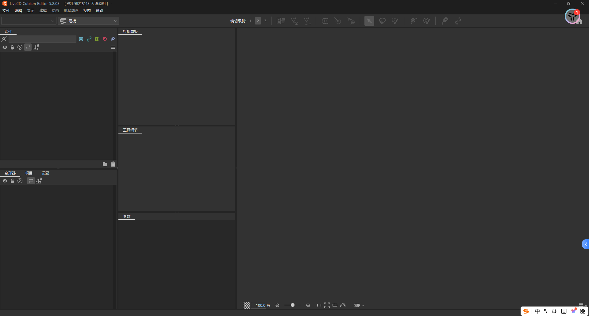
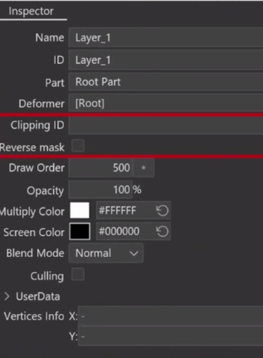
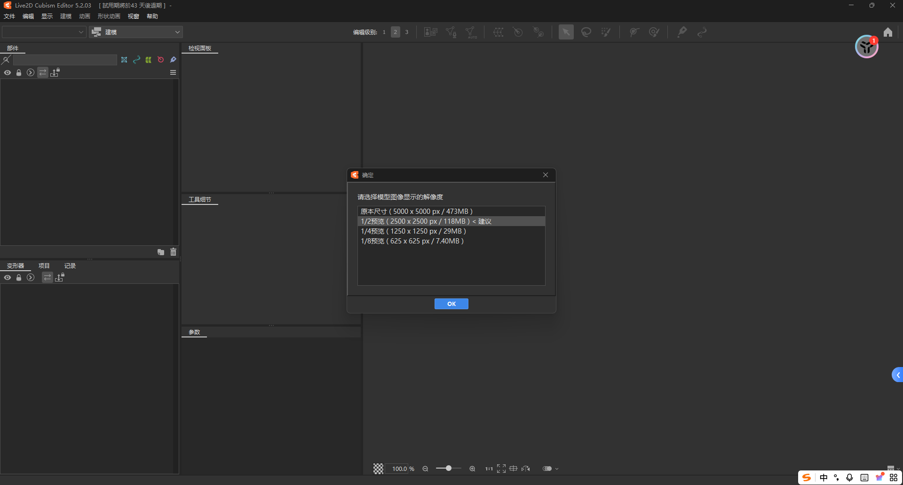
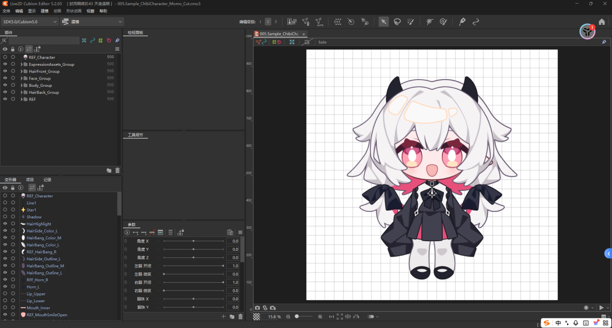
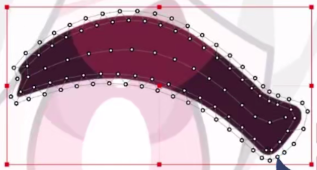
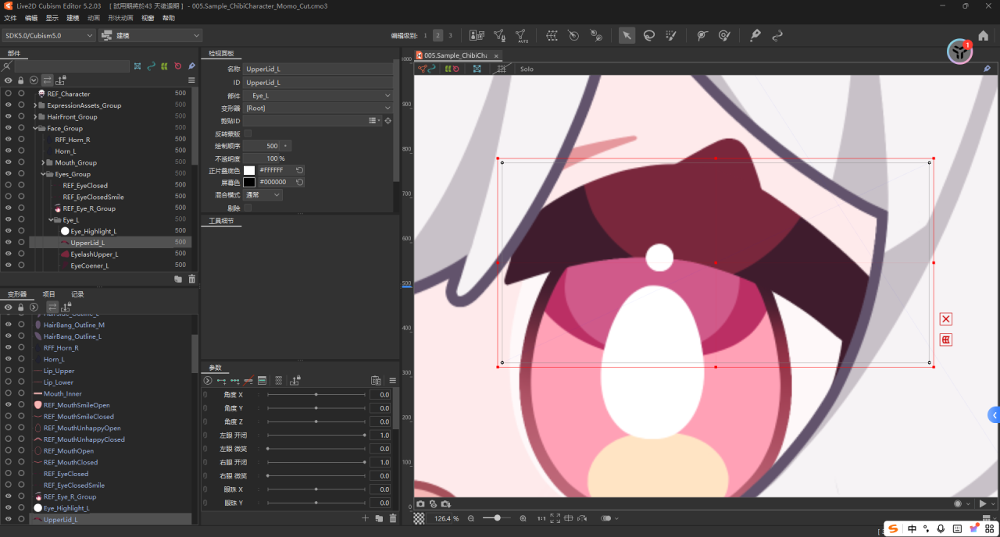
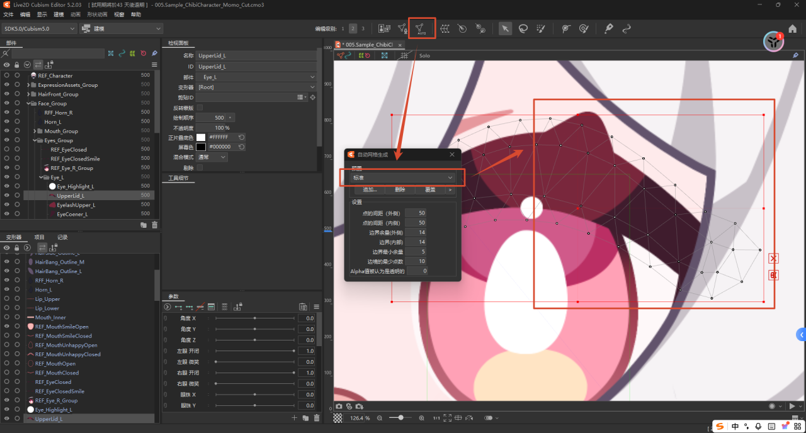

# 二维建模

## 1.环境安装

- **[Krita 5.2.15](https://krita.org/)**：绘图软件，用来画 `Vtuber` 立绘、拆分图层（五官、头发、肢体等），导出 `PSD` 给 `Live2D` 拆骨，`PS、SAI、CSP` 都可以替代，只要能分层导出 `PSD`
- **[Live2D Cubism Editor 5.2.03](https://www.live2d.com/cubism/download/editor/)**：`Live2D` 核心编辑器，导入分层 `PSD`，做网格、绑定骨骼、制作表情、眨眼、口型、动作参数，输出 `.model3.json` 模型文件
- **VTube Studio（VTS）1.32.67（Steam 安装）**：主流 `VTuber` 直播软件，加载做好的 `Live2D` 模型，读取摄像头/手机面部追踪，实时驱动模型跟着你的脸动，推流给 `OBS` 直播
- **VBridger（VB）1.1.5.3（Steam 安装）**：`VTS` 插件，强化追踪能力，提升面部捕捉精度、支持更多高级参数（眼球转动、鼻翼、嘴角、舌头等精细动作），补足原生 VTS 追踪的短板，而 `Editor DLC` 是扩展资源包（额外动作、范例），可选，不是必装

整体逻辑是 **摄像头采集画面 → VTS 面捕计算 → 驱动 Live2D 模型渲染输出给直播软件**：

1. 摄像头输入
2. `VTS` 自带两套主流追踪引擎：**Mediapipe**、**NVIDIA Broadcast Tracker**
3. 引擎会自己读取摄像头画面，`AI` 识别你的面部动作，换算成对应的动作参数（转头、眨眼、张嘴、眉毛等），生成 `VTS` 标准动作参数
4. `VTubeStudio` 接收上面算出的面部参数，传递给加载好的 `Live2D` 模型
5. 根据参数驱动模型、渲染画面
6. 把渲染完成的虚拟形象画面输出（虚拟摄像头），给到 `OBS` 这类直播软件用于开播

有了 `VB` 后，面捕计算环节交给 `VB` 接管了，流程变为了 **摄像头采集画面 → VBridger 面部计算 → VTubeStudio 渲染输出 -> 驱动 Live2D 模型渲染输出给直播软件**。这里由于有了 `VB`，就可以支持多种来源采集面部数据：手机 `VTS/iFacialMocap`、桌面端 `NVIDIA` 追踪。这样可以拿到 52 个 ARKit 混合形状参数（非常精细的面部数据：眼球、舌头、鼻翼、嘴角等微表情）+ 头部旋转、位置信息。核心是做参数二次运算，可以自定义加减乘除、函数，把原始面捕参数合并、调整、重映射。计算规则能用 `Editor DLC` 自定义修改，生成一套 `VB` 参数。适配建模，给 `Live2D` 模型提供更顺滑、可控、自定义的动作信号，弥补原生 `VTS` 面捕参数少、微调不方便的短板。`VTubeStudio` 不再自己做面部识别计算，只接收 `VB` 输出好的参数。把参数喂给 `Live2D` 模型，负责模型渲染，最后输出画面给到 `OBS` 直播软件。

为了区分参数，我们一般把 `VTS` 和 `VB` 各自的参数称呼为 [VTS 参数](https://github.com/DenchiSoft/VTubeStudio/wiki/VTS-Model-Settings) 和 [VB 参数](https://developer.apple.com/documentation/arkit/arfaceanchor/blendshapelocation)。

我们先打开 `Live2D Cubism Editor 5.2`，先获取免费 `43` 天的 `Pro` 版，然后设置主题、自动保存、导入快捷键，然后调整界面。

## 2.基础学习

### 2.1.角色设计

这里准备了三个角色，其中两个角色有简单人物和高精人物两种版本，而最后一个则是我自己的 `OC`，也有简单人物和高精人物两种版本，但是这部分是我自己内部使用（您也可以在学好后再使用自己的 `OC` 来进行尝试），另外两个角色不属于公开资源，只供学习使用。

- momo
- lila
- kuku

上面是三个角色的名字。

### 2.2.稿件拆分

拆分之前需要了解一些地方：

- 图层分组：

  - 在 `PSD` 图像导入 `Live2D` 后，每个图层会被转化成一个 `ArtMesh`，因为习惯，这些 `ArtMesh` 一般也会被叫做图层。例如 `Live2D` 中的 `ArtMesh` 绘制顺序一般也会说成图层顺序

  - 每个图层组会被转化为一个 `Part`，因为习惯，这些 `Part` 一般也会被叫做图层组、组、或者文件夹

- 混合模式：`Live2D` 中图层混合模式（`Blend Mode`）和一般绘画软件中的图层混合模式对应

  - `Live2D Cubism Editor 5.2` 混合模式，`Normal、Additive、Multiply`，只有正常状态、叠加增亮、正片叠底三种

  - `Live2D Cubism Editor 5.3` 混合模式，`Add、Add (Glow)、Darken、Multiply、Color burn、Linear burn、Lighten、Screen、Color dodge、Overlay、Soft light、Hard light、Linear light、Hue、Color`，新增了大量和 `PS/Krita/CSP` 一致的混合模式，做发光、光影、上色效果更方便

- 蒙版功能：`Live2D` 和绘画软件的蒙版逻辑不同，所有蒙版需在导入前合并。`Clipping ID` 是蒙版图层，蒙版按 `ArtMesh ID` 指定，一个图层可以同时使用多个图层作为蒙版，但蒙版和反转蒙版只能使用一种。`Live2D` 有两种蒙版模式：

  - 正常蒙版（未勾 `Reverse mask` 时）：目标图层与蒙版图层是重合的部分显示

  - 反转蒙版（勾选 `Reverse mask` 时）：目标图层与蒙版图层不重合的部分显示

    

- 不透明度：

  - `Live2D` 中图层不透明度（`Opacity`）和一般绘画软件中的不透明度选项对应

  - 当一个图层在 `Live2D` 中用作蒙版时，仅有组成该图像像素的 `Alpha` 值影响蒙版效果，图层不透明度不影响蒙版效果
    - 蒙版图层可全部隐藏（`Opacity = 0`）
    - 半透明蒙版需要图像本身的 `Alpha<1`，这点比较坑

拆分细节，待补充...

> [!IMPORTANT]
>
> 补充：`Live2D` 拆分检查注意事项
> - 文件检查
>   - 格式：PSD
>   - 画布尺寸
>     - 是否符合项目要求
>     - 一般画布至少大于3000px
>     - 确认角色的五官特征是否清晰
>   - 颜色模式：sRGB 8bit/channel
>
> - 角色位置检查
>   - 角色位置居中，对称部分对称轴垂直居中
>   - 非大角度侧脸模型，脸必须正向前方
>   - 对称部件外形需完全对称
>
> - 文件内容检查
>   - 根据需求文件检查文件是否包含所需部件
>     - 如有特殊嘴型要求：是否包含所需图层
>     - 如有服装、发型替换要求：是否包含替换服装、发型
>     - 如有发型调整要求（不需要新部件，只需要调整长短、位置等）：推荐画师提供参考图，如无参考图，使用变形、液化工具调整相关图层预览效果，评估可行性
>     - 特殊表情要求：是否有制作表情所需的素材
>     - 特殊动画要求：是否有制作动画所需的素材
>     - 特殊动作要求：是否有手臂、手部姿势素材，替换素材是否配件齐全？如使用已有素材变形制作，大概进行变形评估可行性
>   - 按效果图检查装饰、配饰是否齐全
>
> - 图层命名检查
>   - 一般图层
>     - 图层名需要使用全英文字母
>       - 推荐单词之间用下划线（_）分开
>       - 图层名不得包含除下划线外的任何特殊字符或符号
>       - 图层名不得重复
>     - 图层名必须准确描述该图层包含的部件
>       - 不推荐part2、 layer3 这类无意义命名
>       - 名称越具体越好。例如手指应使用：拇指，食指，中指，无名指，小指，而不是：手指1，手指2，手指3，手指4，手指5
>       - 如使用简写，必须全文件统一
>     - 使用字母简写后缀或数字区分部件以避免重名
>       - 可以按位置区分，如_R，_L，_M。例如刘海分为左、中、右三个部分：HairBang_L，HairBang_M，HairBang_R。格式无严格要求但需要整个文件统一，不能一些图层是_R，_L，另一些是_Left，_Right
>       - 如无法按位置细分，则可以使用数字区分。例如刘海中间部分可分为Hairbang1_L，Hairbang2_L，Hairbang3_L……。编号的位置无严格要求但需要整个文件统一。推荐按特定规律编号，如从左到右边、从上到下，且不要把数字放在名称最后（Hairbang1_L会比Hairbang_L1处理起来要方便一些）
>     - 图层名尽量小于(64-8)/2=28个字符（自动生成的胶水名是两个图层的ID加8个字符，胶水长于64个字符会导致模型无法导出）
>
>   - 特殊图层
>     - 参考图
>       - 在命名上和普通图层做区分，例如使用前缀“REF_”
>       - 参考图一般需要包含模型正面效果的参考图，嘴型或表情参考，以及对称/重复部件的位置参考
>         - 如模型有特殊嘴型（如猫猫嘴），推荐提供嘴型参考图
>         - 左右两侧完全一样的部件或多个部分完全相同的部件推荐只保留一份（节省贴图集空间），另一侧只保留为参考图或删除
>     - 蒙版
>       - 所有绘画软件中的蒙版均应合并或按Live2D支持的方式进行处理
>       - Live2D有两种蒙版，一般蒙版和反转蒙版。当一个图层被设定为目标图层的蒙版时，目标图层与该蒙版图层重合的部分显示；当一个图层被设定目标图层的反转蒙版时，目标图层与该蒙版图层不重合的部分显示。一个图层可以同时使用多个图层作为蒙版，但蒙版和反转蒙版只能使用一种
>       - 如作为蒙版的图层会在最终的模型中显示，例如眼白的蒙版，可以按照普通图层的标准进行命名
>       - 部分蒙版在最终的模型中不显示（不透明度为0%），例如擦除脸边缘线的蒙版或刘海半透明的功能性蒙版，这种蒙版的图层可加特定的前缀以示区分，例如蒙版用前缀“MASK_”，反转蒙版用前缀“INV_MASK_”。蒙版名字需要说清楚蒙版的用处
>     - 特殊混合模式图层
>       - Live2D Cubism Editor 5.2支持三种图层混合模式： Normal、Additive、Multiply。使用其他混合模式的图层必须合并。较为复杂的效果推荐特殊混合模式图层在命名上加以区分，例如加算用后缀“_ADD”，正片叠底图层用后缀“_MTP”
>       - Live2D Cubism Editor 5.3支持更多混合模式：Add，Add (Glow)，Darken、Multiply、Color burn、Linear burn、Lighten、Screen、Color dodge、Overlay、Soft light、Hard light、Linear light、Hue、Color。虽然支持混合模式较多，但不推荐把不必要的特殊混合模式都分出来。Live2D是按部件运动和效果拆分，如果不打算添加变换特效（如发光、反光、变色），这些特殊混合模式图层应进行合并
>
> - 图层分组
>   - 按小块部件为图层分组，例如刘海左、中、右可以分为三个组
>   - 为了使用方便，每组图层不宜过多（一般推荐<15个）
>   - 图层组命名要求和一般图层一样
>
> - 图层内容质量检查
>   - 补画部分检查（单独显示图层检查）
>     - 被遮挡部分已完整补画
>       - 单独图层不应依赖其他图层上的结构、图案
>       - 被遮挡部分的图案不应和遮挡该图层部件图案、纹理重复
>     - 补画范围合适
>       - 对于会摆动的部件需要想象其摆动时的状态，补画部分不宜过窄或短
>       - 对于不容易、不太可能会露出的部分，没必要进行补画和拆分
>     - 补画边缘部分
>       - 部件的边缘必须平滑
>       - 避免不齐的边缘，过于明显的笔触和半透明的部分
>     - 补画细节足够：补画的部分必须和可见的部分细节程度相当
>     - 补画衔接
>       - 补画部分纹理和正面露出部分衔接顺畅
>       - 补画部分边缘线应和正面露出部分一致
>       - 放小看需要无法一眼辨认出被遮挡和未被遮挡的区域
>     - 补画内容合理
>       - 被遮挡的地方不宜出现出乎意料的设计和结构
>       - 如应设计需要在遮挡处有隐藏图案，推荐调整被遮挡的图案、设计的位置，让图案在正面立绘露出一点（在正面图加一些“提示”）
>     - 连接处
>       - 连接处有一定重叠部分，预留变形空间，但不宜补画过多
>       - 旋转中心、关节处采用圆形或近似圆形的结构
>       - 旋转或移动部件检查连接处补画是否合理
>     - 穿插结构
>       - 注意前后遮挡关系，图层顺序合理
>       - 考虑部件的运动模式和运动范围，遮挡关系合理
>       - 旋转或移动部件检查连接处补画是否合理
>     - 部件内部检查
>       - 部件内部颜色填充完整，无漏色
>       - 如果部件本身不是半透明的，部件内不应有任何半透明像素
>       - 高对比背景图层检查
>     - 外部检查
>       - 部件外不得留有任何在拆分时没有擦除干净的杂色，杂点，残留像素
>       - 除特殊需求，边缘必须平滑整齐、无明显笔触残留、无半透明毛边
>       - 使用蒙版的图层，蒙版外区域需要彻底清理干净
>       - 缩略图、描边检查
>     - 文件清理
>       - 合并图层特效、调整图层
>       - 删除无用图层
>       - 删除测试、草稿、临时图层及特效

### 2.3.导入文件

`.psd` 文件直接拖拽进界面即可。

### 2.4.布点工具

然后了解一下导入后的概念，导入 `PSD` 文件时每个图层都会被转化为一个 `ArtMesh`，这个东西实际上就是 `图像 + 网格`，网格由顶点、多边形、边组成，多边形是图像变形的最小单元，通过顶点移动完成变形。密度越高的网格变形后的效果也越好，但过高的网格密度会导致运行时的负载增大。

导入 `PSD` 的时候，`Cubism` 会自动生成初始网格（顶点、多边形、边），但自动生成的网格一般不够好用，需要再次自动生成或手动二次编辑。

比如一开始导入的这个眉毛只有四个点，给它进行再次自动生成。

但是呢，上面这种自动方式实际上还不是我想要的，一般是在边缘和色差的地方进行布点即可，而且也顺便为了熟悉手动布点，这里进行手动，待补充...

### 2.5.属性字段

#### 2.5.1.图形网格 ArtMesh

布点后，还需要了解一些属性字段：

- Name：ArtMesh 名称，同绘画软件图层名
- ID：Live2D 为 ArtMesh 分配的 ID
- Part：所属 Part（图层组）
- Deformer：所属 Deformer
- Clipping ID, Reverse Mask：蒙版设置
- Draw Order（0-1000）：绘制顺序，数字越大越靠前，默认为 500
- Opacity：不透明度，同绘画软件不透明度
- Multiply/Screen Color：正片叠底 / 屏幕色，可为 ArtMesh 调色
- Blend Mode：混合模式，同绘画软件中的混合模式
- Culling：是否隐藏 ArtMesh 背面

#### 2.5.2.部件分组 Part

#### 2.5.3.变形器物 Deformer

##### 2.5.3.1.旋转变形 Rotation Deformer

##### 2.5.3.2.弯曲变形 Wrap Deformer

#### 2.5.4.控制参数 Parameter

### 2.6.常见工具

### 2.7.开始制作

#### 2.7.1.脸部绑定

#### 2.7.2.物理动画

#### 2.7.3.头部转动

#### 2.7.4.头发发丝

#### 2.7.5.身体驱干

#### 2.7.6.整体运动

#### 2.7.7.动态表情

### 2.8.使用模型

## 3.快速体验

## 4.深入研究

> [!IMPORTANT]
>
> - 名字：白柠哭哭（Hakune kuku）
>
> - 别名：kuku、ku、哭哭
>
> - 种族：温顺的小恶魔
>
> - 性别：无
>
> - 年龄：100+
>
> - 性格：温柔、多疑、敏感
>
> - 弱点：害怕发生无法挽回的事情
>
> - 口癖：常见尾缀有“的说、嘛、嘿、惹”，将“他/她/它”替换为“ta”，自称“我”替换为“沃”，有疑问会说“诶”
>
> - 锚点：白色蝴蝶、紫色短发、紫色宝石、紫蝎尾辫、花纹尖角、金边礼服
>
> - 设定：
>
>   - 淡紫银灰的短发，一小缕蝎尾辫垂在侧边
>
>   - 领结的紫色宝石刚好和瞳色呼应
>
>   - 衣服是干净的白衬衫，精致的金色镶边，是仪式用的礼服
>
>   - 白色蝴蝶不是装饰，平时会趴在头发上面，是重要朋友赠予的礼物，代表祝福、安全感、好运
>
> 这里正常步骤来说是需要画画的，但是我这里跳过了这个步骤，直接去米画师上找人画好给我了。正常来说这个步骤是需要自己拆分后进行补画的，但是我这里也是请画师大大帮我拆好的。

